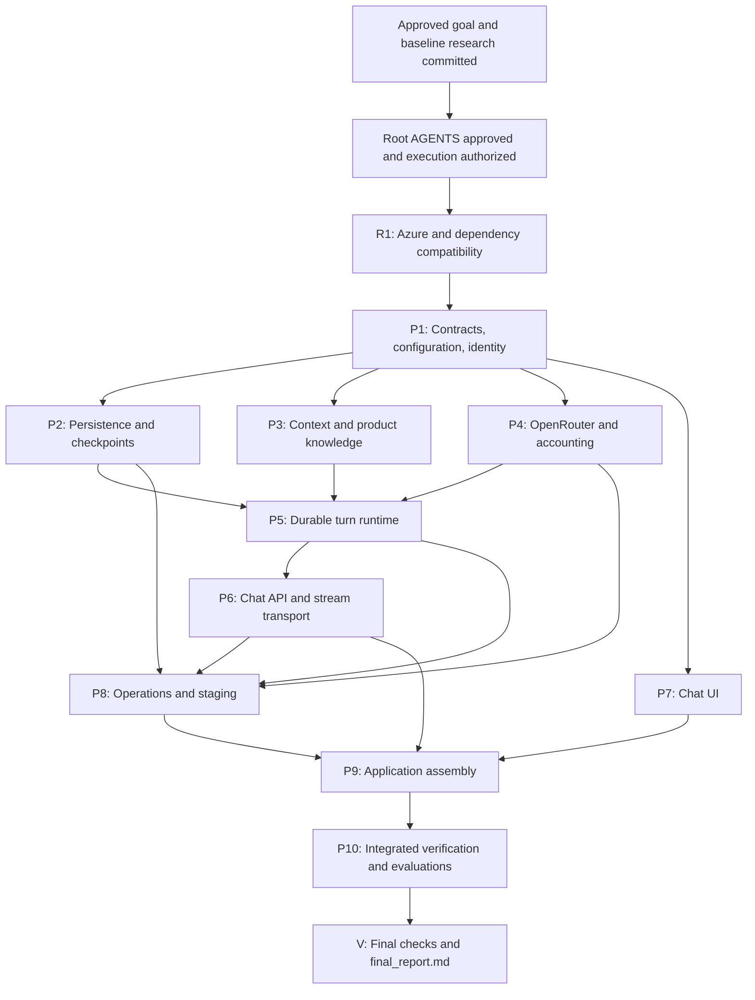

# State and Dependency Graph: Aurvin Phase 1

## Workflow configuration

- Keep workflow artifacts directly in `docs/aurvin-phase-1/`.
- Approved scope: `goal.md`. Consolidated baseline research: `research.md`.
- Unified review is skipped via the user's explicit `--skip review` instruction on 6 October 2026. Existing brainstorming and baseline research satisfy their preparation milestones; focused compatibility research R1 remains scheduled.
- Current authorization covers workflow documentation and root-level `AGENTS.md`. The user explicitly requested waiting for approval of `AGENTS.md`; no planners or workers may be dispatched before that approval. Continue within the scope authorized by the approval response.
- `dag_status: complete` means the dependency graph is fully constructed. It does not mean plans, code, tests, or the overall MAW execution are complete.
- Preserve existing untracked scaffold files and local configuration. Stage only workflow documents in this preparation turn. Do not stage secrets, dependencies, generated files, or unrelated user work.
- On execution, establish a checked public-source baseline before feature commits so diffs distinguish scaffold from implementation. Preserve all intervening changes; never use `git add .` as a shortcut.
- Main orchestrator owns DAG/status/dispatch and shared commit scheduling, not implementation code.
- Main must not ingest `research.md` or `plan*.md` contents for execution management. Use researcher/planner summaries and verify artifacts through reported commits with `git log -1 --stat <hash>`.
- Dispatch independent planners concurrently within capacity and await them in the active workflow; do not detach agents. Four total slots permit at most three child agents while the main remains active.
- Pipeline ready workers immediately after their plan commits and prerequisite worker commits. Required planning/execution/final verification remain pending. Do not dispatch a reviewer or a review-triggered fixer; failed checks and defects still require correction by their owners.
- Paths use forward slashes. Source modules may be created within the existing backend/frontend structure; no separate worktrees or new services are required by this workflow.

## Workflow milestones

- [x] Step 1: Brainstorming and goal alignment; explicit user scope approval, 6 October 2026.
- [x] Goal specification written and committed: `goal.md`, `f7bfd97`.
- [x] Step 2a: Baseline technical research consolidated and committed: `research.md`, `f7bfd97`.
- [x] Complete DAG, readiness rules, ownership, acceptance mapping, and resume procedure constructed in this state.
- [x] User approval of root-level `AGENTS.md` and full execution authorization; granted 6 October 2026 ("Everything is approved, you can proceed").
- [x] Step 2b: Focused Azure/dependency compatibility research R1 committed: `research.md` supplement, `dfe4e08` (partially blocked; P1 unblocked, P2 Azure certification gated on missing service input).
- [ ] Step 3: All implementation plans written and committed.
- [ ] Step 4: All plan workers complete, verified, and committed.
- [x] Step 5: Unified review **Skipped** via `--skip review`, explicit user instruction on 6 October 2026; no review result is claimed.
- [x] Step 6: Final verification, evidence, and `final_report.md` committed (`3cd8f54`, complete-with-blocks; AC16/AC18/live/proxy/kill/backup/rollback remain blocked).

## Brainstorming tasks and approval evidence

- [x] Explored project structure, manifests, source scaffold, instructions, and Git state.
- [x] Clarified Phase 1 tools versus chat scope, fixed context, history, streaming, model selection, deployment, and storage.
- [x] Compared checkpoint storage, bounded session documents, separate messages, and reference versus copied memory.
- [x] Presented the design and obtained decisions through selectable question tools.
- [x] Recorded the user's selected `sessions` / `messages` separation and reference-based agent memory.
- [x] User authorized writing the MAW goal and complete state on 6 October 2026.
- [x] User corrected the research filename to `research.md`; all workflow references use that name.
- [x] Goal and research committed; document preparation preserves application source.
- [x] Specification self-check completed for scope, authority, consistency, and explicit unresolved gates; graph/coverage verification passed.
- [ ] Optional written-artifact feedback incorporated if the user requests changes. This does not invalidate the existing scope approval or require re-asking approval for this preparation task.

## Initial findings

- React/Vite/TypeScript frontend and NestJS/TypeScript ESM backend exist as scaffolds with a health path.
- Chat, model calls, MongoDB repositories, checkpointing, context manifests, and stream lifecycle are not implemented.
- Backend scripts: build, lint, unit tests, and end-to-end tests. Frontend scripts: build and lint.
- The repository had no prior commits; application scaffolds remain untracked after workflow-only commits.
- No applicable AGENTS.md was discovered during context exploration.
- Exact Azure service/API/partitioning is unknown. The user believes it is Cosmos DB; native MongoDB guarantees must not be assumed.
- Baseline evidence is documentation/scaffold inspection, not tested adapter compatibility or production certification.

## Confirmed product decisions

- Use LangGraph, OpenRouter, MongoDB, and the existing frontend/backend stack.
- One model configured by the backend; send a stable hardcoded development identity in OpenRouter's `user` field.
- No application authentication; local or protected staging first.
- Fixed context is system instructions, behavioral guardrails, and `product_knowledge.md`; include eligible current-session history and new input exactly once.
- General questions are supported. Responses stream into a ChatGPT-like chat layout.
- Six collections: `sessions`, `messages`, `agent-memory`, `metadata`, `checkpoints`, `checkpoint_writes`.
- Session documents hold metadata; message documents hold individual visible messages.
- Agent memory selects original records through references/ranges rather than copied transcript content.
- Metadata holds bounded attempts/accounting and supports future tool request/result evidence with precise turn/event linkage.
- Live tools, automatic compaction, episodic extraction, and cross-session retrieval are deferred.
- Production foundations include durable lifecycle, idempotency, context/resource bounds, reconciliation, and operations evidence.

## Dependency matrix and execution status

`B` is the approved goal plus completed baseline research (`f7bfd97`). `R1` is the compatibility supplement. Worker prerequisites below require verified implementation commits. A plan commit does not satisfy a worker dependency. Planner prerequisites are listed separately to permit planning while prerequisite workers are executing.

| ID | Title and scope | Worker prerequisites | Owned subsystem | Planner / researcher status | Worker status | Commits |
| --- | --- | --- | --- | --- | --- | --- |
| R1 | Azure and published dependency compatibility | B, execution authorization, actual service identification | `research.md` supplement only | [x] `dfe4e08` partially-blocked (service unknown, matrix + pins recorded) | Not applicable | `dfe4e08` |
| P1 | Shared contracts, configuration, and identity | R1 | Contracts/platform; dependency manifests and verification scripts | [x] `e90d700` | [x] Complete `d899e93`..`db763b6` (15 commits) | `e90d700` (plan) + `d899e93`..`db763b6` (worker) |
| P2 | Bounded persistence and checkpoint integration | P1 | Backend persistence repositories/adapter | [x] `5b20dc4` | [x] Complete `c78d935`..`ea46dd3` (9 commits) | `5b20dc4` (plan) + `c78d935`..`ea46dd3` (worker) |
| P3 | Context selection and product instructions | P1 | Backend context and knowledge assets | [x] `f90cad0` | [x] Complete `9da8043`..`3362082` (7 commits) | `f90cad0` (plan) + `9da8043`..`3362082` (worker) |
| P4 | OpenRouter adapter and accounting | P1 | Backend model integration and provider fixtures | [x] `b49196d` | [x] Complete `15e4461`..`8ae8de7` (8 commits) | `b49196d` (plan) + `15e4461`..`8ae8de7` (worker) |
| P5 | Durable LangGraph turn orchestration | P2, P3, P4 | Backend agent/runtime lifecycle and reconciliation | [x] `2663bfc` | [x] Complete `3fd9e1f`..`bb90fcb` + regression `a336b99` (no product defect; P10 harness duplicate-gen follow-up open) | `2663bfc` (plan) + `3fd9e1f`..`bb90fcb` + `a336b99` |
| P6 | Session/chat API and streaming transport | P5 | Backend HTTP controllers and stream contract implementation | [x] `b6cb724` | [x] Complete `8c1ef67`..`efac6e9` + fixer `88e5fac` first-chunk coalesce (P10 native rerun pending AC02) | `b6cb724` (plan) + `8c1ef67`..`efac6e9` + `88e5fac` |
| P7 | Chat UI and session navigation | P1 | Frontend chat features, API client, rendering | [x] `d0e64a0` | [x] Complete `5c2568b`..`2180151` (11 commits) | `d0e64a0` (plan) + `5c2568b`..`2180151` (worker) |
| P8 | Operational and staging controls | P2, P4, P5, P6 | Backend operations and staging/runbook assets | [x] `02e3d4f` | [x] Complete `ae73635`..`9e3c022` + fixer `31f56bb` retry-bypass (P10 native rerun pending AC08/AC14) | `02e3d4f` (plan) + `ae73635`..`9e3c022` + `31f56bb` |
| P9 | Application assembly | P6, P7, P8 | Backend/frontend entry points and central wiring | [x] `bb5ba9b` | [x] Complete `660a90b`..`d0b9d4e` + Task 1 smoke PASS (standalone isolated, replica-set limitation recorded) | `bb5ba9b` (plan) + `660a90b`..`d0b9d4e` (worker) |
| P10 | Integrated reliability and behavior evidence | P9 | End-to-end/failure/compatibility/evaluation tests and evidence | [x] `7204dbd` | [x] Worker + follow-up complete — `351dfe3`..`1493f80` + `0e32322` + `a3cb917`; AC01-15/17/19 pass, AC16/AC18 blocked (external), AC20 skipped-review; owner defects resolved; V still blocked on drills | `7204dbd` (plan) + `351dfe3`..`1493f80` + `0e32322` + `a3cb917` |
| V | Final verification and report | P10 and every worker gate passed, defects resolved | `final_report.md`, final state | [x] COMPLETE-WITH-BLOCKS `3cd8f54` — builds/lints/unit pass, e2e 101/101 isolated native; AC01-15/17/19 pass, AC16/18 blocked, AC20 skipped-review; no prod claim | `3cd8f54` |

### Execution graph

Unified review (Q) is explicitly skipped and is not an active DAG node. Failed checks or defects discovered during implementation/P10/V return to their file owners and must be corrected before final verification passes; no review-triggered fixer phase is scheduled. New scope/contract changes require versioned DAG reconciliation rather than an undeclared cycle.

### Planner readiness and immediate worker dispatch

| Planner | Earliest planning prerequisites | Worker start condition |
| --- | --- | --- |
| P1 | R1 findings/compatibility committed | `plan1.md` committed, R1 closed |
| P2 | P1 worker committed and contracts stable | `plan2.md` committed, P1 complete |
| P3 | P1 worker committed and contracts stable | `plan3.md` committed, P1 complete |
| P4 | P1 worker committed and contracts stable | `plan4.md` committed, P1 complete |
| P7 | P1 worker committed and stream/API contracts stable | `plan7.md` committed, P1 complete; uses contract fixtures until integration |
| P5 | P2/P3/P4 plans committed with interface summaries | `plan5.md` committed, P2/P3/P4 workers complete |
| P6 | P5 plan committed and P1 contracts stable | `plan6.md` committed, P5 complete |
| P8 | P2/P4/P5/P6 plans committed with lifecycle/operation hooks | `plan8.md` committed, P2/P4/P5/P6 workers complete |
| P9 | P6/P7/P8 plans committed and assembly interfaces stable | `plan9.md` committed, P6/P7/P8 workers complete |
| P10 | P9 plan committed and all behavior contracts defined | `plan10.md` committed, P9 complete |

- Run ready planners as a bounded foreground cohort. Capacity is three children, not a promise to run all four P2/P3/P4/P7 planners simultaneously.
- Start a worker as soon as its committed plan and worker dependencies are ready; do not wait for unrelated planners.
- P2/P3/P4/P7 have disjoint source ownership; schedule their workers concurrently within available slots.
- P5/P6/P8 plans may be prepared before all prerequisite implementations finish; their workers may not.
- Serialize staging/commits through the orchestrator. Each commit contains only the owner's files; never let parallel agents race the shared Git index.
- P1 owns shared contracts and manifests. Later dependency additions or contract changes go through a serialized P1 follow-up; affected downstream work waits for reconciliation.
- Planners read the goal/research/upstream plans themselves. The main receives path, commit, interface summary, verification outcome, and readiness/blockers without reading plan contents.

## Plan scopes, file ownership, and completion gates

### R1 — compatibility supplement

**Deliverable:** update `research.md` with actual service/API/capability evidence, published dependency compatibility, and a concise researcher summary/commit.

**Ownership:** workflow research only; no implementation edits, credential disclosure, Azure settings changes, or infrastructure purchases.

**Scope:** identify the user's Azure offering safely; verify document/transaction/index/TTL/partition/consistency constraints and standard checkpoint integration. Inspect published runtime requirements and existing project dependencies. Select supported testing environments and clarify feasibility of execution ownership.

**Exit gate:** actual service identified, supported/unsupported behavior matrix recorded, dependency strategy viable, and persistence assumptions handed to P1/P2. If external identification is unavailable, record the precise missing input and do not certify compatibility. Independent planning can be refined, but P2 implementation stays gated.

### P1 — contracts, configuration, identity

**Deliverable:** `plan1.md` and verified platform/contract implementation.

**Owned files:** `backend/src/contracts/**`, `backend/src/platform/**`, `frontend/src/api/protocol.ts`, backend/frontend `package.json` and lockfiles, compiler/test/lint configuration, `.env.example` templates, root `.gitignore` changes needed for generated/sensitive artifacts. Entry-point wiring remains P9-owned.

**Scope:** define versioned session/message/context/metadata/attempt/stream contracts; error taxonomy; ownership/repository/model/runtime interfaces; server identity resolver; validated environment configuration; finite default budgets; and required verification scripts. Pin compatible dependencies. API/stream contracts must be sufficient for P7 to build against fixtures.

**Exit gate:** contracts compile in both applications; invalid/missing config fails predictably; browser identity/model overrides are excluded; default limits are explicit; scripts/configuration support downstream checks. Record published version matrix and interface summary.

### P2 — persistence and checkpoints

**Deliverable:** `plan2.md`, bounded repositories, checkpoint factory, and database integration evidence.

**Owned files:** `backend/src/persistence/**`, `backend/test/persistence/**`, `backend/test/compatibility/**`. Package/script edits are requested from P1; runtime orchestration belongs to P5.

**Scope:** six collections, indexes, bounded record validation, stable identity/ordering, scoped queries, pagination, conditional acceptance/execution ownership primitives, context manifests, attempt/accounting records, and supported standard checkpoint adapter setup. Implement service-compatible idempotent write/reconciliation primitives rather than unsupported atomicity.

**Exit gate:** repository isolation/order/pagination/deduplication tests pass; acceptance survives restart; repeated/ambiguous writes do not duplicate; actual Azure compatibility assertions pass; adapter and checkpoint writes are exercised. Show document headroom and ownership behavior under the supported topology.

### P3 — context and instructions

**Deliverable:** `plan3.md`, context builder, versioned instructions, and product knowledge.

**Owned files:** `backend/src/context/**`, `backend/src/instructions/**`, `product_knowledge.md`, `backend/test/context/**`.

**Scope:** load/validate/hash knowledge and instructions; select referenced session context; preserve roles/order and exclude incomplete answers; reserve output budget; detect overflow; expose future-summary references without implementing summarization or retrieval. Keep knowledge truthful and credentials absent.

**Exit gate:** prompt snapshots/semantic assertions prove correct fixed context, session isolation, exactly-once history/new input, version tracking, deterministic overflow, and no silent compaction. Tool-shaped fixtures remain protocol-valid; no live tools are registered.

### P4 — OpenRouter and accounting

**Deliverable:** `plan4.md`, model adapter, deterministic provider fixtures, and live-check procedure.

**Owned files:** `backend/src/model/**`, `backend/test/fixtures/openrouter/**`, `backend/test/model/**`.

**Scope:** selected integration, request `user` and model, provider privacy/compression options, stream framing/errors, generation IDs, usage/cost normalization, accounting lookup, cancellation, deadlines, bounded retry policy, and error classification. Persistence writes are performed through contracts, not direct modifications of P2 repositories.

**Exit gate:** outgoing body contract tests prove identity/configuration; fixtures cover comments/chunks/usage-only frames/HTTP-200 errors/EOF/length/abort; missing cost remains unknown; retries are bounded and classified. Version-specific token/cost/abort capabilities and finite model budgets are reported honestly.

### P5 — durable turn orchestration

**Deliverable:** `plan5.md`, graph runtime, lifecycle, and recovery implementation.

**Owned files:** `backend/src/agent/**`, `backend/src/chat-runtime/**`, `backend/test/runtime/**`.

**Scope:** exclusive session execution, accepted input before inference, new graph input only, context-version checks, stream lifecycle, checkpoint-aware finalization, metadata/memory updates, explicit retry/cancel, stale-attempt handling, and basic reconciliation. Provide operation/drain hooks for P8.

**Exit gate:** deterministic crash-window tests prove saved-result recovery without reinference, interrupted-state fallback, repeated reconciliation safety, no false completion, and no duplicated input. Two concurrent clients cannot advance one session twice; supported topology/fencing limitation is enforced and documented.

### P6 — API and stream transport

**Deliverable:** `plan6.md`, chat/session routes and application stream implementation.

**Owned files:** `backend/src/http/**`, `backend/test/http/**`.

**Scope:** validated session listing/creation/message retrieval/turn submission/status/cancel/retry endpoints, server identity, pagination, idempotency/conflict responses, stream events/backpressure/disconnect handling, and stable client-safe errors. Delegate generation to P5. Export module without modifying app entry points.

**Exit gate:** route tests prove scoping, pagination, unknown-field rejection, duplicate/conflict handling, disconnect/status recovery, cancellation, event ordering, and completed only after durable finalization. No private graph/provider/credential data leaks into responses.

### P7 — chat UI

**Deliverable:** `plan7.md`, session/navigation/composer/stream UI with contract-driven tests.

**Owned files:** `frontend/src/features/chat/**` excluding `integration-tests/**`, `frontend/src/api/client.ts`, `frontend/src/components/**`, `frontend/src/styles/**`, `frontend/src/index.css`, chat feature tests. `frontend/src/api/protocol.ts` remains P1-owned; `App.tsx`, `App.css`, and entry-point assembly remain P9-owned. P10 exclusively owns chat `integration-tests/**`.

**Scope:** welcoming empty state, new chat, sidebar session history, paginated transcript, multiline composer, progressive rendering, controlled scrolling, pending/finalizing/terminal states, safe Markdown/links, explicit cancellation/retry, refresh/reconnect status, accessibility, and responsive layout. Build against P1 protocol and provider-independent fixtures.

**Exit gate:** UI tests prove navigation and request behavior, no duplicate input on retry, honest partial/truncated status, persisted result after reconnect, safe rendering, and usable keyboard/narrow-screen interaction. Build/lint pass without real credentials.

### P8 — operations and staging

**Deliverable:** `plan8.md`, operations module and `operations.md` / `staging-evidence.md` procedures.

**Owned files:** `backend/src/operations/**`, `backend/test/operations/**`, `docs/aurvin-phase-1/operations.md`, `docs/aurvin-phase-1/staging-evidence.md`, deployment assets required for the selected staging platform. Entry points remain P9-owned.

**Scope:** readiness/liveness, dependency degradation, correlated redacted telemetry, rate/overload controls, supported executor topology, shutdown/drain hooks, staging access/privacy/proxy settings, retention, backup/restore, migration/rollback, and explicit measured targets. Export wiring for P9; do not provision external infrastructure without appropriate authorization.

**Exit gate:** config/readiness/redaction/rate/drain tests pass; stage controls and finite targets are explicit; actual deployment proxy/backup evidence can be exercised by P10. Provider outage must not create a restart loop or paid health calls. Document unresolved production-only access/capacity decisions as rollout gates, not staging failures.

### P9 — application assembly

**Deliverable:** `plan9.md`, integrated application composition and startup documentation.

**Owned files:** `backend/src/main.ts`, `backend/src/app.module.ts`, existing `backend/src/app.controller.ts`, `backend/src/app.service.ts`, `backend/src/app.controller.spec.ts`, `frontend/src/App.tsx`, `frontend/src/App.css`, `frontend/src/main.tsx`, root `README.md`.

**Scope:** wire exported platform/persistence/runtime/API/operations modules; replace scaffold-only UI with chat; configure bootstrap/shutdown/CORS according to validated settings; keep old scaffold routes/tests coherent; document local/staging setup and actual commands. Do not duplicate feature implementations or alter shared contracts unilaterally.

**Exit gate:** both builds and lints pass; application boot/readiness and one fixture-backed end-to-end chat run succeed; all required module services are connected; startup does not expose credentials or silently run unsupported topology.

### P10 — integrated verification and behavior evaluation

**Deliverable:** `plan10.md`, integrated tests, versioned evaluation fixtures, and `verification.md`.

**Owned files:** `backend/test/app.e2e-spec.ts`, `backend/test/integration/**`, `backend/test/evaluations/**`, frontend integrated test fixtures/specs in `frontend/src/features/chat/integration-tests/**`, `docs/aurvin-phase-1/verification.md`. After P8 completion, ownership of evidence entries in `staging-evidence.md` transfers to P10 for actual results; P8 retains operational source/runbook policy. No broad fixes to upstream source; route defects to the owning worker.

**Scope:** full AC matrix, real selected-service integration, double submissions/two tabs, partial-stream errors, restart/crash windows, accounting reconciliation, bounded context/storage, proxy behavior, isolation/redaction, restore/rollback, and a limited live-model smoke/behavior suite. Record measured workload, latency/cost, and limitations.

**Exit gate:** AC01-AC20 have concrete pass/fail evidence, with AC20 explicitly recording the skipped review; deterministic tests and selected-service tests pass; live checks have bounded cost and isolated records; no unsupported production-readiness claim. Blocking defects return to owners and prevent V readiness.

### Skipped review and V — final verification

The user selected `--skip review`. Do not dispatch Q, create a review result, or require review-triggered fixes/re-review. Record the phase as skipped rather than passed. Defects and failed required checks still go to existing file owners with appropriate regression tests and serialized commits.

V runs the full required checks against the final integrated commit set, verifies evidence and open rollout limitations, writes `final_report.md`, and updates state/commit records. Only then set overall `status: complete`. A completed DAG or documentation handoff is not execution completion.

## Acceptance coverage

| Goal criterion | Primary owners | Integrated verification |
| --- | --- | --- |
| AC01: sessions/navigation/history | P2, P6, P7, P9 | P10 UI/API/restart tests |
| AC02: streamed and honest lifecycle UI | P4, P5, P6, P7 | P10 failure and reconnect tests |
| AC03: fixed/current-session context | P3, P4, P5 | P10 prompt/behavior evaluation |
| AC04: continuity/isolation | P2, P3, P5, P6 | P10 restart and scope tests |
| AC05: bounded six-collection storage | P1, P2 | P10 service/schema/headroom checks |
| AC06: reference-based memory | P2, P3, P5 | P10 context-manifest assertions |
| AC07: event/tool causality foundation | P1, P2, P3 | P10 tool-shaped reconstruction fixtures |
| AC08: durable duplicate/retry semantics | P2, P5, P6, P7 | P10 duplicate/payload/retry tests |
| AC09: session concurrency/topology | P2, P5, P8 | P10 two-client/crash ownership tests |
| AC10: acceptance/finalization ordering | P2, P4, P5, P6 | P10 persistence fault injection |
| AC11: stream terminal outcomes | P4, P5, P6, P7 | P10 HTTP-200 error/EOF/length/cancel tests |
| AC12: idempotent crash recovery | P2, P5, P8 | P10 crash-window/repeated recovery tests |
| AC13: server identity/model/key boundaries | P1, P4, P6 | P10 outgoing-request and leak tests |
| AC14: accounting and reconciliation | P2, P4, P5 | P10 usage-frame/lookup/dedup tests |
| AC15: finite resource/context controls | P1, P3, P4, P8 | P10 boundary/overload/timeout tests |
| AC16: Azure compatibility | R1, P1, P2 | P10 actual selected-service integration |
| AC17: validation/security/readiness | P1, P3, P6, P7, P8 | P10 adversarial/rendering/readiness tests |
| AC18: operations and restore | P5, P8, P9 | P10 staging/crash/proxy/restore evidence |
| AC19: behavior evaluations | P3, P4, P10 | Versioned small live/deterministic suite |
| AC20: complete checks/evidence; review skipped | All plans, V | Final verification and final report; explicit skipped-review record |

## Research handoff

Baseline research was committed in `f7bfd97`, verified through its commit record. The orchestrator already holds the research summaries from this conversation; execution does not require rereading the full artifact.

Handoff conclusions: preserve independent archive/context/execution roles; no unbounded session transcripts; distinguish generation from durable completion; use application idempotency and reconciliation alongside checkpoints; record attempt-level accounting; enforce server identity and finite budgets; and verify Azure compatibility explicitly. R1 closes the service/dependency uncertainty without restarting all completed baseline research.

## Final verification commands and evidence

Commands below are for later worker/final verification. None were executed as product checks during document preparation.

Documentation verification passed after the user's review-skip instruction: 12 scheduled nodes (R1, P1-P10, V), 18 internal dependency edges, acyclic ordering, exact Mermaid/matrix agreement, AC01-AC20 coverage, existing artifact paths, consistent skipped-review policy, the root-AGENTS approval gate, and clean Git whitespace checks. Q is bypassed. File ownership exclusions/handoffs for P7/P10 integration tests and P8/P10 staging evidence remain in force. These are document checks, not runtime test results.

| Working directory | Command / evidence | Purpose and readiness |
| --- | --- | --- |
| `backend` | `npm run build` | Existing backend compile check |
| `backend` | `npm run lint` | Existing backend lint/type-aware checks |
| `backend` | `npm test` | Existing unit test entry point; workers add meaningful suites |
| `backend` | `npm run test:e2e` | Existing end-to-end entry point |
| `frontend` | `npm run build` | Existing frontend type/build check |
| `frontend` | `npm run lint` | Existing frontend lint check |
| `backend` | `npm run test:azure` | P1 adds script; P2/P10 supply selected-service compatibility tests; isolated staging credentials required |
| `frontend` | `npm test` | P1 adds the chosen frontend test entry point; P7/P10 supply behavior tests |
| `backend` | `npm run test:behavior` | P1 adds bounded evaluation entry point; P10 defines deterministic/live modes and explicit cost limit |
| Selected staging deployment | Procedures in `operations.md` and recorded `staging-evidence.md` | Access, actual streaming, drain/crash, migrations, backup/restore, measured targets |

P1 may reconcile script names with the selected toolchain, but must update this table and downstream plan contracts. Never report a planned command as an existing or passing check. V records final commit, environment, command, outcome, and links to evidence; secrets and transcript payloads are excluded.

## Artifact and commit record

| Artifact | State | Commit |
| --- | --- | --- |
| `goal.md` | Approved direction; user-selected review skip recorded | `1efe259087a19a6482ba0b4a5bad99783139cf6f` |
| `research.md` | Consolidated baseline complete + R1 supplement (service unknown, intersection profile, dependency pins) | `f7bfd97` + `dfe4e08` |
| `state.md` | Complete dependency graph and handoff | Resolve its current commit with `git log -1 --format=%H -- docs/aurvin-phase-1/state.md` |
| Root `AGENTS.md` | Approved 2026-10-06; execution authorized ("Everything is approved, you can proceed") | `1efe259087a19a6482ba0b4a5bad99783139cf6f` + `901fa37bb46029e725bfec6f492dc9b3b751703e` code-style update |
| `plan1.md` through `plan10.md` | All 10 plans committed; P10 worker finished `351dfe3`..`1493f80` with exit gate NOT passed (failures open) | `e90d700`, `5b20dc4`, `f90cad0`, `b49196d`, `2663bfc`, `b6cb724`, `d0e64a0`, `02e3d4f`, `bb5ba9b`, `7204dbd` |
| `operations.md`, `staging-evidence.md`, `verification.md` | `operations.md` P8 `9e3c022` + retry-bypass note `31f56bb`; `verification.md` P10 `a3cb917`; `staging-evidence.md` policy P8 `de6ae27` + results P10 `a3cb917` | `31f56bb`, `9e3c022`, `a3cb917` |
| `review.md` | Not required; unified review skipped by user | No review commit expected |
| `final_report.md` | V complete-with-blocks | `3cd8f54bf5fb489a8edae38645d93666c2df419e` |

The old `docs/research/2026-10-06-phase-1-production-baseline.md` was replaced by the fully consolidated `research.md`. No `results.md` remains. Record each later researcher/planner/worker commit as it completes; do not infer completion from file existence alone.

## Current gate and resume procedure

**CURRENT GATE: CLOSED — V COMPLETE-WITH-BLOCKS (3cd8f54). All implementable Phase 1 work verified; no open product defects. Open: AC16 Azure facts, AC18/proxy/kill/backup/rollback drills, live smoke (need operator inputs/authorization). Review skipped, never passed. No production claim.**

1. Confirm explicit user approval of root `AGENTS.md`, record it here, and follow the scope authorized by that response. Read the root instructions, this state, the approved goal, current Git status, and artifact commit records; preserve intervening changes. Do not infer approval or execution authorization from elapsed time.
2. Establish the scaffold source baseline and dispatch R1. Request only the precise service-identification input if it cannot be discovered safely from authorized configuration. Never print database credentials.
3. Verify R1's reported commit, record its findings/closed gates, and reconcile dependency/ownership assumptions. Keep any unresolved compatibility gate explicit.
4. Dispatch P1 planner and then its worker when ready. Planners use `writing-plans`; workers use the appropriate execution/TDD skills as required by MAW.
5. Dispatch ready P2/P3/P4/P7 planners in bounded foreground cohorts; immediately pipeline ready workers. Apply the separate planner/worker prerequisites above to all later nodes.
6. Keep ownership, contract versions, readiness, commits, and verification outcomes updated after every transition. Serialize commits and central file changes.
7. After all worker gates pass, proceed to V with review skipped. Resolve outstanding failed checks and defects through their owners before V passes; do not dispatch Q or a review-triggered fixer.
8. Execute V, commit the final report and state, and mark overall workflow complete only when required evidence passes. Keep public-production rollout limitations explicit.

When continuing from another chat, use this file as the execution index and give subagents artifact paths directly. A future resume must not mistake approved documentation or a constructed DAG for implemented product functionality.
