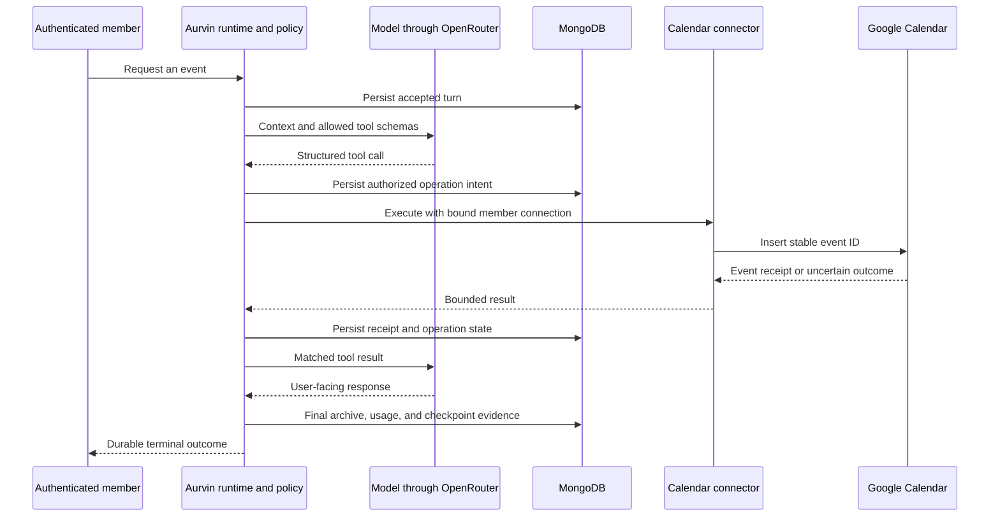

# Aurvin plugins and the first Google Calendar connection

Research date: **20 October 2026**. Source baseline: `681787cffadd813f68f61531b7b1126656935263`. This report contains research and proposals, not an approved implementation specification or live-service certification.

The recommended direction is a small, organization-controlled Calendar connector, a bounded agent tool loop, and durable action/accounting evidence. The first connection belongs to the member who authorizes their own Google Calendar. Prove one useful action before designing distribution or a marketplace.

The research is split into three referenced reports:

- [Plugin architecture and model execution](platforms.md): Codex, Claude, MCP, discovery, tool schemas, trust, portability, and protocol versions.
- [Google Calendar and OAuth](calendar.md): connection lifecycle, scopes, current Google-operated MCP preview, reliable creation, data policy, quotas, and acceptance tests.
- [Aurvin source fit and gaps](aurvin-fit.md): exact source references, current runtime limitations, MongoDB, accounting, dependency compatibility, identity, privacy, and change surface.

[goal.md](goal.md) records the user's research request and selected per-member connection model. [state.md](state.md) records ownership, commits, verification, and the boundary before future implementation.

## What a plugin gives an agent

A plugin is a package the host understands. A skill supplies workflow instructions. A connector implements access to a service. MCP standardizes communication between the agent host's client and a tool server. A plugin may package these together, but they are separate responsibilities. Official [OpenAI plugin architecture](https://developers.openai.com/plugins/concepts/plugins), [Claude Code plugin documentation](https://code.claude.com/docs/en/plugins), and [Claude plugin guidance](https://support.claude.com/en/articles/13837440-use-plugins-in-claude) establish this distinction. They do not disclose every internal implementation detail of either product.

For Aurvin, the important boundary is between the model proposing an operation and trusted code deciding whether to execute it. A Calendar capability does not require model retraining. The host presents allowed tool names, descriptions, and structured input definitions, then receives a structured tool call. The host executes the operation and returns a matching result for the next model request. [OpenRouter documents this client-executed flow](https://openrouter.ai/docs/guides/features/tool-calling).

The model should see something as narrow as `calendar_create_event(title, start, end, timeZone)`, with a description explaining its behavior. It should not receive OAuth secrets or choose another member by passing an email, user ID, connection ID, or bearer token. The server attaches the authenticated member and approved calendar. The exact tool/schema remains a future design decision.

An illustrative Aurvin interaction is:

1. A member asks: “Add a 30-minute planning block on 21 October 2026 at 10:00 in Asia/Kolkata on my Aurvin test calendar.”
2. Aurvin resolves the member and their connection, checks organization policy, and accepts the turn durably.
3. The first model request contains permitted Calendar tools and the bounded session context. The model proposes event details.
4. Aurvin assembles and validates the complete call, checks the concrete authorization and budgets, and persists the action intent before dispatch.
5. The connector creates the event using a stable operation/event ID and returns an outcome that Aurvin saves durably.
6. A later model request receives the matching tool result and writes the response. The UI confirms completion only when the required application/checkpoint evidence is durable.

A clear user instruction can authorize its specified operation; missing dates, ambiguous times, changed targets, or newly added attendees require clarification or renewed authorization. OAuth consent alone does not authorize every future action.

This sequence is a proposed behavior. Unknown external outcomes follow reconciliation rather than the successful path drawn above. No step has been exercised against a live Calendar in this research.

## Choosing the first connector path

| Path | What it proves | Tradeoff | Recommendation for Aurvin |
| --- | --- | --- | --- |
| Narrow backend tools calling the stable Calendar API | A model can request an authorized action, Aurvin can execute it, and durable recovery/accounting work | Does not itself demonstrate MCP interoperability | Smallest first action proof |
| The same narrow operations exposed by an organization-hosted MCP adapter | Tool discovery/calls work through a reusable protocol as well as the Calendar action | Adds client/server lifecycle, authentication boundaries, and version compatibility | Add a small transport proof if learning MCP is an acceptance criterion |
| Google-operated Calendar MCP | Use of Google's own remote tool service | Developer Preview eligibility, documented tool constraints, and operational dependency | Evaluate as a real alternative; do not assume it is ready for this installation |
| Third-party managed connector | Outsourced connection/tool plumbing | Additional processor, pricing, credential custody, and operational terms | Consider only if its benefit justifies those dependencies |

This is a recommendation, not an approved choice. A “Calendar plugin” in Aurvin can use the first or second path; the model-facing tool loop remains necessary for both. Installing a Calendar plugin in Codex or Claude does not install it in Aurvin or transfer a user's authorization grant.

Google now documents an [official Calendar MCP server](https://developers.google.com/workspace/calendar/api/guides/configure-mcp-server), currently a Workspace Developer Preview. Its [create-event tool](https://developers.google.com/workspace/calendar/api/v3/reference/mcp/tools_list/create_event) has no caller-supplied event-ID field, declares creation non-idempotent, and treats unspecified notification level as all attendees. Its required write scopes also differ from the setup guide's read-only examples. These facts make stable REST creation worth proving first; preview membership and actual client behavior remain unverified.

MCP itself is versioned. The current [July 2026 revision](https://modelcontextprotocol.io/specification/2026-07-28/changelog) differs from older initialization examples still present in product guides. Pin a tested client/server/protocol combination. Aurvin's installed LangChain versions satisfy the researched adapter's declared peers, but no MCP package has been installed or integration-tested. The detailed reports separate these declarations from verified runtime behavior.

## What Aurvin already has, and what is missing

| Area | Actual source finding | Consequence for the proposed work |
| --- | --- | --- |
| Provider boundary | `backend/src/model/openrouter-adapter.ts:100` rejects tool/function calls | A plugin cannot be enabled by configuration alone |
| Model context | `backend/src/contracts/context.ts:22` allows string system/user/assistant messages; request preparation strips down to role/content | Tool calls/results need explicit typed support and complete matching groups |
| Graph | `backend/src/agent/turn-graph.ts:29` is prepare, generate, seal | Add a bounded loop and tool/approval states deliberately |
| Durable lifecycle | Accepted input precedes inference; finalization and sealed-result recovery already exist | Extend the established owner/runtime rather than introducing a second executor |
| Identity/admin | One configured development identity; super-admin configuration is not authenticated RBAC | Real member identity and server-enforced connection ownership precede multi-member access |
| Accounting | One immutable provider-generation/accounting association per application attempt | Add evidence for each model round/dispatch; never overwrite the first round's cost |
| Storage | Source declares seven collections, including `config`; tool metadata shapes are preparatory | Preserve existing roles and explicitly design member connection/action storage |
| Credentials | Existing encrypted singleton configuration pattern | Reuse its security approach with member/organization/connection binding and OAuth lifecycle |
| Recovery/topology | Native single-process execution and guarded persistence ownership | Preserve those fences; Calendar/MCP does not establish multi-instance or Azure compatibility |

Exact links, line checks, and additional callers are in [aurvin-fit.md](aurvin-fit.md). Historical Phase 1 text in root instructions is not treated as a current inventory; later admin, voice, and accounting source is included in this investigation.

For the selected product, real authentication is a prerequisite. A strictly local, single-operator spike could remain explicitly single-user, but it cannot serve as evidence for member isolation. The existing admin UI should not be mistaken for permission enforcement.

The proposed affected surfaces include shared contracts, provider streaming/parser logic, context assembly, graph execution, lifecycle/reconciliation, persistence indexes/records, accounting/reporting, server identity and OAuth routes, admin policy, connection/status UI, fixed instructions, and the corresponding fixtures/integration tests. Text chat is the first proof; voice introduces additional approval, interruption, and replay questions.

## Organization control and member connection ownership

For every tool dispatch, the effective permission is the intersection of authenticated Aurvin membership, organization/plugin policy, member consent, granted Google scopes, Calendar access rights, and authorization for the concrete operation. A tool being discoverable is not sufficient. Check permission again before execution, including after a pause or connection change.

The super admin controls which integration and actions are enabled, limits, and audit visibility. A member connects and disconnects their own account. Admin status must not silently confer access to member Calendar contents. Use server-bound, one-time OAuth callback state and secure backend token handling, following [Google's web-server OAuth flow](https://developers.google.com/identity/protocols/oauth2/web-server). The detailed Calendar report compares Internal Workspace and External/personal-account setup, testing-token expiry, revocation, scopes, and shared-calendar alternatives.

“Organization-controlled” also needs a precise product definition. Owning Aurvin's application and MongoDB does not make OpenRouter, downstream model providers, or Google local. Current source requests denied provider data collection but does not configure request-level ZDR or a provider allowlist. [OpenRouter distinguishes non-training from zero retention](https://openrouter.ai/docs/guides/features/zdr). Decide approved processors, routing, retention, and user disclosure before real organization data reaches the model.

Calendar descriptions and remote tool metadata are untrusted input. A fetched event must not expand policy, substitute a connection, or instruct Aurvin to send data elsewhere. Keep allowed operations narrow, validate them on the server, bound outputs, render safely, and avoid a generic tool that can request arbitrary URLs.

## MongoDB, memory, and external effects

Keep the existing distinctions: messages are the visible archive, checkpoints describe graph execution, agent memory selects context, and metadata carries bounded causal/accounting evidence. The existing `config` collection has its own administrative purpose. Member OAuth grants need their own bounded ownership/lifecycle design rather than an ever-growing array in singleton config.

The proposed action evidence includes a stable operation ID, member/organization and connection binding, session/turn/application-attempt linkage, originating model/tool-call IDs, sequence and causal links, tool/schema version, canonical request hash, authorization evidence, dispatch/outcome state, Google resource ID, and a bounded result reference. Store only fields needed for recovery, audit, and user-visible behavior; never private model reasoning or raw credentials.

The most important failure case is **Google creates the event, then Aurvin fails before saving the receipt**. A MongoDB checkpoint cannot make that external action atomic. Persist the operation first; generate a Google-compatible event ID once; reuse it for the same action across retry/recovery; query that ID after an ambiguous result and verify linkage before completing locally. Duplicate/conflicting results require reconciliation, not a new random ID. Google's [event creation](https://developers.google.com/workspace/calendar/api/guides/create-events) and [error guidance](https://developers.google.com/workspace/calendar/api/guides/errors) support this approach. It reduces duplicates without promising universal exactly-once execution.

Separate external action status from later narrative generation. An event can be created even if the final model response fails. The UI should show the durable action receipt and the failed response status accurately; a retry of the narrative must not create another event. Cancellation is not an undo and cannot guarantee that a dispatched write or model charge stops.

Content retention needs a deliberate decision. Google's current [Workspace data policy](https://developers.google.com/workspace/workspace-api-user-data-developer-policy) constrains transfers, retention, and uses of fetched data. Do not default to indefinite archives of event bodies, derived chat copies, checkpoints, summaries, and backups. Preserve necessary references/outcomes/accounting separately from retained source content, with deletion and retention behavior designed before real data use.

## Cost and budget accounting

One accepted turn can contain several billable model requests, multiple transport attempts, and tool operations. Each needs its own evidence and relationship. A model call that produces only a tool request still consumes resources. Include failed/cancelled or disconnected work when it incurs cost; missing evidence remains unknown rather than zero.

Conceptually:

`turn cost = sum(model dispatch charges) + known connector/service charges + separately attributed infrastructure costs`

For each model dispatch, retain the server-resolved member attribution, requested/actual model and provider where available, provider request/generation IDs, token breakdowns, timing, decimal monetary evidence/currency or unit, and known/pending/unknown status. Preserve separate tool-operation attempts and external outcome evidence. Aggregate once; do not add an attempt summary to its underlying rounds. Existing Decimal128 and bounded reporting patterns are reusable.

The [current OpenRouter accounting contract](https://openrouter.ai/docs/cookbook/administration/usage-accounting) returns usage evidence on normal responses and the final SSE usage event. A lost stream can lose that evidence; where a generation ID exists, bounded reconciliation may retrieve it. Provider-reported charge evidence and local estimates must remain distinguishable.

Tool definitions and results also take context space. Start with a few authorized tools and bounded event reads; consider deferred discovery only when a real catalogue requires it. Set finite model-round, token, tool-call, time, retry, and spend ceilings. Strict member/organization budgets require durable reservations before dispatch, which the current resource limits do not supply.

Calendar/API quota and connector hosting/vendor costs belong in the accounting design too. Google's [current quota/pricing page](https://developers.google.com/workspace/calendar/api/guides/quota) describes standard use without additional cost but anticipates later-2026 overage billing. Do not hardcode “free forever” or invent overage prices. No cost per Calendar task has been measured in this research.

## Proposed proof and later design decisions

The smallest useful eventual proof is text-only: one authenticated test member, their own disposable Calendar, bounded event list/get/create, no attendees, and no invitation emails. Enforce the calendar on the server. Use actual event readback and a durable receipt to establish success. If MCP learning is required, also prove discovery and invocation through a pinned, organization-controlled MCP adapter; a direct API success alone is not that evidence.

Before a live proof, deterministic fixtures should cover malformed/fragmented model calls, tool/result ordering, unauthorized or invented tools, cross-member/callback isolation, limits, revoked/changed connections, duplicate submissions, ambiguous create responses, database failure after external success, successful action with failed narration, cancellation, injected event content, and accounting completeness. Native fixtures then verify persistence and recovery in isolated admitted databases. Authorized, bounded live tests establish Google behavior separately.

The next design discussion should settle these questions:

1. Is the first acceptance criterion a Calendar action, or both the action and MCP interoperability?
2. Which member-authentication and organization boundary will precede connection ownership? Is the account a managed Workspace identity or personal Google account?
3. Should the first target remain a disposable member-owned calendar, and which exact tool/actions and authorization UX are allowed?
4. Which model/provider/privacy policy can support tool rounds without retaining private reasoning?
5. Which per-call and per-turn ceilings, monetary evidence rules, and member/organization budgets are required now?
6. What fetched content may be retained, for how long, in transcripts/checkpoints/backups, and who may access audit records?

These are decisions for the later written implementation specification. They are not reasons to leave the present research incomplete. A full marketplace, arbitrary plugin uploads, domain-wide delegation, automatic memory extraction, and parallel side-effect execution are unnecessary for this first proof.

## Evidence boundary

Completed: current primary-document research, actual source inspection at the stated baseline, dependency/declared-peer comparison, research-document consistency checks, and a proposed acceptance approach. Researcher commits and verification results are recorded in [state.md](state.md).

Unrun: application suites, package installation, authenticated member flows, OAuth grants, live Calendar/OpenRouter/MCP calls, database fixtures, deployment, real charges, and production/privacy/topology certification. Unified review is **skipped**, not passed. No application source or configuration was changed by this work.
