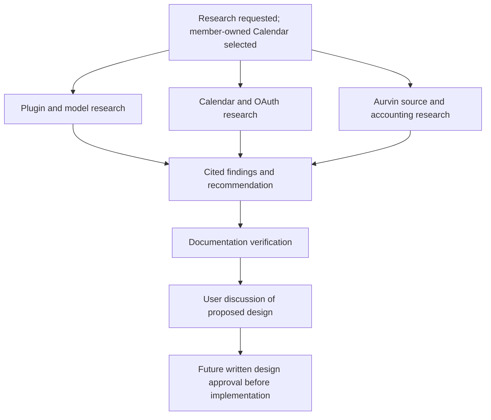

# Aurvin plugin research: execution record

## Authorization and scope

The user requested research before any implementation. [goal.md](goal.md) records this research brief, not an approved product specification. The selected experiment is a member connecting their own Calendar. No new integration, OAuth grant, Google project, paid check, or deployment is authorized.

This is the research portion of MAW. Implementation design approval, planners, workers, and application verification remain future lifecycle gates; they are not marked complete or skipped by finishing this research task. Unified review is **skipped** as instructed. No reviewer is dispatched.

Work branch: `codex/aurvin-plugin-research`. Initial checkout was clean at baseline `681787c`. Preserve `.openchamber/`, environment files, and intervening user changes. Researchers own disjoint documents and receive explicit commit turns; only named task files are staged.

## Research ownership and dependencies

| ID | Research scope | Owned artifact | Prerequisites | Status | Commit |
| --- | --- | --- | --- | --- | --- |
| R1 | Plugin/MCP/LLM loop; Codex/Claude; trust and portability | [platforms.md](platforms.md) | User research request | Complete; commit stat verified | `1f7d782` |
| R2 | Google Calendar API/OAuth/Workspace; reliable create; bounded proof | [calendar.md](calendar.md) | User research request | Complete; commit stat verified | `3bdedee` |
| R3 | Actual Aurvin code fit; LangGraph/OpenRouter; persistence and cost | [aurvin-fit.md](aurvin-fit.md) | Current source at baseline | Complete; commit stat verified | `d4dd696` |
| S | Research synthesis, recommendation, unresolved decisions | [README.md](README.md) | R1, R2, R3 summaries | Complete | Final synthesis commit |
| V | Documentation/link/source-evidence consistency | This record and research artifacts | S | Complete within research scope | Final synthesis commit |

## Research verification

- R1 commit `1f7d782` verified by commit stat: one owned document. Researcher reports 33 fetched primary sources, three JSON examples parsed, external URL syntax and Calendar crosslink checked.
- R2 commit `3bdedee` verified by commit stat: one owned research document; researcher reports 27 unique HTTPS source links and document checks passing. No application or live tests were run.
- R3 commit `d4dd696` verified by commit stat: one owned research document; researcher reports 48 code path/line references checked for existence and range, with clean staged whitespace checks. No application or live tests were run.
- Orchestrator synthesis uses researcher handoffs and selected fetched official pages, without ingesting `research.md` or `plan*.md` or writing implementation code.
- Final local consistency check: six Markdown documents, 13 local link targets checked, 73 distinct external URL strings parsed, three JSON examples parsed, zero failures. External URL syntax checks are not service/API availability tests.
- `git diff --check` passed. Named-file commit checks passed. The task diff contains only the six research documents; application source, configuration, dependencies, and historical workflow records were preserved.
- Application tests are not applicable to documentation-only work. No live Google/OpenRouter/MongoDB/MCP tests are run or implied by this research. No Google grant, project, or connection was created and no event was added.
- Unified review is **skipped**, never passed. No reviewer or review-triggered fixer was dispatched.

## Findings and recommendation handoff

- Plugin packaging, MCP transport, workflow instructions, model tool schemas, and trusted execution are distinct. Codex/Claude installations and OAuth grants do not automatically transfer to Aurvin.
- Current Aurvin source rejects tool calls and assumes one text result/provider generation per attempt. Durable acceptance/finalization, bounded metadata preparation, encrypted configuration patterns, and decimal accounting are reusable foundations; member authentication, connection ownership, the bounded tool loop, and multi-round accounting remain missing.
- Selected account model: a member connects their own Calendar. Organization enablement, Google consent/scopes, Calendar access, and authorization of the concrete action remain separate gates.
- Recommend a narrow stable-API action proof, with a tiny organization-hosted MCP transport proof if interoperability is an acceptance requirement. This is a proposal; no implementation path is approved. Google-operated Calendar MCP is a genuine current Developer Preview alternative with documented create/retry constraints.
- Persist stable operation intent before external dispatch and reconcile uncertain outcomes by the same event ID. A checkpoint cannot atomically commit a Google side effect; do not promise exactly-once behavior.
- Track every model round/dispatch and tool outcome, preserve unknown cost, and avoid duplicate aggregate accounting. Decide content retention and external model/connector data processing before real member data use.
- Current protocol/SDK documentation versions differ; declared dependency peers are compatible but actual interoperability is untested. Azure, multi-instance, live-service, and production certification are not established.

## Artifact record

| Artifact | Evidence |
| --- | --- |
| Research brief and initial state | `05c5471` |
| Calendar research | `3bdedee` |
| Aurvin source/accounting research | `d4dd696` |
| Plugin/MCP/platform research | `1f7d782` |
| Decision summary and final research verification | Final synthesis commit containing this state |

## Current gate

**RESEARCH COMPLETE; IMPLEMENTATION NOT STARTED.** Deliver the findings and discuss the proposed first connector. A later written implementation specification must settle authentication/account ownership, action-vs-MCP acceptance, exact allowed actions, authorization UX, provider/privacy policy, budgets, and content retention before implementation planning. No implementation gate is marked complete, and this research does not advance or certify unrelated workflows.
