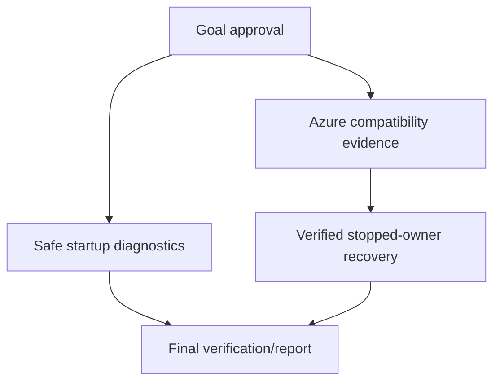

# Backend startup fix state

## Configuration and preservation

- Scope: `goal.md`; keep Azure data, no automatic ownership takeover.
- Review: skipped, not passed. Diagnosis, planning, implementation and verification required.
- Preserve pre-existing local `.env`, `.openchamber/`, and user changes.
- Current user confirmations: keep Azure database; this PC only; prior executor stopped.

## Milestones

- [x] Goal approved: user selected "Fix, test, and recover" after concrete correction/recovery design.
- [x] Initial diagnosis: researcher commits bb542b2, 1567347 and 0b2916f.
- [x] Scoped Azure capability investigation and recovery evidence; full certification remains blocked on tier/partition/service-facts evidence.
- [x] Committed implementation/recovery plans: P1 05e1aee; P2 933f0aa.
- [x] Assigned worker execution: P1 2ac57e7/7059ce7; P2 2f3a221; live evidence 0e6b1be.
- [x] Unified review skipped.
- [x] Final verification and report: final_report.md; startup/proxy recovery proven, remaining service/generation verification blocks explicit.

## Diagnosis handoff

- Configuration/assets and offline Nest initialization passed.
- Existing executor record reproduces UNSUPPORTED_TOPOLOGY before listening.
- Configured service identified as Azure DocumentDB, advertising sharded topology/version 8.0.0; admission/compatibility remains unverified.
- No local Aurvin processes remained; no process kills or database writes performed by researchers.
- S1-SEVI reference uses the same deployment/different database; connection options match. Required six collections/ten indexes present. No connection/index incompatibility reproduced.
- Windows Nest watcher forcibly kills its child tree on reload; disposable process reproduction confirmed shutdown cleanup is bypassed. Build-once/direct Node launch avoids this unsafe reload path.
- Read-only evidence: sessions and checkpoints empty, recorded executor owns no session; user confirmed no remote executor.

## Graph, ownership and gates

| Unit | Planner prerequisites | Worker prerequisites | Owned scope | Status |
| --- | --- | --- | --- | --- |
| P1 safe startup lifecycle/diagnostics | Goal approved; diagnosis complete | Committed P1 plan | run.bat; README.md; launcher spec; backend/src/main.ts; one startup regression test | Complete; plan 05e1aee; implementation 2ac57e7/7059ce7 |
| R2 Azure compatibility | Goal approved | Read-only research; generated isolated service writes authorized | Compatibility evidence; existing suite | Capability probe passed; full Azure certification not established |
| P2 operator recovery | R2 summarized; old-owner stop evidence | Committed plan; verified recovery capabilities; explicit maintenance authorization | Existing operations handoff/reconciliation; application data preservation | Complete; conditional handoff/scoped release and fresh claim/release; evidence 2f3a221 |
| V final verification | Workers finish or explicit blocked outcome | Meaningful checks; actual evidence | final_report.md; state.md | Complete with full Azure certification/live-generation/native-e2e blocks; live evidence 0e6b1be |

- Maximum three child agents; serialize commits. Orchestrator does not implement code or ingest research/plans.
- P1 regression checks known error code preservation, secret-safe ownership guidance, unknown-error redaction, and cleanup behavior.
- P2 must preserve checkpoint results, archive and accounting and avoid inference.
- V checks focused regressions, relevant backend build/lint/tests/e2e, liveness and proxy reads where admitted; report native/service skips separately.

## Existing launcher correction

- Uncommitted parent changes: run.bat and backend/test/operations/launcher.spec.ts.
- Focused launcher source-order check passed; not an end-to-end backend recovery result.
- Prior routine run: 312 tests passed, one skipped, one unrelated README npm-ci expectation failure. Lint passed with warnings.

## Verification received so far

- Environment: Windows, Node v24.18.0, npm 12.0.1.
- P2: One isolated Cosmos capability test passed; generated test database dropped and absence verified. CAS, indexes, stock checkpoint save/reopen, conditional handoff, fencing and quiescent release exercised. Thirteen focused deterministic checks passed; build/lint passed with existing warnings. Negative authorization/facts gates failed as intended.
- P2 initial recovery assessment: no application mutation; database empty except unchanged valid ownership sentinel; scoped currentOp observations zero. Additional evidence assessment in progress. No full Azure certification/profile admission claimed.
- P1 implementation committed 2ac57e7: checked build/direct Node launch, static secret-safe startup error codes and ownership guidance, actual cmd/compiled-entry behavioral regressions, accurate installation/restart README.
- P1 RED/GREEN: 12 focused launcher/bootstrap tests passed after expected missing-build/code-preservation failures; README focused regression passed. Build/lint passed with unrelated warnings; full routine backend suite 324 passed, one native skip.
- P1 diagnostic/non-native e2e: 12 passed. Full e2e without isolated native prerequisites: 12 passed, 33 skipped, 56 prerequisite failures (not a full passing suite). Actual isolated-console Ctrl-C awaited shutdown once with zero persistence/provider opens; Windows exit code 1, IPC exit code 0. Diagnostic shutdown does not prove durable service-backed ownership release.
- Orchestrator frontend final checks: npm test passed 14 files/50 tests; npm run build passed; npm run lint passed with three warnings. No frontend source changed for this fix.
- P2 final settlement checks: three broadened currentOp observations zero across 120 seconds; empty data/owner/revision/indexes stable. Authorized conditional handoff incremented revision; replacement scoped release and fresh ordinary claim/release succeeded. No direct sentinel deletion; data and indexes preserved.
- Live backend/Vite checks passed: backend/proxy liveness and sessions 200; frontend 200; expected readiness 503 with inference explicitly disabled only in child environment. Service-backed IPC shutdown exited 0 and durable ownership/metadata returned to zero. No verification instances/listeners left running.
- Final build and lint passed; non-native e2e 12 passed. Parallel build/test initially interfered with compiled fixtures; serial routine rerun passed 324/one skipped. Worker corrected hidden prebuild dependency in 7059ce7: fresh no-dist full routine run and post-build serial rerun both passed 324/one skipped. External build must not overlap compiled-entry tests.
- Assigned worker must preserve and verify these edits; do not infer runtime behavior solely from source-order assertions.

## Current gate

COMPLETE WITH BLOCKS: reported startup/proxy defect and stopped-owner recovery fixed and verified; no agents/processes remain active. Full Azure service-facts/tier/partition certification and live generation verification are not established; native e2e prerequisites remain absent. Private environment/profile unchanged. Final report/evidence complete; review skipped. Resume only for specifically authorized remaining compatibility/generation gates; never infer full Azure admission from scoped probes or diagnostic archive success.
