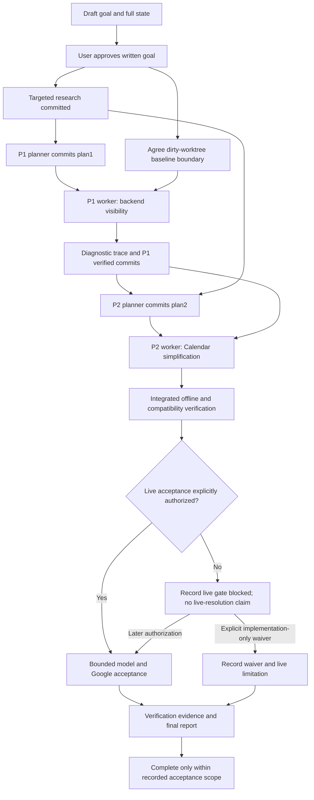

# State & Dependency Graph: Backend Visibility and Calendar Simplification

## Workflow configuration

- Artifacts live directly in `docs/calendar-visibility-simplification/`.
- Exactly **two implementation plans**: P1 backend process visibility and P2 Google Calendar simplification. Research and final verification are phases, not P3 or additional plans.
- **No code review is needed** per the user's instruction on 27 October 2026. Unified review is **skipped**, not passed. Do not dispatch a reviewer or review-triggered fixer; testing, defect correction, compatibility checks, and final verification remain required.
- Current authorization: the user approved the written goal and implementation boundaries on 27 October 2026, and explicitly chose an implementation-only waiver for the unrun external acceptance gates on 27 October 2026. This closes the workflow only within the offline implementation scope; live calls remain unauthorized and no incident-resolution claim is made.
- Both implementation plans and offline verification are complete. Native/live acceptance remains unrun and is not treated as a pass. The overall workflow awaits explicit bounded live authorization or an implementation-only waiver; no incident-resolution claim is made.
- At most three concurrent child agents alongside the orchestrator. Use foreground parallel dispatch only when prerequisites are met and ownership is independent. This DAG deliberately serializes P1/P2 workers.
- Orchestrator owns graph/status/dispatch and workflow index documentation, not application implementation. Do not ingest `research.md` or `plan*.md` for execution management. Consume agent summaries and verified reported commits.
- Preserve all pre-existing tracked edits and untracked files, including `.openchamber/` and local configuration. Stage named task files only; never `git add .`.
- Serialize all shared-index commits. Do not move this busy checkout to a different worktree or branch without user agreement. New branches, if authorized, use `codex/`.

## Workflow milestones

- [x] Step 1: Goal alignment and written specification approval (`goal.md` committed in `1339432`; approved 27 October 2026).
- [x] Step 2: Technical research (`research.md`; `1691a7a`).
- [x] Step 3: Planning completed (`plan1.md` and `plan2.md`; P1 plan `8c7c06e` refined by `fb9d68b`; P2 plan `f4c4a69`).
- [x] Step 4: Execution completed (P1 and P2 implementation commit sets integrated at `920e2c2`).
- [x] Step 5: Code review not needed; unified review **skipped**, not passed, per the user's explicit instruction (27 October 2026).
- [x] Step 6: Final integrated offline verification and report (`verification.md`, `final_report.md`); implementation-only waiver records native/live gates as unverified.

## Brainstorming and specification tasks

- [x] Explore relevant source, current architecture, recent commits, and workspace status.
- [x] Capture the user's corrected count of two workstreams and the reported debugging failure.
- [x] Compare thin documented-contract adapter, hosted Google MCP, and retaining current layers with stronger prompts.
- [x] Draft the recommended design, boundaries, acceptance criteria, ownership, and complete pre-research DAG.
- [x] Check the specification for scope, approval/evidence distinctions, privacy, compatibility, and live-call authorization.
- [x] User approves the written `goal.md` and the implementation boundaries (27 October 2026: “yess” in response to the explicit approval request).
- [x] Record approval and authorize research/ready planners. This approval is distinct from the prior Phase 1 approval.

## Workspace and evidence baseline

- Recorded checkout: `D:/Peter/Aurvin Agent/Aurvin`, branch `codex/google-calendar-plugin`.
- HEAD at preparation: `8ec1a3f` (`fix(calendar): fence budget admission and refresh missing discovery`). The branch was ahead of its upstream by one commit.
- Resume baseline on 27 October 2026: HEAD `de68b1e` (`fix(calendar): seal recoverable failures and preserve turn evidence`); `git status --porcelain=v1 --untracked-files=all` was empty. The earlier dirty-worktree warning describes preparation, not the resumed checkout. Source commits must include only changes attributable to this objective; preserve any intervening changes.
- The index was empty when preparation began. The working tree was already dirty across backend runtime/contracts/model/persistence/plugins/tests, frontend streaming/state/tests, root instructions/setup docs, and `run.bat`.
- Pre-existing untracked tests include `backend/test/persistence/claim-executor.spec.ts`, `backend/test/runtime/calendar-answer-regressions.spec.ts`, and `backend/test/runtime/calendar-feedback.spec.ts`. Preserve them. They are not new P1/P2 completion evidence.
- Resumed source boundary: clean checkout at `de68b1e`; P1 and P2 workers reconfirmed clean starting trees. Worker commits contain the objective's attributable changes; the isolated P2 branch was integrated without overwriting the orchestrator's state commits.
- Immediately preceding verification in this session: backend routine suite 1,982 passed / 10 skipped; backend e2e 22 passed / 129 skipped; backend build and lint passed, with warnings. These characterize the earlier working tree, not this work item's implementation or live correctness.
- No live Google/OpenRouter verification or app-database inspection was performed for the reported incident. The exact rejected live tool arguments and cause remain unestablished.

## Initial findings

1. Existing telemetry provides request/turn correlation but filters out calendar-specific codes and primarily exposes calendar progress phases.
2. The runtime uses fixed rejection/repair-exhaustion answers. Delivered fallback text is not evidence of a successful tool operation.
3. Model tool schemas are custom Aurvin contracts. They pass through a local embedded MCP client/server and Google REST adapters, with custom signed cursors and discovery snapshots.
4. The advertised first-page calendar-list schema permits `{}`. A model's claim that `pageToken` is required is not authoritative evidence of the failing boundary.
5. Official Google Calendar REST contracts and Developer Preview MCP schemas exist. The current integration is not the official hosted MCP server. Their response fields and authorization/availability must not be treated as interchangeable.
6. Scripted response tests prove runtime branches, not live-model adherence. Diagnostics and a bounded authorized live acceptance gate are needed to establish the user's actual outcome.

## Confirmed product decisions and proposed implementation direction

**Confirmed:** two plans; broader backend-process visibility; Calendar simplification including tools as seen by the LLM; alignment with Google's documented contracts; a fully specified MAW state and DAG; preservation of the existing skipped-review instruction.

**Approved direction:** P1 extends existing safe telemetry; P2 follows its diagnostic evidence and uses a thin REST adapter rather than assuming hosted MCP availability or changing OAuth grants. Necessary write-safety, identity, privacy, persistence, attribution, and finite-budget guarantees remain intact.

## Dependency matrix & execution status

`R` means targeted technical research is complete and committed, with an orchestrator-readable summary. A prerequisite worker is complete only when implementation, tests, and an attributable commit set are reported and checked. A committed plan alone never satisfies a worker dependency.

| Plan ID | Title and scope | Worker dependencies | Owned subsystems | Planner status | Worker status | Commits |
| --- | --- | --- | --- | --- | --- | --- |
| **P1** | Backend process visibility: correlated lifecycle, precise safe failures, task outcome, readable local logs | Approved goal; R; clean working-tree baseline; committed plan1 | Existing telemetry/observation path, shared diagnostic hook, necessary lifecycle emissions, related tests/docs | Complete (`8c7c06e`, refined `fb9d68b`) | Complete; offline verification complete | `9522cf4`, `c476854`, `2538fad`, `0ba16ec`, `8d12bd3`, `b0ad7c5`, `4326a1c`, `c2df866`, `1b8b18a` |
| **P2** | Calendar simplification: evidence-led documented contracts, truthful LLM catalogue, minimal execution path, compatibility | P1 worker complete and committed; committed plan2; approved working-tree boundary | Calendar contracts/model/plugins/runtime behavior and integration tests; uses P1 logging contract | Complete (`f4c4a69`) | Complete; offline implementation and verification integrated at `920e2c2` | `aeeceec`, `252f2fe`, `00a1e39`, `920f60d`, `250d742`, `cdffbd2`, `93c98a8`, `36a9f89`; merges `074da01`, `920e2c2` |

### Execution graph

Unified review is **skipped**; there is no review node or review-fixer loop. Any failed required check routes back to its owning worker and reopens dependent gates. A failed live check returns to P1 for missing diagnostics or P2 for behavior defects; it does not silently pass through to completion.

### Planner readiness and immediate worker dispatch

| Planner | Earliest prerequisites | Worker start condition |
| --- | --- | --- |
| P1 | Written goal approved; R committed with diagnostic/compatibility summary | plan1 committed; agreed baseline; P1-owned paths available |
| P2 | R committed; P1 worker committed with an actionable trace/reproducer or explicit evidence gap and stable diagnostic contract | plan2 committed; P1 complete; shared paths handed over |

- P2 planning deliberately waits for P1's evidence rather than guessing at the live failure. The dependency is substantive, not merely a commit-order constraint.
- Dispatch ready workers promptly after the gate is satisfied. Do not dispatch P2 early because a P1 plan exists.
- If a later decomposition makes planners independent, dispatch the ready planners concurrently in the foreground, but retain exactly two implementation plans and reconcile ownership first.
- A changed diagnostic or tool contract pauses downstream work until plans/types are reconciled through the responsible owner.

## Plan scopes, file ownership, and completion gates

### P1 — Backend process visibility

**Plan artifact:** `plan1.md`.

**Primary ownership:**

- `backend/src/operations/telemetry.ts`, `observed-runtime.ts`, `observe-persistence.ts`, and existing operations logging support.
- A minimal diagnostic interface in `backend/src/chat-runtime/ports.ts` / `calendar-ports.ts`, plus assembly wiring in `backend/src/app.service.ts`, only where required to reuse telemetry.
- Diagnostic emissions in `backend/src/chat-runtime/durable-chat-runtime.ts`, `calendar-loop.ts`, and model/provider adapters at the stages needed for the goal; no Calendar behavior simplification in P1.
- `backend/test/operations/**` and focused lifecycle/model/plugin diagnostic tests; create only the minimal additional checks within existing test directories.
- `observability.md`: event contract, safe fields, local readability, tracing instructions, diagnosis/reproduction evidence and known evidence gaps.

**Scope:** precise safe reason vocabulary; correlated stage/outcome observations; distinguish local, cached, and externally delivered operations; useful rejection details; protected log sinks and bounded output. Reuse existing telemetry rather than invent a new platform.

**Exit gate:** AC1–AC4 pass; safe reason codes survive real assembly; one end-to-end offline trace explains local rejection and provider execution separately; privacy and logging-failure tests pass; the actual live reproduction is either authorized and recorded or explicitly unavailable. The worker reports which evidence P2 can rely on and does not guess the incident cause.

### P2 — Google Calendar simplification

**Plan artifact:** `plan2.md`.

**Primary ownership:**

- `backend/src/contracts/calendar-tools.ts`, `calendar-model.ts`, `calendar-mcp-schema.ts` and directly affected Calendar contracts.
- `backend/src/model/calendar-*` and `backend/src/context/calendar-context.ts` for truthful model tool visibility and result history.
- `backend/src/plugins/google-calendar/**`, `backend/src/plugins/mcp/calendar-client.ts`, `calendar-server.ts`, and `backend/src/plugins/registry.ts` for the supported Calendar adapter path.
- `backend/src/chat-runtime/calendar-*.ts` and targeted `durable-chat-runtime.ts`/`app.service.ts` integration changes after P1 hands over shared files.
- Existing Calendar contract/model/context/plugin/runtime/assembly/integration tests, including pre-existing working-tree regressions without overwriting them.
- `contract-alignment.md`: tool-to-Google contract mapping, retained/removed layer rationale, schema authority, cursor semantics, ownership fields, stored-record compatibility, rollout/rollback.

**Scope:** use P1 evidence to reduce unnecessary machinery, align the supported tool subset and implementation with authoritative Google contracts, and prove exact model-visible/runtime parity. Keep required safety and compatibility. No blanket rewrite or new Calendar capabilities.

**Exit gate:** AC5–AC9 pass through production assembly and native model-request serialization; first-page `{}` and returned pagination work; ownership evidence is available; correction/duplicate/write-recovery and privacy regressions remain intact; compatibility and layer-removal decisions are documented. AC10 governs any live claim.

### Shared paths and handoff

P1 and P2 must not concurrently edit `calendar-loop.ts`, `durable-chat-runtime.ts`, provider/model adapters, dependency ports, or `app.service.ts`. P1 owns these first for diagnostic-only changes, then reports its commits, interface, test paths, and observed trace. P2 owns them after handoff and must preserve or deliberately update instrumentation so the trace remains accurate after simplification. P1's telemetry implementation stays its responsibility; reopen P1 if that contract needs changes.

Orchestrator owns `state.md` and the approval/dispatch record. The researcher owns `research.md`; each planner owns its plan file. Workers tick their own plan steps as completed without dropping constraints. Final verification/report ownership is orchestration-only unless a later explicit assignment is recorded; it is not a third implementation plan.

## Acceptance coverage

| Goal criteria | Primary owner | Integrated evidence |
| --- | --- | --- |
| AC1–AC2: lifecycle, tool and rejection visibility | P1 | Structured real-assembly traces for success/local rejection/correction/provider error |
| AC3: delivery versus task outcome | P1 | Completed fallback, successful Calendar action, clarification, cancellation, uncertain create |
| AC4: safe bounded logs | P1 | Redaction, argument-shape allowlist, sink-failure, size/cardinality and detail-mode checks |
| AC5: authoritative documented contracts | P2 | Google references and schema/runtime contract parity tests |
| AC6: listing, ownership, continuation | P2 | Production assembly fixtures; authorized live check before live-resolution claim |
| AC7: schemas visible to model; bounded repair/duplicates | P2 | Actual serialized request bodies for all dispatch modes and execution-count assertions |
| AC8: preserved safety and compatibility | P2 | Existing and added create/recovery/expiry/identity/limit tests plus rollout notes |
| AC9: instrumentation survives simplification | P2 and final verification | P1 event contract asserted through the final P2 path |
| AC10: calibrated service evidence | Both and final verification | Separate offline, native, live and waived/unrun evidence rows |

## Research handoff — complete (`1691a7a`)

- P1 must establish safe correlated diagnostics before attributing the reported incident; the actual rejected call and failing boundary are still unknown.
- P2 should prefer the existing REST integration over Google's Developer Preview MCP server, distinguish Aurvin signed continuations from Google page tokens, and explicitly test schema parity and stored-record compatibility.
- Google's `owner` access role denotes manager access, not necessarily ownership of the underlying data. P2 must qualify ownership evidence rather than infer ownership solely from the role; reconcile this with AC6 without inventing unsupported proof.
- Start with deterministic production-assembly fixtures. Native tests require an isolated operator-supplied MongoDB fixture; live incident resolution requires separate user authorization.
- Research documentation checks passed; no application tests, live calls, provisioning, or application-database access were performed.

## P1 implementation handoff — complete (offline evidence)

- The worker reports a contract-v1 bounded structured process trace and a deterministic assembly trace distinguishing local cursor rejection, cached success, provider failure, fallback, and uncertain write. Actual live incident evidence remains unavailable; no live resolution is claimed.
- The initial commit-only inspection identified five evidence gaps. P1 commit `4326a1c` adds HTTP submit/SSE correlation in the production HTTP assembly; interleaved production-assembly turns; configured and hard maximum diagnostic-count assertions; ordinary-chat private provider-exception assertions; and diagnostic assertions in feedback, answer, and recovery suites. The added code also emits authority-denial and recovered-finalization outcomes.
- Commit `c2df866` records the focused and full backend results after those changes: build/lint passed; routine 2,033 passed / 10 skipped; e2e 22 passed / 129 skipped; focused assembly observability 10, HTTP assembly 2, validation 98, runtime 7, feedback 5, answer 15, and recovery 5 passed. These are worker-reported results, not rerun by the orchestrator. Native database checks remain unrun because isolated fixture configuration was unavailable.
- The orchestrator inspected the added test diffs and their commit. P1's offline exit evidence is now complete; this does not constitute live incident evidence or final integrated verification.

## P2 planner handoff — complete (`f4c4a69`)

- The commit contains only `plan2.md`; the worktree was clean after the commit. No application tests were run for this planning-only change.
- The reported P2 scope includes direct REST execution, truthful model-facing contracts, initial/continuation/correction serialization, pagination, bounded repairs, duplicate suppression, compatibility, and AC9 instrumentation. The implementation worker must reconfirm its working-tree boundary before source changes.
- The planner identified that adapter emissions omit allowed `dispatchKind` and `model-decision` observations. P2 includes TDD coverage and correction without changing diagnostic contract v1; verify in production assembly and retain P1 correlation.
- Ownership caveat remains: Google `owner` is manager access, not proof of underlying data ownership. Produce qualified answers and do not claim a definitive ownership inventory from that role alone. Native/live acceptance and actual old-binary rollback remain unrun; the original incident is not resolved by offline tests.

## P2 execution handoff — complete (offline)

- `aeeceec` records the P2 contract/compatibility boundary; `252f2fe` commits native contracts and bounded feedback; `00a1e39`, `920f60d`, `250d742`, and `cdffbd2` implement direct REST execution, qualified ownership/continuation, bounded repair/duplicate suppression, and stored-record/write-recovery compatibility. Worker evidence is detailed in `contract-alignment.md`.
- `93c98a8` records built-assembly, AC9, and worker offline checks. Prompt release follow-up `36a9f89` pins the system asset at `phase1.v2`; `074da01` and `920e2c2` integrate the P2 branch into the active checkout.
- The deterministic behavior suite regression was caught after merge, fixed test-first, and rerun. Final integrated backend build, lint, routine, e2e, and behavior checks passed; exact results are in `verification.md`.
- AC6 remains qualified: primary and access-role evidence are available, but secondary data ownership is unknown. No native MongoDB, Azure-service, live provider, or prior-binary rollback check was performed.

Completed researcher assignment:

1. Verify current Google REST and MCP contracts, preview availability, ownership fields, paging, errors, supported scopes, and the supported tool subset against primary docs.
2. Inspect the current trace/adapter/validation/persistence boundaries and identify the thinnest safe execution path. Do not assume source presence proves a successful incident reproduction.
3. Identify how to unify advertised/runtime schema authority without new dependencies if existing tools suffice.
4. Specify the minimal P1 diagnostic contract P2 will consume, privacy restrictions, fixture versus live evidence, baseline compatibility, and test prerequisites.
5. Commit only `research.md` and return a concise decision/ownership summary and commit hash. Orchestrator verifies the commit without reading the artifact.

## Final verification commands and evidence

Final integrated offline evidence is recorded below and in `verification.md`. Worker-specific focused results and chronology are kept in `observability.md` and `contract-alignment.md`.

| Working directory | Command or check | Purpose / admission |
| --- | --- | --- |
| `backend` | `npm run build` | Passed after final source merge |
| `backend` | `npm run lint` | Passed; warnings only in existing voice tests |
| `backend` | `npm test -- --no-file-parallelism` | 2,001 passed / 10 skipped; 246 files passed / 2 skipped |
| `backend` | `npm run test:e2e` | 22 passed / 129 skipped; 4 files passed / 40 skipped |
| `backend` | `npm run test:behavior` | 5 passed / 1 skipped (guarded live smoke) |
| `frontend` | `npm run build`, `npm run lint`, `npm test` | Not run; no frontend or shared UI/wire change |
| Isolated native fixture | Native database tests | Not run; `AURVIN_TEST_MONGODB_URI` and expected prefix were absent |
| Azure / live | `test:azure`, live Google/OpenRouter checks | Not run; no Azure certification or live authorization. Incident remains unobserved |
| Repository | `git diff --check de68b1e..HEAD` | Passed; final documentation is checked before its commit |

`verification.md` records the baseline and commit set, environment, commands/results, warnings, skips, native/live prerequisites, and unrun rollback. `final_report.md` distinguishes implementation and offline evidence from unrun native/live acceptance. Overall status remains open until explicit bounded live authorization or an implementation-only waiver; do not claim incident resolution.

## Artifact and commit record

| Artifact | State | Commit |
| --- | --- | --- |
| `goal.md` | Approved 27 October 2026 | `1339432` |
| `state.md` | Final DAG, worker status, and external gate | Final documentation commit |
| `research.md` | Complete | `1691a7a` |
| `plan1.md` | Complete; refined by P1 worker | `8c7c06e`, `fb9d68b` and worker commits |
| `plan2.md` | Complete; P2 worker complete | `f4c4a69`, worker updates through `93c98a8` |
| `observability.md` | P1 runbook and verification handoff | `b0ad7c5`, `c2df866`, `1b8b18a` |
| `contract-alignment.md` | P2 contract/compatibility record complete, with prompt-release follow-up | `aeeceec`, `252f2fe`, `00a1e39`, `920f60d`, `250d742`, `cdffbd2`, `93c98a8`, `36a9f89`, final addendum |
| `verification.md` | Final integrated offline verification; external gates unrun | Final documentation commit |
| `final_report.md` | Implementation complete; awaiting external-gate closeout | Final documentation commit |
| Unified review | **Skipped**, never passed | Not applicable |

Use `git log --oneline -- docs/calendar-visibility-simplification/goal.md docs/calendar-visibility-simplification/state.md` to resolve the preparation commit without a circular self-hash. Record all subsequent research/planner/worker commit hashes explicitly here when they exist.

## Current gate and resume procedure

**CURRENT GATE: COMPLETE WITH IMPLEMENTATION-ONLY WAIVER.** The user explicitly waived native/live acceptance for workflow closeout on 27 October 2026. P1/P2 implementation and offline verification are complete; native/live and previous-binary rollback evidence remain unverified. No live incident-resolution claim is made.

1. [x] Read this state, `goal.md`, current instructions and Git status; preserve all intervening user work.
2. [x] Obtain explicit approval of the written goal and record it.
3. [x] Record the resumed clean-worktree baseline before source commits; any later dirty changes require an attributable boundary.
4. [x] Dispatch researcher; verify its reported commit with `git show --stat <hash>`; record the returned summary and reconcile the DAG/ownership without reading `research.md`.
5. [x] Dispatch P1 planner/worker and verify their committed plan and offline evidence.
6. [x] Record P1 handoff; verify P2 plan `f4c4a69`, integrate P2 worker commits, and reconcile the evidence after the deterministic behavior regression.
7. [x] Serialize shared-index operations, preserve the main state commit while integrating the isolated P2 branch, and route the prompt pin defect to the P2 owner.
8. [x] Perform integrated offline verification, including instrumentation after simplification. Record native/live gates as unrun; obtain explicit bounded live authorization or an implementation-only waiver.
9. [x] Write and commit `verification.md` and `final_report.md`; record unified review as **skipped**. Close only within the user's explicitly waived implementation-only acceptance scope.
