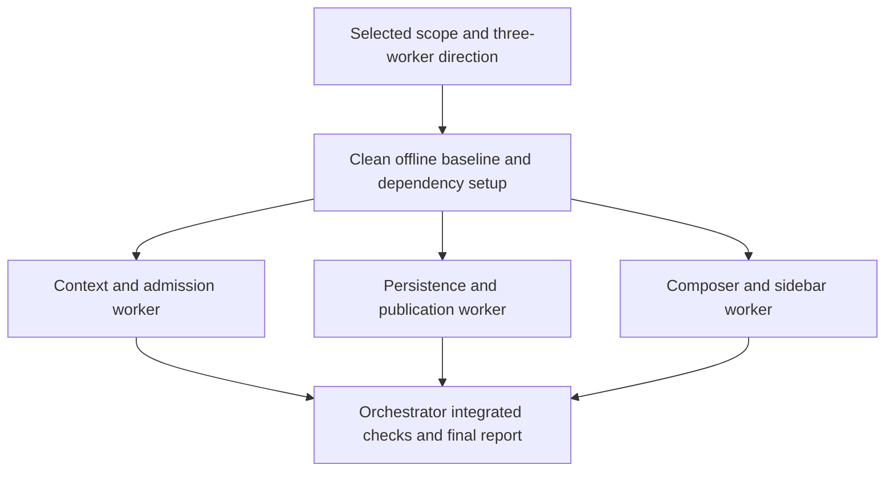

# State: faster follow-up chat

## User direction and workspace

- 2026-11-02: user selected **Focused simplification (Recommended)**, no additional note, authorizing the selected scope in an isolated worktree while preserving current durability and concurrent edits.
- Latest direction: **"No, I don't want three planning sessions. Just want three workers that can work on the tasks."** This supersedes the proposed separate planner/researcher structure and further approval-session gate. Dispatch exactly three task workers. Each does focused research and a short plan within its task, then implements and tests. No separate planner, researcher, reviewer or verification agent.
- Planning/research are incorporated into the workers, not skipped. Unified review remains **skipped**, not passed. Final verification and defect correction remain required.
- Session worktree: `C:/Users/Peter/.local/share/opencode/worktree/f7bfd97fde2a32e37bf6da2e73c2303830a2f5ee/chat-followup-latency`, branch `codex/chat-followup-latency`, base `927ab45871d1206e1ac56978c13083fc924ae671`.
- Only this session's investigation document was carried from main. Original checkout edits, credentials and application environment files stayed behind. Preserve all intervening work.
- Orchestrator manages ownership, status, integrated checks and serialized named-file commits; it does not implement application code or ingest `research.md`/`plan*.md`. Exactly three child worker sessions maximum, plus orchestrator. Workers do not stage/commit concurrently; main serializes commits from their reports.
- No real database/provider connection, paid check, application restart, default saver-facade activation, mutation, migration or deployment is authorized.

## Milestones

- [x] Investigate and record source findings and historical offline measurements.
- [x] Approve focused direction and isolated worktree; prepare goal and initial state (`4d7ae7d`).
- [x] Reconcile staffing to the user's three-worker instruction; no separate planning sessions.
- [x] Capture clean-branch offline baseline before worker source changes: 123 passed / 15 existing acceptance-target failures, 9 files; no context-limit fixture failures on this branch.
- [x] W1 own research/brief plan, context/admission implementation and focused tests; final integrated verification pending.
- [x] W2 own research/brief plan, persistence/finalization implementation and focused tests; final integrated verification pending.
- [x] W3 own research/brief plan, composer/sidebar implementation and tests; final integrated verification pending.
- [x] Unified review **skipped**, not passed.
- [x] Integrate, correct defects through existing worker owners, run final checks and report actual performance results/blocks. Offline evidence is complete; performance acceptance remains open, not passed.

## Three-worker ownership

| Worker | Task and write ownership | Dependencies / integration contract | State | Commits |
| --- | --- | --- | --- | --- |
| W1 | Context/admission healthy path: `backend/src/chat-runtime/durable-chat-runtime.ts`, `admission-receipt.ts`, relevant backend context contracts/assembler only if needed; new focused admission/context/runtime performance tests; `plan1.md`, `worker1-results.md` | Matched manifest receipt plus explicit non-live combined-finish commitment supplied; strict fallback retained. Existing manifest test now uses real persisted mutation. | Complete; independently verified in final combined checks: `ses_e64c4675dffec5WQtUVSruwwuq` | Plan `e887f4e`; implementation `8ba5db5`; correction `aa1eac6` |
| W2 | Persistence/publication: `backend/src/chat-runtime/finalization.ts`, relevant `backend/src/persistence/{ownership,memory,checkpoints,metadata,store}.ts` and `backend/src/model/` only for demonstrated duplication; matching persistence/finalization/model performance tests; `plan2.md`, `worker2-results.md` | Optional manifest receipt and explicit `activityUpdatedByFinish?: true`; strict fallback without commitment. | Complete handoff; 30 focused passes: `ses_e64c4674affeJOTvcNzi52PCnR` | Plan `e887f4e`; implementation `e28399b` |
| W3 | Drafting/sidebar: `frontend/src/components/Composer.tsx`, `frontend/src/features/chat/state/`, related existing API-client functions only if required for cancellation; matching frontend tests; `plan3.md`, `worker3-results.md` | Existing protocol; known-session refresh deferred until 250 ms idle, authoritative updates preserve paging. | Complete; main build/lint/536 tests pass: `ses_e64c46744ffe9ieD52qspdF9sm` | Plan `e887f4e`; implementation `2486483`; test correction `a802e4a` |

Shared-file changes go through the named owner; no concurrent cross-ownership edits. W1 obtains actual store-bound manifest evidence; W2 validates/uses it and retains strict recovery/fallback behavior when omitted. The explicitly approved additional integration is `activityUpdatedByFinish?: true`: W1 sets it only for non-live text with finishAttempt, confirmed attempt receipt, compareAttemptConfirmed and terminal-receipt callback. W2 requires both that commitment and capabilities before dropping early activity publication; callback presence alone is not commitment. Voice/recovery/omitted flag keep activity ownership. Any further contract change is reported before edits and routed to the owner.

## Worker exit gates

- All workers load systematic-debugging/TDD as applicable, trace shared callers and write their own concise `planN.md` before code. No handoff to a planner and no wait for a separate planning session. Use existing helpers/dependencies; minimum working diff. Preserve code-header requirements.
- W1: valid proven same-process attachment avoids redundant full archive/attempt reconstruction and repeat assembly. Missing/expired/stale/wrong-scope evidence, retention/revocation, voice delivery, response mode, settings, time projections, rebase and recovery remain safe. Never trust synthetic checkpoint IDs/unmaintained epochs or skip guards without equivalent evidence. Keep strict fallback if proof cannot be established.
- W2: each removed durable operation/guard has a focused failing check before the fix; keep majority acknowledgments, uncertain-write confirmation, finite storage-only phases, generation identity before output, dispatch accounting before provider, durable terminal publication and recovery without inference replay. Avoid client/model/network callbacks inside ownership phases. Native-gated facade remains inactive.
- W3: textarea remains editable through generating/finalizing; Send stays serialized, voice input exclusive, drafts survive old-turn terminal/error/cancel/cleanup and navigation. Do not invent authoritative sidebar timestamps/titles; defer/reconcile safely where local evidence is insufficient. Preserve pinning, paging, retry, new-chat and cancellation semantics.
- Each reports owned files, exact red/green tests, other checks, measured operation changes, unresolved failures/blocks and minimal integration needs. No secret/config reads, paid/native checks, app startup, source edits outside ownership or Git staging/commits.

## Coverage and final verification

| Goal acceptance | Owner / verification |
| --- | --- |
| AC1 interaction/sidebar | W3 focused tests; main frontend checks |
| AC2 context/evidence/privacy/time | W1; W1/W2 receipt integration; shared runtime/context suites |
| AC3 durable ordering/recovery | W1/W2 fault/concurrency tests; main integrated suites |
| AC4 less storage work | Clean branch baseline versus final complete counts/dependencies; frozen gates unchanged |
| AC5 compatibility | Main backend/frontend builds/lints/tests; failures routed to same owners |
| AC6 latency honesty | Main report separates emulated counts from actual p50/p95; native/provider/browser targets explicitly unverified until measured |
| AC7 safety/reporting | All: scope, named commits, no unauthorized external execution, final evidence |

- Backend commands: `npm run build`, `npm run lint`, `npm test`, `npm run test:e2e` after prerequisite/side-effect assessment. Clear test DB settings for fixture-only runs and never substitute application storage. Native skips/failures reported separately.
- Frontend commands: `npm run build`, `npm run lint`, `npm test`. Node tests are not browser paint evidence.
- Run matching whole-runtime performance comparisons, with actual provider-end boundaries kept distinct from the old fixture fetch-response marker. Do not rebase/relax frozen acceptance caps or hide waiting work outside measurement.
- Original-checkout investigation: 117 pass/21 fail; focused 14 pass/55 filtered. Those are historical dirty-main evidence, not the worktree baseline. Absolute sub-100 ms native/browser/provider claims remain unverified.
- Clean-branch baseline: `npm test -- test/performance --maxWorkers=1 --silent=false --disableConsoleIntercept --reporter=verbose`, disabled native flag and empty test URI/prefix, no application dotenv present. 123 pass / 15 acceptance-target fail, exit 1, 9 files. New text: 129R/45W, 75 pre/84 first-answer/44 post-seal waves. Follow-up 1 and 20: 128R/41W, 69/78/44 waves. Source unchanged from `927ab45`; docs at `4d7ae7d`. Raw log: `C:/Users/Peter/AppData/Local/Temp/opencode/followup-clean-branch-baseline-20261102.log`.
- Independent full-unit baseline: tracked commit `927ab45871d1206e1ac56978c13083fc924ae671` exported with `git archive` to fresh `C:/Users/Peter/AppData/Local/Temp/opencode/followup-latency-baseline-927ab45`, no application environment copied, matched dependency junction. Build passed; serialized full-unit 2347 passed / 15 existing acceptance failures / 10 skipped, exit 1.
- Main frontend verification at `a802e4a`: build/lint pass, unit536 passed across73 files; source stable across171 files. Intermediate backend: build/lint pass, unit2376 pass/16 fail/10 skip (one additional manifest-guard case), e2e22 pass/135 skip. Intermediate performance showed new-text/Calendar preflight regression; W1 correction required before final verification. Details: [verification.md](verification.md).
- Final corrected source `aa1eac647f6b68b74266f59e7f1e44f4d0152b1e`: main backend build/lint pass; full-unit2379 pass/15 unchanged target fail/10 skip; e2e22 pass/135 skip; separate performance134 pass/15 unchanged target fail. Backend source/test hashes stable across598 files. No additional correctness failure remains in executed checks; the suite is not green because targets still fail. Follow-up169→151 commands,69→68 pre-dispatch waves,44→30 post-seal waves. All15 scenario histograms/profiles/full-unit metrics reconcile with no clean-baseline count/wave regression. Frozen goal passes:3/15 commands,0/13 pre,12/12 post. Real sub-100 ms remains unverified.
- Backend dependencies may be reused via a local junction only when package lockfiles match; no worker may install/remove shared dependencies. Frontend lock differed from the active original checkout, so main prepares a private worktree installation from this branch's existing lockfile. No dependency manifest changes or application environment copying.

## Artifacts and current gate

- [Goal](goal.md): selected scope plus latest worker instruction.
- [Investigation](../latency-reduction/follow-up-investigation.md): findings, limitations and original evidence.
- `plan1.md`–`plan3.md`: worker-owned brief plans, not separate planning sessions. Main verifies their committed existence without ingesting them.
- `worker1-results.md`–`worker3-results.md`: actual implementation/testing handoffs.
- [verification.md](verification.md): completed baseline, intermediate and corrected-source checks, full scenario comparison and limitations.
- [final_report.md](final_report.md): completed offline implementation/evidence report; explicitly does not claim performance acceptance, native latency or deployment readiness.

## User-authorized drastic simplification increment

- After the first offline report, the user explicitly requested one sub-agent to drastically simplify the remaining admission path and retain only necessary operations. This authorizes another implementation increment, not native/provider calls or weaker safety guarantees.
- Starting commit: `0ef86e943a113f1a1ec80c2e3f719d148e25e8ea`. Verified starting workload: follow-up151 commands,68 pre-dispatch waves,30 post-seal waves. The prior report and verification remain historical evidence, not results for this new increment.
- One implementation worker: `ses_e648d6bd3ffeYE3US3FvAF9mFr`. Sole ownership of relevant backend runtime/HTTP/persistence/graph internal protocol and associated tests. No additional planning/research/review agents. Internal research/planning stays within that same worker.
- Target: drastically fewer healthy-path dependencies through a coherent simpler admission protocol, not cosmetic rearrangement. Halving pre-dispatch waves is a stretch target, never justification for dropped durability, privacy, identity, idempotency, recovery or resource invariants. Frozen harness/caps remain unchanged.
- Worker writes `drastic-simplification-notes.md` and `drastic-simplification-results.md`; main owns this state, serialized commits and independent final verification. No frontend scope change, dependency install, external connection, restart or deployment authorized.

### Initial increment handoff and verification

- Worker reports follow-up151→128 emulated commands and68→47 pre-dispatch waves; seven text/retry combined frozen targets now pass. Reported build/lint pass, full-unit2392 pass/8 target fail/10 skip, e2e22 pass/135 skip. These are worker results pending main verification, not native milliseconds. New-text post-seal increases30→31 waves and must remain visible.
- Main started independent build/lint/full-unit/e2e/performance checks with source/test hash bracketing. Source is not yet committed.
- Same worker restored the necessary compatibility boundary: valid public hot receipts use local checks; internal/live receipts are refused; cold/missing receipts return null so HTTP checks session existence/active lifecycle before status. Main focused visibility/admission checks:15 passed across2 files. No additional worker or review session was created.
- Increment implementation committed as `301c33b`. Main's earlier full check may overlap the visibility correction and must not certify this final source unless hashes agree; run stable final checks before closeout.

### Final increment verification

- Stable implementation `301c33b` independently verified: build/lint pass; backend2398 pass/8 remaining frozen target fail/10 skip; e2e22 pass/135 skip; separate performance149 pass/8 target fail. Source/test hashes match across599 files. No additional correctness failure remains in executed checks, but the full suite is not green.
- Follow-up151→128 commands,68→47 pre-dispatch,77→56 first-text waves,30 post-seal unchanged. Relative to original clean baseline169/69/78/44, all follow-up measures improve. New-text post-seal30→31 is explicitly retained as a trade-off.
- Seven text/retry combined targets now pass. Frozen goal passes:7/15 command,8/13 pre,12/12 post. The stretch target to halve68 was not met;47 is not claimed irreducible. Native/browser/provider millisecond targets remain unverified.
- Latest evidence is at the top of [final_report.md](final_report.md) and [verification.md](verification.md); earlier sections remain historical. Review skipped, never passed.

**CURRENT GATE: single-agent increment implemented and offline-verified; remaining performance acceptance open.** No background task remains. Further simplification or representative native/browser/provider measurements require explicit scope/authorization. Do not infer permission to merge into active main, enable the saver facade, restart, deploy or access application data. Real sub-100 ms remains unverified.
