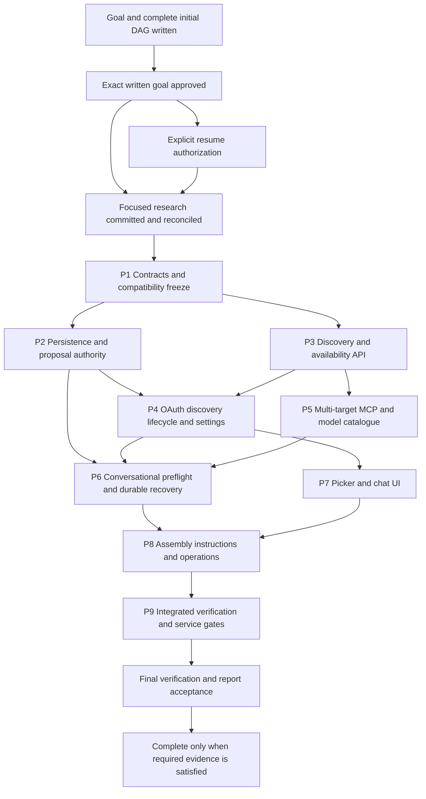

# State and dependency graph: Google Calendar Phase 2

## Workflow configuration and authorization

- Keep all phase artifacts directly in `docs/google-calendar-multi-calendar/`; do not overwrite [Phase 1 records](../google-calendar-plugin/state.md) or the [source roadmap](../google-calendar-plugin/future-phase-multi-calendar.md). Reuse existing source directories and packages.
- Original checkpoint request: MAW, `--skip review`, stop before research after constructing the DAG. G/H were subsequently approved, R completed, and P1–P7 plans/workers are complete. The 23 October 2026 hold before P6/P7 was lifted on 24 October when the user selected this objective in response to the resume prompt. P8 and P9 plans are committed. P4/P6/P2 persistence corrections pass focused checks; P8 tests and serial package checks pass, but account-revision invalidation remains blocked on a P6 atomic quiesce interface and P8 wiring. P9 implementation waits for this safety gate. Review remains skipped.
- The user approved the design in this conversation on 22 October 2026. On 22 October 2026 the user also approved the **exact written goal** (`goal.md`, commit `a31e548`) and **explicitly authorized continuation beyond the requested pre-research stop**. Both gates G and H are recorded. Written-goal approval and explicit authorization to leave this stop were separate prerequisites; neither the roadmap nor Phase 1 approvals substituted for either gate.
- Unified review is **skipped**, never passed. Do not dispatch a reviewer or review-triggered fixer. Required planning, execution, compatibility, defect correction, and final verification remain mandatory after resume.
- Current branch: `codex/google-calendar-plugin`, source baseline at P8 test commit `d905dc6`. Continue on this branch; no new worktree is needed. Preserve intervening user work, `.openchamber/`, `.env` files, dependencies, generated output, and the Phase 1 live-gate records. Stage named task files only.
- Orchestrator owns only goal/state/DAG/dispatch and documentation/evidence coordination, not implementation. Never ingest `research.md` or `plan*.md`; assigned agents read their own artifacts and return concise interface/compatibility summaries, test evidence and commit hashes. Verify reported commits with `git log -1 --stat <hash>`.
- Delegation preflight for remaining workers is **resolved**. Research and planning will not be rerun. The user did not specify a model or effort; the next worker inherits the current session default rather than a prior worker's unrecorded model. No new researcher or planner is dispatched.
- Capacity: at most three child agents plus the orchestrator. Ready independent planners run in a **foreground parallel cohort**. Workers may pipeline alongside later planners when dependencies and disjoint ownership permit. A plan commit is not a completed worker dependency.
- Serialize all shared-index staging/commits, including disjoint work. One explicit commit owner at a time; other agents leave the index untouched. Planners may hand off a completed document for serialized commit if several finish together. Source owners retain their focused tests; integrated verifier owns only reserved new integration files.
- No live OAuth/Google/model action, Google Cloud configuration change, package installation, database action, application-data migration, provisioning, paid check, or deployment is authorized by this checkpoint. Future research is read-only compatibility/policy investigation within the goal's limits.

## Workflow milestones

- [x] Step 1a: Explore project context, source roadmap, current source boundaries and recent commits.
- [x] Step 1b: Resolve requirements and compare approaches; design approved on 22 October 2026.
- [x] Step 1c: Write goal and fully construct the initial DAG, ownership, readiness, exit gates, acceptance mapping and resume procedure.
- [x] Step 1d: User approves the exact written `goal.md` (**G**, 22 October 2026, commit `a31e548`).
- [x] Step 1e: User explicitly authorizes continuation beyond the requested pre-research stop (**H**, 22 October 2026).
- [x] Step 2: Technical research committed and handoff reconciled (`research.md`, `5f9c6c5`; reconciled into goal/state 22 October 2026).
- [x] Step 3: All nine implementation plans written and committed (`plan1.md`–`plan9.md`).
- [x] Step 4: All nine workers implemented, tested and committed; remaining gaps are named operator/service gates, not missing plans.
- [x] Step 5: Unified code review **skipped via --skip review**, not passed.
- [ ] Step 6: `final_report.md` written for the verified subset; whole-workflow completion remains blocked on named gates. Orchestrator V has not accepted full completion.

## Brainstorming task record

- [x] Explore project context: roadmap, parent goal/state, source seams, manifests, Git status/history.
- [x] Clarify requirements one at a time: full multi-calendar access; target precedence; conflict/incomplete-coverage behavior.
- [x] Compare bounded cached extension, live discovery per request, and a separate connector/router; select existing-plugin extension.
- [x] Present architecture, data flow, boundaries, and safety behavior; obtain design approval.
- [x] Write the validated design to `goal.md`; commit recorded in the artifact table.
- [x] Self-check written specification and DAG for ambiguity, contradictions, missing coverage, ownership overlap and cycles; evidence recorded below.
- [x] User reviews and approves the written specification; **do not infer approval from design approval**. **G recorded 22 October 2026.**

## Initial findings

- The Phase 1 plugin is already implemented, with real embedded MCP client/server, an encrypted connection record, durable operation ledger, model repair/accounting, a local connection panel, and receipt/progress UI. Its state records a pending live-service gate. Historical verification is not Phase 2 certification.
- Actual source uses `connection.ts`, `tools.ts`, `tools-validation.ts`, `calendar-api*.ts`, and `plugins/mcp/calendar-{client,server}.ts`; the roadmap's `mcp-adapter.ts` and `runtime-gate.ts` do not exist. Reuse the real seams.
- `calendar-policy.ts` has `google-calendar.v1` and owned-event scopes. `calendar-tools.ts` allows exactly three tools, forbids `calendarId`, and `model/calendar-policy.ts` checks the old revision. Version/schema/permission changes must reach all layers.
- The current connection binding equates the configured default with every operation's target; `connection.ts` rechecks the environment pin, and persistence invalidates the connection when that target changes. Separate preferences from immutable operation authority without weakening disable/revoke/account fencing.
- `authorizeCreate` currently requires an exact canonical JSON sentence. Ordinary scheduling and natural-language clarification need a durable authorization path, not only prompt edits or removal of the check.
- Existing event-list projection omits all-day entries, so it cannot prove free/busy across calendars. Availability needs its own bounded provider primitive and honest per-calendar coverage.
- The frontend disables Connect when `targetCalendarId` is absent. Removing target setup must cover config parsing, public wire status, API client/state, panel, assembly and operator runbooks together.
- There are separate backend/frontend packages and no root npm workspace. Preserve existing Vitest and native fixture conventions; package checks must not race builds against bootstrap tests.

## Confirmed decisions and roadmap reconciliation

- Full accessible-calendar discovery/availability and owned/shared writable event creation, subject to verified actual scopes and permissions.
- Explicit named target → saved default override → primary. Mere multiplicity does not trigger a question. Unknown/ambiguous/unauthorized explicit targets and invalid saved defaults never silently fall back.
- Conflict or incomplete availability → ask; create only after durable event-specific acceptance or a changed time. Recheck before first dispatch, with no atomic reservation guarantee.
- One connected Google account for the existing local operator; no member identity/RBAC/public-hosting expansion.
- Extend the embedded MCP plugin, current persistence and UI. No new service, collection, connector, external dependency or fuzzy-search infrastructure is presumed necessary.
- New connections default automatically to canonical primary. Versioned migration retains an existing Phase 1 target as an explicit saved override until the operator clears it. Legacy environment pin is deprecated, not a new targeting authority.
- The goal resolves the roadmap's contradictory “always clarify with multiple calendars” instruction in favor of the user-approved precedence rule. Read versus write permissions are distinct. All three event tools, including `get_event`, participate in multi-target binding.
- Calendar names, discovery entries, availability and badge metadata remain untrusted/minimized/expiry-controlled. Discovery caching does not constitute permanent permission.
- No live-service proof, Google scope classification, or Workspace/public-verification exemption is asserted before later research/verification.

## Dependency matrix and execution status

`G` means approval of the exact written goal. `H` means explicit authorization to leave this requested stop. `R` means research committed **and its handoff reconciled**. In worker prerequisites, `P#` always means that worker's implementation is verified and committed, never just its plan. Prerequisites below are direct edges; transitive requirements remain mandatory. A planner also requires its separate planning prerequisites and a free child slot.

| ID | Title and scope | Worker prerequisites | Planner status | Worker status | Commits |
| --- | --- | --- | --- | --- | --- |
| R | Focused Google/API/scope/cache/protocol compatibility and policy delta | G, H | Research task; no plan | Complete `5f9c6c5`; handoff reconciled 22 Oct 2026 | `5f9c6c5` |
| P1 | Versioned contracts, capabilities, authority, limits and compatibility freeze | R | `[x] 99e5dfd` | `[x] Contract implementation complete; focused exit gates pass. Earlier downstream package failures were superseded by later serial backend checks; native/service gates remain open. | `99e5dfd` (plan) + `52e32f6` `3435a56` `45feda2` `d51663a` `47b96a3` `a69108e` `d5ca527` `e6f021c` `4b4f5eb` `5bd1d33` + A1 `e160c0c` |
| P2 | Connection/cache/default/proposal and operation storage evolution | P1 | `[x] 91a3ed3` | `[x] Persistence invalidation/index/stale-write follow-up committed; focused P2 suites pass. P8 must drain finalization and wire all pages; native index explain is unrun. | `91a3ed3` + `46de1a7`…`098d6f2` + `48a4b4f` `65b4dbc` |
| P3 | Bounded provider discovery and cross-calendar availability primitives | P1 | `[x] b71d097` | `[x] Implementation committed; focused checks 3 files / 44 tests pass; build/lint pass after TS null-narrowing fix; no increase in full-suite failures` | `b71d097` + `656fa76` |
| P4 | OAuth re-consent, discovery lifecycle, capabilities and settings API | P2, P3 | `[x] e59842c` | `[x] Follow-up fixed: bounded GET /calendars is admitted; focused route tests pass 3 files / 8 tests and P8 assembled checks later pass. | `e59842c` + `6218f50`…`cf58010` + `5202f8b` |
| P5 | Multi-target event adapter, real MCP catalogue and model schema compatibility | P3 | `[x] ad5674e` | `[x] Implementation committed; all 10 tasks complete; focused suites pass (21 plugin files / 230 tests, 8 model files / 151 tests, 6 MCP files / 50 tests); build/lint green` | `ad5674e` + `1425495` `7cbdd06` `27a357d` `52a50cc` `3ba1662` `d5be56c` `e5bef61` `ca827ee` `df83b28` `7905676` `9ae85f0` |
| P6 | Conversational targeting, durable approvals/preflight and pinned recovery | P2, P4, P5 | `[x] 1a697b7` | `[x]` A3 committed; P9 authority HTTP defects fixed (`1818749`). Native cases remain unexecuted. | Plan + implementation/amendment commits in P6 evidence below + A3 `4fe9045` + `1818749` |
| P7 | Calendar picker/client/state and truthful chat target experience | P4 | `[x] 1a697b7` | `[x]` Node checks pass; browser fixture owner-reported 8/8 after `eb1203c`. Accessibility unrun. | `1a697b7` (plan) + `58b6b17`…`de9e2b3` + `eb1203c` |
| P8 | Shared assembly/config, instructions, transport, operations and rollout | P6, P7 | `[x] aa47ac3` | `[x]` A3 reservation + paged invalidation wired; focused P8 and default `npm test` pass. e2e not rerun this follow-up. | `aa47ac3` (plan) + `2934284`…`d905dc6` + A3 `340bb28` |
| P9 | Integrated acceptance/native/browser/service gates and evidence | P8 | `[x] fab4680` | `[~]` Deterministic subset recorded (`801c911`). AC07 GREEN; browser 8/8 P9-observed. Native/live/policy pending. | `fab4680` (plan) + `cb9a33b`…`5f791dc` + `801c911` |
| V | Orchestrator final commit-set/evidence/report acceptance | P9 | No extra plan | `[~]` Subset verified 26 Oct 2026; full completion blocked on named gates | - |

### Worker execution graph

No review node is present because review is explicitly skipped. Research is a real future node, not executed or bypassed by local context exploration. A failed required check returns to its source owner and invalidates affected downstream readiness; no review-triggered fixer is introduced.

### Planner readiness and immediate worker dispatch

| Planner | Earliest planning prerequisites after G and H | Worker start condition |
| --- | --- | --- |
| P1 | R handoff committed and reconciled | P1 plan committed; R complete |
| P2 | P1 worker committed | P2 plan committed; P1 complete |
| P3 | P1 worker committed | P3 plan committed; P1 complete |
| P4 | P1 worker committed; P2 and P3 plans committed | P4 plan committed; P2 and P3 workers complete |
| P5 | P1 worker committed; P3 plan committed | P5 plan committed; P3 worker complete |
| P6 | P2 worker committed; P4 and P5 plans committed | P6 plan committed; P2/P4/P5 workers complete |
| P7 | P1 worker committed; P4 plan committed | P7 plan committed; P4 worker complete |
| P8 | P4/P5 workers complete; P6 and P7 plans committed | P8 plan committed; P6/P7 workers complete |
| P9 | P8 plan committed; P6/P7 workers complete | P9 plan committed; P8 worker complete |

After P1, dispatch P2/P3 planners together in a foreground parallel cohort. Dispatch each eligible worker when its own plan is committed and prerequisites are complete, without waiting for unrelated plans. At a foreground cohort boundary, process completed handoffs immediately; do not hold a ready worker for a later planning wave. As slots open, P4/P5 planning can overlap P2/P3 execution, then P6/P7 planning and ready P4/P5/P7 workers can pipeline under the table above. P4 and P5 have disjoint source ownership; P6 and P7 can execute together after their respective prerequisites.

Every planner owns only its `planN.md`, loads writing-plans, reads its assigned goal/research/upstream artifacts, and supplies exact test/code/command/path steps plus a concise interface handoff. Workers load executing-plans and TDD, write and demonstrate failing meaningful tests before implementation, and retain the existing Vitest/fixtures/header/module conventions. Do not insert documentation banner headers into plan Markdown; code file headers follow repository rules. No upstream schema/ownership amendment is implicit in a plan.

### Contract changes and block propagation

P1 remains sole owner of shared schemas/manifests through execution. If R or any downstream task contradicts the approved goal, exceeds a proposed ceiling, changes consent/operation authority, or needs another owner's files, pause affected consumers and report the change. Reconcile goal/state and material product decisions before a serialized owner amendment. Revalidate affected plans and checks before unblocking. A missing live prerequisite blocks that evidence branch, not permission to claim a fixture is live or mark the entire workflow complete.

### Ownership amendment A1 — P1 union consumers (23 October 2026)

**Cause.** P1's contract work legitimately extended the success-result union with `calendar_list_calendars` and `calendar_check_availability` results, and advanced the frozen tool revision from `google-calendar.v1` to `google-calendar.v2`. Three P5-owned files contain exhaustive narrowing written against the old three-member union, so `backend npm run build` fails with four TypeScript errors before P2/P3 can verify anything:

| File | Line | Error |
| --- | --- | --- |
| `backend/src/model/calendar-policy.ts` | 42 | `TS2367` — comparison against the superseded `'google-calendar.v1'` literal no longer overlaps |
| `backend/src/plugins/google-calendar/tools-validation.ts` | 228 | `TS2345` — `else` branch treats a five-member call union as create-only |
| `backend/src/plugins/google-calendar/tools.ts` | 219 | `TS2339` — `result.event` read on a non-get result |
| `backend/src/plugins/google-calendar/tools.ts` | 244 | `TS2339` — same narrowing gap in receipt construction |

**Amendment.** A minimal fixer is authorized to make **type-narrowing-only** edits in those three files so they compile against the extended union — compare against the current frozen revision constant rather than a hardcoded `v1` literal, and narrow explicitly to `calendar_get_event`/`calendar_list_events` before reading `event`/`events`. **No behavior change, no new tool wiring, no new receipt fields, no relaxed validation.** Any edit beyond the narrowing required by the extended union is out of scope and must be reported instead.

**Ownership.** P5 retains ownership of these files from its own plan onward and must re-verify their behavior when it implements the new tools; A1 is a one-time compile-compatibility amendment, not a transfer. P5's plan must therefore treat these three files as already migrated to the v2 union and must not revert the narrowing.

**Gate.** `backend npm run build` returns to exit 0, the existing P1 contract suite and the existing calendar suites stay green, and no test is weakened, skipped or deleted to achieve it.

### Ownership amendment A2 — P8 assembled HTTP test harness (25 October 2026)

**Cause.** P8 verification found the existing `backend/test/plugins/integration/assembled-http.spec.ts` receives 403 because Node `fetch` rewrites the attempted `Host` header to the ephemeral request URL port, which the production Host boundary correctly rejects.

**Amendment.** P8 may make a test-harness-only change to `backend/test/plugins/integration/assembled-http.spec.ts` so the request preserves the intended allowed loopback Host. Do not weaken or change production Host validation, and do not edit P9-reserved `backend/test/plugins/integration/multi-calendar/**` files.

**Gate.** The assembled stream request passes with the intended Host value; the production Host boundary and its denial cases remain unchanged and tested.

### Ownership amendment A3 — P6 atomic stream quiescence and P8 invalidation wiring (25 October 2026)

**Cause.** P8 found that the current runtime drain registers P5 `Work` only after `ChatStreamTransport.open()` has awaited status work. A pre-existing open stream can therefore remain outside the drain. On timeout, the current drain returns `drained: false` after abort without itself awaiting finalization/message persistence. Since generic `MongoMessages.append` is not account-revision guarded, a late append could land after P2's message invalidation cursor passes.

**Amendment.** P6 may add a runtime-owned atomic quiescence/reservation API and matching P6 tests under `backend/src/chat-runtime/**` and its assigned runtime tests. P8 owns `backend/src/http/chat-stream-transport.ts`, its HTTP tests, and the `AppService` invalidation callback. P8 must reserve/fence each relevant stream before its first asynchronous status work, hold it through `open()`/`executeTurn()` finalization and pending message persistence, and use the P6 quiescence barrier across every P2 invalidation page. P6 must not edit P8 HTTP files; P8 must not edit P6 runtime files. No P9-reserved integration paths are added to either owner.

**Safety gate.** Quiescence atomically rejects new relevant attachments, aborts existing work, and waits for each full promise through final message persistence. P8 keeps the fence closed while invalidation pages run, propagates failures, and does not reopen on a failed scan; retry restarts at `cursor: null`. P8 may claim invalidation complete only after this contract is tested end-to-end. No transaction or new collection is assumed.

## Plan scopes, file ownership, and completion gates

Paths below reserve planned write ownership; they are not claims that all proposed files already exist. Existing source/tests are reused where suitable. No implementation file is created at this checkpoint. P# planners own only their one `planN.md`; the following boundaries govern their future workers.

### R — Focused compatibility and policy delta

**Deliverable:** `docs/google-calendar-multi-calendar/research.md`, committed source-backed recommendations and a concise reported handoff. No application source ownership.

Research current primary documentation for calendar-list completeness/pagination/roles/primary, shared read/write/free-busy scopes and incremental consent, partial grants, busy-event semantics, provider batching/error/interval bounds, quota/cache/retention and external-processing rules, current official MCP schema/annotation behavior on the installed pinned SDK, and the existing operation/checkpoint/version migration constraints. Inspect existing code and prior research without assuming the parent live gate passed. Verify sensitivity/verification statements rather than repeating the roadmap. Prefer existing native fetch/SDK and no new dependencies. Classify documentation support, isolated compatibility evidence, and still-unrun service gates separately. No live account/API/model calls, consent edits, repo dependency changes or credential access.

**Exit gate:** committed recommendation with exact viable scopes/API/protocol/version candidates; capability matrix; cache and free/busy semantics/limits; migration and consent implications; fixtures/live prerequisites; contradictions explicitly reported and goal/state reconciled before planning. Orchestrator verifies the commit without reading the artifact.

### P1 — Contracts, authority, limits, and compatibility freeze

**Deliverable:** `plan1.md`; versioned contract implementation and upstream handoff.

**Owned files:** `backend/src/contracts/**`, matching `backend/test/contracts/**`; `backend/package.json`, `backend/package-lock.json`, `frontend/package.json`, `frontend/package-lock.json` only if research proves a change necessary. Do not change root `AGENTS.md` or another owner's runtime code to hide compile/test failures.

Define discovery entries/snapshots/completeness/pagination; effective read/write/availability capabilities; exact scopes and re-consent status; saved-default versus operation-target revisions; primary canonicalization; legacy/new connection, operation, source/receipt/wire versions; bounded pending proposal/selection/conflict-acceptance authority with cross-turn linkage; discovery/availability ports; five-tool catalogue; optional allowed target selectors; per-calendar availability coverage and fingerprints; request categories, budgets, expiry and migration/rollback compatibility. Old grants must parse without being certified for new scopes. Add explicit versioned contracts alongside necessary legacy decoders; do not change a global scope/revision constant in a way that makes stored v1 records unreadable before consumers migrate. Freeze result provenance for multi-calendar reads and target labels before consumers implement. No model field can manufacture approval or credentials.

**Research-mandated specifics for P1** (`5f9c6c5`, reconciled 22 October 2026 — these are requirements, not optional refinements):
- Add `calendar.freebusy` to the scope constant alongside `calendar.calendarlist.readonly` and `calendar.events`; `calendar.events.owned` must not be used for shared-calendar capability, and the broad `calendar` scope stays forbidden.
- Advance the tool revision to `google-calendar.v2`, the proof revision to `google-calendar.multi.v2` and the cursor version to 2, admitting legacy v1 records **read-only**; non-terminal v1 operations must be representable as terminal `failed`/`cancelled` while completed v1 receipts stay renderable.
- Remove `calendarId` from the forbidden-keys list while keeping `targetRevision`, `connectionId`, `attendees` and the credential/identity keys forbidden; extend the repair-diagnostics path enum with `calendarId`, `calendarIds` and the new tool input keys, or bounded argument repair fails validation.
- Extend the success-result union with the two new result schemas, because the pinned MCP SDK auto-validates `structuredContent` against the registered output schema.
- Admit `writerWithoutPrivateAccess` in the access-role schema, or normalize it at ingestion to `writer` plus an explicit `privateAccess: false` flag.
- Model `defaultSettingRevision` separately from `connectionRevision`, so a saved-default change does not fence in-flight operations, cursors or checkpoints.
- Encode the reconciled ceilings: ≤100 retained calendars, ≤20 per UI/tool page, ≤2 in-turn discovery page deliveries, ≤50 calendars per availability request, 2,000 busy intervals as an ingestion ceiling with the returned payload inside the 16 KiB result budget, 5-minute freshness, 10-minute proposal lifetime.
- Keep `primary` resolution based on the entry's own `primary: true` flag and treat a snapshot missing it as legitimately incomplete rather than as a parse failure.

**Exit gate:** strict schema/version/unknown-field/role/scope/byte/count/boundary tests; v1 fixtures decode accurately; operation/approval identity and revision invariants hold; package compatibility checked if changed. P2/P3 planners have executable ports, not unspecified dependency assumptions. Report cross-package intermediate failures truthfully and route consumer migrations to their owners.

### P2 — Persistence evolution and proposal authority

**Deliverable:** `plan2.md`; versioned storage/CAS and isolated migration fixtures.

**Owned files:** `backend/src/persistence/calendar-*.ts`, necessary `backend/src/persistence/persistence.ts`, `indexes.ts`, `index.ts`, and matching `backend/test/persistence/calendar-*`; any required migration fixture uses the `calendar-migration*` prefix. A standalone migration script requires a named ownership amendment before writing. Existing shared owner/store behavior is reused; unrelated persistence refactoring is excluded.

Store bounded discovery/default state in `integration_connections`; add bounded typed pending proposal/approval records in existing `metadata` through frozen ports. Separate default changes, discovery refresh, token rotation and connection replacement revisions. Ensure refresh/default CAS races and ambiguous acknowledgements cannot corrupt a newer account/snapshot/default. Persist proposal expiry, supersession, single consumption and causal intent-to-operation uniqueness across turns. Preserve pinned legacy/current operations and versioned receipts/results/accounting. Prove safe migration and rollback preconditions; do not run on application data. No new collection, broad TTL, unbounded arrays, transaction assumption or second owner.

**Exit gate:** memory-fixture and isolated-native checks for legacy decoding/migration, defaults surviving restart, cache bounds, concurrent refresh/settings/token updates, one proposal consumer/operation, stale/cross-session rejection, unknown effects/quarantine, expiry/tombstones and source retention; current accounting totals remain correct. Report native skips separately.

### P3 — Provider discovery and availability primitives

**Deliverable:** `plan3.md`; bounded Google REST primitives behind P1 ports.

**Owned files:** planned `backend/src/plugins/google-calendar/calendar-discovery-api.ts`, `calendar-availability-api.ts`, and focused companion files only if needed; existing `backend/src/plugins/google-calendar/calendar-api-http.ts`; corresponding `backend/test/plugins/google-calendar/calendar-discovery-api*`, `calendar-availability-api*`, `calendar-api-http*`. P5 owns existing `calendar-api.ts`/cursor and event handlers; P4 owns OAuth/connection lifecycle. Shared HTTP amendments return to P3.

Implement paginated list/canonical primary and fresh operation-specific capability metadata; bounded batched free/busy including per-calendar errors, query range/timezone validation, provider busy semantics and honest incomplete coverage. Reuse shared fetch/timeout/error/rate-limit/request-admission behavior, avoid raw event details for availability, validate provider metadata, and propagate applicable privacy/cache evidence. All HTTP deliveries/retries count; no credentials in results/logs and no standalone background sync. Consume trusted credentials through ports without owning their storage/lifecycle.

**Exit gate:** deterministic fixtures cover pagination loops/overflow/duplicates/partial failure, unknown roles, primary mapping, shared/reader/free-busy-only capabilities, busy semantics/timezone/DST/boundaries, batching/interval/byte limits, quota/timeout/cancel/malformed responses, exact request counting and no false all-clear. Existing HTTP/event tests remain green.

**Research-mandated specifics for P3** (`5f9c6c5`): a discovery snapshot is complete only when no `nextPageToken` remains — a short page with a token is a valid partial result and must not be recorded as complete; `primary` is at-most-one and may be absent from a truncated snapshot; request `maxResults=100` and never set `minAccessRole` to `writer`, which would hide reader and free-busy calendars. Availability must batch a ≤100-calendar scan into at most two `freebusy.query` requests of ≤50 calendars, must read per-calendar `calendars[id].errors[]` inside an HTTP 200 body as `error` coverage rather than free, and must classify `403` `rateLimitExceeded`/`userRateLimitExceeded` as retryable within the existing bounded delivery-retry budget while `400`, `401` (after one refresh), `403` `insufficientPermissions`, `403` `quotaExceeded` and `404` are terminal — with a per-calendar `404` leaving the connection connected. The `groups` expansion parameter is unusable. The returned payload must coalesce overlapping intervals within the 16 KiB result budget or report `truncated`.

### P4 — OAuth, discovery lifecycle, capability gate, and settings API

**Deliverable:** `plan4.md`; connection/discovery/default services and route handoff.

**Owned files:** `backend/src/plugins/google-calendar/connection.ts`, `oauth*.ts`, `options.ts`, `controller*.ts`, `module.ts`; a planned `discovery.ts` service only if separation is needed; matching `backend/test/plugins/google-calendar/connection*`, `oauth*`, `options*`, `setup*`, `discovery*`. P3 owns the `calendar-discovery-api*` prefix, not this service prefix. Central bootstrap/config/HTTP protections remain P8-owned.

Remove mandatory target setup from plugin options and Connect lifecycle; install/upgrade grants with canonical primary and discovered capabilities. Preserve valid same-account saved defaults through re-consent; reset preferences on account replacement without transferring old operation authority. Use P2 stores and P3 ports for bounded post-connect/expiry/manual refresh; preserve complete versus partial snapshots and refresh coalescing/CAS safety. Re-consent missing permissions safely without corrupting legacy credentials or pretending partial consent is full. Implement operation-specific authorization checks separate from defaults; current revocation/account replacement must still fence work. Extend GET calendars, POST refresh and PATCH settings selection/reset/enablement with expected-revision conflicts. Reject invalid defaults without silently selecting primary. Do not let stale async refresh resurrect a disconnected/replaced account.

**Exit gate:** no-target setup/connect fixtures pass; state/nonce/PKCE/replay/origin protections and encryption/rotation regressions pass; shared roles/scopes correctly gate operations; refresh/disconnect/replacement/settings races preserve revisions; old/partial grants require reconnect; pagination/stale/empty/default-loss/settings-conflict routes return bounded safe errors. Publish final service/API handoff for P7/P8.

**Research-mandated specifics for P4** (`5f9c6c5`): the re-consent URL must request incremental authorization with `include_granted_scopes=true` and `prompt=consent`, and the callback must **fail closed** — every required scope must appear in the returned `scope` value, and a partial grant stays reconnect-required with an explicit missing-scope diagnostic instead of being treated as full consent. An existing Phase 1 grant **cannot be widened by a token refresh**, so it must transition to reconnect-required with a scope-upgrade reason rather than being silently upgraded, and never corrupt history or crash startup. Verify the OAuth `sub` still matches the stored Google subject and keep the subject-changed guard. The saved-default write must use its own `defaultSettingRevision` and must not bump `connectionRevision`, which currently fences in-flight operations, cursors and checkpoints.

### P5 — Multi-target event execution, MCP, and model catalogue

**Deliverable:** `plan5.md`; the actual revised MCP/model catalogue and event execution.

**Owned files:** `backend/src/plugins/google-calendar/calendar-api.ts`, `calendar-api-cursor.ts`, `tools.ts`, `tools-validation.ts`; `backend/src/plugins/mcp/**`, `backend/src/plugins/registry.ts`; necessary catalogue/validation/revision compatibility edits in `backend/src/model/calendar-*.ts` and matching `backend/test/model/calendar-*`; corresponding `backend/test/plugins/mcp/**`, `registry*`, `backend/test/plugins/google-calendar/calendar-api.spec.ts`, `calendar-api-cursor*`, `tools*`. Exclude P3-owned HTTP/discovery/availability files and P4 lifecycle files. No unrelated provider redesign.

Wire list-calendars and check-availability through real MCP, version-pin exact schemas, and extend list/get/create target selectors. Consume P3 discovery/availability ports and P1 capability-gate ports with fixtures until P4 is ready. Replace the old blanket calendar-ID prohibition only at approved selector fields. Bind the server-resolved target/account/capabilities outside untrusted model authority. Cursor/event provenance and receipts must be target-bound; multi-calendar results must not be mislabelled as the default. Preserve stable create IDs, no-invitation defaults, readback linkage and all unsupported-feature denials. Update provider catalogue/revision validation and correction tests for the revised surface without resetting model budgets or weakening schema/policy separation. Server preflight/approval orchestration belongs to P6.

**Exit gate:** actual SDK client discovers and calls exactly the five frozen tools; model and MCP schemas/revisions match; forged IDs/credentials/approval flags, stale capability bindings, wrong-calendar cursors/event IDs and schema changes fail safely; owner/shared-writer versus reader/free-busy behavior is correct; repaired calls cannot bypass policy; create/readback and unchanged Phase 1 restrictions remain tested.

**Research-mandated specifics for P5** (`5f9c6c5`): the five-tool surface fits the installed `@modelcontextprotocol/server@2.3.1` `registerTool` contract with **no new dependency** — the wire pin stays `CALENDAR_MCP_WIRE = '2026-07-28'`. The SDK auto-validates `structuredContent` against the registered output schema, so the success-result union must carry the two new result schemas. `calendar_create_event` must stay non-retryable so a create can never be silently duplicated. `calendar.events` covers shared-calendar reads and writes for `owner`/`writer`/`writerWithoutPrivateAccess`; `reader` and `freeBusyReader` writes must fail with a bounded permission error, and `writerWithoutPrivateAccess` reads must be treated as private-masked.

### P6 — Conversational targeting, preflight, authorization, and recovery

**Deliverable:** `plan6.md`; durable natural-language action and clarification runtime.

**Owned files:** `backend/src/chat-runtime/calendar-*.ts`, necessary `backend/src/chat-runtime/durable-chat-runtime.ts` integration, `backend/src/agent/state.ts`, `turn-graph.ts`, `backend/src/context/calendar-context.ts`; matching `backend/test/runtime/calendar-*`, `backend/test/context/calendar-*` and focused graph tests. No direct storage/connection/model implementation changes outside ports; P8 owns fixed system instruction assets and central wiring.

Resolve explicit/saved/primary targets per action with current capabilities; bound name candidates and clarification without introducing an alias/search framework. Replace canonical-JSON-only authorization with accepted-intent/canonical-action evidence and durable pending proposal/reply handling. Bind any confirmation to its original intent/account/target/event and single operation across accepted turns. Enforce server preflight even for a direct model create; pause for conflict/incomplete coverage, validate actual user acceptance, recheck fresh evidence, and invalidate materially changed proposals. Keep ordinary explicit no-conflict scheduling free of redundant target/JSON confirmation. Fix every caller of the touched authority seam, not only the named chat path.

Separate account/grant authority from settings; before first dispatch revalidate unresolved targets/proposals, and after dispatch pin original target/event ID for retry/readback. Preserve uncertain outcome quarantine, cancellation/drain, persisted budgets/accounting/attribution, no paid/write replay, complete context groups and accepted input once, source-expiry semantics and tool-disabled live voice. Do not let conflict preflight restart an already-dispatched write.

**Exit gate:** scripted model/runtime fixtures prove primary/override/explicit precedence, fuzzy/duplicate/missing/unauthorized clarification, ordinary natural-language creation without JSON echo, valid follow-up choice, zero effect before required acceptance, unchanged versus changed conflict rechecks, stale/replayed/cross-session confirmations, competing submissions, account/default/rights changes and every dispatch/crash/readback window. Exact budgets survive retry/restart; completed operation remains visible if narration fails. Isolated-native recovery/authority checks execute only with prerequisites.

**Research-mandated specifics for P6** (`5f9c6c5`): the canonical-JSON `authorizeCreate` check in `chat-runtime/calendar-operation.ts` must be replaced by a durable proposal whose lifetime is ≤10 minutes, while the invariant that the authorization's canonical action hash matches the request hash stays enforced. The proposal must be bound to the originating accepted intent, account, connection, resolved target, canonical event and the discovery/availability revisions that produced the disclosed condition, and it must be single-consumption with expiry and tombstone semantics. A conflict fingerprint must cover the disclosed conflict **and** the coverage limitation, because transparent events and per-calendar `errors[]` are invisible to free/busy and therefore cannot be silently ignored in a recheck.

### P7 — Picker, client/state, and chat target UI

**Deliverable:** `plan7.md`; existing UI/client extension, not an unrelated redesign.

**Owned files:** `frontend/src/api/calendar-client.ts`, `calendar-protocol.ts` and their tests; `frontend/src/features/plugins/google-calendar/**`, necessary Calendar-specific integration in `frontend/src/features/chat/**` and its focused tests. Exclude all `integration-tests/**` reserved for P9. Do not alter unrelated chat minimap, voice, canvas or admin behavior.

Remove target-ID prerequisite from Connect. Add bounded calendar list/roles/freshness, optional default picker/reset, refresh, saving/CAS conflict feedback, no writable calendar and reconnect/partial/stale states. Keep existing enable/disable/disconnect behavior separate from preference saves. Show actual durable target badge on receipts and accurate clarification/conflict/unknown/narration-failed states; never infer target from the latest picker value. Reuse styling and accessible native controls with safe links/labels/focus/announcements and preserved drafts. Model approval is not generated in the browser; any UI-assisted reply uses the P1/P4/P6 trusted protocol.

**Exit gate:** Node Vitest protocol/client/reducer/render checks cover loading/paging/reset/save/refresh/failure/partial/permission changes and stale responses; browser fixtures demonstrate keyboard/screen-reader semantics, no-ID connect and durable target display despite default changes. No secrets/client identity overrides or false created receipt. Report browser fixture versus real service separately.

### P8 — Assembly, transport, configuration, instructions, and operations

**Deliverable:** `plan8.md`; shared wiring and `docs/google-calendar-multi-calendar/operations.md`.

**Owned files:** `backend/src/app.service.ts`, `app.module.ts`, `main.ts` and their central source specs; `backend/src/operations/**`, `backend/src/http/**`; `backend/src/platform/config/calendar-config.ts`, `bootstrap-config.ts`, `load-config.ts` and their `.spec.ts` files; `backend/src/instructions/system.md`, root `product_knowledge.md`, root `README.md`, and non-secret `backend/.env.example`; matching `backend/test/assembly/**`, `backend/test/http/**`, `backend/test/operations/**`. Goal/state remain orchestrator-owned. Parent Phase 1 evidence remains unchanged.

Wire P3/P4/P5/P6 through one existing composition/storage owner and expose new routes under the current local security boundary. Remove central mandatory environment pin and align ready/status/capability/config snapshot behavior without network/paid/write health probes. Fixed instructions express approved target precedence and conflict/coverage behavior, not the roadmap's contradictory always-ask rule; they do not grant tools to live voice. Document exact verified scopes, consent/reconnect/setup, actual configured origins/ports, migration/rollback, cache/privacy/retention, target-pinned reconciliation, limits, degradation/drain, and explicit live-action authorization. Updating a runbook never changes Google Cloud settings or application data.

**Exit gate:** assembled fixtures cover no-target boot/connect, ordinary scheduling → availability → real MCP → durable target receipt, shared permission denial, partial coverage/acceptance, persisted default reset, old-grant reconnect and migration readiness, local Host/Origin/CSRF, healthy ordinary chat during Calendar outage, safe drain/recovery and secret-free telemetry. Existing config/text/voice/canvas/release-asset checks pass.

### P9 — Integrated acceptance and evidence

**Deliverable:** `plan9.md`; integrated tests plus `verification.md`, `staging-evidence.md`, and `final_report.md` in this phase directory.

**Owned files:** new `backend/test/integration/plugins/multi-calendar/**`, `backend/test/plugins/integration/multi-calendar/**`, and `frontend/src/features/plugins/integration-tests/multi-calendar-*.test.ts`; the three evidence documents above. Existing source-owner fixtures and Phase 1 integration suites are read-only unless ownership is explicitly reassigned. An observed defect goes back to the owning worker, not a reviewer/fixer.

Execute AC01–AC14 against the assembled implementation, actual SDK transport, scripted model/Google fixtures, isolated native MongoDB, frontend Node tests and browser fixtures. Include cross-turn selection/approval, cross-tab races, default switch during dispatch/unknown outcome, shared roles/scopes, partial list/free-busy coverage, all-day/DST busy cases, malformed model repair and retention/accounting regressions. Record exact commits/environment and real skips. Run live actions only under separately supplied exact authorization; never treat a Phase 1 fixture, OAuth grant, or personal-calendar discovery as write permission.

**Exit gate:** required package/deterministic/MCP checks pass; required native/browser/service/policy checks have actual evidence or named pending gates; live owned/shared writable creation/readback and safe-retry proof stay within authorized targets/data/cost. A required unrun gate prevents whole-workflow completion. Review remains skipped. Orchestrator V verifies commit set, acceptance mapping, recorded outcomes and final report.

## Shared-file and handoff rules

| Surface | Sole writer / boundary |
| --- | --- |
| Goal/state/DAG/authorization and dispatch | Orchestrator; material scope changes need approval |
| Research and one plan artifact per P# | Assigned researcher or planner only; orchestrator verifies commit/stat, not content |
| Shared contracts, tool/wire versions, limits, dependency manifests/locks | P1 throughout; amendments serialize before consumer changes |
| Storage codecs/indexes/CAS/migration/proposal consumption | P2; runtime/connection consumers use ports |
| Discovery/free-busy REST and shared HTTP helper | P3; P5 returns HTTP changes here |
| OAuth/connection/discovery service/options/controller/module | P4; P8 owns central bootstrap config and HTTP boundary |
| Event REST/cursors/tool validation/MCP/registry/model catalogue | P5; P6 owns runtime intent/preflight/approval orchestration |
| Runtime/agent/context versus fixed instructions | P6 source; P8 fixed system/product assets |
| Frontend source/unit/browser fixture versus reserved integration files | P7 source; P9 only named new integrated files |
| AppService/shared transport/config/operations/runbooks | P8; upstream agents publish service/port summaries |
| Final actual verification/evidence documents | P9 writes; orchestrator validates and records final disposition |

No two workers receive write ownership of the same path. Prefix exclusions in scopes take precedence over broad directory globs. New helper files in another owner's directory require an explicit ownership amendment before writing. Agents may read upstream implementation but must not opportunistically edit it or parent historical evidence. Shared commits are serialized even when paths are disjoint.

## Acceptance coverage

| Goal criterion | Primary owners | Integrated verifier |
| --- | --- | --- |
| AC01 no-ID connect/local setup | P1, P4, P7, P8 | P9 |
| AC02 bounded truthful discovery | P1, P2, P3, P4 | P9 |
| AC03 scopes/roles/shared permissions | R, P1, P3, P4, P5 | P9 |
| AC04 precedence/default persistence | P1, P2, P4, P6, P7 | P9 |
| AC05 conversational names/intents/replies | P1, P2, P6, P7 | P9 |
| AC06 cross-calendar coverage/busy semantics | R, P1, P3, P5, P6 | P9 |
| AC07 mandatory preflight/approval/recheck | P1, P2, P3, P6 | P9 |
| AC08 real MCP/model/selector validation | P1, P4, P5 | P9 |
| AC09 pinned recovery/no duplicate creation | P1, P2, P4, P5, P6 | P9 |
| AC10 budgets/context/usage/expiry | P1, P2, P3, P5, P6 | P9 |
| AC11 accessible truthful picker/chat | P1, P4, P6, P7 | P9 |
| AC12 migration/single owner/regressions | P1, P2, P4, P6, P8 | P9 |
| AC13 security/privacy/ops/service limits | R, P2, P3, P4, P5, P6, P7, P8 | P9 |
| AC14 exact evidence/live gates/review skipped | P9, orchestrator | V |

## Research handoff — complete (`5f9c6c5`), reconciled 22 October 2026

Researcher reported a concise handoff; the orchestrator verified the commit (`5f9c6c5b6ace64b647bcfb24f841aec4a8831dbb`, `research.md` only, tree clean) and reconciled it into `goal.md` without ingesting the artifact. All findings below are **primary-documentation supported**; none is executed service evidence.

**Verified least-sufficient scopes** (replaces the goal's undetermined scope set): `openid`, `email`, `calendar.calendarlist.readonly` (listing), `calendar.events` (owned **and shared** read + create), `calendar.freebusy` (availability — required; `calendar.events` does not authorize `freebusy.query`). `calendar.events.owned` **fails on shared calendars**. The broad `calendar` scope and broader-than-needed `calendar.readonly` remain forbidden. The four calendar scopes are **Sensitive** (none Restricted): no CASA audit, and no verification exemption for external publishing.

**Capability matrix**: `owner` read/create/availability; `writer` read/create/availability; `writerWithoutPrivateAccess` read (non-private, private masked)/create (non-private only)/availability; `reader` read (private masked to start/end)/no create/availability; `freeBusyReader` no read/no create/availability only.

**Availability semantics**: busy is event-driven and opaque — covers timed opaque, tentative (indistinguishable from accepted), server-expanded recurring, opaque all-day, `outOfOffice`/`focusTime`; **not** transparent events (invisible, and the default for UI-created all-day events), declined/cancelled, or working hours/nights/weekends. Per-calendar failures arrive as **HTTP 200** with `calendars[id].errors[]` and must never be read as an all-clear.

**Provider limits**: `calendarList.list` `maxResults` default 100, max 250/page, **no completeness guarantee** (complete only when no `nextPageToken`); `minAccessRole` must not be set to `writer` (it would hide reader/free-busy calendars). `freebusy.query` **hard maximum 50 calendars per request**; `groups` unusable; window far shorter than a month. Retryable: `429`, `5xx`, `403` `rateLimitExceeded`/`userRateLimitExceeded`. Terminal: `400`, `401` (one refresh, then terminal), `403` `insufficientPermissions`, `403` `quotaExceeded`, `404` — and a per-calendar `404` must **not** disconnect the connection. `events.insert` stays non-retryable.

**MCP SDK 2.3.1**: the five-tool surface fits `McpServer.registerTool` in the installed `@modelcontextprotocol/server@2.3.1` with **no new dependency** (client 2.3.1; wire pin `CALENDAR_MCP_WIRE = '2026-07-28'`). One caveat for P1: the SDK auto-validates `structuredContent` against the registered `outputSchema`, so `calendarSuccessSchema.data` (a union of the three existing result schemas) must be extended with the two new result schemas or every new call throws at runtime.

**Goal amendments applied** (each is a correction of an unproven premise, not a scope expansion): scope set now stated in the goal; `writerWithoutPrivateAccess` admitted; availability batching ≤50 per request; busy intervals 2,000 as an ingestion ceiling only with a returned payload inside the existing 16 KiB result budget; discovery page deliveries ≤2 in-turn with the 10-page ceiling applying to out-of-turn refresh only; `primary` documented as at-most-one and possibly absent from a truncated snapshot; revision advances (`google-calendar.v1` → `v2`, proof revision `events-owned.v1` → `multi.v2`, cursor 1 → 2) with legacy v1 read-only and non-terminal v1 operations failing closed; `defaultSettingRevision` separated from `connectionRevision`; incremental re-consent with `include_granted_scopes=true` and `prompt=consent` and fail-closed partial-grant handling; error classification by meaning rather than status alone.

**No new dependency is proposed.** No new collection: the eight existing collections already cover the snapshot, default-setting revision and typed proposal evidence.

**P1 impact**: add `calendar.freebusy` to the scope set; remove `calendarId` from the forbidden-keys list (it currently throws `CALENDAR_FORBIDDEN` at any nesting level, which would make multi-calendar targeting impossible) while keeping `targetRevision`/`connectionId`/`attendees` forbidden; extend the repair-diagnostics path enum with `calendarId`/`calendarIds` and the new tool input keys; extend the success-result union; admit `writerWithoutPrivateAccess`; replace the `authorizeCreate` canonical-JSON match with the durable proposal; relax the env pin that currently rejects `primary` and requires `accessRole === 'owner'`; classify `403` `rateLimitExceeded` as rate-limit and make `404` per-calendar; frontend must stop gating Connect on `targetCalendarId`.

**Live drills still requiring operator inputs** (Bucket 3, not satisfiable by fixtures): the OAuth consent drill (granular per-scope choices, incremental upgrade from a Phase 1 grant, partial-grant rejection); the multi-calendar ACL drill (primary, secondary `owner`, shared `writer` owned by another account, `reader`, `freeBusyReader`) against `calendarList.list`, `freebusy.query`, `events.list`, `events.insert`; the replica-set MongoDB drill; and live quota/secondary-rate-limit behavior plus Workspace shared-calendar shape.

The approved goal and the pre-research graph do not pre-certify the exact Google scopes/API/policy behavior; the reconciled goal now states what primary documentation supports and what remains a named live gate.

## Final verification commands and evidence rules

These are future execution requirements, **unrun at this documentation checkpoint**. Use package manifests, existing fixtures and Node compatibility (`^22.22.3 || ^24.15.0 || >=26.0.0`); no root workspace commands.

| Working directory | Command / check | Required purpose and evidence |
| --- | --- | --- |
| `backend/` | `npm run build` | Type/module compatibility |
| `backend/` | `npm run lint` | Existing type-aware lint |
| `backend/` | `npm test` | Discovered deterministic schema/provider/runtime/permission regressions |
| `backend/` | `npm run test:e2e` | Actual HTTP/native integration results with skips separate |
| `frontend/` | `npm run build` | Client type/bundle compatibility |
| `frontend/` | `npm run lint` | Existing client lint |
| `frontend/` | `npm test` | Node protocol/state/render checks, not browser certification |
| Either package | `npm test -- <relative-test-path> -t "<test-name>"` | Each source owner's focused runnable regression checks |
| Actual MCP | Production SDK client/server discover/call tests | Exact revised catalogue, real handler/transport, not client mocks only |
| Isolated native MongoDB | Operator-supplied `AURVIN_TEST_MONGODB_URI` and exact `AURVIN_TEST_DB_PREFIX=aurvin_p2_test_` | Generated fixture databases; migration/CAS/approval/recovery/accounting; no app data/secrets |
| Browser fixtures | P7/P9 local fixture flows | Real observed picker/default/clarification/accessibility/receipt behavior |
| Live Google/provider gate | Exact operator-authorized targets/data/consent/policy and bounded costs | Owned/shared write/readback/retry and denied read-only/conflict behavior; never infer primary-write authorization |

Run package checks **sequentially**; a build racing bootstrap tests can rewrite `dist` and invalidate results. No-tests or prerequisite-skipped exits are not evidence. Retain Phase 1 regressions and explicitly classify old versus newly run evidence. When a check fails, route it to its owner; unified review remains skipped.

### Documentation checkpoint evidence — 22 October 2026

- Relative-link validation: all 5 local Markdown link occurrences resolve. Goal/state contain no unresolved placeholder or template markers; future artifacts are deliberately pending, not broken Markdown links.
- Worker DAG: 15 nodes and 19 unique edges, all 15 nodes topologically sorted; no cycle. All direct matrix prerequisites have corresponding graph edges.
- Combined planner/worker readiness check: 22 task nodes and 45 edges, acyclic. All nine plan units have separate planning/start conditions, owned paths and exit gates; no worker substitutes a committed plan for prerequisite implementation.
- Acceptance mapping: AC01–AC14 appear in both goal and owner/verifier coverage, without missing or extra IDs.
- Ownership check: 291 existing/planned path reservations have at most one owner across P1–P9; all 8 representative proposed paths map to the intended owner. P7 excludes reserved integration files. P2/P3, P4/P5, and P6/P7 have disjoint source ownership.
- Manual spec self-check reconciled same-account re-consent versus account replacement, legacy grant decoding versus new scope/revision constants, and conflicting cross-tab replies versus the existing same-operator multi-tab boundary. Source-specific ownership names were tightened to avoid implied shared writers.
- Direct document whitespace and named-file staged checks passed at the checkpoint commits. Only this phase's `goal.md` and `state.md` are task changes. No research/plan artifact or implementation source was created.
- No application tests, package installs, DB/service actions, OAuth/consent changes or agents have run for this phase. These are documentation consistency results, not application or Google compatibility evidence.

### Research reconciliation evidence — 22 October 2026

- R commit `5f9c6c5b6ace64b647bcfb24f841aec4a8831dbb` verified with `git log -1 --stat`: one file, `research.md` only; working tree clean afterwards; no application source touched.
- The orchestrator did not read `research.md`. The researcher's concise reported handoff was reconciled into `goal.md` and this state file; six contradictions were folded in as corrections to unproven premises, not scope expansions: the scope set, the `writerWithoutPrivateAccess` role, availability batching at ≤50 per request, busy intervals as an ingestion ceiling with a bounded returned payload, discovery page deliveries split into in-turn and out-of-turn, and `primary` as at-most-one and possibly absent from a truncated snapshot.
- Research findings that changed downstream requirements were pushed into the P1, P3, P4, P5 and P6 scopes as explicit "research-mandated specifics", so no planner can plan against the superseded premise.
- Post-reconciliation consistency checks: all relative Markdown links in `goal.md` and `state.md` resolve; AC01–AC14 appear in both the goal and the owner/verifier coverage table with no missing or extra IDs; no unresolved placeholder or template markers were introduced.
- These are **documentation and primary-documentation-supported** results. No application test, package check, native database check, MCP transport check or Google service call was executed for this phase, and no live service gate is discharged by this reconciliation.

### P1 implementation and integration evidence — 23 October 2026

- P1 plan `99e5dfd` verified (`plan1.md` only, 1,916 lines). P1 worker produced ten contract commits (`52e32f6` through `5bd1d33`); changes are confined to `backend/src/contracts/**` and `backend/test/contracts/**`. A1 compile-compatibility commit `e160c0c` is confined to the three specifically amended P5 consumer files. The working tree is clean.
- P1 focused contract evidence from worker: 19 files / 35 tests passed; focused model policy 16/16 and tools implementation 20/20 passed. `npm run build` and `npm run lint` pass after A1 (lint reports 400 existing warnings, zero errors). `npm run test:e2e` passes 4 files / 22 tests; 37 files / 123 tests skip because no operator MongoDB URI/prefix were supplied.
- Full backend unit suite was rerun after A1: 13 files / 34 tests fail; 189 files / 1,563 tests pass; 2 files / 10 tests skip (Vitest totals: 204 files, 1,607 tests). These are **not recorded as green**. Failures cluster at downstream consumers of the newly frozen v2 scope/catalogue: P4 OAuth/connection fixtures fail the new verified-scope invariant (reproduced: a connected fixture raises `Connected state requires credentials and verified scopes`); P5 catalogue/model/MCP tests still assert the old `google-calendar.v1` three-tool catalogue; P8 assembly/HTTP tests also fail in the changed integration boundary. Relevant failing files include `test/plugins/google-calendar/{connection-refresh,connection,oauth,oauth-http,setup,tools-validation}.spec.ts`, `test/plugins/mcp/calendar-server.spec.ts`, `test/plugins/integration/{embedded-mcp,assembled-http}.spec.ts`, `test/model/calendar-validation.spec.ts`, and `test/assembly/{calendar-assets,calendar-capability,calendar-flow}.spec.ts`.
- Ownership routing: P4 must migrate OAuth/connection fixtures and verified-scope handling; P5 must migrate v2 catalogue/model/MCP assertions and tool handling; P8 must re-verify assembled capability/HTTP behavior after P4/P5 integrations. Do not edit those owners' files outside their assigned plans. No test was weakened or skipped to claim green.
- A1 fixed only revision comparison and union narrowing in three P5-owned files; it did not wire new tools or update old catalogue tests. P1's own contract/compatibility deliverable is committed and its focused gates pass. The full suite remains an open downstream integration gate and must become green before final verification.
- P2 and P3 plans are committed (`91a3ed3`, `b71d097`); their workers ran in parallel on disjoint persistence/provider ownership, with the shared index serialized. Their plans consume the committed P1 contracts; neither worker may patch another owner's tests.

### P2/P3 worker evidence — 23 October 2026

- P2 plan `91a3ed3` verified; implementation commits `46de1a7`…`098d6f2` are in history. The orchestrator ran `npm test -- test/persistence/calendar-`: **17 files / 76 tests passed**.
- P3 plan `b71d097` verified; its seven owned paths were committed in `656fa76`. The orchestrator ran the three focused suites: **3 files / 44 tests passed**. The first backend build found eight TS18047 nullability errors in `calendar-availability-api.ts`; the P3 owner corrected the guard by returning the existing `never` helper directly, preserving runtime behavior.
- P3 owner verification: focused tests **3 files / 44 passed**, backend build pass, backend lint pass (**374 warnings, none in P3 files**, per owner), and `git diff --check` pass. Orchestrator independently reran backend build (pass), lint (exit 0), and focused P2 persistence suite (17 files / 76 passed).
- Sequential package-wide backend verification after P2/P3: `npm run build` pass; `npm run lint` pass; `npm test` **199 passed, 34 failed, 10 skipped** across **214 files** (13 failed files, 2 skipped files); `npm run test:e2e` **22 passed, 125 skipped** across **43 files** (4 passed, 39 skipped). Native skips are because operator-supplied `AURVIN_TEST_MONGODB_URI` and exact `AURVIN_TEST_DB_PREFIX=aurvin_p2_test_` were not provided. The same 34 tests in the same 13 P4/P5/P8 consumer files failed as the recorded P1/A1 baseline; P2/P3 added passing coverage without increasing failed tests. These downstream failures remain open and must be fixed by their owners.

### P4 and P5 worker evidence — 23 October 2026

- **P4 Worker Deliverable (`6218f50`…`cf58010`):**
  - Implemented no-target setup, versioned reconnect status, incremental re-consent with `include_granted_scopes=true` and exact scope diagnostics, same-account defaults preservation, credential rotation without coupling preferences, bounded discovery with coalesced fenced refreshes, fresh operation-specific capabilities, independent `defaultSettingRevision` conflicts, bounded cached calendar pages with scoped cursors, and versioned preference/refresh HTTP routes.
  - Closed re-consent discovery and lifecycle security regressions across `connection.ts`, `discovery.ts`, `options.ts`, and test harnesses.
  - Focused suites in `test/plugins/google-calendar/`: `connection*`, `discovery*`, `oauth*`, `setup*` all pass.

- **P5 Worker Deliverable (`1425495`…`9ae85f0`):**
  - Plan `ad5674e` executed across all 10 tasks.
  - Task 1 (`1425495`): 5 strict multi-calendar tool inputs validated with recursive forbidden-key and depth scanning.
  - Task 2 (`7cbdd06`): Create authority and action hashes bound to canonical targets.
  - Task 3 (`27a357d`): Signed v2 event and snapshot-page continuations bound to target snapshot and expiry.
  - Task 4 (`52a50cc`): Shared event reads and writes projected onto canonical targets with private masking and stable IDs.
  - Task 5 (`3ba1662`): V2 execution composed with fresh capability gates and account fencing.
  - Task 6 (`d5be56c`): Bounded discovery and honest availability tools exposed with pagination ceilings.
  - Task 7 (`e5bef61`): Target-bound v2 provenance, sources, and receipts emitted.
  - P1 amendment (`ca827ee`): `calendarExecutionEnvelopeV2JsonSchema` frozen and exported.
  - Task 8 (`df83b28`): 5-tool MCP catalogue registered with exact validated v2 output schema.
  - Task 9 (`7905676`): Target-bound MCP results validated with safe socket-free transport teardown.
  - Task 10 (`9ae85f0`): Model catalogue validation, charged repairs, and adapters migrated to v2.
  - Verification: Backend build pass (exit code 0); Backend lint pass (0 errors, 434 warnings); focused `test/model/calendar-` (8 files / 151 tests pass); focused `test/plugins/google-calendar/` (21 files / 230 tests pass); focused `test/plugins/mcp/`, `registry`, and `embedded-mcp` (6 files / 50 tests pass); Frontend build pass; Frontend unit test pass (63 files / 456 tests pass); Backend e2e pass (4 files / 22 tests pass, 39 files / 125 tests skipped due to absent test MongoDB URI).
  - Full backend unit suite was **not rerun after P4/P5**. The 34 failures recorded after P1/P3 are historical evidence, not a current full-suite result; do not claim the current full suite is green or reuse that count as current. The remaining known integration concern is P8-owned assembly/HTTP coverage, to be reverified after its worker integrates P6/P7.

### P6 worker evidence — 25 October 2026

- **Scope:** `plan6.md` Tasks 1–12, executed by ten bounded workers on `codex/google-calendar-plugin`. Every write stayed inside the P6 write set except the owner amendments below, which were routed, ratified and committed separately by their owners.
- **Owner amendments (I1–I11, all ratified):** I1 `3679f83` bounded proposal authority lookup (`getCurrentSlot`/`getAuthority`); I2 `0257aa0` `operationEventV2Schema` + `appendEventV2`/`listEventsV2`; I3 `4063227` durable idempotent `calendarDebitId` debits; I4+I5 `d0a13ec` optional `calendarReplyTo`, durable reply binding and the incomplete-details proposal; I6 `185b011` `CalendarCompatibleEnvelope`/`CalendarCompatibleTurnState` transport types; I7 `c3d0cd4` bounded `listUnresolvedBySession`; I8 `eac927d` MCP server-side v2 gate shape; I9 `c6b0703` budget limit check before the persisted parse; I10+I11 `fdb7eaf` assembled v2 dependency branch and the admin 413 flush-then-drain fix; plugin-side 413 fix `41087d1`.
- **Task commits:** `7df2570` (Task 4 single-use authority), `9cac8fd` (Task 5 preflight), `8396dbd` (Task 6 shared create seam), `c920c55`/`74e124e` (Task 7 reply loop and the v2 read-path root-cause fix — only real provider tool calls are charged), `bed14c3`/`a0a5e9e` (Task 8 reference-only v2 graph/context state), `a0a5e9e` (Task 6 remainder + Task 8 wiring + Task 9 pinned recovery), `e5c6b2d` (Task 10 compatible publication), `856af8e` (Task 11 concurrency/budget), `2febd43` (Task 12 preflight charge + native fixture), `72669b3` (Task 12 native competing-consume and exact-debit cases).
- **Sequential verification, 25 October 2026** (one command at a time, never build and test together):
  - `npm test -- <16 focused Calendar runtime/context files>` → 16 files / **130 tests passed**.
  - `npm test -- test/plugins/mcp test/plugins/google-calendar test/model/calendar-policy.spec.ts test/model/calendar-adapter.spec.ts` → 27 files / **303 tests passed**.
  - `npm run build` → exit **0**; `npm run lint` → exit **0**, warnings only and all pre-existing.
  - `npm test` → 230 passed + 2 skipped files, **1851 passed + 10 skipped tests, 0 failed**, exit 0.
  - `npm run test:e2e` → 4 passed + 39 skipped files, 22 passed + 127 skipped tests, exit 0.
  - Frontend `npm run build` → exit 0 (chunk-size warning only); `npm run lint` → exit 0, warnings only; `npm test` → 65 files / **479 tests passed**.
- **Isolated-native status:** `AURVIN_TEST_MONGODB_URI` is unset and `AURVIN_TEST_DB_PREFIX` is not `aurvin_p2_test_`, so `test/runtime/calendar-recovery.native.e2e-spec.ts` **skips** (1 file / 3 tests). The three behaviour cases — recovery of one consumed intent after a stopped executor, competing consume with one admitted reply and one create, and a create debit whose acknowledgement is lost — are written against the real native bundle and compile, but **have never been executed**. No application data was provisioned or borrowed to run them.
- **Defects routed, not patched:** the SSE pending-buffer rescan in `backend/src/model/sse.ts` (model owner) and the v1-vs-v2 decision-chunk union in the model adapter remain outside P6.
- **Review:** unified review is **skipped** per the workflow instruction. It was never passed.

### P7 worker evidence — 25 October 2026

- **Scope and commits:** the nine P7 implementation commits are `58b6b17`, `2d6d02a`, `d4d7e47`, `22ce67b`, `97bbd1f`, `0c15c6c`, `90f454b`, `fb2fbbf`, and `de9e2b3`. Commit stats were checked; changes cover the Calendar API protocol/client, setup state and picker, target/clarification chat UI, focused tests, and the browser fixture. No P9 `integration-tests/**` files were changed.
- **Orchestrator verification on 25 October 2026:** in `frontend/`, `npm run build` passed (Vite chunk-size warning); `npm run lint` passed with warnings only; `npm test` passed **65 files / 479 tests**. These are frontend package checks in its Node Vitest environment.
- The P7 browser fixture source was extended in `de9e2b3`, but no actual browser session or screen-reader check was executed here. P9 must record browser evidence separately. The test results do not certify Google service behavior.
- The user confirmed both workers completed. Unified review remains **skipped**, never passed.

### P8 planner handoff — 25 October 2026

- **Plan:** `plan8.md`, 11 scoped tasks, committed as `aa47ac3`. Commit stat contains only this plan. The user-supplied handoff reports that plan consistency checks passed and a 12-file / 49-test baseline passed; the exact baseline command was not supplied, so it is not recorded as independently verified evidence.
- **Ownership findings reported by the planner; owner disposition is pending:** P4's calendars GET rejection is reported as confirmed and must be reproduced/fixed by P4; a P6 request-budget undercount is suspected and requires root-cause investigation before any change; P2 all-copy invalidation is reported missing and must be verified/fixed by P2. These findings are not transferred to P8.
- **Migration-entrypoint boundary:** P8 may document the verified migration/rollback procedure. Do not add a standalone migration script or modify P2 storage paths without a named ownership amendment; the approved goal does not by itself require a new migration executable.
- The P8 worker may proceed with disjoint P8-owned assembly/config/instructions/operations tasks. If an upstream defect blocks an exit gate, preserve the failing evidence and route it to P2/P4/P6; do not patch another owner's files.

### P9 planner handoff — 25 October 2026

- **Plan:** `plan9.md`, 10 scoped tasks covering AC01–AC14 and native/browser/live gates, committed as `fab4680`. The user-reported plan checks passed for ownership, acceptance mapping, links and whitespace. The planner also reports 13 TypeScript snippets / 11 virtual files with zero type diagnostics, backend baseline 5 files / 51 tests, and frontend Node baseline 3 files / 20 tests. Exact commands were not supplied; these are recorded as planner-reported, not independently rerun evidence.
- The planner's repository-wide whitespace check flagged `backend/test/assembly/calendar-capability.spec.ts:283` (blank line at EOF), which P9 did not touch. The orchestrator reproduced it with `git diff --check 7960bdb..HEAD`; last touched by P8 commit `16a2664`.
- The same inspection found P8-owned tests `backend/test/assembly/calendar-multi-flow.spec.ts` and `backend/test/assembly/calendar-multi-http.spec.ts` untracked at that time. P8 later committed these tests and the permitted test-harness fix in `d905dc6`; that closes the test/whitespace portion of the handoff, but not the separate invalidation safety gate below.

### P8 closeout and downstream verification — 25 October 2026

- **P8 closeout commits:** `3cba5dc` removed excess EOF blank lines from four P8-owned tests (`calendar-assembly.spec.ts`, `calendar-capability.spec.ts`, `calendar-docs.spec.ts`, and `operations/persistence.spec.ts`); `9fe8610` passed the fixture's injected clock to the assembled runtime. The orchestrator verified `git diff --check 7960bdb..HEAD` passes after these commits.
- P8 tests and the test-only Host correction were committed in `d905dc6`: `calendar-multi-flow.spec.ts`, `calendar-multi-http.spec.ts`, and `backend/test/plugins/integration/assembled-http.spec.ts`. Production Host/Origin/CSRF checks are unchanged.
- **Pre-correction baseline (superseded):** focused P8 assembly/HTTP/operations checks had 20 files pass / 2 fail (115 passed / 5 failed); backend unit had 3 failing files / 6 failing tests; e2e had 22 passed / 127 skipped. These results predate the P4/P6/P2 corrections and Host test-harness fix. They are retained as historical RED evidence, not the current result.
- **P4 correction:** commit `5202f8b` narrows the boundary to allow only the bounded `GET /calendars` route with query strings; the controller still validates and bounds query values. Host/loopback and Origin checks remain, mutations still require CSRF, and status routing is unchanged. TDD focused run: `npm test -- test/plugins/google-calendar/setup-multi.spec.ts test/plugins/google-calendar/setup.spec.ts test/plugins/google-calendar/controller-http-close.spec.ts` — 3 files / 8 tests passed. The P8 assembly tests subsequently pass in the focused run below.
- **P6 owner correction — commit `60345e9`:** request accounting now charges discovery and capability-recheck callbacks; test doubles emit callbacks only for actual HTTP deliveries. The stale disclosure root cause was that the create writer discarded the fresh same-calendar target returned by capability validation, so clarification publication used the older discovery revision. The refreshed target now flows through preflight, disclosure, operation creation, and dispatch while still fencing changes to calendar, user, account, subject, or target revision. The P2 revision guard is unchanged.
- **P6 TDD and focused verification:** RED reproduced 10 actual REST deliveries versus 2 persisted charges in each target-precedence case; another RED hit the unchanged P2 discovery-revision guard. GREEN: 9 focused runtime files / 66 tests passed, including the new accounting and disclosure regressions. No P2/P4 source or tests changed. The package-wide checks were rerun later as recorded below; native/live gates remain pending.
- **P8 test/runtime verification — commit `d905dc6`:** the Host regression failed RED (expected 200, got 403) because native `fetch` replaced the Host header for the ephemeral listener; replacing only the test request with `node:http` sent the expected Host and gave 4 passing assembled-http tests. Focused P8 assembly/HTTP/operations checks: **25 files / 95 tests passed**. `npm run build` passed; `npm run lint` passed with existing voice-test warnings.
- **Serial backend checks after P4/P6/P2 changes:** default `npm test` had two 5-second timeouts under file-parallel execution. `npm test -- --no-file-parallelism` passed **1,888 tests / 10 skipped**. Default `npm run test:e2e` exhausted memory; `npm run test:e2e -- --no-file-parallelism` passed **22 tests / 127 skipped** (39 files skipped). MongoDB URI/prefix were absent; no native DB, live provider, provisioning, or deployment checks ran. These deterministic package checks pass, but they do not certify P2 native index behavior or account invalidation.
- **P2 invalidation handoff:** the P8 `AppService` hook at `app.service.ts:532–538` remains a no-op. P2's page API is committed, but P8 did not wire it because the current P5 drain cannot safely cover open streams that have not yet registered `Work` or finalization after abort. P6/P8 must establish amendment A3 before invalidation can be called safe.
- **Host test harness root cause and resolution:** `backend/test/plugins/integration/assembled-http.spec.ts` originally received 403 because native Node `fetch` replaced the attempted Host value with the ephemeral URL port. The P8 test-only correction in `d905dc6` uses `node:http` to send the intended Host; the assembled HTTP regression now passes. Production Host validation remains unchanged under amendment A2.
- The P4/P6 defects, Host test failure and P8 tests are now corrected and deterministic package checks pass. P8 is **still not complete**: account-revision invalidation remains unwired until amendment A3's P6 quiescence contract is implemented and consumed. Keep P9 implementation blocked.

### P2 invalidation page API — 25 October 2026

- **Commit `48a4b4f`:** P2 added `calendarRetention.invalidateAccountRevisionPage` and focused persistence coverage. Owner-reported focused result: 4 files / 20 tests passed; `git diff --check` passed. No build, lint, native database, or package-wide verification ran.
- **P8 wiring handoff:** in the awaited invalidation callback call `calendarRetention.invalidateAccountRevisionPage({ account, now, cursor, limit })` beginning with `cursor: null`; reuse the same account and timestamp for every page; await each result and continue until `nextCursor === null`; propagate failures. A retry may restart at `cursor: null`.
- **P2 follow-up — commit `65b4dbc`:** added six compound indexes and account-scoped message-provenance selection. P2 source/evidence/operation/proposal writes now recheck the current account after writing and scrub or reject stale writes; stale proposal authority is not exposed. The proposal guard was strengthened. Focused owner-reported checks passed: `calendar-multi-retention.spec.ts` 13, `calendar-multi-indexes.spec.ts` 2, `calendar-records.spec.ts -t "Calendar indexes"` 1, `calendar-evidence.spec.ts` 4, `calendar-multi-evidence.spec.ts` 2, `calendar-multi-proposals.spec.ts` 14, and `calendar-multi-operations.spec.ts` 10. `git diff --check` passed. Build/lint/package-wide and native DB checks were not run; no native `explain` confirms index coverage.
- **Remaining P8 lifecycle boundary:** generic `MongoMessages.append` during chat finalization is not account-revision guarded. P8 must use amendment A3 to fence/abort old-account work and await it through final message persistence before the paged invalidation scan; otherwise a late assistant-message append could land after the message cursor passes. No transaction or new collection was introduced.

### State reconciliation — 25 October 2026

- Reconciled P4/P6/P2 fixes, P8 committed tests and Host harness, and the later serial backend results with the earlier failing baseline. The P8 test files are tracked in `d905dc6`; P8 remains incomplete only at the invalidation lifecycle safety gate.
- Updated the DAG to show all nine plans committed and P9 implementation blocked on P6 quiescence followed by P8 invalidation wiring. No P9 worker has been dispatched.
- OpenCode remaining-worker setup was resolved on 26 October 2026 resume: inherit the current session default; do not rerun research or planning; do not infer a prior worker model. P6 A3 is the next dispatch.
- `operations.md` is present but still carries earlier P4/P6/P2 gate notes; P8 must reconcile those against the eventual quiescence/invalidation implementation and verified checks. This update changes only workflow-state documentation; it adds no new application-test evidence or live-service authorization.
- Documentation checks for this state update passed: `git diff --check`; all 2 local Markdown link targets resolve; all 12 expected goal/research/plan/runbook artifacts exist. No application test or service check was rerun for this documentation-only change.

### Resume — 26 October 2026

- User selected `google-calendar-multi-calendar` from the resume prompt. Branch remains `codex/google-calendar-plugin`; HEAD before this resume record was `6c97403`; working tree was clean.
- Remaining-worker setup is inherit-session. No live/service/provisioning authorization is implied.

### P6 A3 quiescence evidence — 26 October 2026

- Worker commit `4fe9045d43e6a76e876079fcf735f038cebde02d` verified: five files, `backend/src/chat-runtime/{durable-chat-runtime,index,ports,work}.ts` and `backend/test/runtime/stream-quiescence.spec.ts` only. No P8 HTTP, AppService, P2, or P9-reserved paths.
- Owner-reported focused checks: `stream-quiescence` + `work` 15 passed; drain/finalization set 7 files / 53 passed; 16 P6 calendar runtime files plus `calendar-context` 17 files / 134 passed. Native MongoDB and live Google were not run.
- Published P8 contract: `reserveStream(userId, sessionId, signal)` before first async status work; `slot.run()` covers `open()`/`executeTurn()` through final message persistence; `quiesceStreams(timeoutMs?)` atomically rejects new attachments, aborts existing work, and waits through persistence without reopening; `releaseStreamFence()` only after a successful full invalidation scan. `observedRuntime` does not yet forward the new methods.
- Remaining P8 defects (not patched by P6): `chat-stream-transport.ts` still awaits `status()` before `executeTurn`; `app.service.ts` `redactInvalidatedRevision` remains a no-op; generic `MongoMessages.append` is still not account-revision guarded.

### P8 A3 invalidation wiring evidence — 26 October 2026

- Worker commit `340bb28a1dbdca1b665fb3b3cd992d9f621292e5` verified: eight P8-owned files (`app.service.ts`, `chat-stream.transport.ts`, `observed-runtime.ts`, HTTP/assembly/operations tests, `operations.md`). No P6 chat-runtime or P2 persistence paths.
- Owner-reported checks: focused P8 assembly/HTTP/operations 19 files / 88 tests passed; `npm run build` pass; `npm run lint` pass with existing warnings; default `npm test` **1902 passed / 10 skipped**. `npm run test:e2e` was **not rerun**. Native MongoDB and live Google were not run.
- Wired contract: `reserveStream` before `status()`; `slot.run()` covers status + executeTurn through settlement; `redactInvalidatedRevision` quiesces, fail-closes without releasing the fence if undrained, pages `invalidateAccountRevisionPage` from `cursor: null` until `nextCursor === null`, and releases the fence only after a full successful scan.
- Remaining named gaps: generic `MongoMessages.append` still unguarded (fence is the safety path); P2 native index explain unrun; P9 still owns integrated/native/browser/live evidence.

### P9 integrated evidence — 26 October 2026

- P9 commits verified in history: `cb9a33b` `08809fb` `a383638` `d32947f` `87c82ac` `24746e5` `af36a3f` `81512b9` `5f791dc`. Evidence docs are `verification.md`, `staging-evidence.md`, `final_report.md`. Package commands ran on `81512b9`.
- Owner-reported results: backend unit **1939 passed / 2 failed / 10 skipped**; frontend **67 files / 482 passed**; build/lint green both packages; e2e **22 passed / 128 skipped**. The two failures are preserved P9 tests of P6 HTTP authority.
- Routed P6 defects: `authority.spec.ts` "renews acceptance when fresh coverage changes" (`publishProposal` `PERSISTENCE_ERROR`, no clarification frame); "admits one competing same-session reply" expected `[202, 409]` got `[202, 503]`.
- Routed P7 observation: browser fixture 5/8 (`calendar-browser.tsx` panel header missing; two closed-stream enqueue failures). Not a package-test failure.
- Named pending gates remain: P9-NATIVE, P9-BROWSER, P9-ACCESSIBILITY, P9-LIVE-CONSENT, P9-LIVE-ACL, P9-LIVE-BUSY, P9-LIVE-RETRY, P9-LIVE-QUOTA, P9-REAL-DATA-POLICY, P8-GATE-P2-INVALIDATION native/backup, P8-GATE-MIGRATION-ENTRYPOINT.
- `final_report.md` does not complete the workflow. Orchestrator V has not accepted it. Review remains skipped.

### P6 authority HTTP fix — 26 October 2026

- Worker commit `181874947d4c4d1deb85466995b1cef383963e4c` verified: five P6-owned files (`calendar-authority.ts`, `calendar-loop.ts`, `durable-chat-runtime.ts`, two runtime specs). P9 tests and `state.md` were not edited.
- Owner-reported: P9 `authority.spec.ts` was 2 failed / 3 passed, then **5 passed** after the fix. Focused P6 runtime/context: **17 files / 136 passed**.
- Root causes recorded by owner: successor `publishProposal` reused a consumed proposal key (P2 `putCurrent` conflict); `finishCreate` omitted `calendar-clarification` for coverage/conflict; competing assembled HTTP mapped an accepted-but-unexecuted turn to `NOT_READY` (503) instead of `CONFLICT_ACTIVE_TURN` (409).
- P9 evidence docs still describe AC07 as failed until P9 re-records after this commit.

### P7 browser fixture fix — 26 October 2026

- Worker commit `eb1203cdf9f9aadb20cd0c8918cc2aa05bc55155` verified: six P7-owned frontend files under `frontend/src/features/plugins/google-calendar/**`. No P9 integration-tests, backend, or `state.md`.
- Owner-reported: focused P7 Node 8 files / 51 passed; frontend `npm test` 68 files / 487 passed; build/lint pass; browser fixture **5/8 → 8/8**.
- Root causes recorded by owner: fixture asserted the wrong panel heading; follow-up POST `/turns` was unmocked so SSE enqueue hit a closed controller; discovery page expiry exceeded the 300s protocol max; settings PATCH mock read the wrong default field.
- P9-ACCESSIBILITY remains unrun. P9 must re-record browser evidence.

### P9 evidence rerecord and orchestrator V — 26 October 2026

- P9 commit `801c9117f87d0643cdcb4d8e150e9c1721decaa3` verified: `verification.md`, `staging-evidence.md`, `final_report.md` only.
- Owner-reported on source SHA `7e59b78`: P9 `authority.spec.ts` 5 passed; backend `npm test` **1944 passed / 0 failed / 10 skipped**; build/lint pass; P9-observed browser fixture 8/8. Frontend package suite was not re-run on this pass.
- Orchestrator V accepts the **deterministic subset** record and does **not** accept whole-workflow completion. Review remains skipped.
- Next resume needs operator authorization for the named native/live/policy gates; do not dispatch implementation workers for those gates without that authorization.

## Artifact and commit record

| Artifact | State | Commit |
| --- | --- | --- |
| Source roadmap | Preserved input, not an approved Phase 2 execution plan | `b3497f1` |
| Parent Phase 1 workflow | Preserved; pending live-gate history remains separate | Existing history |
| `goal.md` | Written and **approved** (G) 22 October 2026; reconciled with research findings 22 October 2026 | `a31e548` + `0033a61` |
| `state.md` | Initial DAG plus approvals, research handoff, P1–P9 plans, amendments A1–A3, current owner evidence and blocked gates | `dd7ae2f` + `1b9434e` + `0033a61` + `a1ced1f` + subsequent status commits |
| `research.md` | Complete; handoff reconciled into goal/state | `5f9c6c5` |
| `plan1.md` | P1 plan committed | `99e5dfd` |
| `plan2.md` | P2 plan committed | `91a3ed3` |
| `plan3.md` | P3 plan committed | `b71d097` |
| `plan4.md` | P4 plan committed | `e59842c` |
| `plan5.md` | P5 plan committed | `ad5674e` |
| `plan6.md`, `plan7.md` | Complete | `1a697b7` |
| `plan8.md` | Complete | `aa47ac3` |
| `plan9.md` | Complete | `fab4680` |
| P1 implementation | Complete in owned contracts; earlier downstream package failures are superseded by the later passing serial backend suite | `52e32f6`…`5bd1d33`, A1 `e160c0c` |
| P2 implementation | Paged invalidation, indexes and stale-write fences committed; focused tests pass; P8 callback wiring/drain and native explain remain | `46de1a7`…`098d6f2` + `48a4b4f` `65b4dbc` |
| P3 implementation | Committed; focused suites and build/lint pass | `656fa76` |
| P4 implementation | Committed; calendars GET follow-up fixed and focused route tests pass | `6218f50`…`cf58010` + `5202f8b` |
| P5 implementation | Committed; all 10 tasks complete; focused model/plugin/MCP suites pass; build/lint green | `1425495`…`9ae85f0` |
| P6 implementation | A3 committed; P9 assembled authority HTTP defects fixed | `3679f83`…`72669b3` + `eda13d0` `60345e9` + A3 `4fe9045` + `1818749` |
| P7 implementation | Complete; fixture 8/8 owner-reported; accessibility unrun | `58b6b17`…`de9e2b3` + `eb1203c` |
| P8 implementation | A3 reservation + invalidation wired; focused P8 and default unit suite pass; e2e not rerun this follow-up | `2934284`…`d905dc6` + A3 `340bb28` |
| P9 implementation | Evidence committed and rerecorded; incomplete pending named gates | `cb9a33b`…`5f791dc` + `801c911` |
| `operations.md` | Present; P8 runbook still contains P4/P6/P2 gate notes requiring reconciliation after invalidation follow-up | Existing P8 history |
| `verification.md`, `staging-evidence.md`, `final_report.md` | Written and rerecorded; workflow not complete | `81512b9` `5f791dc` `801c911` |
| Unified review | Skipped by user instruction; no review artifact expected | Not applicable |

## Current gate and resume procedure

**CURRENT GATE: DETERMINISTIC SUBSET VERIFIED 26 OCTOBER 2026. Whole-workflow completion is blocked. Orchestrator V has not accepted full completion. Remaining operator gates: P9-NATIVE, P9-ACCESSIBILITY, P9-LIVE-CONSENT, P9-LIVE-ACL, P9-LIVE-BUSY, P9-LIVE-RETRY, P9-LIVE-QUOTA, P9-REAL-DATA-POLICY, P8-GATE-P2-INVALIDATION native/backup, P8-GATE-MIGRATION-ENTRYPOINT. No live action or provisioning is authorized.**

On a later resume:

1. [x] Read this state, the written goal, Git status/branch and artifact commit history; preserve intervening changes. Do not read research/plan works into orchestrator context. **Done for this resume: branch `codex/google-calendar-plugin`, HEAD `d905dc6` before the state-only update; only this state file is modified.**
2. [x] Record approval of the exact written goal as G. Do not confuse design approval or parent-workflow approval with approval of this document. **Done 22 October 2026.**
3. [x] Record explicit user authorization H to leave the requested stop. **Do not start R merely because files exist or the written goal is approved.** No new service/paid/provisioning authorization is implied. **Done 22 October 2026.**
4. [x] Dispatch only R first; verify its commit/stat and reconcile its concise handoff, including scopes, coverage semantics, privacy, limits, legacy/re-consent and any goal contradictions. **Done 22 October 2026: `5f9c6c5` verified; contradictions folded into `goal.md` and the handoff section above.**
5. [x] Dispatch P1 planner and worker, freeze interfaces, and verify commits. **Done: P1 plan `99e5dfd`, contract worker `52e32f6`…`5bd1d33`, A1 `e160c0c`; focused gates pass and backend build/lint are green.**
6. [x] P2 (`91a3ed3`), P3 (`b71d097`), P4 (`e59842c`), and P5 (`ad5674e`) plans and workers completed. Implementations are P2 (`46de1a7`…`098d6f2`), P3 (`656fa76`), P4 (`6218f50`…`cf58010`), and P5 (`1425495`…`9ae85f0`). Package-wide backend checks and focused suites are recorded above.
7. [x] P4 and P5 closed their assigned consumer migrations from the v2 contract transition (OAuth scopes/lifecycle, model validation/repairs, five-tool MCP catalogue). Remaining integration suites cluster in downstream P8 assembly (`test/assembly/*`, `test/plugins/integration/assembled-http.spec.ts`).
8. [x] User-requested pause before P6/P7 lifted by explicit resume selection on 24 October 2026. Continue only within the approved goal; no live/service action is authorized.
9. [x] P6/P7 plans completed and committed together in `1a697b7`; plan artifacts are `plan6.md` and `plan7.md`.
10. [x] P6/P7 workers completed; their commit sets and package evidence are recorded above. P6's isolated-native cases and P7's actual-browser evidence remain pending for P9.
11. [x] P8 plan completed and committed as `aa47ac3`; its 11-task scope and owner-reported findings are recorded above.
12. [x] P8 whitespace, injected-clock, test/Host-harness, focused-check, and serial backend-check follow-ups are recorded above (`3cba5dc`, `9fe8610`, `d905dc6`). P8 remains incomplete only at the invalidation lifecycle gate.
13. [x] P4 route owner correction committed as `5202f8b`; focused regression passed and later assembled P8 checks pass.
14. [x] P6 accounting and refreshed-disclosure owner fixes committed in `60345e9`; 9 focused runtime files / 66 tests pass. The P2 guard remained unchanged.
15. [x] P2 page API, compound indexes, and stale-writer checks committed (`48a4b4f`, `65b4dbc`); focused suites passed. P8 callback must still drain through final message persistence and await every page.
16. [x] P8 committed the assembly tests and Host test-harness correction (`d905dc6`). Focused checks and serial backend build/lint/unit/e2e pass; P8 did not wire invalidation because the current drain is unsafe for pre-Work streams and finalization.
17. [x] Remaining-worker setup resolved on 26 October 2026 resume: inherit session default; research and planning will not be rerun.
18. [x] P6 A3 atomic quiescence/reservation committed as `4fe9045`; focused runtime suites pass. P8 HTTP files were not changed.
19. [x] P8 A3 wiring committed as `340bb28`; focused P8 checks and default `npm test` pass. e2e was not rerun in this follow-up.
20. [x] P9 wrote reserved tests and evidence (`cb9a33b`…`5f791dc`). `final_report.md` treats the workflow as incomplete. Package SHA `81512b9`: backend unit 1939 passed / 2 failed / 10 skipped.
21. [x] P6 authority HTTP fix committed as `1818749`. Owner-reported: P9 `authority.spec.ts` 5 passed; focused P6 runtime/context 17 files / 136 passed. P9 tests were not edited.
22. [x] P7 fixture fix committed as `eb1203c`. Owner-reported: fixture 5/8 → 8/8; frontend Node 68 files / 487 passed.
23. [x] P9 rerecord committed as `801c911`. AC07 `authority.spec.ts` 5/5; backend `npm test` 1944 passed / 0 failed / 10 skipped on source SHA `7e59b78`. P9-BROWSER 8/8 P9-observed. Workflow still incomplete.
24. [x] Orchestrator V verified the rerecord commit and subset. Full completion is **not** accepted while the named operator/service gates remain. Review remains skipped.
25. [ ] Operator-supplied native MongoDB (`AURVIN_TEST_MONGODB_URI` + exact `AURVIN_TEST_DB_PREFIX=aurvin_p2_test_`), accessibility, live consent/ACL/busy/retry/quota, real-data policy, native invalidation/backup, and migration-entrypoint evidence. Then P9 updates evidence and V re-evaluates completion.
