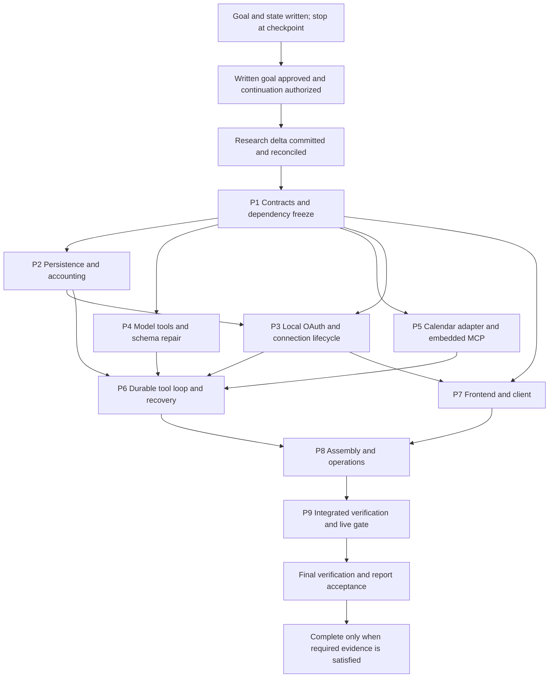

# State and dependency graph: Google Calendar plugin

## Workflow configuration and authorization

- Artifacts live directly in `docs/google-calendar-plugin/`. Reuse existing source/test directories and the committed plugin research; do not recreate the old scaffold or a root npm workspace.
- Current branch: `codex/google-calendar-plugin`, created from clean baseline `989d6b1`. Preserve all intervening user changes, `.openchamber/`, private environment files, dependencies, and generated output. Stage exact named task files only.
- On 20 October 2026 the user approved the exact written goal and authorized continuation beyond the documentation checkpoint. Old Phase 1/plugin-research approval remains insufficient as a substitute. R is committed and reconciled at `cd5d521`; P1 planner is the next dispatch. This approval does not authorize live Google/OpenRouter spend, provisioning, or deployment.
- User instruction for this workflow: planners must **not** include the repository documentation-header banner (`FILE` / `LOCATION` / `PURPOSE` / `ROLE IN PROJECT` / `KEY COMPONENTS`) in `plan*.md`.
- On 20 October 2026 the user selected **single-user local proof; member accounts later**. Bind one Google connection to the current server identity. Do not implement sign-in/RBAC or claim member isolation.
- User selected `--skip review`. Unified code review is **skipped**, never passed. Do not dispatch a reviewer or review-triggered fixer. Required tests, compatibility checks, correction of observed defects, and final verification remain in the graph.
- This is MAW orchestration: the orchestrator maintains scope, DAG/status, ownership, dispatch and serialized commits; it does not write implementation code or ingest `research.md`/`plan*.md`. Assigned agents read their artifacts and return interface summaries, evidence and commit hashes. Documentation maintenance does not require a subagent.
- Maximum active capacity is four: orchestrator plus at most three child agents. Dispatch independent ready planners in a foreground cohort. Start each worker once its own committed plan and all worker prerequisites are satisfied; do not wait for unrelated plans. A plan commit is not a worker completion.
- Grant one explicit Git staging/commit turn at a time, including for disjoint files. Workers awaiting a commit turn report ready paths and leave the shared index untouched. Verify reports with `git log -1 --stat <hash>`.

## Workflow milestones

- [x] Explore source baseline, prior researcher handoffs, package manifests and budgets; preserve current work.
- [x] Clarify local versus member scope: local proof selected explicitly.
- [x] Compare direct API, owned MCP, and Google/managed remote approaches; document the proposed owned embedded MCP choice for written-goal approval.
- [x] Draft [goal.md](goal.md), this complete initial DAG, ownership, acceptance mapping, exit gates and resume procedure.
- [x] Obtain approval of the written goal and authorization to continue beyond this checkpoint (20 October 2026; exact written scope).
- [x] R: reconcile the existing research with the new schema-repair, embedded-MCP and local OAuth scope (`cd5d521`).
- [x] All nine implementation plans written and committed.
- [x] P1-P9 workers implemented, tested and committed; prerequisite-specific gates verified. D1–D6 are corrected and re-proved.
- [x] Unified code review **skipped** by explicit user instruction; no review verdict is asserted.
- [x] Final verification, live-gate disposition and final report complete as a **truthful partial**: deterministic, in-memory fixture, browser-fixture, package and **isolated-native** checks are executed and green.
- [ ] Workflow completion: **blocked on operator inputs for the live gate** — a Google OAuth client, the operator's own grant, a disposable owned calendar, the real-data processing approval and a bounded spend authorization. Not complete on local fixtures and a local replica set alone.

## Initial findings and proposed decisions

- Prior research is complete at `989d6b1`, with Calendar `3bdedee`, Aurvin fit `d4dd696`, and platforms `1f7d782`. [The research summary](../aurvin-plugins-research/README.md) and [research state](../aurvin-plugins-research/state.md) are readable handoffs; downstream agents read their specific detailed source reports as needed. Broad research is reused, not marked skipped or repeated indiscriminately.
- Current provider code rejects tool calls; context allows text system/user/assistant messages; graph has one generation; accounting has one generation per execution attempt. A plugin catalogue entry alone cannot fulfill the goal.
- Existing acceptance/finalization/recovery, encrypted configuration, Decimal128, bounded metadata and ownership guards are reusable. Actual collection names include seven collections with `config`; this scope proposes one additional `integration_connections` collection plus bounded typed `metadata` records.
- Current budgets default to 180 seconds/run, one active attempt/session, two provider attempts and eight concurrent process generations. The new goal adds turn-wide tool/repair/dispatch/spend limits without resetting the existing deadline.
- Proposed plugin transport is a real official-SDK client/server handler/fetch path inside the existing process. It opens no public route/port and shares the existing persistence owner. MCP protocol/package compatibility must be pinned and tested; production/remote transport certification is not implied.
- Google-operated Calendar MCP is a current preview alternative, but its creation/retry constraints differ from the stable API. The owned stable adapter permits caller-supplied event IDs and a narrow no-invitations surface.
- The repair contract is at most two model corrections per accepted turn, with sanitized diagnostics and the explicit prompt in the goal. Repair happens before dispatch; authorization, semantic ambiguity, provider failures and uncertain effects are separate paths. All dispatches, including corrections, count toward eight total and monetary evidence.
- The written goal's transport choice, three tools, limits, default-off operation, content lifetimes and estimated USD 1.00 admission cap are **approved** as of 20 October 2026. A later research finding that contradicts them must be reconciled in goal/state before dependent planning; no silent scope substitution.

## Dependency matrix

`G` means the written goal is approved **and continuation is authorized**. `R` means the delta research handoff is committed and reconciled into this state. `P#` in worker dependencies means that worker's implementation and required checks are complete and committed. A committed plan never substitutes for a worker prerequisite.

| ID | Scope | Worker prerequisites | Planner status | Worker status | Commit evidence |
| --- | --- | --- | --- | --- | --- |
| R | Focused compatibility/schema-repair/local-OAuth research delta | G | Research task, no implementation plan | Complete | `cd5d521`, amendment `85db0a9` |
| P1 | Shared contracts, limits, protocol versions and dependency freeze | R | `[x] 4d0b5e6` | `[x] Complete` | `9f8da4b` `819cb03` `a9e9754` `5724d63` `0cb64e2` `d765529` `744c399` `ddaa4d2` `916427a` `9bf224e` |
| P2 | Connection/operation persistence, accounting and retention foundations | P1 | `[x] 28e9b36` | `[x] Complete` | `db2e5c7` `2c98adc` `06b6cbd` `da0293b` `8ac8b29` `6487bc0` `207865f` `6c680dd` `b274baf` `016fb22` |
| P3 | Local Calendar OAuth, connection lifecycle and setup API | P1, P2 | `[x] 2367d0c` | `[x] Complete` | `02e9f49` `0004df2` `e86a1f2` `6a64962` `b3325d8` `5d9ac8b` `a8acebf` `9555391` `9c90980` |
| P4 | Native model tool calls, strict parsing and corrective regeneration | P1 | `[x] 80b0955` | `[x] Complete` | `3b66f40` `3add52f` `cc8aa89` `1bf9066` `4173839` `248799d` `1cedd57` `3aa8983` `5d0d19c` `b60be09` |
| P5 | Calendar API adapter, curated MCP catalogue/client/server and execution binding | P1 | `[x] 81dada6` | `[x] Complete` | `9e61213` `1adeef4` `17358dc` `6ffe795` `568bc59` `737460b` `0671b24` `f8a21b4` |
| P6 | Bounded agent/context/runtime loop, durable effects and recovery | P2, P3, P4, P5 | `[x] 3d04daa` | `[x] Complete` | `4db38ab` `d0513b2` `eacf4e4` `3f1824d` `d318a73` `3463048` `95ae426` `ca7428f` `826b72f` `2e4f539` |
| P7 | Calendar connection UI, chat progress/receipts and client protocol | P1, P3 | `[x] 81ac1d7` | `[x] Complete` | `b457284` `0dc3156` `1abf8dc` `70b541a` `939066a` `f8cc7c2` `c47f9fe` |
| P8 | Shared application wiring, HTTP/operations, fixed instructions and runbooks | P6, P7 | `[x] af80190` | `[x] Complete` | `e08a6d8` `8a55d9c` `9555fd3` `3e7ae2c` `9fcc6db` `d16476c` `286490d` `ec5f39e` |
| P9 | Integrated verification, isolated/native/browser evidence and live gate | P8 | `[x] 62e9e80` | `[x] Complete` | `ea01980` `30e7f89` `79dc39f` `551fd89` `43cf562` `cdeaacf` `7d19c70` `71357f8` `e447f66` `7a74a2a` |
| V | Orchestrator final evidence/commit-set checks and final-report acceptance | P9 and all required acceptance gates | No extra implementation plan | `[x] Complete with named pending gates` | `5f0354a` `a0bd63f` `ebb8dfb` `7a74a2a` |

### Worker execution DAG

Code review has no node because it is explicitly skipped. A failed required check routes to its owning worker and invalidates affected downstream readiness; it does not create a review/fixer phase.

### Planner readiness and immediate worker dispatch

| Planner | Earliest prerequisites for planning after G | Worker start condition |
| --- | --- | --- |
| P1 | R committed and handoff reconciled | P1 plan committed |
| P2 | P1 worker committed: shared schemas/ports/dependencies frozen | P2 plan committed and P1 complete |
| P3 | P1 worker committed: connection store and setup API contracts available | P3 plan committed and P2 complete |
| P4 | P1 worker committed: tool/provider/repair contracts frozen | P4 plan committed and P1 complete |
| P5 | P1 worker committed: API/MCP/credential and operation ports frozen | P5 plan committed and P1 complete |
| P6 | P2/P4/P5 workers committed and P3 plan committed | P6 plan committed and P2/P3/P4/P5 workers complete |
| P7 | P1 worker and P3 plan committed | P7 plan committed and P3 worker complete |
| P8 | P6 plan committed, P3/P4/P5 workers complete, P7 plan committed | P8 plan committed and P6/P7 workers complete |
| P9 | P8 plan committed and P6/P7 workers complete | P9 plan committed and P8 worker complete |

When P1 completes, P2/P4/P5 are the first three independent ready planners; launch them together within capacity. P3 is also planning-ready and takes the next available slot, then P7 after its plan is committed. Do not exceed capacity to force a cohort. Ready workers can occupy slots while the remaining planners run; prioritize unblocking P2/P3 and P6. Plans may be written before all their worker prerequisites finish, as specified above.

Every P# planner owns only its `planN.md`. It follows the writing-plans skill, reads the goal and its upstream handoffs, records exact file/test commands and compatibility assumptions, and commits before worker dispatch. **Do not** put the repository documentation-header banner in plan markdown. Workers follow executing-plans/TDD instructions, ESM `.js` import conventions, and established Vitest/fixture conventions; they also omit that documentation-header banner unless a later instruction restores it. P1–P8 workers are committed. `plan9.md` is committed; the P9 worker occupies the next child slot. Review remains skipped. Live Google/OpenRouter spend is still unauthorized unless an exact prior operator grant already exists. Untracked `.openchamber/screenshots/**` remain unstaged. Serialize commits.

## Research handoff — complete (`cd5d521`)

- Verified `git log -1 --stat cd5d521`: message `docs(google-calendar-plugin): technical research delta`; only `docs/google-calendar-plugin/research.md` (+407). Working tree was clean on `codex/google-calendar-plugin`.
- Follow-up `85db0a9` (`docs(google-calendar-plugin): reconcile research with approved goal`) amended only `research.md` (+115/−117). Orchestrator did not ingest either revision.
- Assigned P1+ agents read `research.md` themselves. No contradiction was reported to the orchestrator as a dispatch blocker; the P1 worker must still halt and report rather than silently substitute if implementation would change approved transport, local/member scope, limits, Calendar actions, repair contract, or retention.
- Live Google/MCP/OpenRouter compatibility is **not** certified by the research commits. Declared package/protocol candidates and later execution gates in `research.md` remain planner/worker verification work.

## Plan scopes, ownership and exit gates

### R — Focused research delta

**Deliverable:** future `research.md` in this directory, plus a concise reported source/compatibility handoff. Reuse the three existing detailed reports and their committed evidence. Own no application source or manifests.

Resolve the new requirements: safe native tool-call correction without invalid message sequences; strict JSON parsing/duplicate-key/truncation behavior; current exact SDK/protocol and handler/fetch support on Aurvin's Node/TypeScript/Zod versions; Google OAuth/account identification and owned-calendar scope sufficiency; provider price/privacy/tool support; and the proposed source-linked retention behavior, cache/header restrictions and guarded-owner/TTL interaction. State primary documentation versus declared compatibility versus executed evidence. Temporary isolated compatibility work must not alter repository dependency files or use credentials/services.

**Exit gate:** committed source-backed recommendation and exact package/API/protocol candidates; safe schema-repair boundary and test cases; local-origin/OAuth constraints; explicit policy/compatibility blockers and later execution gates. Do not certify live compatibility from declarations. A finding that contradicts the goal is reconciled in the goal/state before dependent planning; no silent scope substitution.

### P1 — Shared contracts and dependency freeze

**Deliverable:** `plan1.md` and committed contract implementation.

**Owned source/tests:** `backend/src/contracts/**`, relevant `backend/test/contracts/**`, `backend/package.json`, `backend/package-lock.json`, `frontend/package.json`, `frontend/package-lock.json`, and only dependency/config changes explicitly required by R. Preserve existing package/module conventions. Root `AGENTS.md` is not part of this worker's scope.

Define versioned plugin/tool schemas, strict allowlisted arguments/results, trusted execution/connection bindings, OAuth-store ports, operation intent/receipt/reconciliation lifecycle, repair/error/retry categories, provider messages and streaming events, accounting dispatch/aggregate contracts, source expiry references, config/readiness options and finite limits. Keep legacy read compatibility explicit. Add only packages justified by real MCP/OAuth/security behavior; freeze versions/peer evidence and document protocol era. No generic plugin marketplace or remote endpoint abstraction.

**Exit gate:** strict schema/size/cardinality/limit tests; unknown sensitive fields rejected; wire compatibility and legacy schemas tested; API/port handoff sufficient for independent P2/P3/P4/P5 work; package compatibility/type checks executed where applicable. Later shared contract/manifest changes return to P1 under a serialized amendment before dependents proceed.

### P2 — Persistence, accounting and retention foundations

**Deliverable:** `plan2.md` and committed storage implementation.

**Owned source/tests:** `backend/src/persistence/**`, `backend/src/platform/crypto/**`, the narrowly required cipher extraction in `backend/src/admin-config/credential-service.ts` and its test, `backend/test/persistence/**`, and specifically named accounting/retention migration scripts/tests if an additive migration is actually required. P2 does not own HTTP, runtime or central assembly.

Implement bounded `integration_connections` records; hashed/expiring OAuth state; encrypted credential versions; typed metadata records for operation current state/events and dispatch/repair evidence; stable uniqueness/indexes; CAS/idempotent transitions; immutable receipts; source-linked expiry/tombstones; and read-compatible per-dispatch/turn accounting. Preserve existing config ciphertext/AAD compatibility if sharing cipher logic. Route writes through current guarded client/fencing. Test proposed migrations on isolated fixtures; do not mutate application data.

**Exit gate:** fixture and admitted isolated-native checks for ownership keys, token encryption/AAD mismatch, rotation CAS, duplicate operation/event sequencing, unknown states, stable reservations/repair counters, decimal accounting/legacy totals, expiry/redaction provenance and safe quarantine. No unbounded record arrays, unsafe broad TTL, double-counted aggregates or second MongoDB owner. Report native skips distinctly.

### P3 — Local OAuth and connection/setup API

**Deliverable:** `plan3.md` and committed connection service/API.

**Owned source/tests:** `backend/src/plugins/google-calendar/oauth*`, `connection*`, `controller*`, `module*`, `options*`; corresponding `backend/test/plugins/google-calendar/oauth*`, `connection*`, `setup*`; local plugin-specific setup/Origin/CSRF guards. Do not own Calendar tool handlers, shared HTTP transport/bootstrap or identity/sign-in infrastructure.

Implement browser-bound state, callback validation, grant/account metadata, one server-owned active connection, minimum scopes, target validation, refresh lock/rotation, revision invalidation, reconnect, disconnect/explicit revoke, default-off setup and safe status/API errors. Keep local proof identity fixed and credentials backend-only. Consume P2 ports; do not add another storage owner. Publish the API/event handoff for P7 before central wiring.

**Exit gate:** callback replay/mismatch/expiry/cross-browser/hostile-origin cases fail; token/account/target swaps do not leak or retarget work; concurrent refresh and revoked/missing grants are bounded; setup routes work in module fixtures; fixture assertions show no secret leakage. A fixture grant is never reported as a real Google connection.

### P4 — Provider tools, strict parsing and repair

**Deliverable:** `plan4.md` and committed model boundary.

**Owned source/tests:** `backend/src/model/**`, `backend/test/model/**`. P4 owns the corrective instruction implementation; P8 later reconciles the general fixed system assets. Do not own runtime counters/storage or graph dispatch.

Extend native provider tool schemas/messages and streamed assembly while preserving ordinary text behavior. Parse complete calls strictly with bounded memory, duplicate-key/trailing-content detection and valid terminal framing. Emit normalized structural diagnostics and the exact substantive repair instruction, clean-history reconstruction inputs, repair provenance and per-dispatch usage callbacks. Keep correction distinct from policy/semantic/provider failures. Enforce shared remaining budgets passed by P6; do not create a second independently resetting retry loop.

**Exit gate:** malformed-then-valid, missing/wrong/extra fields, forbidden fields, unknown tools, duplicate keys, fragmented interleaved chunks, excess calls, truncation, broken streams, injection-shaped output, valid text answers, two-correction exhaustion and cancellation tests. Assert rejected calls execute zero times, no unmatched provider message groups, attribution on every dispatch, complete cost evidence and no private reasoning persistence.

### P5 — Calendar adapter and real embedded MCP plugin

**Deliverable:** `plan5.md` and committed Calendar/MCP implementation.

**Owned source/tests:** `backend/src/plugins/registry*`, `backend/src/plugins/mcp/**`, `backend/src/plugins/google-calendar/calendar-api*`, `tools*`; corresponding `backend/test/plugins/mcp/**` and `backend/test/plugins/google-calendar/calendar-api*`/`tools*`. P3 retains connection/controller paths. Use P1 ports and fixtures; do not reach directly into storage or create a MongoDB client.

Implement the three curated tool definitions, stable Calendar REST operations, event-ID mapping, safe request defaults, explicit pagination/result bounds, bounded transient errors/readback support, and real SDK catalogue/call flow. Trusted execution closure/context supplies local identity, current connection and authorized target outside model arguments; no raw tokens enter MCP parameters. Runtime P6 owns durable operation authority and counters. Use the official handler/fetch path and shared process lifecycle; open no public MCP endpoint. Validate API tools first, then the same adapter through real MCP transport.

**Exit gate:** exact catalogue/schema snapshots; actual SDK client discovers and invokes the production handler with observed pinned protocol; disabled/schema-tampered/unbound calls fail; same event ID survives delivery retries; timezone/offset/range/cursor/unsupported-feature and no-invitations fixtures pass; bounded output/error decoding and clean channel closure pass. A mocked client alone is insufficient.

### P6 — Durable tool loop, context and recovery

**Deliverable:** `plan6.md` and committed integrated runtime behavior behind ports.

**Owned source/tests:** `backend/src/agent/**`, `backend/src/chat-runtime/**`, `backend/src/context/**`, `backend/test/runtime/**`, `backend/test/context/**`, and only necessary compatibility edits to `backend/src/voice/agent/agent-voice-adapter.ts` with its corresponding voice-agent tests. No central assembly, HTTP transport, model adapter or persistence writes outside ports.

Implement the bounded graph, complete message groups, valid-context repair routing, persisted dispatch/repair budgets, reservations/accounting, one authorized logical write, operation-first dispatch, durable results, event-ID reconciliation, explicit unknown outcomes, safe retry/cancellation/drain/restart behavior, terminal publication and sealed-result reuse. Preserve one accepted input and one owner. Prevent live-voice tool access while keeping ordinary text/dictation behavior.

**Exit gate:** acceptance-before-inference, valid repair executes once, rejected decisions never dispatch, limits survive restart, all crash windows including external success then DB/final-answer failure, duplicate submission/cross-tab contention, revoked/changed connection, unknown cost/operation, preserved tool-result grouping/history and no silent model/write replay. Completion requires the durable evidence chain, and a successful action remains visible when narration fails.

### P7 — Frontend connection and chat experience

**Deliverable:** `plan7.md` and committed UI/client implementation.

**Owned source/tests:** `frontend/src/api/**`, `frontend/src/features/plugins/**`, necessary `frontend/src/features/admin-config/**` and `frontend/src/features/chat/**` edits, `frontend/src/App.tsx` and associated styles/assembly tests. Exclude the new plugin integrated acceptance tests reserved for P9. Do not redesign unrelated chat/canvas/voice features.

Implement local Calendar setup/status/enable/disconnect, safe OAuth navigation, configured-target display, progress for correction/execution/reconciliation, durable event receipts, narration-failure distinction and useful retry/reconnect/clarification states. Preserve unsent drafts and unsaved New Chat behavior. Mirror frozen P1 wire contracts and P3 setup API without client identity/model/credential inputs.

**Exit gate:** existing Node Vitest state/client checks plus focused accessibility/browser evidence; no secrets/local identity overrides in storage or URLs; interrupted/reconnect/correcting/unknown/succeeded-but-response-failed flows render accurately; safe links and keyboard behavior work; normal text/voice/canvas/menu flows regressions checked. Browser results remain separate from real service evidence.

### P8 — Assembly, transport, operations and instructions

**Deliverable:** `plan8.md`, shared wiring and operator runbook `operations.md`.

**Owned source/tests:** `backend/src/app.service.ts`, `app.module.ts`, `main.ts`, `backend/src/http/**`, `backend/src/operations/**`, `backend/src/platform/config/**`, necessary `backend/src/admin-config/**` excluding P2 cipher files, fixed instruction assets including `backend/src/instructions/system.md` and root `product_knowledge.md`, root `README.md`, relevant deployment documentation, `backend/test/assembly/**`, `backend/test/http/**`, `backend/test/operations/**`, related central source specs and narrow voice-session assembly changes/tests if needed. Read P1-owned contracts/manifests; route changes through P1 rather than editing them concurrently.

Wire one process-owned plugin/connection/runtime/persistence composition, setup routes and SSE events, local-origin enforcement, default-off capabilities, non-paid readiness/degradation, shutdown/drain, resumable status, privacy/retention controls and safe telemetry. Reconcile fixed instructions/release assets with enabled text tools and disabled live-voice tools. Document OAuth/operator setup, exact scopes, chosen SDK/protocol, budgets, cost caveats, ownership handoff, unknown-write recovery, redaction/backup handling, rollback and migration preconditions. Provision nothing.

**Exit gate:** assembled fixture chat/model repair/MCP/Calendar receipt flow, blank-config diagnostics, plugin-only outage with normal text healthy, safe shutdown/restart, secret-safe correlated logs, local Host/Origin/CSRF and transport terminal-state behavior; existing text/config/accounting/voice/canvas behavior stays covered. Preserve the single persistence-close owner and local recovery fences.

### P9 — Integrated verification and evidence

**Deliverable:** `plan9.md`, integrated tests, `verification.md`, `staging-evidence.md`, and `final_report.md`.

**Owned source/tests:** new `backend/test/integration/plugins/**`, `backend/test/plugins/integration/**`, `frontend/src/features/plugins/integration-tests/**`, and the evidence documents above. P9 does not amend implementation source to make failing checks disappear; observed defects return to their owning worker. Do not dispatch a reviewer or review-triggered fixer.

Execute package checks and the AC01-AC14 matrix; include scripted model malformed/valid/exhausted cases, real embedded MCP handler, deterministic Calendar, isolated MongoDB recovery/accounting, browser flows and legacy regressions. Record exact commit set and environment. Native prerequisites and real Google/OpenRouter actions require their documented operator inputs/authorization; do not substitute source presence or no-tests exits.

**Exit gate:** required deterministic checks pass; native/browser/service evidence is measured and accurately categorized; required live creation/readback and safe-retry evidence runs only within an existing precise authorization. If any required acceptance remains blocked, report that gate and leave completion pending. The orchestrator verifies reported commits/evidence and final report before marking complete. Review remains skipped.

## Shared-file rules and interface handoffs

| Shared surface | Sole writer / handoff rule |
| --- | --- |
| Goal, state, graph and dispatch record | Orchestrator only; scope changes require recorded approval where material |
| Contracts, schemas, limits, package manifests/lockfiles | P1 throughout; downstream reports requested changes and waits for amendment |
| Persistence/indexes/accounting codec/reporting and shared cipher | P2; new needs return here before consumers change |
| Google OAuth/connection lifecycle versus Calendar/MCP handlers | P3 and P5 own disjoint filename prefixes, share P1 ports |
| Provider parser/repair instruction versus graph counters/dispatch | P4 versus P6; P1 defines the seam and counters have one durable owner |
| Frontend source versus final integrated tests | P7 source/unit tests; P9 owns the explicitly reserved integration-test directories |
| Central wiring, HTTP, operations and general instruction assets | P8; upstream workers supply interface summaries and fixture proof |
| Final evidence documents | P9 writes; orchestrator validates and records gate/status |

New files inside another owner's directory must be named in a planner's handoff and ownership reconciled before writing. Existing tests/fixtures changed by a source owner remain that owner's responsibility unless explicitly reserved above. No two workers receive concurrent write ownership of the same path. Planner commits do not implicitly approve API changes or authorize service calls.

## Acceptance coverage

| Goal criterion | Primary owner(s) | Integrated verifier |
| --- | --- | --- |
| AC01 local boundary/identity/default-off | P1, P3, P8 | P9 |
| AC02 real curated MCP | P1, P5 | P9 |
| AC03 OAuth/connection lifecycle | P2, P3 | P9 |
| AC04 structural repair | P4, P6 | P9 |
| AC05 repair/permission/intent separation | P3, P4, P5, P6 | P9 |
| AC06 streaming/context/protocol | P1, P4, P6, P8 | P9 |
| AC07 Calendar validation/receipt | P5, P6 | P9 |
| AC08 durability/concurrency/recovery | P2, P6, P8 | P9 |
| AC09 attribution/accounting/spend | P1, P2, P4, P6 | P9 |
| AC10 finite budgets | P1, P4, P5, P6 | P9 |
| AC11 UI and accurate outcomes | P7, P8 | P9 |
| AC12 privacy/injection/retention | R, P2, P3, P4, P5, P7, P8 | P9 |
| AC13 shared assembly/regressions/ops | P8 and affected source owners | P9 |
| AC14 final evidence/live gate/review skipped | P9 and orchestrator | V |

## Final verification commands and evidence rules

| Directory | Command / check | Evidence required |
| --- | --- | --- |
| `backend/` | `npm run build` | Build/type/module compatibility |
| `backend/` | `npm run lint` | Existing lint/type-aware checks |
| `backend/` | `npm test` | Executed deterministic suites; schema-repair tests must be discovered |
| `backend/` | `npm run test:e2e` | Executed HTTP/native integrations; list actual skips/prerequisites |
| `frontend/` | `npm run build` | Client type/bundle compatibility |
| `frontend/` | `npm run lint` | Existing client lint |
| `frontend/` | `npm test` | Node Vitest client/state tests; not browser certification |
| Either package | `npm test -- <relative-test-path> -t "<test-name>"` | Focused regression command owned by each plan |
| Isolated MongoDB | Existing `AURVIN_TEST_MONGODB_URI` and exact `AURVIN_TEST_DB_PREFIX=aurvin_p2_test_` prerequisites | Generated fixture databases only; no credential output |
| Browser | P7/P9 fixture-backed local connection/repair/receipt/recovery flows | Actual tested browser and observed results |
| Live gate | Explicit operator grant, disposable target, exact event, model/privacy configuration and bounded spend | Real created-event readback and stable-operation retry evidence; no duplicate creation |

Both packages require Node `^22.22.3 || ^24.15.0 || >=26.0.0`. No root workspace commands exist. Install packages only in the relevant directory during the authorized execution stage. Separate Azure/behavior suites can allow empty discovery and never certify this feature from a zero-test exit. Retention/privacy and external service behavior must be reported with their actual limits.

At the current checkpoint only document/link/DAG/ownership consistency checks are applicable. Application suites, installs, OAuth, Google/model calls, DB fixtures, provisioning and deployment are **unrun**, not failed or passed. Checkpoint validation results are recorded below after the documents are checked.

### Checkpoint documentation verification — 20 October 2026

- Two requested documents prepared; five local Markdown link targets resolved successfully.
- Worker graph parsed as 14 nodes and 19 edges; all nodes topologically sorted, with no cycle. All prerequisites in the nine pending worker rows have corresponding DAG edges.
- All nine plans have explicit scopes/owners/exit gates and separate planner/worker readiness conditions. AC01-AC14 each map to source owners and integrated verification.
- Template-marker scan found no unresolved TODO/TBD/FIXME markers. Pending plans, approvals and future evidence are intentionally recorded as pending rather than fabricated.
- Only the two new checkpoint documents are task changes. No implementation agent, test suite, installation, account/DB/service operation or reviewer was started.
- Named-file staged whitespace checks passed; ownership-path and required local-scope/repair-limit/pending-approval markers passed with zero failures. These checks validate the checkpoint documents, not application behavior or the proposed defaults.

## Artifact and commit record

| Artifact | State | Commit |
| --- | --- | --- |
| Existing plugin research | Complete; reusable handoffs | `3bdedee`, `d4dd696`, `1f7d782`, synthesis `989d6b1` |
| `goal.md` | Approved 20 October 2026; exact written scope | `ff3883b` |
| `state.md` | Final gate recorded; workflow pending named external gates | `5261a47` plus this orchestrator commit |
| `research.md` | Complete delta plus goal-reconciliation amendment; not ingested by orchestrator | `cd5d521`, `85db0a9` |
| `plan1.md` | Written | `4d0b5e6` |
| P1 worker source | Complete; contracts tests 21 files / 123 passed | `9f8da4b` … `9bf224e` |
| `plan2.md` | Written | `28e9b36` |
| P2 worker source | Complete | `db2e5c7` … `016fb22` |
| `plan4.md` | Written | `80b0955` |
| P4 worker source | Complete | `3b66f40` … `b60be09` |
| `plan5.md` | Written | `81dada6` |
| P5 worker source | Complete | `9e61213` … `f8a21b4` |
| P2/P4/P5 focused tests | 28 files / 384 passed (`npm test -- persistence/calendar model/calendar model/strict-json model/catalogue model/policy model/deadlines plugins/google-calendar plugins/mcp plugins/registry`) | 21 Oct 2026 |
| Native P2 e2e | Present; not executed here (operator URI/prefix required) | Unrun / skip pending |
| `plan3.md` | Written | `2367d0c` |
| P3 worker source | Complete; oauth/connection/setup tests 6 files / 55 passed | `02e9f49` … `9c90980` |
| User work (not this graph) | Chat copy controls; preserved | `3510157` |
| `plan6.md` | Written | `3d04daa` |
| P6 worker source | Complete; runtime/context calendar tests 7 files / 39 passed | `4db38ab` … `2e4f539` |
| `plan7.md` | Written | `81ac1d7` |
| P7 worker source | Complete; frontend calendar tests 5 files / 23 passed | `b457284` … `c47f9fe` |
| User work (not this graph) | Chat copy controls; scrollbar reveal | `3510157`, `1b9b733` |
| `plan8.md` | Written | `af80190` |
| P8 worker source | Complete; assembly/http/operations calendar tests 12 files / 28 passed | `e08a6d8` … `ec5f39e` |
| `operations.md` | Written by P8 worker | `286490d` |
| `plan9.md` | Written | `62e9e80` |
| P9 worker source | Complete; integrated suites plus evidence documents | `ea01980` … `7a74a2a` |
| `operations.md` | Written by P8 worker | `286490d` |
| `verification.md`, `staging-evidence.md`, `final_report.md` | Written by P9 and refreshed after the D1/D2/D3 corrections | `e447f66`, `7a74a2a` |
| D1 correction (P5) | Fixture time-independence | `5f0354a` |
| D3 correction (P6) | One logical tool call per create | `a0bd63f` |
| D2 correction (P8) | Load-tolerant bootstrap fixture bound | `ebb8dfb` |
| D4 correction (P2/P6/P8) | Native suites skip without the isolated database | `c45c3be`, `aa7a46d`, `a7e0ed3` |
| D5 correction (phase-1 harness) | Native assembled harness uses a real bootstrap config | `196cdec` |
| D5b/D5c corrections | Explicit native-suite bounds, time-independent budget fixture, voice contract alignment | `fe1c1d7`, `759266d`, `c1b65b0` |
| D6 correction (P6) | Text chat recovery healthy without a Calendar connection | `86cd063` |

## Defect log

### D7 follow-up — 22 October 2026

**Closed** in P4 `3b198c9` and P8 `e45e8b6`. Production configuration preparation never supplied the optional Calendar evidence to `loadModelLimits`, so real configuration snapshots could never advertise Calendar tools or admit a Calendar budget. The model layer now supplies frozen evidence for `openai/gpt-6-luna`; boot and admin activation pass it to the catalogue verifier. Unknown models, price mismatches and missing native tool support remain text-only. A capable model still needs an enabled, connected plugin before tools are advertised.

Orchestrator verification at `e45e8b6`: `npm test -- test/model/calendar-evidence.spec.ts test/assembly/calendar-capability.spec.ts` passed 2 files / 19 tests; full backend `npm test` passed 192 files with 2 skipped, 1572 tests with 10 skipped; `npm run build` and `npm run lint` exited 0. Checks ran sequentially. Native/browser evidence below is the historical 21 October measurement, not a re-run at this tip. No live Google action or paid inference ran.

The user selected **Option A — Google Cloud OAuth web client** on 22 October. This keeps the existing Connect-button authorization-code flow; no alternate personal-token mode is authorized. Setup instructions must use the actual configured host and port: `PORT=8001`, `FRONTEND_ORIGIN=http://localhost:5179`. Match the callback host to that configuration (`http://localhost:8001/api/plugins/google-calendar/oauth/callback`), rather than blindly copying the default port 3000 or mixing `localhost` with `127.0.0.1`.

| ID | Owner | Defect | Evidence | Disposition |
| --- | --- | --- | --- | --- |
| D1 | P5 | `backend/test/plugins/google-calendar/tools-fixtures.ts` hardcoded absolute deadlines (`binding.deadlineAt` = `2026-10-21T09:00:10.000Z`, default `policyDeadlines` = `2026-10-21T12:00:00.000Z`) that production code compares against the real clock. Once wall-clock passed those instants the whole file failed with `budget/CALENDAR_DEADLINE_EXCEEDED` instead of exercising its assertions. | Orchestrator `npm test` on 21 Oct 2026: `test/plugins/google-calendar/tools.spec.ts` 15/20 failed; the same file passed earlier the same day. Every other Calendar fixture already used relative deadlines. | **Closed** in `5f0354a` (fixture-only correction). 20/20 pass; a wall clock shifted +365 days also passes, and the pre-fix fixture still fails under the same shift, so the fixture is now time-independent. Production deadline enforcement unchanged. |
| D2 | P8 | `backend/test/operations/bootstrap.spec.ts` gave each spawned child a 10-second wall-clock bound. On a loaded 16-CPU host the bound was exceeded by CPU contention and 2 of 8 cases failed, although the file passes 8/8 in isolation. | Orchestrator: default-parallelism `npm test` failed those 2 cases; `npm test -- --maxWorkers=4` passed the whole suite (188 files / 1543 tests). P9 reproduced the failures with every P9 spec file removed from discovery. | **Closed** in `ebb8dfb` (test-harness bound only, no production change): child bound 10 s → 60 s, case timeout 15 s → 120 s, build bound 60 s → 600 s. The guard still fails the case, proven by a temporary 500 ms bound. The suite now exits 0 at default parallelism. |
| D3 | P6 | One create was charged **twice** against the turn's `logicalTools` budget (once in `calendar-loop.ts` `execute()`, once in `calendar-operation.ts` `admitCreate()`), so a single model-requested create spent 2 of the 6 stated logical tool calls and the effective ceiling was 5, contradicting the goal's separate "6 logical tool calls" and "1 logical event creation" rows. | P9 measurement in `backend/test/plugins/integration/recovery-limits.spec.ts`: `logicalTools: 2` for one create. | **Closed** in `a0bd63f`. `admitCreate()` now charges only the mutating-operation row, guarded by the P1 contract invariant `creates <= logicalTools`. Corrected measurement: `logicalTools: 1`, `creates: 1`. New tests prove the 6th call is allowed, the 7th is rejected (`STORAGE_BUDGET_EXCEEDED`), and delivery retries/readback spend request budget only. |
| D4 | Pre-existing native suites, not feature-owned | 17 native suites call `nativeDatabase()` without a prerequisite guard, so `npm run test:e2e` **fails** instead of skipping when the operator URI/prefix are absent. | Orchestrator `npm run test:e2e`: 41 files (4 passed, 17 failed, 20 skipped), 145 tests (22 passed, 70 failed, 53 skipped); every failure is `Error: Isolated native test configuration is required.` | **Closed.** Owners P2/P6/P8 added the repository's existing `describe.skipIf(!configured)` guard to all 17 files (`c45c3be`, `aa7a46d`, `a7e0ed3`). `npm run test:e2e` without prerequisites now exits 0 with 37 files / 123 tests skipped, and with prerequisites it runs and passes. |
| D5 | Phase-1 native integration harness (pre-existing, previously unexecuted) | `backend/test/integration/assembled-harness.ts` passed a legacy `AurvinConfig` (`loadConfig`) into `AppService.create(bootstrap: BootstrapConfig)`, so `bootstrap.safety` was `undefined`, the strict `budgetConfigSchema` parse failed and every assembled native suite died with `CONFIGURATION_ERROR`. Present at the baseline `989d6b1`; invisible to `nest build` because `backend/test/**` is not compiled, and masked by D4. | Orchestrator, with the native prerequisites present: 11 files / 34 tests failed with `Invalid application configuration.` at `manageable-config.ts:44` ← `composeRuntimeBudgets` ← `buildRuntimeSnapshot` ← `new AppService`. | **Closed** in `196cdec`. The harness now builds a real `BootstrapConfig` and seeds a stored config document (fixture model + sealed fixture credential) so the app is configured through the production admin-config path; the model catalogue is still resolved only through the injected fixture fetcher. All 11 suites pass with their assertions unchanged. |
| D5b | P2 | The Calendar native persistence suites had no explicit per-test timeout and hit vitest's 5-second default; the 5-second bound was also masking a real failure (a pinned past turn-budget deadline). | Orchestrator: `calendar-storage` / `calendar-retention` / `calendar-accounting` native files all failed `Test timed out in 5000ms`. | **Closed** in `fe1c1d7` and `c1b65b0`: explicit 30 s / 60 s bounds matching the repository's native-suite convention, and the shared `calendar-fixtures.ts` budget window is now derived from the current time instead of a pinned past instant. |
| D5c | P6 | `test/runtime/calendar-recovery.native.e2e-spec.ts` had no explicit timeout, and the voice integration specs were stale against the committed 2026-10-16 `SubmitLiveTurn.configSnapshot` contract, so they failed whenever the native URI was present. | Orchestrator/P6: native recovery file timed out; `test/voice/integration/*` failed with `NOT_READY 'Voice configuration is unavailable.'` when the URI was set. | **Closed** in `759266d`: explicit 30 s bound, and the voice fixtures now freeze a live-capable `RuntimeConfigSnapshot` exactly as production does. The routine suite passes with and without the native URI. |
| D6 | P6 (production) | **Product defect.** `DurableChatRuntime.reconcileSession` guarded the Calendar reconciliation only on dependency presence (`if (this.d.calendar)`), but P8 always wires the Calendar composition, so chat **recovery** always called `currentBinding()` and threw `CALENDAR_EXECUTION_DENIED` when no Google Calendar was connected. A text-only deployment therefore failed ordinary chat recovery. | Phase-1 native AC12 recovery evidence: `CalendarToolFault: CALENDAR_EXECUTION_DENIED` at `connection.ts:371` ← `calendar-assembly.ts:44` ← `durable-chat-runtime.ts:766`. | **Closed** in `86cd063`. Recovery now reconciles only when a pending Calendar operation exists, derives the binding from that persisted operation, and maps an unavailable connection/policy to the existing `unknown` outcome (visible, no receipt, no second mutating dispatch). The dispatch path still fails closed. The phase-1 harness workaround was undone, so that suite now exercises the real assembled path. |

## Final verification results — 21 October 2026

Environment: Node `v24.18.0`, npm `12.0.1`, Vitest `4.1.11`, Windows 11 Pro 10.0.26200, branch `codex/google-calendar-plugin`.

Native evidence used an **isolated local single-node MongoDB 8.3 replica set** started by the orchestrator on `127.0.0.1:27099` with a temporary dbpath, `replicaSet=aurvinNative`, PRIMARY, reachable only on loopback. The native harness generated and dropped its own `aurvin_p2_test_<uuid>` databases; no application database was touched and no URI or credential was printed. The instance was stopped and its data directory removed after the run.

| Check | Result |
| --- | --- |
| `backend npm run build` | exit 0 |
| `backend npm run lint` | exit 0 (0 errors; pre-existing voice-test warnings only) |
| `backend npm test` (no native URI) | **exit 0** — 192 files (190 passed, 2 skipped), 1563 tests (1553 passed, 10 skipped) |
| `backend npm test` (native URI present) | **exit 0** — 192 files passed, 1563 tests (1562 passed, 1 skipped) |
| `backend npm run test:e2e` **with** the native replica set | **exit 0 — 41 files, 145 tests passed, 0 skipped.** This is the executed isolated-native evidence for AC03, AC08 and AC09 |
| `backend npm run test:e2e` without the native prerequisites | exit 0 — 41 files (4 passed, 37 skipped), 145 tests (22 passed, 123 skipped); no false failures |
| `frontend npm run build` | exit 0 (`tsc -b` + `vite build`) |
| `frontend npm run lint` | exit 0 |
| `frontend npm test` | exit 0 — 63 files / 456 tests passed |
| Live Google Calendar / paid OpenRouter | **not run, blocked** — the Google OAuth client, the operator's grant, a disposable owned calendar, the real-data processing approval and a bounded spend authorization are not supplied |
| Browser | **executed** — closed Vite fixture, a local fixture and not a live Google session |
| Unified review | **skipped**, never passed |

AC03, AC08 and AC09 now pass on their isolated-native halves against a real replica set. AC13 passes. AC14 remains blocked on the live Google/provider gate.

Note on the local database: a **single-node** replica set satisfies the repository's native MongoDB admission, but it is not a multi-member or production topology. Azure/multi-instance admission and public deployment remain out of scope.

Documentation follow-up (not fixed here, other workflows' ownership): the old 10-second bootstrap bound is still cited in `docs/backend-startup-fix/plan1.md` (around lines 270-272 and 340) and `docs/mongodb-usage-accounting/implementation-report.md` (around line 218). Those are historical records of other workflows; rewriting them would falsify that history, so they are left unchanged and named here instead.

Verification hygiene: run the package checks **sequentially**. A concurrent `npm run build` rewrites `backend/dist/` and makes the spawned `dist/main.js` child in `backend/test/operations/bootstrap.spec.ts` fail with a module-load error. That suite passes 8/8 when the build is not racing it.

## Current gate and resume procedure

**CURRENT GATE: LIVE GOOGLE / PROVIDER GATE (G8, G9) — AWAITING OPERATOR INPUTS.** All nine plans and all nine workers are committed. D1–D6 are corrected and re-proved. The deterministic, browser-fixture and **isolated-native** gates are executed and green: `backend npm run test:e2e` passes 41 files / 145 tests against a real single-node replica set, and `backend npm test` passes with and without the native URI. The remaining gate needs the operator: a Google OAuth client, their own grant, a disposable owned calendar, the real-data processing approval and a bounded spend authorization. No live Google/OpenRouter spend, provisioning, or deployment is authorized by this state.

On a later resume:

1. Read this state, the written goal and current Git status; preserve intervening changes. Verify current branch/commit and checkpoint file history. Do not read `research.md`/`plan*.md` into the orchestrator context.
2. Goal approval of this exact written scope is already recorded. If a later instruction changes transport, local/member scope, limits or permitted Calendar actions, update goal/DAG/ownership before further dispatch. Old Phase 1/research approval remains insufficient as a substitute.
3. R is complete at `cd5d521` with amendment `85db0a9`. Do not redo completed broad research or skip the research delta.
4. Do not re-dispatch planners or workers for P1–P9; their plans, implementations and owned checks are committed. Do not reinstate unified review.
5. To close the **live** gate: require the operator's exact prior authorization (Google project/consent configuration, the operator's own grant, a disposable owned calendar, exact permitted event data and cleanup authority, a tool-capable configured model with an approved external-data policy, and a bounded spend limit). The backend reads `AURVIN_GOOGLE_CALENDAR_CLIENT_ID`, `AURVIN_GOOGLE_CALENDAR_CLIENT_SECRET`, `AURVIN_GOOGLE_CALENDAR_REDIRECT_URI`, `AURVIN_GOOGLE_CALENDAR_TARGET_ID`, `AURVIN_GOOGLE_CALENDAR_PROCESSING_POLICY_ID`, `AURVIN_GOOGLE_CALENDAR_POLICY_APPROVED`, `AURVIN_GOOGLE_CALENDAR_CONTENT_PERMISSION`, `AURVIN_GOOGLE_CALENDAR_MINIMAL_EVIDENCE_ALLOWED`, `AURVIN_GOOGLE_CALENDAR_POLICY_DEADLINE_AT` and `AURVIN_GOOGLE_CALENDAR_TIME_ZONE` from `backend/.env`; the plugin stays disabled while they are absent. Do not request duplicate permission for an action already authorized. Record the created-event readback and the safe-retry evidence, and keep the browser fixture, native evidence and live evidence distinct.
6. To re-run the **native** gate later: start an isolated MongoDB instance, set `AURVIN_TEST_MONGODB_URI` and the exact `AURVIN_TEST_DB_PREFIX=aurvin_p2_test_`, then run `backend npm run test:e2e`. Fixtures create and drop only generated `aurvin_p2_test_` databases. Never print the URI or credentials, and never point fixtures at application data. Update `verification.md` and `final_report.md` with the executed results, and record that a single-node replica set is not a multi-member or production topology.
7. If the live prerequisite stays unavailable, keep the named gate open and keep the workflow incomplete. Do not mark the workflow complete on local fixtures and a local replica set alone.
8. Preserve untracked `.openchamber/screenshots/**` and the user's uncommitted frontend work (`frontend/src/components/MessageItem.tsx`, `Transcript.tsx`, `styles/chat.css`, `styles/styles.test.ts`, `components/PromptTraveler.tsx` and its test). Serialize commits, and run the package checks sequentially.
