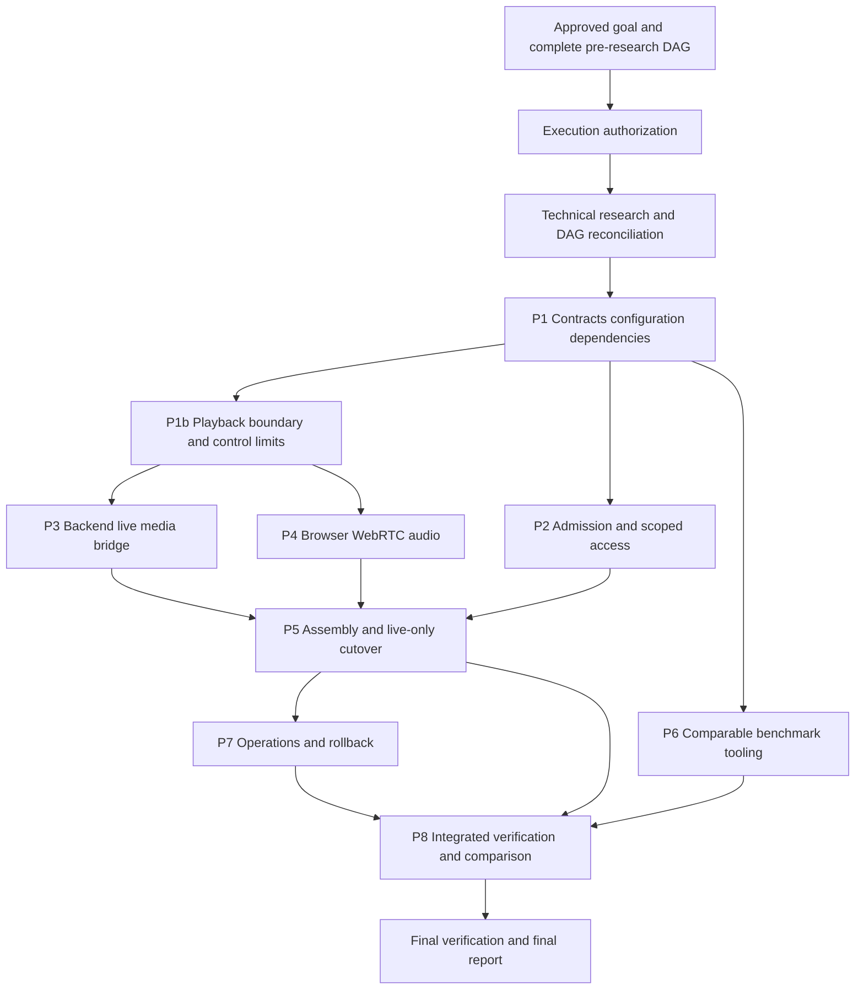

# State & Dependency Graph: Live voice over WebRTC

## Workflow configuration

- This is the complete **pre-research workflow definition**, not a claim that research, detailed plans, implementation, or verification have finished.
- Goal: [goal.md](goal.md). The user's 5 November 2026 request to turn this goal into MAW approved preparing this workflow. On 5 November 2026 the user resumed the workflow through the resume flow and selected `live-voice-webrtc`; that selection is the recorded execution authorization.
- Latest user constraint: **Ponytail — a minimal working WebRTC integration, no over-engineering.** The goal's implementation principle governs all scopes below. Work packages allocate ownership, not mandatory new layers/services. Research must favor reuse and collapse redundant work; no new auth system, repeated checks, per-frame persistence/config checks, or unnecessary critical-path round trips. Retain essential trust-boundary safeguards and existing correctness without duplicating them.
- Skipped phase: **unified code review (`--skip review`)**. Do not dispatch a reviewer or review-triggered fixer. Record review as skipped, never passed.
- Research, detailed planning, execution, defect correction, and final verification remain mandatory once execution is authorized.
- Keep workflow artifacts directly in `docs/live-voice-webrtc/`. Reuse existing source and benchmark directories; create only integration-specific files justified by research.
- Capacity: at most **three child agents plus the orchestrator**. Dispatch independent planners concurrently in the foreground, then pipeline ready workers without waiting for unrelated plans. Reserve slots and serialize shared-index staging/commits.
- The orchestrator manages dispatch, graph, evidence, and documentation only. It must not implement code or read `research.md`/`plan*.md`; use agent summaries and verified commit statistics. Assigned agents read their own inputs.
- Preserve all intervening user work, `.openchamber/`, credentials, and ignored benchmark evidence. Never stage broad directories or reset changes to obtain a clean checkout.
- Do not provision LiveKit infrastructure, incur new paid usage, mutate Calendar, or deploy publicly without separate appropriate approval. The previous eight-submission benchmark approval is exhausted.

## Resume reconciliation — 7 November 2026

- Current HEAD is `b180e78` (`refactor: update integration tests for LiveKit voice client and controller`), branch `main`; worktree clean. This commit contains the P8 integration-test changes and both P8 reports, plus concurrent chat-performance/canvas/Markdown work that is preserved and is outside this workflow.
- `b180e78` is not a P8 completion: the committed [verification](verification.md) records P8 as incomplete, one P4-owned frontend regression failing, unresolved historical full-suite failures, and native/service/browser/paid evidence blocked. The report's source identity `a096c62` plus a dirty tree predates the commit that now contains it.
- `npm ci` was rerun in `backend/` and `frontend/` on 7 November 2026; the pinned LiveKit packages are installed. The clean HEAD reproduces the P4 failure exactly: `denied LiveKit microphone permission allocates no session and keeps the original editable draft` expects `canResume: true`, receives `false` with `phase: 'suspended'` and `resumeRequired: true`.
- The P6 handoff is confirmed: `backend/src/benchmark/` contains no LiveKit/WebRTC integration, transport selection, provenance, or output fence, and the inspected driver retains the old `--live` WebSocket assumptions. P6 is reopened for the missing planned WebRTC measurement tooling; no live or paid run is authorized.
- P4 owner fix `121ae72` treats pre-admission capture denial as resumable: `fail()` keys off `!run.session`, and `resume()` re-activates when there is no session. The exact P8 regression now passes 1/1; P4-focused suites reported 124/124 dictation/transport/audio plus 34/34 P8 integration cases; frontend build/lint pass (0 errors, 80 warning baseline).
- P6 owner fix `b528445`..`deb09f5` adds transport selection, a fail-closed headless LiveKit participant, decoded-nonzero onset, strict nonsecret provenance, guarded run identity/output fencing, and transport-aware comparison. `npm run test:benchmark` verified 147/147 on 7 November 2026. No live or paid run occurred.
- P8 rerun `4b565ad`/`6366944` is complete on source `4a564e0`: deterministic migration gate **PASS**; backend integration 38 passed/8 named native skips; frontend integration 34/34; frontend full suite 670/670; benchmark 147/147; e2e 43 passed/139 skipped; builds/lints pass. Backend routine suite remains **FAIL** on the five documented baseline files (25 standalone arithmetic) plus six host script-execution-policy failures; no voice/LiveKit/P4/P6 test failed.
- Real LiveKit, browser, native-database, impairment, and paid benchmark evidence remain blocked pending separate authorization. The comparison verdict is **INCONCLUSIVE**; no WebRTC sample exists and no latency improvement is claimed.
- Delegation configuration records harness-default roles because this legacy workflow has no persisted model selections; no model override is requested or claimed.

## Workflow milestones

- [x] Step 1: Goal alignment recorded in `goal.md`; user requested MAW preparation against that goal.
- [x] Complete pre-research DAG, separate planner/worker dependencies, ownership, exit gates, and acceptance mapping constructed below.
- [x] Step 2: Technical research committed as `research.md` (`7de77e3`); integration choice and compatibility reconciled into this state.
- [x] Step 3: All eight detailed implementation plans committed (`plan1.md`–`plan8.md`; supplemental P1b follow-up also planned), final plan commits `7d1efdd`, `0d3d468`, `2c8e056`, `311a5af`.
- [x] Step 4: All eight workers completed, tested, and committed. P8 deterministic rerun committed `4b565ad`/`6366944`; external evidence remains blocked.
- [x] Step 5: Unified code review **skipped by user instruction**, not passed.
- [x] Step 6: Final verification and `final_report.md` completed with actual evidence and limitations; external evidence gates remain blocked, so workflow completion is not claimed.

## Goal alignment and preparation tasks

- [x] Explore goal, baseline evidence, current source layout, manifests, Git status, and repository instructions.
- [x] Confirm live voice only; dictation and text chat remain unchanged.
- [x] Record LiveKit/WebRTC as the intended browser audio transport, retaining Aurvin's authoritative runtime.
- [x] Separate transport benefits from endpointing/model/TTS delay; require measured comparisons.
- [x] Preserve the approved goal without silently selecting a bridge versus Agents architecture.
- [x] Check scope and construct the complete initial DAG.
- [x] Commit approved goal and this state in a focused documentation commit before execution; preparation commit `e1baf1f`.
- [x] Execution authorization recorded: user resumed `live-voice-webrtc` on 5 November 2026.

## Initial findings and baseline evidence

- Inspected HEAD: `a78f23ad9b9d8398d5ed7f857a89faa6cd05de4a` (`Improve live voice responsiveness`), branch `main`. Recheck before execution; this is not a frozen future implementation checkout.
- Existing voice admission/controller/options live in `backend/src/voice/session/`; WebSocket framing and connection lifecycle live in `backend/src/voice/transport/`. Live and dictation flows are separate files but share contracts and session infrastructure.
- `backend/src/app.service.ts` and `app.module.ts` compose one runtime and session owner. Preserve that ownership and one persistence-close path.
- The frontend has separate live/dictation controllers and shared audio/transport helpers. A live-only transport switch must not rewrite dictation's WebSocket path or assume shared PCM helpers can all be deleted.
- Neither package manifest currently declares LiveKit. Exact SDK/plugin versions, Windows/Node support, media conversion, browser compatibility, and hosting must be researched before selecting dependencies.
- The benchmark tooling/baseline changes are committed as `24a3382` (P6 implementation); they are not a clean-HEAD recreation of the original baseline. Preserve baseline reports/raw evidence and do not overwrite prior WebSocket results.
- Reference: [real WebSocket baseline](../voice-latency-benchmark/websocket-live-baseline-2026-11-05.md). Eight completed turns, one excluded warm-up, seven measured samples. Speech-end to **first received PCM**, not audible onset: p50 **7800.788 ms**, exploratory p95 **17696.421 ms**. Startup: p50 **1479.505 ms**, exploratory p95 **2216.661 ms**.
- Baseline source/input hash: `e916bc586fafc4c2950791fb7cc1c46589623545b63dc11394631320ff4b0432`; run ID `9ab4762c-c960-406f-adcf-84d91f265d56`. Its ignored raw evidence must be retained privately. Seven samples do not establish a stable tail estimate.
- Audible browser onset, interruption-to-playback-stop, and network impairment were **not measured**. Baseline shows substantial server-path variability, so transport alone must not be credited for all changes.

## Confirmed decisions and research boundaries

1. Replace browser-facing live audio with bidirectional LiveKit/WebRTC media. LiveKit signaling and provider WebSockets may remain; this is not a ban on WebSockets everywhere.
2. Preserve LangGraph, accepted-turn durability, history, idempotency, cancellation, reconnect semantics, quotas, accounting, and the server-resolved identity. No second independent conversation engine.
3. Browser grants must be short-lived and room/participant scoped. Provider and LiveKit server secrets stay backend-only. Existing development identity is not authentication.
4. Prefer the smallest integration that preserves these responsibilities. Research must compare a media bridge with a narrowly scoped Agents integration and recommend one; it must not introduce another LLM/history owner.
5. Research must choose one authoritative interruption/end-of-turn policy, specify live control-event delivery, and define playback progress versus durable completion. Do not duplicate VAD/endpointing loops or label published audio as heard audio.
6. No numerical improvement target was approved. Report absolute and percentage deltas for matching boundaries, sample counts, failures, and uncertainty. Do not declare a latency win when results are inconclusive or slower.
7. Hosting selection/cost is a subsequent decision. Research may recommend options, but must obtain approval before external provisioning or paid service use.
8. LiveKit credentials and configuration stay in server env/bootstrap config; no `Manage Aurvin` credential card or stored-config schema is added (user decision, 5 November 2026).

## Dependency matrix & execution status

`R` means research completed, committed, and reconciled by reported summary. `P#` worker dependencies mean prerequisite **implementation**, tests, and commits, not just a written plan. Every worker also requires its own committed plan. `V` is final synthesis, not review.

| Plan | Title and scope | Worker dependencies | Exclusive primary subsystem | Planner status | Worker status | Commits |
| :--- | :--- | :--- | :--- | :--- | :--- | :--- |
| P1 | Transport contracts, configuration, dependencies | R | Shared contracts/config, both manifests/lockfiles | [x] `7f0ea14` | [x] Complete `6a55473`..`0b6d4a8` (5 commits); one P2/P5 fixture handoff recorded below | `7f0ea14` (plan) + `6a55473`..`0b6d4a8` (worker) |
| P1b | Contract follow-up: WebRTC playback boundary/watermark and control-packet limits | P1 | `backend/src/contracts/voice-wire.ts`, `frontend/src/api/voice-protocol.ts`, fixtures/tests | [x] `84ce65c` | [x] Complete `2dd748a` | `84ce65c` (plan) + `2dd748a` (worker) |
| P2 | Session admission and scoped LiveKit access | P1 | Voice session service/controller, token/room admission | [x] `78ad9ff` | [x] Complete `40f1c97`; H1/H3 owner fixes `c961708` | `78ad9ff` (plan) + `40f1c97`, `c961708` |
| P3 | Backend bidirectional media bridge and live lifecycle | P1, P1b | New media adapter, live flow, delivery/usage integration | [x] `314b995` | [x] Complete `af62c58`; H2/H4/proof fixes `503e6b3`; P8 integration handoff remains | `314b995` (plan) + `af62c58`, `503e6b3` |
| P4 | Browser live WebRTC transport and playback | P1, P1b | Frontend live controller, API/media integration | [x] `01c3931` | [x] Complete `2740cbb`; permission-denial owner fix `121ae72`; exact regression and P4 suites pass | `01c3931` (plan) + `2740cbb`, `121ae72` |
| P5 | Application assembly and live-only cutover | P2, P3, P4 | Central wiring, existing WebSocket boundary, readiness | [x] `7d1efdd` | [x] Complete `3d84aa0` + `2ca1457`; gateway and assembly regressions pass; frontend P8 failures handed off | `7d1efdd` (plan) + `3d84aa0`, `2ca1457` (worker) |
| P6 | Comparable benchmark tooling and offline checks | P1 | Existing benchmark runner/driver and benchmark tests | [x] `0d3d468` | [x] Complete `24a3382`; WebRTC driver/provenance/output-fence fix `b528445`..`deb09f5` (7 commits); `test:benchmark` 147/147 | `0d3d468` (plan) + `24a3382`, `b528445`..`deb09f5` |
| P7 | Operations, security procedures, and rollback | P5 | Operating docs, deployment examples, setup guidance | [x] `2c8e056` | [x] Complete `82f4785`; docs/link/whitespace/NGINX directive-invariance checks and backend build pass; lint 542 warnings/0 errors | `2c8e056` (plan) + `82f4785` |
| P8 | Integrated regressions and before/after evidence | P5, P6, P7 | Integration tests, verification and measurement artifacts | [x] `311a5af` | [x] Deterministic rerun complete `4b565ad`/`6366944`; G1 PASS, G2 PARTIAL (documented baseline + host-policy failures), external evidence BLOCKED; no measurement | `311a5af` (plan) + `b180e78` (partial) + `4b565ad`, `6366944` |

### Execution graph

The graph contains no review node. External approval gates can block R's hosting decision or P8's live evidence without being mistaken for completed work.

### Planner readiness and immediate worker dispatch

| Planner | Earliest prerequisites | Worker start condition |
| :--- | :--- | :--- |
| P1 | R committed, summarized, and reconciled | P1 plan committed; R complete |
| P1b | P1 worker complete | P1b plan committed; P1 complete |
| P2 | P1 worker complete | P2 plan committed; P1 complete |
| P3 | P1 worker complete | P3 plan committed; P1 and P1b complete |
| P4 | P1 worker complete | P4 plan committed; P1 and P1b complete |
| P6 | P1 worker complete | P6 plan committed; P1 complete |
| P5 | P1 worker complete; P2/P3/P4 plans committed | P5 plan committed; P2/P3/P4 workers complete |
| P7 | P5 plan committed | P7 plan committed; P5 worker complete |
| P8 | P5/P6/P7 plans committed | P8 plan committed; P5/P6/P7 workers complete; live evidence requires approval |

- P2/P3/P4/P6 are logically parallel, but four agents cannot run together under the three-child limit. Schedule P2/P3/P4 first when slots permit, then P6 at the first free slot; do not invent a dependency on them for P6.
- **P1b contract reconciliation:** P3/P4 planning flagged that the P1 wire contract lacks WebRTC audio boundary/watermark fields (total generated samples per response, segment mapping to continuous track playout) and control-packet size bounds for reliable data packets. P1b is a P1-owned follow-up that adds only contract fields, guards, fixtures, and tests. It does not change topology beyond P3/P4 consuming it. Workers must not fabricate played-sample progress; if playout cannot be proven, report the response as unproven rather than complete.
- Independent ready planners run concurrently in foreground batches that fit available capacity. Workers may run concurrently with subsequent planning, within the same capacity limit.
- Start ready workers immediately after their own plan commit, prerequisite completion, and slot availability. No global planning barrier.
- Before parallel writes, confirm exclusive ownership. A new shared-file need goes to its owner or becomes a serialized handoff recorded here; no opportunistic cross-owner edits.
- Contract changes after P1 pause affected work until the P1 owner updates contracts, dependent plans reconcile, and checks pass. Shared files have only one active writer.
- Each planner supplies exact paths, red/green tests and commands, minimal implementation steps, and commit boundaries using `writing-plans`. Workers use `executing-plans` and TDD; debugging uses `systematic-debugging`.
- Serialize Git staging and commits through the orchestrator's explicit permission, stage named files only, and verify reported hashes with `git log -1 --stat <hash>`.

## Plan scopes, file ownership, and completion gates

Ownership below is the initial complete allocation. New filenames are proposed, not existing-file claims. Research may refine exact adapter filenames; update this state before dispatch, preserving dependencies and exclusive writers.

### P1 — Transport contracts, configuration, dependencies

**Deliverable:** `plan1.md`; frozen admission/media/control contracts and supported dependency set.

**Owned files:** `backend/src/contracts/voice*.ts`, relevant `contracts/testing/voice-fixtures*`, `contracts/config-runtime*`, `contracts/admin-config*`; `backend/src/platform/config/` LiveKit/voice-related validation files and tests; `backend/src/platform/voice-dependencies.spec.ts`; `frontend/src/api/voice-protocol*`; both `package.json` and `package-lock.json` files. If stored credential/schema handling is required, P1 exclusively owns the necessary `backend/src/admin-config/` files and their tests.

**Scope:** Choose only research-justified SDK dependencies, validate server settings and public capability responses, define scoped participant/room/session binding, control ordering, audio rates/conversion boundaries, reconnect generations, lifecycle/progress semantics, and failure codes. Preserve dictation protocol compatibility and configuration snapshots. Pin token TTL/refresh/rejoin rules and finite queue/connect/disconnect budgets in the detailed plan. No browser provider secrets or arbitrary client identity.

**Exit gate:** Contract/guard tests reject malformed or cross-mode transport descriptors; configuration fails closed without disabling text/dictation unnecessarily; secret fields never enter public config; dependency install/build compatibility verified on admitted Node/Windows. No provider inference during readiness or routine tests.

### P2 — Session admission and scoped LiveKit access

**Deliverable:** `plan2.md`; backend admission/token implementation behind the P1 ports.

**Owned files:** `backend/src/voice/session/voice-session.service.ts`, `voice-session.controller.ts`, `voice-session.options.ts`; proposed `backend/src/voice/session/livekit-admission.ts`; corresponding `backend/test/voice/session/` tests. Do not modify `live-flow.ts` or central application wiring.

**Scope:** Reuse server identity, session admission, idempotent creation, unsaved-chat behavior, quota/concurrency reservations, snapshot configuration, and disconnect/expiry cleanup. Issue minimal publish/subscribe grants bound to the admitted session; prevent cross-session joins and duplicate live owners. Define safe reconnect/refresh and server-side teardown; token expiry alone must not be assumed to disconnect an already joined participant. Preserve dictation tickets.

**Exit gate:** Fixtures verify grant scope/expiry, repeated create/reconnect, rejected identity/room mismatch, expired admission, drain, cleanup and reservation release exactly once, and no new empty transcript. Denial performs no provider work. No signed access tokens in logs/artifacts.

### P3 — Backend bidirectional media and live lifecycle

**Deliverable:** `plan3.md`; transport adapter feeding existing live voice logic.

**Owned files:** proposed `backend/src/voice/transport/livekit-media.ts` and integration-specific siblings; `backend/src/voice/session/live-flow.ts`; relevant `backend/src/voice/agent/` and `backend/src/voice/usage/` files; adapter/live-flow/usage tests under `backend/test/voice/`. Existing `voice.gateway.ts` and `voice-connection.ts` are P5-owned. Provider adapters remain unchanged unless research demonstrates a required, documented P3 change.

**Scope:** Receive browser media, convert to existing STT input, publish TTS audio, and map controls/progress to existing turns and durable delivery. Preserve one LangGraph runtime, server attribution, budgets, cancellation, quotas and accounting. Bound buffers, correlate response generations, flush obsolete queued audio on interruption/reconnect, and stop paid work on teardown. Do not duplicate VAD/turn ownership or mark track publication as playback confirmation.

**Exit gate:** Deterministic frame/rate/order tests, no stale audio after supersession, one accepted turn/inference owner, durable terminal semantics, bounded buffering, cancellation/disconnect distinctions, error cleanup and unchanged usage attribution. Media failure cannot take down text chat.

### P4 — Browser live WebRTC transport and playback

**Deliverable:** `plan4.md`; browser live mode using negotiated LiveKit media.

**Owned files:** `frontend/src/api/voice-client.ts` and new live transport files; `frontend/src/features/voice/state/live-voice-*`, `useLiveVoice.ts`, `state/testing/live-voice-fixture.ts`; `features/voice/live/`; new live-only media helper(s) under `features/voice/audio/`; focused transport/live tests, excluding P8-owned integration tests. Shared PCM helpers may only change if demonstrably necessary, with dictation regression tests. P1 owns protocol definitions and manifests.

**Scope:** Select transport by mode/server capability; publish live microphone tracks, subscribe/play assistant tracks, handle permission/autoplay/device failures, mute/interruption, reconnect and teardown. Do not keep a second simultaneous PCM/WebSocket audio path for live mode. Keep existing WebSocket client behavior for dictation and any explicitly selected live controls.

**Exit gate:** Deterministic SDK/media fakes prove live routing, one mic capture, prompt stale-track stop, idempotent cleanup, reconnect generation isolation, usable failures and unchanged dictation routing. Browser-dependent behavior must be listed for P8; Node Vitest results are not device evidence.

### P5 — Application assembly and live-only cutover

**Deliverable:** `plan5.md`; integrated server wiring and transport admission.

**Owned files:** `backend/src/app.service.ts`, `app.module.ts`; existing `backend/src/voice/transport/voice.gateway.ts`, `voice-connection.ts`; necessary `backend/src/operations/` integration files; central assembly/transport/readiness tests. Request upstream owners for contract/session/media changes instead of editing their files concurrently.

**Scope:** Wire P2/P3 into the existing runtime, route live audio exclusively through the selected WebRTC integration, preserve dictation WebSocket service and any designed control channel, and drain room/media/provider resources using one composition owner. Isolate LiveKit configuration/outage failures from text chat. Define disabled/unconfigured/degraded behavior and whether any explicit rollback path is retained; never silently call WebSocket audio WebRTC success.

**Exit gate:** Assembled fixture proves correct mode routing, one runtime/executor, finite admission/shutdown, readiness without paid health calls, provider/LiveKit faults isolated, and completed/failed/cancelled/interrupted durability retained. Existing dictation and text assembly tests pass.

### P6 — Comparable benchmark tooling and offline checks

**Deliverable:** `plan6.md`; reusable transport-aware measurement and comparison path.

**Owned files:** `backend/src/benchmark/`, `backend/test/benchmark/`; benchmark methodology documentation under `docs/voice-latency-benchmark/`, except existing baseline reports/raw results which remain immutable. P8 owns new actual measurement reports/evidence. Coordinate before touching the existing uncommitted benchmark work.

**Scope:** Extend, do not replace, the current runner. Preserve budget guards, no-tool scenarios, real-time synthetic input, timing boundaries, warm-up exclusion, raw samples, source/config provenance, and failures. Separate receipt/decoded-media/track scheduling/audible boundaries; define a comparable decoded-audio receipt boundary or explicitly report incompatibility with PCM receipt. Preserve input PCM hash and speech-end marker; record WebRTC codec, resampling, packetization and bridge placement. Provide browser measurement and fixed impairment procedures, without assuming real-device execution or approval.

**Exit gate:** Offline tests verify monotonic clocks, correct boundaries and nearest-rank summaries, unmatched/incomplete-run rejection, no false success, secrets exclusion and guard limits. Reproducible invocation records transport/settings and cannot overwrite baseline outputs. Protocol changes cannot manufacture a like-for-like improvement.

### P7 — Operations, security procedures, and rollback

**Deliverable:** `plan7.md`; `operations.md` plus minimal updates to existing setup/deployment guidance.

**Owned files:** `docs/live-voice-webrtc/operations.md`, root `README.md`, relevant `backend/.env.example` entries and deployment examples under `deployment/`. No live infrastructure changes. Other workflow artifacts remain orchestrator/assigned-owner controlled.

**Scope:** Document private server credentials, scoped token handling, secure browser context, reachable media/signaling endpoints, approved region placement, network/firewall/TURN fallback requirements based on verified LiveKit documentation, readiness/drain, retention/data routing, costs and rollback. Make clear the HTTP staging proxy alone does not certify WebRTC connectivity or access control. Keep application auth deferral explicit; do not expose unauthenticated public voice.

**Exit gate:** Document/link/config consistency passes; setup and rollback steps are executable against assembled P5 behavior; every unrun operational drill is marked unrun. Hosting/provisioning and public rollout remain separately gated.

### P8 — Integrated verification and before/after evidence

**Deliverable:** `plan8.md`; `verification.md` and `comparison.md`, with preserved raw measurement provenance.

**Owned files:** new `backend/test/voice/integration/` tests and necessary voice-specific e2e tests; `frontend/src/features/voice/integration-tests/`; `docs/live-voice-webrtc/verification.md`, `comparison.md`; new ignored benchmark output directories only. Functional fixes discovered here go back to the responsible P1–P7 owner, followed by rerun; P8 does not become an unrestricted fixer.

**Scope:** Verify assembled lifecycle, reconnect, cancellation, turn durability, accounting/quotas, permissions, shutdown, and text/dictation regressions. With renewed bounded approval and approved LiveKit access, run matched WebRTC measurements against retained WebSocket evidence. Add matched browser audible/interruption and network-impairment measurements for **both** transports when authorized; use a separately retained WebSocket checkout/build or baseline-first capture without reverting current user work. Preserve shared mic/backend/database safety constraints.

**Exit gate:** Required suites have actual outcomes, prerequisites/skips separated. Comparison records per-run samples, p50/p95 and exploratory qualification, absolute/percentage deltas only for matching metrics, configuration/codec/placement differences, failures and spend. Real audible and impairment claims require observed runs, not fixtures. If approvals/hardware or a comparable baseline are missing, mark the affected evidence **blocked** and do not declare full goal verification or workflow completion. A measured non-improvement is reported honestly, not relabeled success.

## Acceptance coverage

| Criterion | Primary owner(s) | Integrated evidence |
| :--- | :--- | :--- |
| AC1: Bidirectional live audio uses LiveKit/WebRTC, not the old audio WebSocket | P1, P3, P4, P5 | P8 assembled routing and real media evidence |
| AC2: Dictation and text behavior unchanged | P1, P2, P4, P5 | P8 existing regression suites and targeted mode isolation |
| AC3: One authoritative runtime; durable turns/history/idempotency retained | P2, P3, P5 | P8 integration and persistence tests |
| AC4: Cancellation, interruption, reconnect and stale-audio stopping preserved | P2, P3, P4 | P8 deterministic tests plus actual browser stop timing |
| AC5: Scoped short-lived access, backend secrets, trusted session/identity boundaries | P1, P2, P7 | P8 negative admission tests and export-safety checks |
| AC6: Finite budgets, quotas, attribution and accounting remain correct | P1, P2, P3, P6 | P8 limits/error/usage tests and bounded live run evidence |
| AC7: Startup, received-audio and audible latency compared without boundary confusion | P6 | P8 comparison and retained before/after artifacts |
| AC8: Jitter/loss behavior and deployment trade-offs documented and verified honestly | R, P7 | P8 approved fixed-profile network tests and limitations |
| AC9: Meaningful verification and truthful completion; review skipped | All workers, orchestrator | Verification record and final report, no invented review pass |

## Research handoff — complete (`7de77e3`)

Research is **not skipped**. Commit `7de77e3` contains `research.md` only (283 insertions). Orchestrator summary, verified by commit stat without ingesting the artifact:

- **Architecture:** thin in-process `LiveKitMediaBridge` (`backend/src/voice/transport/livekit-media.ts`) implementing the existing `VoiceSink` in front of `LiveFlow`. Reject `@livekit/agents`: it would add a competing worker/VAD/turn loop against the single LangGraph runtime.
- **Dependencies:** backend `livekit-server-sdk@^2.19.2` and `@livekit/rtc-node@^1.2.1` (prebuilt win32-x64 FFI bindings); frontend `livekit-client@^2.23.0`. Pure JS/prebuilt, no install performed.
- **Wire and control:** extend `CreateVoiceSessionResponse` with `livekit?: { url, roomName, participantIdentity, participantToken }`; keep `websocketUrl` for dictation. Carry `VoiceClientEvent`/`VoiceServerEvent` JSON envelopes over LiveKit reliable data packets on the same Room.
- **Audio:** one browser Opus mic track. Backend `AudioStream(track, { sampleRate: 16000, numChannels: 1, frameSizeMs: 80 })` feeds existing STT input; outbound 24 kHz `AudioSource`. Backend 5-second capture gate pauses paid STT on silence. On barge-in: `sink.invalidate()` → `clearQueue()` plus TTS/runtime cancellation. Track publication is not playback proof; `VoiceDelivery.settle` still requires speech-completed plus browser playback progress.
- **Admission and teardown:** room `aurvin-live-${sessionId}`, participant `${userId}:${sessionId}:${connectionEpoch}`, ≤30 s room-join token with mic-only `canPublishSources`. JWT expiry only gates join, so end/stop/sweep/drain actively disconnect the bridge and call `RoomServiceClient.deleteRoom` with a 2 s bound.
- **Benchmark:** extend `runVoice` with a headless `@livekit/rtc-node` participant, gating `firstAudioMs`/`speechEndToFirstAudioMs` on `audio.start` plus the first decoded non-zero 24 kHz frame; write new `webrtc-live-*` outputs and never overwrite `benchmark-results/ws-live-2026-11-05`.
- **Hosting:** co-locate backend and SFU; local `livekit-server --dev` on 127.0.0.1:7880 ($0); staging near Deepgram. Provisioning and paid use remain separately gated.
- **Ownership refinements (DAG topology unchanged):** P1 keeps LiveKit credentials in env/bootstrap config (`bootstrap-config.ts`, `manageable-config.ts`, `config-runtime.ts`) instead of MongoDB stored config/admin UI, and adds `redact.ts` + `redact.spec.ts`. P3 records provider adapters unchanged and assigns bridge framing/gate/outbound/control ownership. P4 uses one `livekit-client` Room and one mic track, leaving dictation untouched.

### Open decisions and gates

- **Config surface (resolved 2026-11-05):** env/bootstrap-only LiveKit credentials, confirmed by the user. No stored-config schema, admin API, or `Manage Aurvin` credential card is required.
- **P2 → P5 assembly handoff (fixture resolved; cutover rerun pending):** P2's original bootstrap fixture omitted `LIVEKIT_*`, yielding four expected `VOICE_DISABLED` errors. P5 added an isolated LiveKit fixture in `3d84aa0`; P2 added mode-aware claim in `c961708`. Rerun `voice-bootstrap.e2e-spec.ts` after P5 passes `'dictation'` to the gateway claim. P2's earlier e2e result was 18 passed / 139 skipped / 4 failed, before those fixes.
- **P5 completion:** partial assembly `3d84aa0` plus dictation-only gateway cutover `2ca1457`. Gateway/unit+integration tests pass 32/32; assembly e2e passes 30/30; full backend e2e reported 43 passed / 139 skipped; build passes, lint 636 warnings/0 errors. Live tickets close WebSocket policy 1008 without consuming claimability; `/api/voice` no longer accepts live audio. Frontend's 17 remaining voice integration failures are P8-owned and are not a P5 cutover failure.
- **P3 follow-up defects fixed:** H2 — `session.end` is handled after a duration/quota pause; H4 — terminal transport faults emit one safe stage/code observation; unproven progress/interruption no longer advances durable playback or settles completed delivery. P3 fix commit `503e6b3` also adopts the P5 test-only LiveKit config change in its owned usage fixture.
- P5 worker snapshot before owner fixes: build passed; lint 639 warnings/0 errors; routine backend 2615 passed/47 failed/10 skipped (25 known baseline + 22 then-current P8 integration failures); e2e 39 passed/139 skipped/4 failed, then pending H1. H1–H4/proof owner fixes are now committed; P5 assembly/e2e rerun is still required. No full P5 exit-gate pass claimed.
- **P8 integration handoff after P3/P4 (historical pre-fix run):** suites encoded the PCM/WebSocket live path. Backend canvas integration had 22 failures (428 passed / 8 skipped across `test/voice src/contracts`); frontend voice integration had 17 failures (292 passed across `src/features/voice src/api`). P3's proof/terminal fixes are now committed; P5 cutover and a fresh P8-owned regression run are still needed. No regression-free claim is made until P8 reconciles these suites.
- **P2 implementation notes:** teardown uses an additive `VoiceBinding.livekitCleanup` rather than reusing `entry.cleanup`, so reconnect-issued bridge handles are not dropped; a static-config fallback remains for fixtures that supply LiveKit only through `options.config`. P2's full routine suite reproduced the documented 25-test pre-existing baseline with 2588 passed / 10 skipped, and the P1 fixture handoff now passes.
- **Pre-existing backend failures at preparation baseline (`721f838`):** 5 files / 25 tests already failed before P1: `test/performance/durable-latency.spec.ts`, `test/performance/confirmed-state-cache.spec.ts`, `test/runtime/calendar-recovery-unavailable.spec.ts`, `test/integration/plugins/multi-calendar/authority.spec.ts`, `test/assembly/calendar-simplification.built.spec.ts` (missing built plugin artifact). P1's full backend suite was 26 failed / 2573 passed / 10 skipped; the 26th is the fixture handoff above.
- **P8 LiveKit target (later gate):** local `livekit-server --dev` ($0, no WAN hair-pinning) versus a user-supplied LiveKit Cloud project (Free Build tier).
- **P8 paid benchmark (later gate):** a bounded 8-submission run (~$0.12 expected, $1.00 hard cap via `LiveBudget`) requires explicit approval. The previous eight-submission approval is exhausted.
- Research authorizes no provisioning, paid calls, or public deployment. A reconciled DAG is not implementation evidence.

## Final verification commands and evidence

P8 executed this required set on 7 November 2026; actual outcomes are recorded in [verification.md](verification.md) and [final_report.md](final_report.md). The table remains the required final-verification set for any future source change. Existing baseline pass counts do not certify the WebRTC implementation.

| Working directory | Command / activity | Purpose and prerequisite |
| :--- | :--- | :--- |
| `backend/` | `npm run build` | TypeScript/Nest build with selected SDK |
| `backend/` | `npm run lint` | Full configured lint; report warnings separately |
| `backend/` | `npm test` | Routine deterministic suites, including contracts and voice |
| `backend/` | `npm run test:benchmark` | Benchmark and budget guard regressions |
| `backend/` | `npm run test:e2e` | Assembled API/lifecycle; record prerequisite skips |
| `frontend/` | `npm run build` | Type check and browser bundle |
| `frontend/` | `npm run lint` | Frontend lint |
| `frontend/` | `npm test` | Existing tests, live transport, dictation and chat regressions |
| Relevant package | Focused test paths defined in committed plans | Red/green and targeted regression evidence |
| Isolated admitted database | Native integration checks | Operator-supplied test URI/prefix; never application/production data; no overlapping executor |
| Approved local/browser setup | New matched live benchmark invocation from P6 plan | Fresh finite spend/submission/time approval; preserve raw runs and guard accounting |
| Approved browser/network setup | Audible onset, interruption stop, fixed impairment profiles on both transports | Actual observation; record device/browser/network and method |
| Repository | Document links, ownership, graph and `git diff --check` | State consistency and whitespace |

Final `verification.md` must record exact commit set plus dirty/source hash, Node/OS/browser and SDK versions, configuration/placement, all commands/outcomes/skips, live authorization envelope and observed usage, cleanup, raw evidence paths, and unresolved limitations. Azure certification and public deployment are not part of this goal.

## Artifact and commit record

| Artifact | State | Commit/evidence |
| :--- | :--- | :--- |
| `goal.md` | Approved basis for requested MAW preparation; existing uncommitted file | `e1baf1f` |
| `state.md` | Complete initial DAG; execution authorized 2026-11-05 | `e1baf1f` |
| Existing WebSocket live baseline | Completed headless baseline; browser/impairment gaps explicit | Linked report; `a78f23a` plus baseline source hash, not clean HEAD alone |
| `research.md` | Complete — bridge architecture, dependency pins, token/teardown model, benchmark plan, open gates | `7de77e3` |
| `plan1.md`–`plan8.md` | `plan1.md` `7f0ea14`; `plan1b.md` `84ce65c`; `plan2.md` `78ad9ff`; `plan3.md` `314b995`; `plan4.md` `01c3931`; `plan5.md` `7d1efdd`; `plan6.md` `0d3d468`; `plan7.md` `2c8e056`; `plan8.md` `311a5af` | `7f0ea14`, `84ce65c`, `78ad9ff`, `314b995`, `01c3931`, `7d1efdd`, `0d3d468`, `2c8e056`, `311a5af` |
| `operations.md` | P7 runbook committed; browser/network/TURN/cost/shutdown/rollback drills explicitly UNRUN | `82f4785` |
| `docs/voice-latency-benchmark/webrtc-methodology.md` | P6 WebRTC measurement boundaries, provenance, and gate documentation; no new measurement | `d7d3d51` |
| `verification.md`, `comparison.md` | P8 rerun committed; determines G1 PASS, G2 PARTIAL, external evidence BLOCKED, comparison INCONCLUSIVE | `4b565ad`, `6366944` |
| `review.md` | **Skipped**; do not create a passing review artifact | User instruction |
| `final_report.md` | Final synthesis complete; states implementation complete, verification blocked externally, comparison inconclusive, review skipped | `ac7a5dd` |

## Current gate and resume procedure

**CURRENT GATE (2026-11-07): EXTERNAL EVIDENCE BLOCKED.** Implementation and P8 deterministic verification are complete at source `4a564e0` plus P4 `121ae72` and P6 `b528445`..`deb09f5`; P8 reports are `4b565ad`/`6366944`. G1 passes; G2 is partial on the five documented baseline files plus six host-policy failures; G3–G8 remain BLOCKED/NOT RUN. `final_report.md` records the synthesis. All real LiveKit/browser/provider/native/paid/network/rollback drills remain UNRUN and require separate authorization. Comparison is INCONCLUSIVE; review remains skipped; workflow completion is not claimed.

1. Read this state, goal, and latest Git status. Preserve current changes and privately retain ignored baseline outputs; commit only specifically assigned documentation/source files. Update source identity and approval records.
2. On explicit execution authorization, record the authorization here, set `status: in-progress` and `resume_gate: authorized`, and dispatch R. Resolve hosting/architecture decisions needing user approval without silently provisioning anything.
3. Verify R's reported commit and summary; reconcile graph/ownership and commit state updates. Then dispatch P1 planner and worker.
4. Follow the separate readiness table, foreground parallel planning, immediate ready-worker dispatch, three-child limit, exclusive ownership and serialized commits. Record planner and worker commits separately after verifying each.
5. Send discovered defects to owning workers with regression checks, not a reviewer. Review stays **skipped**.
6. Obtain renewed finite authorization before any further paid run. Finish P8's real media/browser/network evidence and comparison; missing approval/evidence is a blocked gate, not a skipped success.
7. Verify required checks against the final exact source set, record outcomes and limitations, and write/commit `final_report.md`. State whether latency improved, did not improve, or is inconclusive; do not equate successful migration with measured improvement.
8. Mark `status: complete` only after all mandatory worker and evidence gates and the final report are complete. Never infer readiness from document or source existence.
