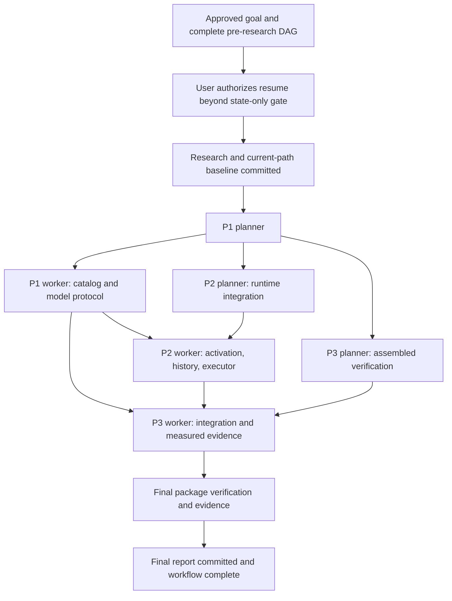

# State & Dependency Graph: Plugin skill scalability v1

## Workflow configuration

- Date: 4 November 2026.
- Branch: `codex/plugin-skill-scalability-v1`, created from local `main` at `118ba21`.
- Workspace: `D:/Peter/Aurvin Agent/Aurvin` (the original checkout, switched to the feature branch).
- Workspace correction: the user requested a branch, not an additional worktree. This session now uses the original checkout; do not create further worktrees for this workflow unless explicitly requested. Existing design/state commits are preserved. Research and execution remain paused.
- Keep workflow artifacts directly in `docs/plugin-skill-scalability/`; do not create extra workflow directories.
- Goal commits on this branch: `7a1fd9d` (design), `e095d16` (Ponytail simplicity and latency requirements).
- Goal approval evidence: after the design and simplicity amendment, the user requested the branch from current `main`, then said, "Good. Now start the MAW workflow. Create a state. I want to skip the code review for this one."
- Current authorization: user invoked `/resume` and selected `plugin-skill-scalability`. Resumed workflow; dispatching technical research and baseline capture (R).
- `--skip review` is explicit. Do not dispatch a reviewer or review-triggered fixer. Record review as **skipped**, never passed. Test failures still require correction by the owning worker.
- Research is **not skipped**. Brainstorming, research, planning, execution, and final verification remain required; only brainstorming and state initialization are complete so far.
- `dag_status: complete` reflects completion and reconciliation of research commit `86dd3974d5e000ab05f4d2285879a723fcd3f69f`. Ownership and contracts updated below.
- Preserve user changes, local configuration, and the recent `main` performance improvements. No dependency additions, new collections, unrelated refactoring, new permission framework, or additional plugins.
- Capacity: at most three child agents plus the orchestrator. Active agents: **0**. Independent ready planners run in foreground parallel; workers may overlap only with disjoint write ownership.
- The orchestrator manages state, dispatch, evidence, and serialized commits; it does not implement application code or read `research.md` / `plan*.md`. Assigned agents read their own artifacts and return concise summaries and commit IDs.

## Workflow milestones

- [x] Step 1: Brainstorming and goal alignment (`goal.md`; `7a1fd9d`, `e095d16`; approved by the start request).
- [x] State initialization: complete pre-research DAG, file ownership, readiness rules, acceptance mapping, and resume gate recorded here.
- [x] Step 2: Technical research and baseline capture (`research.md`; `86dd3974d5e000ab05f4d2285879a723fcd3f69f`).
- [x] Step 3: Planning completed (`plan1.md`: `e30b1a9`, `plan2.md`: `75e4bfb`, `plan3.md`: `3735aa0`).
- [x] Step 4: Execution completed (P1, P2, P3 workers verified and committed).
- [x] Step 5: Unified code review — **skipped** by explicit user instruction; not a passing review.
- [x] Step 6: Final verification and report (`verification.md`, `final_report.md`).

## Brainstorming tasks

- [x] Explore relevant project context and current Calendar tool flow.
- [x] Clarify progressive discovery, cache churn, argument enforcement, and schema lifetime.
- [x] Compare dynamic native tools with a stable dispatcher.
- [x] Align on compact discovery plus `activate_skill` and `call_tool`.
- [x] Write and commit the design and requested simplicity amendment.
- [x] Check the specification for placeholders, contradictions, ambiguity, and scope.
- [x] Obtain approval through the user's subsequent MAW initialization request.
- [x] Construct the complete pre-research DAG below.

## Initial findings

These are source observations for scoping, not passing test or provider evidence:

- `backend/src/contracts/calendar-tools.ts` defines the five Calendar tools and existing schemas. Reuse them rather than duplicating schema definitions.
- `backend/src/chat-runtime/calendar-loop.ts` passes all five `CALENDAR_TOOLS` to context assembly and Calendar model requests.
- Native names, model decisions, complete call/result groups, and durable decision records are currently Calendar-specific in `backend/src/contracts/calendar-model.ts`. Discovery must fit durable history and recovery, not merely return an in-memory schema.
- Model request serialization, streaming assembly, candidate validation, and repair are in `backend/src/model/calendar-*.ts`. Changing only the catalog would leave sibling paths inconsistent.
- Existing runtime, context, persistence, and plugin execution already provide argument validation, permissions, confirmations, operation records, budget accounting, and recovery. Extend those paths; do not recreate them.
- `backend/src/operations/calendar-assembly.ts` composes the existing executor and model port; `backend/src/app.service.ts` is central application wiring. Preserve the single runtime/persistence owner.
- Current local `main` includes `04485ad` (confirmed-state reuse) and `118ba21` (streaming renders and session navigation). Do not regress those changes or restore the older branch's application files.
- Both packages have their own manifests and lockfiles. There is no root package test/build command. Application tests have **not** been run for this state-only change.

## Confirmed product decisions

1. Initially expose plugin grouping plus names and short descriptions, not parameter schemas.
2. Use exactly two stable native discovery/execution definitions for eligible plugin-enabled requests: `activate_skill({ plugin, tools: "all" | [...] })` and `call_tool({ plugin, tool, arguments })`.
3. `calendar.all()` and `calendar.tools(...)` are conceptual shorthand for selecting all, one, or several schemas, not additional native tool layers.
4. Schema discovery is local metadata lookup. No Google request, OAuth refresh, connectivity probe, separate authorization service, or extra router model runs just to load a schema.
5. Append disclosures to ordinary tool history; retain loaded revisions for the chat and reuse them on follow-ups, reopening, and restart. Do not rewrite earlier disclosures, unload after each task, or add compaction.
6. Reject execution-before-load without performing a plugin action. Return an instruction to load the schema and retry automatically, within the existing shared repair and dispatch budgets.
7. Reuse the executor's authoritative argument/access/write-safety checks once at their existing boundaries; do not stack duplicate checks around each discovery step.
8. Normal first use adds at most one discovery round trip for a tool or selected batch. An already-loaded tool adds zero discovery round trips. Existing action confirmations and genuinely new dependencies remain possible.
9. Start with Calendar only. Synthetic catalog fixtures cover scaling; no new plugin platform, schema-version executor, activation store, dependency, or benchmark service.
10. Preserve call/result pairs, durable completion, idempotency, uncertain-write recovery, isolation, provider attribution, and finite budgets. Cache reuse is a measured opportunity, not a guaranteed outcome.

## Dependency matrix & execution status

This is a three-plan DAG deliberately kept small. P1 owns the shared model boundary; P2 owns runtime integration; P3 owns assembled evidence. Do not split these into extra architectural layers merely to create more parallel work.

`G` = approved goal and this complete DAG. `R` = technical research and baseline committed, with a summary accepted into this state. A worker prerequisite means implementation **and its focused verification** are committed, not merely that a plan exists.

| Node | Title and scope | Worker prerequisites | Primary ownership | Planner status | Worker status | Commits |
| :--- | :--- | :--- | :--- | :--- | :--- | :--- |
| R | Targeted research and current-path baseline | Resume authorization, G | `research.md`; read-only code investigation and existing local checks | Not applicable | [x] Complete | `86dd3974d5e000ab05f4d2285879a723fcd3f69f` |
| P1 | Compact catalog and stable model protocol | R, P1 plan committed | Shared contracts; model serialization/streaming/repair; contract/model tests | [x] `e30b1a961057b9a697c137330e9b47aa4b6cc109` | [x] Complete | `d2699f4`..`7fb2b4d` (8 commits) |
| P2 | Local activation, durable history, and existing executor integration | R, P1 worker complete, P2 plan committed | Runtime/context/persistence/central wiring; associated unit tests | [x] `75e4bfb810b2a4c0d1bfe1bdd472f45cfe2622f1` | [x] Complete | `76b1a45`..`dde096f` (11 commits) |
| P3 | Assembled workflow, cache-shape, and latency evidence | R, P1 and P2 workers complete, P3 plan committed | Integration/performance fixtures and evidence; no production implementation | [x] `3735aa0e9e4d3f6f9abeea278ee4213733e220c6` | [x] Complete | `ff05576`..`fde5cc6` (12 commits) |
| V | Final verification and final report | P1, P2, P3 workers complete | Orchestrator evidence and status records; fixes stay with owning workers | Not applicable | [x] Complete | `final_report.md` |

### Execution graph

Code review is deliberately absent from the graph. A failing gate returns to its existing owner, then the dependent checks rerun; this is defect correction, not a review phase or a new DAG subsystem.

### Planner readiness and immediate worker dispatch

| Planner | Earliest planning prerequisites | Worker start condition |
| :--- | :--- | :--- |
| P1 | Resume authorized; R committed and its summary recorded | P1 plan committed; R complete |
| P2 | R complete; P1 plan committed with model/history contract summarized | P2 plan committed; P1 worker verified and committed; reconcile any contract changes |
| P3 | R complete; P1 plan committed with testable request/record contracts summarized | P3 plan committed; P1 and P2 workers verified and committed |

- P1 worker and P2/P3 planners may occupy the three child slots together: one worker plus two foreground parallel planners. Their file ownership is disjoint.
- P2/P3 planners may plan from the committed P1 design; their workers may **not** treat that design as completed implementation.
- Dispatch a ready worker as soon as its prerequisites and committed plan are satisfied. Do not wait for all plans to finish.
- P2 worker can overlap a still-running P3 planner. P3 worker waits for integrated runtime behavior, not merely P2's plan.
- Serialize shared git staging and commits: grant one writer the commit slot at a time, stage named owned files only, and record actual hashes. No simultaneous index operations or `git add .`.
- Upstream contract changes pause affected downstream work for reconciliation. Reassign files explicitly in this state before an agent edits outside its ownership; never silently broaden scope.

## Plan scopes, file ownership, and completion gates

Ownership below covers only changes necessary for this goal, not permission to refactor every listed file. Reuse existing files first. Any minimal helper belongs in the existing subsystem and must be named in the owning plan before implementation. R may recommend a smaller ownership set; record any changes here.

### R — Targeted technical research and baseline

**Deliverable:** `research.md`, committed, plus a concise summary for the orchestrator; no production-code ownership.

**Scope:** Trace every current Calendar/model consumer, including ordinary text routing, voice reuse, streaming validation, decision records, history reconstruction, recovery, confirmation, and the confirmed-state cache. Identify the minimal contract changes needed to carry discovery and dispatch records across turns. Establish which paths should advertise the two tools without adding them to unrelated/disabled modes. Confirm provider serialization/caching constraints with current primary documentation if needed.

Capture the pre-change Calendar request shape and existing deterministic baseline checks at `e095d16` (application source based on `118ba21`) before replacing routing. Record exact environment, commands, model-request counts where observable, and serialized size/token estimates with labels. If prerequisites are absent, report the limitation; do not invent timing, token, or cache-hit measurements. No live provider or external provisioning.

**Handoff:** Commit hash, observed call sites, minimal ownership adjustments, proposed contract summary, history/restart strategy using existing records, baseline evidence, and any genuine blockers. The orchestrator verifies the commit, does not read the artifact, and updates this state from the summary.

**Exit gate:** Research committed; all call sites and runtime/history handoffs accounted for; pre-change baseline recorded or its unavailable measurements explicitly identified. No unresolved design blocker is silently delegated to workers.

### P1 — Compact catalog and stable model protocol

**Deliverable:** `plan1.md`; minimal shared contracts and model adaptation for the two native tools.

**Owned production files:**
- `backend/src/contracts/calendar-tools.ts`, `calendar-model.ts`, `calendar-accounting.ts`, `calendar-policy.ts`, `calendar-sources.ts`, `calendar-compatibility.ts` (added per research reconciliation) — only shared definitions needed by discovery/dispatch/history; other existing contracts require explicit ownership amendment.
- `backend/src/model/calendar-adapter.ts`, `calendar-policy.ts`, `calendar-stream.ts`, `calendar-validation.ts`, `calendar-repair.ts`.
- `backend/src/model/policy.ts`, `openrouter-adapter.ts`, `catalogue.ts` only where an existing consumer requires the same stable protocol; no routing/provider-policy redesign.

**Owned tests:** Necessary files under `backend/test/contracts/` and `backend/test/model/`.

**Scope:** Derive a compact catalog and requested schemas from existing tool definitions; define bounded discovery/dispatcher envelopes and complete records for normal results and recoverable errors. Serialize stable native tool definitions and parse their streamed calls. Preserve raw native names, arguments, call IDs, and results accurately in history while mapping execution to the existing Calendar operation types. Keep plugin-specific argument validation in the established executor path rather than duplicating it in the model adapter. Support existing persisted evidence without maintaining two production routing implementations.

**Exit gate:** Focused contract/model tests pass for compact catalog content, stable tool serialization, one/many/all selection contracts, complete call/result groups, streamed envelopes, and bounded repair diagnostics. Existing model/provider attribution and accounting checks remain intact. Report precise exported contracts, affected callers, commands, and commits to P2/P3.

### P2 — Local activation, durable history, and executor integration

**Deliverable:** `plan2.md`; runnable Calendar workflow through the existing runtime and executor.

**Owned production files:**
- Necessary files in `backend/src/chat-runtime/` and `backend/src/context/`, especially Calendar loop/budget/history/recovery, durable runtime, and confirmed-state cache integration.
- Necessary files in `backend/src/persistence/` for existing decision/history/checkpoint records; no new collection or independent activation store.
- `backend/src/app.service.ts`, `backend/src/operations/calendar-assembly.ts`, and existing runtime-composition consumers under `backend/src/operations/` as needed; no second runtime or persistence-close owner.
- `backend/src/agent/` and `backend/src/instructions/` only for existing graph/context instruction integration.
- Existing consumers under `backend/src/voice/` and `backend/src/plugins/google-calendar/` only when required to reuse the new routing path; no new voice feature, provider behavior, or authorization layer.

**Owned tests:** Necessary files under `backend/test/runtime/`, `backend/test/chat-runtime/`, `backend/test/context/`, `backend/test/persistence/`, and `backend/test/plugins/`, including their existing unit fixtures.

**Scope:** Resolve discovery locally, append its result with existing history persistence, derive loaded revisions from disclosed records, and execute loaded tools directly. Batch loads, acknowledge repeated loads compactly, support reopen/restart, and reject missing/stale schemas before a plugin action. Extend the current bounded correction loop, not a second retry engine. Reuse existing argument/access/confirmation/operation checks at their authoritative boundary. Preserve uncertain-write handling, cancellation, durable completion, user attribution, context limits, and cache-consistent follow-ups.

**Exit gate:** Focused runtime/context/persistence tests prove cold load then execution, direct warm execution, batch/all discovery with no Google/OAuth/preflight calls, automatic missing-schema correction with no action on rejection, shared-budget exhaustion, repeated-load deduplication, stale refresh, reopen/restart/isolation, and intact ordered history. Existing Calendar safety/recovery and confirmed-state-cache regressions pass. Report implementation commits and any prerequisite-bound skipped tests, not a blanket success claim.

### P3 — Assembled verification and task-level evidence

**Deliverable:** `plan3.md`; assembled deterministic checks and `verification.md` evidence. This worker is a test/evidence owner, **not a code reviewer**.

**Owned files:**
- Necessary existing fixtures and suites under `backend/test/integration/`, `backend/test/assembly/`, `backend/test/performance/`, `backend/test/benchmark/`, `backend/test/voice/`, and `backend/test/compatibility/`.
- `backend/src/benchmark/` only for a minimal adaptation to an existing measurement path; no new benchmark platform or production orchestration.
- `docs/plugin-skill-scalability/verification.md`.

**Scope:** Exercise the real assembled model/runtime/record path using deterministic provider/plugin fixtures, not only isolated helpers. Cover ordinary questions, one operation, multiple tools in a batch, repeated follow-ups, and a newly needed later tool. Assert that ordinary continuations preserve the already assembled prefix and two native definitions, with disclosures appended in position. Include larger synthetic catalogs without introducing integrations. Count model requests and external plugin/preflight calls; compare the recorded baseline without retaining a legacy implementation.

Use existing native isolation fixtures if operator-supplied prerequisites are available. Report missing MongoDB prerequisites or service evidence accurately. Route production defects to P1/P2, which add regression checks and correct their owned paths before P3 reruns; do not silently edit their production files.

**Exit gate:** Integrated assertions pass; normal-path discovery call counts meet the goal; no repeated authorization/provider preflight calls are introduced; existing Calendar/voice consumer compatibility is exercised. Evidence distinguishes serialized-size/token estimates from actual usage, fixture timings from provider latency, unavailable cache data from zero cache hits, and executed tests from skips. No claimed provider cache/cost win without authorized measurements.

### V — Final verification and report

After all workers complete, the orchestrator runs required package checks, records the tested commit set and environment, and writes `final_report.md`. Record actual failures/skips and return defects to their owning workers; rerun affected checks after fixes. Do not dispatch a reviewer. Close the workflow only when required evidence and the final report are committed and no unacknowledged blocking failure remains.

## Acceptance coverage

| Goal criterion | Primary owner | Integrated evidence |
| :--- | :--- | :--- |
| Compact names/descriptions; no initial parameter schemas; canonical plugin/tool IDs | P1 | P3 request/catalog assertions |
| One/many/all local schema discovery; bounded selections; no partial/truncated activation | P1, P2 | P3 assembled loads and limits |
| Two stable native definitions; append disclosures rather than rewrite prefix | P1, P2 | P3 serialized continuation comparison |
| Retain/reuse loaded schemas, deduplicate, reopen/restart, refresh stale versions | P2, P1 record contracts | P3 integrated history/recovery checks |
| Reject execution-before-load, instruct load-and-retry, share finite repair budget | P2, P1 error envelopes | P3 correction and exhausted-budget traces |
| Direct warm execution; batch cold loading; no Google/OAuth/auth preflight for discovery | P2 | P3 model/plugin call counts |
| Existing validation, permissions, confirmations, idempotency, uncertain writes, completion | P2 | P3 regressions and final suites |
| Correct isolation, causal call/result groups, provider user attribution, accounting | P1, P2 | P3 assembled checks and final suites |
| Ponytail implementation: reuse, no extra store/framework/dependency/duplicate checks | P1, P2 | P3 observable no-extra-call/state behavior; worker change summaries; not a review phase |
| Task-level baseline/comparison, synthetic scale, honest cache/token/latency limitations | R, P3 | `verification.md`, final report |
| Required package verification; review explicitly skipped | V | Final commands, results, commit record |

## Research handoff — complete (`86dd3974d5e000ab05f4d2285879a723fcd3f69f`)

- **Commit**: `86dd3974d5e000ab05f4d2285879a723fcd3f69f` (working tree clean, no production changes).
- **Consumers traced**: Text admission, voice exclusion, serialization/stream validation/repair, decisions/results, context reconstruction, confirmation, recovery, retention/accounting, central wiring, and confirmed-state cache.
- **Ownership amendment**: Added `backend/src/contracts/calendar-compatibility.ts` to P1 ownership.
- **P1 contract**: Exactly two frozen native tools (`activate_skill`, `call_tool`); bounded discovery/dispatch envelopes; preserve raw native identity; extend existing records for source-free disclosures/errors and legacy decoding. Reuse executor argument validation.
- **P2 strategy**: Reconstruct ordered complete groups from existing metadata, placing them within their originating turns. Derive loaded revisions only from disclosures actually assembled. Preserve confirmation, uncertain-write recovery, and cache validity. Current cross-turn reconstruction retains text, not native groups.
- **P3 evidence**: Matched cold/warm/batch/later-tool scenarios, disabled/voice isolation, restart, prefix stability, model/plugin/preflight counts, and task latency.
- **Baseline results**: Build passed. Focused contracts/model/context/assembly/cache checks: 609 passed. Authoritative post-build full suite: 2,502 passed, 60 failed, 10 skipped. Shared pagination failures traced to stale test callers; performance and authority assertions also fail. Five native schemas serialize to 2,774 bytes, without `strict: true`. Passing fixtures verify three-request correction and pagination flows.
- **Blockers & Limitations**: None for planning. Existing test failures block eventual completion claims. MongoDB prerequisites are absent; live token/cache/cost/latency measurements remain unavailable. Exact commands, measurements, and limitations recorded in `research.md`.

## Final verification commands and evidence

These commands were executed during Final Verification (Node v24.18.0, npm 12.0.1, Windows).

| Working directory | Command | Purpose / evidence status |
| :--- | :--- | :--- |
| `backend` | `npm run build` | Build/type verification — PASS (exit code 0) |
| `backend` | `npm run lint` | Type-aware lint — PASS (exit code 0; 0 errors, 585 pre-existing warnings) |
| `backend` | `npm test` | Full routine suite — 288 files / 2,558 tests passed (25 failed, 10 skipped) |
| `backend` | `npm run test:e2e` | E2E/native suites — 4 files / 22 tests passed (43 files / 139 tests skipped, MongoDB env absent) |
| `frontend` | `npm run build` | Consumer regression build — PASS (exit code 0) |
| `frontend` | `npm run lint` | Frontend regression lint — PASS (exit code 0; 0 errors) |
| `frontend` | `npm test` | Frontend regression suite — PASS (77 files / 607 tests passed) |
| Repository | `git diff --check` | Whitespace/patch hygiene — PASS (clean) |

- Each worker records exact focused test commands in its own plan and completion summary. P3 records assembled comparison commands in `verification.md`; no nonexistent test path is treated as verification.
- Native MongoDB tests require operator-supplied `AURVIN_TEST_MONGODB_URI` and `AURVIN_TEST_DB_PREFIX=aurvin_p2_test_`, isolated generated databases, and the admitted replica-set topology. Do not read/print application credentials, use application data, or run a second live backend on one database.
- Empty discovery and skipped native suites are not passing evidence. Record pass/fail/skip counts and blockers separately.
- Azure compatibility and live provider/staging measurements are not authorized by this workflow. No live paid calls or infrastructure provisioning. Deterministic request-shape tests do not prove provider cache hits.
- Frontend source/lockfiles and root product knowledge are outside planned write ownership. A genuine requirement to modify them must first be explained and added to this state, not silently included.

## Artifact and commit record

| Artifact / baseline | State | Commit |
| :--- | :--- | :--- |
| Current application baseline from `main` | Committed; includes both performance changes | `118ba21` (and parent `04485ad`) |
| `goal.md` initial design | Approved | `7a1fd9d` |
| `goal.md` simplicity amendment | Approved; authoritative goal version | `e095d16` |
| `state.md` | Complete DAG; initialization-only pause | Resolve its initialization commit with `git log -1 -- docs/plugin-skill-scalability/state.md` |
| `research.md` | Complete | `86dd3974d5e000ab05f4d2285879a723fcd3f69f` |
| `plan1.md` | Complete | `e30b1a961057b9a697c137330e9b47aa4b6cc109` |
| `plan2.md` | Complete | `75e4bfb810b2a4c0d1bfe1bdd472f45cfe2622f1` |
| `plan3.md` | Complete | `3735aa0e9e4d3f6f9abeea278ee4213733e220c6` |
| P1 implementation and test commits | Complete | `d2699f4`..`7fb2b4d` (8 commits) |
| P2 implementation and test commits | Complete | `76b1a45`..`dde096f` (11 commits) |
| `verification.md` | Complete | `fde5cc6` |
| `review.md` | **Skipped**; do not create a passing-review artifact | - |
| `final_report.md` | Complete | Pending commit |

## Current gate and resume procedure

**CURRENT GATE: WORKFLOW COMPLETE.**

No agents have been dispatched, no plans/research artifacts have been written, and no application implementation or final verification has begun. The user requested a complete DAG, not falsely completed workers. State initialization and document-consistency checks do not establish application readiness.

On a subsequent instruction to proceed:

1. Read this state, the approved `goal.md`, and current git status. Preserve intervening user changes; confirm the branch and baseline.
2. Set `resume_gate: none` and `status: complete`; record the new authorization and dispatch R only. Do not skip research without a new explicit user instruction.
3. Verify R's commit by hash/stat; use its returned summary to populate the handoff and reconcile the DAG/ownership. Do not read the research artifact in orchestrator context.
4. Dispatch P1 planner; once its plan is committed, start P1 worker and the ready P2/P3 foreground planners within the three-child capacity. Pass artifact paths to workers rather than reading plans here.
5. Pipeline P2 then P3 workers as their own plans and prerequisite implementations become committed and verified. Maintain status, ownership, and serialized named-file commits.
6. Correct failing checks through the owning workers. Keep unified code review **skipped**.
7. Run V, record the actual commit set/environment/check results/limitations in `verification.md` and `final_report.md`, and commit the report. Mark `status: complete` only after required evidence and the report are complete.
