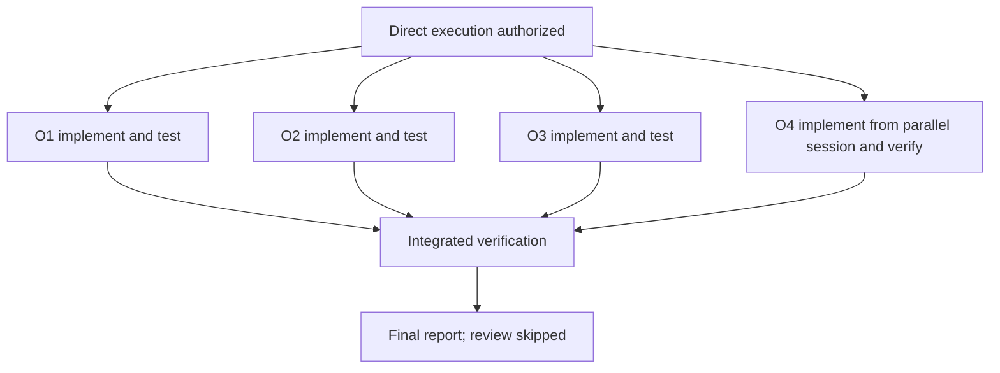

# State: Diagnostic report optimizations

## Current gate

The user explicitly directed: "Don't use any skills. Do everything in this session. Just spawn agents." Proceed directly with one implementation agent per opportunity, managed in this session. This supersedes skill-based planning and approval checkpoints. Investigation found valid cores in all four opportunities, with narrower claims and implementation boundaries.

## Workflow milestones

- [x] Initial report and relevant source investigation; current OpenRouter caching documentation consulted.
- [x] Direct execution authorized by latest user instruction; no further skills or approval checkpoints.
- [x] O1-O4 implementation complete (no separate planning agents).
- [x] Unified review explicitly skipped under repository instruction (not passed).
- [x] Integrated verification and final report complete.

## Dependency matrix and ownership

| ID | Opportunity | Planning prerequisites | Worker prerequisites | Ownership | Agent / commits | Status |
| --- | --- | --- | --- | --- | --- | --- |
| O1 | Stable context prefix | Direct execution authorized | Own investigation | Context assembler, system response-mode instructions, affected selector tests | `ef21b4d`; adapter/isolation reconciliation uncommitted | Complete |
| O2 | Anthropic cache policy | Direct execution authorized | Own investigation | Model policies and dedicated cache serialization tests; shared provider parameters cover text and calendar | `0731af7` | Complete |
| O3 | Batch acceptance verification | Direct execution authorized | Own investigation | Persistence messages and dedicated tests; no new index | `1331226` | Complete |
| O4 | Batch presentation deltas | Direct execution authorized | Own investigation | Chat presentation stream batching and frontend tests | `dfa7cc2`; implementation supplied by the user's parallel session and verified here | Complete |

One child session was used per investigated opportunity. Maximum three simultaneous children observed. O4 was dispatched here after the first three, then stopped before implementation; the user supplied its completed implementation from a parallel live session. It was verified and committed here. O1 and O2 changes do not overlap.

## Verification and evidence

- O1 focused context/voice/behavior checks: 6 files, 54 tests passed.
- O2 + O3 dedicated checks: 2 files, 31 tests passed.
- Dirty adapter assertion reconciled to the leading selector: 45 tests passed.
- Backend build passed; backend lint exited 0 with existing warnings.
- Backend e2e: 22 passed, 135 skipped (native prerequisites absent), 0 failed.
- Frontend build passed (existing >500 kB chunk warning); frontend lint exited 0 with existing warnings; frontend tests 513 passed, including 18 O4 coalescing tests.
- Full backend tests: 2331 passed, 10 skipped, 16 failed. All failures are outside the O1-O3 changes: 15 acceptance-target assertions in the pre-existing dirty `test/performance/durable-latency.spec.ts`, and one `test/assembly/calendar-simplification.built.spec.ts` timeout/module-load failure. The latter also failed in isolation.
- No live cache hit, cost reduction, TTFT, remote database latency, FPS, or production/Azure measurements were performed. Structural serialization tests prove request shape, not provider cache behavior.

## Preservation baseline

Initial `git status --short` showed substantial pre-existing tracked edits across calendar runtime/accounting/contracts, model adapter and adapter tests, persistence ownership, and performance tests; plus untracked benchmark/performance and latency-reduction documents. Preserve all of them. Do not stage or commit those files as this task's work. The new `docs/report-optimizations/` documents are task-owned.

## Resume

This session's scope is complete. O4 is committed as `dfa7cc2`. Re-run the frontend suite if further frontend changes are made.
