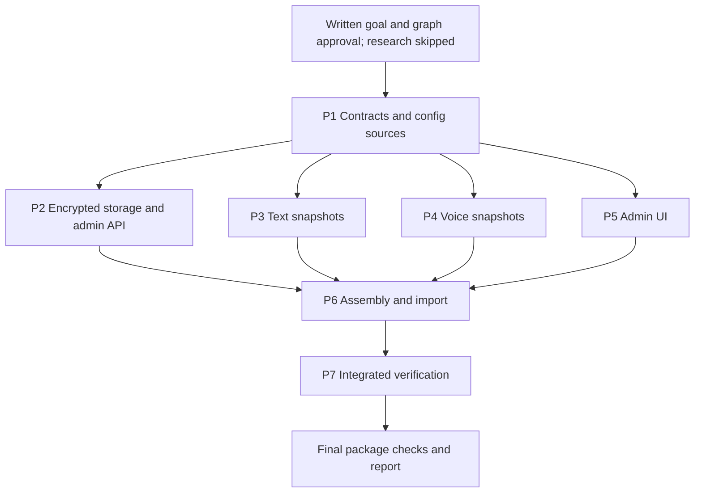

# State & Dependency Graph: Super-admin configuration

## Workflow configuration

- Keep artifacts directly in `docs/super-admin-config/`; reuse existing source/test locations.
- Research and review are **skipped**, not passed, per the user's written-spec approval on 13 October 2026. Planning, execution, defect correction, and final verification remain mandatory.
- Current authorization: written goal (`b5414fc`) and graph (`4171ec0`) approved with “I approve this.” User requested skipping research and code review. P1 worker and P2–P4 workers verified complete via stat-only checks (user-reported completion; worker self-reported check counts still to be confirmed by P7/final verification); P5 planner authorized for immediate foreground dispatch. No migration execution, agent-run live/paid calls, provisioning, or deployment authorized.
- The previously uncommitted `frontend/src/features/chat/state/*` modifications are now committed as `543e53c`, which falls outside P2/P3/P4 ownership (chat-state paths plus `backend/test/model/config-snapshot.ts`). Preserved as committed; no worker may silently extend those paths. P5 planner must confirm ownership before touching them; P7 routes the reconciliation to the responsible owner and verifies no regression.
- Work branch: `codex/super-admin-config`, created from `78599a8`. Preserve the preceding user commits, voice investigation documents, private `.env` files, `.openchamber/`, and all intervening unrelated changes. Checkout was clean at branch creation.
- The orchestrator manages graph/status/dispatch and documentation only, never implements code or reads `research.md`/`plan*.md`. Assigned agents read their artifacts and report summaries, interfaces, checks, and commit hashes.
- Maximum three child agents alongside the orchestrator. Independent planners run concurrently in foreground cohorts, never detached. Start ready workers immediately when their plan and prerequisite implementations are committed.
- User explicitly reaffirmed foreground parallel planners and requested no documentation headers in plans. Planners omit documentation/file-header boilerplate from plans and sample code; retain substantive scope, architecture, exact paths, tests, commands, and task details without a template header. Actual implementation code still follows repository source-file header requirements.
- P1 was launched foreground without a background flag. The user then explicitly moved that active blocking call to the background. This is a P1-specific runtime override, not permission to background subsequent planners; do not poll the active agent. Resume from its completion notification.
- Serialize staging/commits with explicit orchestrator-granted commit turns; agents awaiting a turn report ready paths and do not touch the index. Stage exact owned files only. Do not use `git add .` or stage an entire docs directory.
- Planner prerequisites and worker prerequisites are distinct. Upstream interface changes pause dependent work until reconciled. Ownership below supersedes earlier workflow plan labels only for this feature, not unrelated work.

## Workflow milestones

- [x] Step 1: Written goal and graph approved ([goal.md](goal.md); `b5414fc`, graph `4171ec0`; explicit session approval 13 October 2026).
- [x] Step 2: Technical research **Skipped** by user instruction; no research artifact/agent.
- [x] Step 3: All seven plans written and committed.
- [x] Step 4: All seven workers implemented, verified, and committed (P7 to environment limits; blocked gates explicit).
- [x] Step 5: Unified code review **Skipped** under repository `--skip review` instruction.
- [x] Step 6: Final verification and `final_report.md` committed (complete with explicit blocked gates).

## Brainstorming tasks

- [x] Explore current source, configuration, persistence ownership, UI, package commands, and recent commits.
- [x] Clarify encryption/transport, write-only fields, non-billable validation, automatic credential saving, and immediate activation.
- [x] Compare database authority, environment overlays, and rewriting `.env`; database authority selected.
- [x] Approve sidebar profile menu from user sketch and modern OpenAI-style dashboard direction.
- [x] Approve backend behavior and explicit one-time import.
- [x] Write specification, self-check boundaries/consistency, and construct DAG/ownership/acceptance mapping.
- [x] Obtain user approval of the written specification and graph before planner/worker dispatch: “I approve this,” 13 October 2026.

## Initial findings

- Existing `backend/src/platform/config/load-config.ts` and `voice-config.ts` parse provider, budget, infrastructure, and voice values from environment; migration must separate sources, not add a parallel override ladder.
- `AppService` constructs shared chat/voice/usage services at startup. Live application needs per-operation snapshots and coordinated admission, not replacement runtimes/persistence owners.
- `createPersistenceBundle`/`openPersistence` own executor admission and standard checkpointer setup. Local recovery uses a guarded client/mutation journal; config writes and import must retain those fences.
- `frontend/src/App.tsx` owns one ChatProvider/live voice shell. Sidebar currently has history/menu patterns but no account row or admin page. Navigation must not accidentally tear down voice or discard chat state.
- Existing UI tokens supply light/dark monochrome styling; React/Nest/MongoDB/Zod/Vitest already exist. No root workspace or routing library is installed; prefer existing/native navigation without an unnecessary dependency.
- Preliminary official documentation confirms OpenRouter `/api/v1/key` and Deepgram `/v1/auth/token` credential checks. Assigned P2 planner/worker verifies regional routing and strict response handling, not a separate researcher and not an assumption from successful fixtures.
- Existing user voice investigation commit `78599a8` is baseline context, not work owned by this feature. Do not silently mark its unresolved defects fixed.

## Confirmed product decisions

- Default role is server-assigned super admin; authentication/RBAC remain deferred. Local/protected-gateway use only.
- Chat stays landing page. Bottom profile menu opens Manage Aurvin; Sign out is disabled with explanation.
- Separate modern dashboard with Config default and empty Analytics; four settings sections, responsive/accessibility requirements.
- Provider credentials are write-only, encrypted in backend storage, never persisted by the application in browser storage, and transmitted over HTTPS outside explicit localhost development.
- Non-billable credential checks precede automatic credential persistence; no second Save click, no paid feature probe.
- Database is sole manageable runtime source; infrastructure/master key stays environment-only. Explicit one-time import preserves current configuration without overwriting a populated store.
- Confirmed saves activate for new work immediately; active work retains snapshots and usage history. Invalid edits/conflicts fail safely.

## Dependency matrix & execution status

`G` means written goal/graph approved; research is skipped. `P#` worker dependencies mean prerequisite implementation verified and committed; a plan commit alone is insufficient. The initial graph can be reconciled from planner interface summaries without a research phase.

| Plan | Title / subsystem | Worker dependencies | Planner status | Worker status | Commits |
| --- | --- | --- | --- | --- | --- |
| P1 | Contracts, source mapping, validation and bootstrap split | G | [x] `24fd5bc` | [x] Complete | plan: `24fd5bc`; worker: `5dc8df0..48126e2` |
| P2 | Encrypted config persistence, credential checks, admin service/API | P1 | [x] `5c4ca1f` | [x] Complete | plan: `5c4ca1f`; worker: `2e01d61`, `4002546`, `bef0462`, `40e30d6`, `3da8cdf`, `a395f40`, `808dc01`, `fe39d29`, `c433b18`, `49b3d03`, `d1df2f9`, `efcbe1b` |
| P3 | Text runtime/context/model settings snapshots | P1 | [x] `4dbbc6e` | [x] Complete | plan: `4dbbc6e`; worker: `ac3dba6`, `4072039`, `fc322ef`, `c3f6214`, `ecef688`, `7680c78`, `d076ad7` |
| P4 | Voice snapshots, capabilities and quota continuity | P1 | [x] `6831c19` | [x] Complete | plan: `6831c19`; worker: `7e98423`, `ad08b77`, `599fac3`, `a64ba64`, `a746a27`, `d8acafd` |
| P5 | Sidebar profile menu and modern admin frontend | P1 | [x] `fbaad01` | [x] Complete | plan: `fbaad01`; worker: `3e4b67b`, `b0c3e25`, `4c6ceff`, `1e627bd`, `8fde186`, `5c29417`, `49b8c8c`, `977bd8b`, `50ea392`, `eed1eb8`; browser evidence untracked under `.openchamber/screenshots/` (preserved) |
| P6 | Shared assembly, live activation, environment import and operator docs | P2, P3, P4, P5 | [x] `8e924b3` | [x] Complete | plan: `8e924b3`; worker: `4f0a88e`, `2a807ce`, `9f97b6e`, `b5e7805`, `4a2ccd0`, `4650891`, `29a81fa`, `9b8e89a`, `e530c26`, `2d2629f` (worker-reported: backend build/lint/test 874 passed; frontend build/lint/test 314 passed; e2e native-gated only) |
| P7 | Integrated verification, native fixtures and evidence | P6 | [x] `3c2a0d2` (content rewritten `3ae96ab`) | [x] Complete to environment limits | plan: `3c2a0d2`/`3ae96ab`; worker evidence: `fb4e925` |

### Execution graph

### Planner readiness and immediate worker dispatch

| Planner | Earliest prerequisites | Worker start condition |
| --- | --- | --- |
| P1 | Written goal/graph approved; research skipped | P1 plan committed |
| P2, P3, P4, P5 | P1 worker committed | Own plan committed; P1 complete |
| P6 | P1 worker complete; P2–P5 plans committed | Own plan committed; P2–P5 workers complete |
| P7 | P6 plan committed; P2–P5 workers complete | Own plan committed; P6 worker complete |

- Dispatch independent planners in foreground cohorts fitting the three-child limit. A ready worker takes an available slot immediately rather than waiting for unrelated planning.
- P2–P5 have disjoint write ownership; coordinate shared interfaces through P1. Concurrent execution is permitted, concurrent Git-index mutation is not.
- P6 integrates reported interfaces/commits, not unfinished drafts. P7 routes observed defects to their owner; it is not a unified reviewer.

## Plan scopes, file ownership, and completion gates

### P1 — Contracts, configuration source split, validation

**Deliverable:** `plan1.md`; exhaustive manageable/bootstrap mapping and settings/snapshot/API contracts.

**Owned:** `backend/src/contracts/**` (feature-related changes only); `backend/src/platform/config/**`; matching config/contract tests; frontend admin wire types under `frontend/src/api/admin-config-protocol.ts`; package manifests/lockfiles only if a justified change is required.

**Scope:** Reuse existing defaults and cross-field validators; schema/revision/secret operation rules; server-only bootstrap/master-key parsing; obsolete environment warnings; immutable privacy/topology/storage safety ceilings. Coordinate types without implementing P2/P3/P4/P6 wiring. Prefer no new dependency.

**Exit:** Tests prove source separation, safe defaults, bounded settings, rejected unknown fields and invalid combinations, redacted wire contracts, and fixed single-session concurrency/privacy policy.

### P2 — Encrypted storage, provider validation, admin API

**Deliverable:** `plan2.md`; config repository, encryption/verification service, independent admin module/controller and activation port.

**Owned:** New `backend/src/admin-config/**`; new `backend/src/persistence/config.ts` and its dedicated tests; config index/bundle/export changes in `backend/src/persistence/indexes.ts`, `persistence.ts`, `index.ts`; dedicated unit/API tests outside P7 integration fixtures.

**Scope:** One bounded `config` document; AES-GCM envelopes; bounded non-billable allowlisted provider checks; credential Validate and save/removal; redacted reads/errors/logs; CAS and uncertain-write handling; request origin/body/rate/cache protection. Use existing guarded persistence; no new Mongo client or central application composition here.

**Exit:** Encryption/tamper/nonce, no-secret-exposure, successful validate-save, failed/malformed/timeout validation preservation, delayed-validation CAS conflict, journal/ownership failure, and input/security tests pass.

### P3 — Text snapshots

**Deliverable:** `plan3.md`; current settings port and attempt-stable text execution.

**Owned:** `backend/src/chat-runtime/**`, `backend/src/context/**`, `backend/src/model/**`, `backend/src/agent/**`, feature-required `backend/src/http/**`, and their focused tests. Do not edit P1 contract files or P6 assembly.

**Scope:** Snapshot per admitted new attempt; automatic retries remain on original settings; explicit retry uses current settings; catalogue/context/output safety and shared admission updates; durable terminal/recovery behavior unchanged. No keys in persisted attempts/checkpoints.

**Exit:** New versus active attempt revision tests, automatic/explicit retry distinctions, output/context limits, lowering-concurrency admission, provider attribution, and saved-result finalization/reconciliation regressions pass.

### P4 — Voice snapshots and accounting continuity

**Deliverable:** `plan4.md`; session-stable speech settings and dynamic safe capabilities/admission.

**Owned:** `backend/src/voice/**` and matching backend voice tests; `frontend/src/features/voice/**` only for required safe-config refresh/session-snapshot consumption. No voice-orb redesign or unrelated defect-investigation edits.

**Scope:** New sessions use current keys/flags/limits; active dictation/live/reconnect/turn/accounting retain session snapshots. Disable mode for new admission only; preserve quota counters and unknown rates. Expose a refresh hook for P5 rather than sharing edit ownership.

**Exit:** New/active session key and limit tests, reconnect/live-turn consistency, capabilities refresh without active-session renegotiation, disabled-mode admission, lowering-quota behavior and non-reset accounting pass.

### P5 — Frontend dashboard and entry point

**Deliverable:** `plan5.md`; modern responsive admin interface matching the approved screenshot entry.

**Owned:** `frontend/src/features/admin-config/**`; `frontend/src/api/admin-config-client.ts`; `frontend/src/components/Sidebar.tsx`; `frontend/src/App.tsx`, `App.css`; minimal related sidebar/icon CSS/components; `frontend/src/features/chat/ChatView.tsx` only for navigation integration; focused frontend tests. P1 owns admin wire types and P4 owns voice internals.

**Scope:** Bottom profile menu; disabled Sign out; separate Config/empty Analytics; section-based fields; fixed masked credentials; validate-save, replace/remove, dirty/save/conflict/error states; safe capability-refresh hook. Keep provider/lifecycle owners mounted and credentials out of storage. Use frontend-design skill with existing Aurvin tokens and native/existing navigation where sufficient.

**Exit:** Menu/tab/section, accessibility, fixed mask/no reveal/no storage, credential clearing, no unrelated dirty-field save, conflicts, draft preservation, active work navigation, and desktop/mobile browser checks pass. Source/static rendering checks alone do not prove interactions work.

### P6 — Assembly, activation, import and operations

**Deliverable:** `plan6.md`; one integrated config owner, live revision publication, explicit migration command and operator guidance.

**Owned:** `backend/src/app.service.ts`, `app.module.ts`, `main.ts`, related central assembly tests; `backend/src/platform/platform.module.ts`, tokens/identity files only as required; feature-related `backend/src/operations/**`; new `backend/src/scripts/import-config.ts`; `.env.example`, README/setup/run guidance and feature operations doc. P1 coordinates any package script changes.

**Scope:** Open one guarded persistence bundle, load/decrypt config before generation admission, make admin accessible while chat is unconfigured, validate/commit/publish candidate with no duplicate owners, preserve drain/recovery, import through admitted ownership with no overwrite or secret output, document HTTPS boundary/master-key backup/manual env cleanup/rollback.

**Exit:** Blank-key admin bootstrap, DB/encryption/schema failures, immediate confirmed activation, reload durability, single close/reservation/usage owner, import atomicity/idempotency/ownership, and safe drain/uncertain-write tests pass.

### P7 — Integrated verification and evidence

**Deliverable:** `plan7.md`; acceptance matrix and actual integration evidence.

**Owned:** Dedicated backend admin-config integration/e2e tests in existing backend test locations; `frontend/src/features/admin-config/integration-tests/**`; `docs/super-admin-config/verification.md` and evidence entries in feature operations docs. Orchestrator owns `state.md` and `final_report.md`.

**Scope:** Integrate fixture text/voice/UI flows, encrypted native persistence/restart/import when isolated prerequisites exist, security boundaries, malformed/failing provider checks and concurrent revisions. Inspect actual dashboard desktop/mobile with browser tools. No paid/live calls, application-data mutations, reviewer dispatch, or readiness claims from file existence.

**Exit:** AC1–AC8 mapped to actual checks; package checks pass; skips and release blockers explicit. Correct defects through their owning workers, then rerun affected checks. Unrun required gates must not be labeled complete/passed.

## Acceptance coverage

| Criterion from goal | Primary owners | Integrated verification |
| --- | --- | --- |
| AC1: Navigation, dashboard, Analytics | P5 | P7/browser |
| AC2: Source separation | P1, P6 | P7/restart/import |
| AC3: Write-only encrypted credentials | P1, P2, P5 | P7/security/native |
| AC4: Validate then save | P2, P5 | P7/provider fixtures |
| AC5: Immediate consistent activation | P3, P4, P6 | P7/text/voice/navigation |
| AC6: Safe saves/removal/conflicts | P1, P2, P3, P4, P5, P6 | P7/failure matrix |
| AC7: Import/restart durability | P2, P6 | P7/native/operator procedure |
| AC8: Integration/security/regressions | All | P7/final verification |

## Research handoff — skipped

User explicitly skipped research with written-goal approval. No researcher or `research.md`. Planners/workers inspect their assigned current source and verify relevant primary API/library documentation for correctness; report interface/source-map decisions, risks, dependency adjustments, and check prerequisites in concise handoffs. The orchestrator verifies plan commits via `git log -1 --stat <hash>` without reading plans.

## Final verification commands and evidence

All commands below are **planned, not run for this feature**. No zero-test/skip exit is a passing result. Record environment and actual counts.

| Directory | Command/check | Purpose |
| --- | --- | --- |
| backend | `npm run build` | Compile/type validation |
| backend | `npm run lint` | Existing type-aware lint |
| backend | `npm test` | Routine fixtures and regressions |
| backend | `npm run test:e2e` | Existing e2e plus integrated admin flows |
| frontend | `npm run build` | Compile/bundle |
| frontend | `npm run lint` | Existing lint |
| frontend | `npm test` | State/client/render/interaction checks supported by established infrastructure |
| backend | Native isolated config/import/restart suites selected by P7 | Requires operator-supplied replica-set test URI and `AURVIN_TEST_DB_PREFIX=aurvin_p2_test_`; never application DB |
| Browser | Actual desktop/mobile dashboard/navigation inspection with fixtures | Layout, keyboard/forms, secret masking, chat/voice continuity |
| Documentation | Links, graph, ownership, source mapping, commit/evidence consistency | No unrelated tests for documentation-only checkpoint |

Azure/live provider/gateway/paid checks are not authorized. Final checks must distinguish fixture passes from skipped native/provider/browser prerequisites. Any required unrun acceptance gate remains blocked, not passed.

### Documentation checkpoint — 13 October 2026

- Passed local Markdown-link existence checks, AC1–AC8 goal/graph coverage, seven plan-scope presence, goal placeholder scan, whitespace checks, and pending-approval/skipped-review gate checks.
- Specification staged diff whitespace check passed. No application builds/tests, native checks, provider requests, migration, or agent dispatch performed for this documentation-only checkpoint.
- Written goal committed as `b5414fc`; graph/status committed separately. Git history identifies this state checkpoint's commit without a self-referential hash.

## Artifact and commit record

| Artifact | State | Commit |
| --- | --- | --- |
| `goal.md` | Written specification approved; skip flags recorded in subsequent approval checkpoint | `b5414fc` |
| `state.md` | Initial graph approved; execution authorized | `4171ec0`; approval checkpoint in Git history |
| `research.md` | **Skipped**; no artifact planned | — |
| `plan1.md`–`plan7.md` | All seven written (`24fd5bc`, `5c4ca1f`, `4dbbc6e`, `6831c19`, `fbaad01`, `8e924b3`, `3c2a0d2`) | `24fd5bc`, `5c4ca1f`, `4dbbc6e`, `6831c19`, `fbaad01`, `8e924b3`, `3c2a0d2` |
| `verification.md` | Complete to environment limits; blocked gates explicit | `fb4e925` |
| `final_report.md` | Complete with blocks | This final checkpoint; see Git history |
| Unified review | **Skipped**; no review artifact planned | — |

## Current gate and resume procedure

**CURRENT GATE: COMPLETE WITH BLOCKS — FINAL REPORT COMMITTED.**

- P7 worker evidence committed as `fb4e925` after a clean secret scan. Orchestrator independently re-ran final checks: backend build/lint/test (114 files, 875 passed, 10 skipped) and frontend build/lint/test (47 files, 317 passed) all pass.
- Blocked items stay blocked, never passed: native AC7/isolated-DB evidence (no operator URI), AC5 provider-gate scoping (F2 `attemptConfigRevision` gap), F1 `543e53c` reconciliation, F3 legacy-harness correction, AC4 matrix expansion. Review **skipped**.
- Uncommitted chat-state modifications are preserved as-is; P5 planner must confirm ownership with the user before touching those paths.
- Carried forward: user-reported pending P6 item (not a P1 defect) — `platform.module.ts` still calls `loadConfig(process.env)`; P6 must switch to bootstrap config, emit the name-only legacy warning once, wire stored config plus current-config port, extend CORS for admin mutation, and run the explicit import command. Downstream start points: P2 from ConfigRepository/envelope schemas/redacted contracts; P3/P4 from current-config port, frozen snapshots, `dictationWarningMs`; P5 from `frontend/src/api/admin-config-protocol.ts` only.

1. Read this state, [goal.md](goal.md), current status and intervening commits; preserve user work. Do not read research/plans in orchestrator context.
2. Written-spec approval is recorded; research and review are skipped. Do not reopen the approval gate or dispatch a researcher/reviewer.
3. Link any issue/change request actually assigned/opened/resolved for this task immediately. None has been supplied or opened at this checkpoint.
4. P7 evidence committed (`fb4e925`); final checks independently re-run and recorded; `final_report.md` committed. Workflow complete with explicit blocked gates.
5. Dispatch ready foreground planners and immediately pipeline eligible workers; enforce three-child capacity, ownership, and serialized commit turns.
6. P7 records integrated evidence and routes observed defects to owners. Unified review stays **skipped**.
7. Run final checks, reconcile commit/evidence records, and commit `final_report.md`. Mark complete only when required evidence is complete; keep unmet acceptance/release gates explicit.
