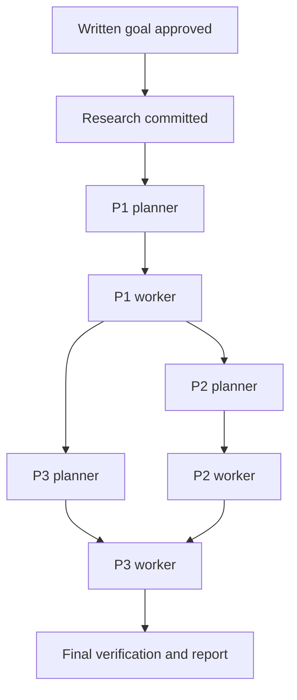

# State & Dependency Graph: Voice Calendar Canvas

## Workflow configuration

- Keep workflow artifacts in `docs/voice-calendar-canvas/`.
- At most **three implementation plans**, as requested by the user.
- Unified review is **skipped**, not passed. No reviewer or review-triggered fixer is to be dispatched.
- User explicitly reconfirmed skipped review and required very simple implementation work, polished UI, and no added latency to voice/text. Reuse existing safeguards and flows; do not create a validation framework or add display-only calls/serial waits. Apply the goal's latency requirements to every handoff.
- Research, planning, execution, meaningful tests, compatibility checks, test-discovered defect correction, and final verification remain required.
- Current authorization: record the aligned design and initialize MAW; await explicit approval of written `goal.md` before dispatching any agents.
- Orchestrator manages graph/status/dispatch and documentation only; it must not implement code or ingest `research.md` or `plan*.md`.
- Capacity: at most three child agents alongside the orchestrator. Independent planners run foreground-parallel; disjoint workers may overlap. Serialize all staging/commits through explicit ownership and permission.
- Preserve all unrelated changes and `.openchamber/`; stage only named task files. Initial checkout: `main`, HEAD `707ef11`, clean tracked/untracked status reported by `git status --short`.
- Do not provision infrastructure or make live/paid provider calls. No database inspection or mutation is authorized by this workflow setup.

## Delegation configuration & handoffs

| Handoff ID | Role | Plan/phase scope | Prompt reference | Expected artifacts | Status | Returned evidence |
| :--- | :--- | :--- | :--- | :--- | :--- | :--- |
| P3-W1 | worker | P3 integrated verification and completion (`plan3.md`) | Chat handoff prompt, 11 Nov 2026 | `backend/test/voice/integration/calendar-voice.spec.ts` + fixture extension, HTTP publication spec, latency/non-blocking specs, frontend voice integration test, `docs/voice-calendar-canvas/verification.md`; focused and full check results; commits | verified | `433c397`, `6964ca7`, `cc69720`, `f1a4926`, `ba534f4`; 32 backend integration + 22 latency/reference + 10 frontend focused tests pass; full backend exit 1 for classified pre-existing suites plus one P1 mirror; frontend 782/782; committed paths match ownership |

- P3-W1 continued an interrupted automatic worker. The prior uncommitted spec draft was preserved, corrected, and committed in `433c397`.
- Returned evidence was checked against git metadata and `verification.md`; the P1 mirror defect was routed for correction rather than accepted as a pass.

## Workflow milestones

- [x] Step 1a: Goal and initial DAG written and committed (see artifact record).
- [x] Step 1b: Written goal approval (explicitly approved by user on 11 November 2026).
- [x] Step 2: Technical research (`docs/voice-calendar-canvas/research.md`; `e45918e`).
- [x] Step 3: All three plans committed (P1: `489986e`, P2: `cb174a6`, P3: `2638c7a`).
- [x] Step 4: All three workers complete with verification evidence (P3: `d203665`, `c68c2f5`, `3cca8b4`, `433c397`, `6964ca7`, `cc69720`, `f1a4926`, `ba534f4`; P1 mirror correction: `3cda6a0`).
- [x] Step 5: Unified review **skipped** per repository instruction.
- [x] Step 6: Final verification and `final_report.md` complete.

## Brainstorming tasks

- [x] Explore relevant existing Canvas, calendar feedback, voice bridge, and recent commits.
- [x] Clarify mode distinction: voice auto-opens; text stays inline with an explicit Canvas button.
- [x] Compare approaches: reuse structured authority/projections rather than a duplicate stack or model-authored operation visuals.
- [x] Record approved conversational direction in `goal.md`.
- [x] Self-check written scope, mode policy, safety, ownership, and acceptance criteria.
- [x] Obtain user approval of written specification (approved by user on 11 November 2026).
- [x] Construct initial DAG, separate planner/worker prerequisites, ownership, gates, acceptance mapping, and resume procedure.

## Initial findings

- `frontend/src/features/chat/ChatView.tsx` already combines text/live Canvas artifacts and has a calendar success auto-open path. Text calendar auto-open must be changed intentionally, without altering unrelated visual artifacts.
- `frontend/src/features/canvas/CanvasPanel.tsx` already displays calendar artifacts beside other visual types; its diagram-style controls do not automatically suit an interactive agenda.
- `frontend/src/features/canvas/renderers/calendar-event-renderer.tsx` renders confirmed single-event cards; do not mislabel lookup/proposal cards as confirmed creations.
- `frontend/src/features/plugins/google-calendar/CalendarTurnRegion.tsx` already presents progress, receipts, clarification, and confirmation details; reuse authoritative semantics and safe helpers where appropriate.
- `backend/src/voice/agent/agent-voice-adapter.ts` bridges live turns to the durable runtime and emits existing visual artifacts. Research must trace calendar execution and confirmation through this path rather than assume shared-model parity.
- Older Phase 1 restrictions describe a historical baseline; this feature targets the actual current calendar/voice implementation. No claim is made that existing plans/docs establish current passing verification.

## Confirmed product decisions

- Voice uses automatically presented, interactive calendar Canvas; text uses inline content and a manual Canvas entry point.
- One evolving workspace per operation, not a new tab per progress tick.
- Inline voice confirmation, with explicit speech/buttons resolving one server-authorized proposal.
- Structured provider/runtime evidence determines visuals and outcomes; no generated percentages or model-invented calendar facts.
- Dismissal/barge-in do not authorize or implicitly cancel writes; repeated updates respect dismissal.
- Scope is existing supported calendar actions, not a new scheduling product.
- Minimal implementation is mandatory: reuse existing authority/validation rather than duplicate checks. Protect real trust boundaries and single-write correctness without speculative defensive layers.
- Canvas presentation must not gate speech/text streaming or add model/provider calls, polling, or blocking round trips. Measure representative paths and verify delayed/failed visual handling is non-blocking; do not claim unmeasurable absolute zero overhead.

## Dependency matrix & execution status

`R` means completed, committed research. Worker dependencies require implementation, meaningful verification, and a committed handoff, not merely a committed plan.

| Plan | Scope | Worker dependencies | Ownership boundary | Planner | Worker | Commits |
| --- | --- | --- | --- | --- | --- | --- |
| P1 | Calendar authority and voice bridge | R | Backend contracts (calendar-wire, message/api, voice-wire), all-day read projection, CalendarLoop view emission, publication/hydration write, durable live admission + memory-first frame bridge, adapter emitCalendar/calendarControl, live-flow confirm, system.md, and backend unit tests | [x] `489986e` | [x] Complete (`f9ca285..d8ee6a4`; mirror correction `3cda6a0`) | `f9ca285`, `2f527e7`, `ae67d48`, `ae1509f`, `d7f2243`, `dc41dc4`, `8b316a4`, `aec4d95`, `4727f20`, `a7bfd0c`, `2fb134e`, `f77cfda`, `d8ee6a4`, `3cda6a0` |
| P2 | Voice-first Canvas and text entry points | P1 | Frontend protocol mirrors, live controller/reducer calendar slice + confirmCalendar, ChatView text auto-open removal + voice workspace auto-open/dismissal, Canvas calendar mode without pan/zoom, agenda/review/outcome renderers, hydration/dedupe, CalendarTurnRegion result button, CSS/accessibility, and frontend unit tests | [x] `cb174a6` | [x] Complete (`dfe477f..fd253a7`) | `dfe477f`, `8c2a438`, `e3f3ce6`, `cff5e8e`, `330638d`, `a54073f`, `eed4d4f`, `bb79e77`, `9550b8f`, `fd253a7` |
| P3 | Integrated verification and completion | P1, P2 | Backend/test/voice/integration/calendar-voice.spec.ts + fixture extension, HTTP publication spec, latency/non-blocking specs, frontend voice integration test, verification.md, final report inputs | [x] `2638c7a` | [x] Complete (manual P3-W1; `d203665..ba534f4`) | `d203665`, `c68c2f5`, `3cca8b4`, `433c397`, `6964ca7`, `cc69720`, `f1a4926`, `ba534f4` |

### Execution graph

### Planner readiness and immediate dispatch

| Planner | Earliest prerequisite | Worker start gate |
| --- | --- | --- |
| P1 | Approved goal and R committed | P1 plan committed and R complete |
| P2 | P1 worker committed; stable structured/wire handoff | P2 plan committed and P1 complete |
| P3 | P1 worker committed; stable structured/wire handoff | P3 plan committed and P1/P2 workers complete |

- Dispatch P2/P3 planners foreground-parallel when ready; serialize their commits. Start P2's worker as soon as its plan returns and dependencies are satisfied; do not hold it for further P3 planning.
- Reconcile upstream interface changes before downstream work proceeds. Record exact file ownership from researcher/planner summaries without reading their full artifacts.

## Plan scopes, ownership, and completion gates

### P1 — Calendar authority and voice bridge

- Deliverable: `plan1.md`; committed backend implementation and a concise stable handoff for frontend/verification planners.
- Initial ownership: relevant `backend/src/contracts/`, `backend/src/chat-runtime/`, `backend/src/voice/`, existing calendar plugin internals only as necessary, and their backend unit tests. Backend migrations/wiring only if research demonstrates necessity; reuse existing runtime ownership.
- Exit: deterministic tests for real lifecycle/result projections, reuse of existing schema/safety checks with only necessary boundary additions, speech/button confirmation correlation and races, no duplicate writes, durable truthful outcomes, and correct voice continuation. No display-only model/provider requests or visual awaits on speech/text critical paths. Build/lint plus relevant regressions pass or baseline blockers are isolated and reported.

### P2 — Voice-first Canvas and text entry points

- Deliverable: `plan2.md`; implemented accessible views and frontend integration.
- Initial ownership: `frontend/src/api/`, `frontend/src/features/canvas/`, `frontend/src/features/chat/`, `frontend/src/features/voice/`, calendar plugin UI as needed, related styles and unit tests.
- Exit: tests demonstrate voice auto-open and sticky dismissal, text manual-only calendar Canvas, inline text feedback, correlated interactive confirmation, agenda edge cases, safe rendering, history hydration, navigation isolation, and no regression of non-calendar Canvas/voice behavior. Visual rendering/animation must not gate audio or chat delivery. Frontend build/lint/tests run.

### P3 — Integrated verification and completion

- Deliverable: `plan3.md`; integration checks, `verification.md`, and `final_report.md` evidence inputs.
- Initial ownership: dedicated cases under `backend/test/voice/integration/`, `backend/test/http/`, frontend existing integration-test areas, fixtures used exclusively by these cases, and workflow verification documentation. P1/P2 retain source and unit-test ownership. Confirm exact named integration files before dispatch.
- Exit: fixture-driven lookup-to-agenda and proposal-to-single-write scenarios exercise the actual supported transport/state path; lifecycle failures, stale frames, duplicate confirmation, reload/mode switch, and text/voice opening differences are covered. Include a representative deterministic before/after latency comparison and delayed/failed-visual non-blocking checks, with request/serial-dependency evidence. Run all required package checks, recording actual results/skips/limitations and browser evidence when available.
- Test-discovered defects return to the owning worker for correction and rechecks. This is execution verification, not a reinstated unified review. The orchestrator finalizes graph/status/report after receiving evidence.

## Acceptance coverage

| Criterion | Primary ownership | Integrated verification |
| --- | --- | --- |
| AC1 Voice lookup | P1, P2 | P3 |
| AC2 Text/manual opening | P2 | P3 |
| AC3 Safe confirmation | P1, P2 | P3 |
| AC4 Truthful lifecycle | P1, P2 | P3 |
| AC5 Agenda integrity | P1 payloads, P2 presentation | P3 |
| AC6 Continuity/isolation | P1 durability, P2 hydration/navigation | P3 |
| AC7 Accessible presentation | P2 | P3 interaction evidence |
| AC8 Verification evidence | All workers | P3 and final orchestration |
| AC9 Minimal work/latency preserved | P1 critical path, P2 lightweight presentation | P3 measurements and non-blocking checks |

## Research handoff — complete (`e45918e`)

- **Voice bridge gap & runtime admission**: The adapter previously never supplied `emitCalendar`; durable runtime excluded live/internal turns from `CalendarLoop` (`admitCalendarBudget` skipped for live, `calendarWindow` required `!internal`), and `runCalendarTurn` hard-coded `responseMode: 'text'`. Memory-first dropped non-delta frames without `emitCalendar`. P1 bridges these paths in the backend so voice runs the calendar loop and emits frames.
- **Structured lookup projection & all-day support**: `executeReadV2` previously persisted to metadata without emitting views; Canvas synthesized cards only for succeeded create actions. Date-only all-day events were dropped by `projectEvent` in `calendar-api.ts`. P1 extends read schema to support all-day events with exclusive end dates, UTC instants, and `displayTimeZone`.
- **Text auto-open removal**: Text calendar auto-open is located in `ChatView.tsx` (~lines 178–211). P2 removes this auto-open block; text remains inline with an explicit Canvas inspect button.
- **Race-safe confirmation**: Spoken "yes" works once voice executes the calendar loop (CAS proposal confirmation). For voice Canvas buttons, P1 adds a `calendar.confirm` live control event resolving the same proposal.
- **Continuity & hydration**: Optional bounded `calendarView` (<=14KB) on assistant messages or voice-only canvasArtifacts ensures reloaded sessions preserve visual cards.
- **Wire interfaces**: `calendar-view` protocol 3 event, `calendar.frame` voice server event, `calendar.confirm` voice client event.
- **Latency & non-blocking discipline**: Synchronous sink calls (never awaited in voice stream); text view emitted at publication; executing state on tool start; reuse `DependencyProbe/latency-runtime-fixture` and `calendar-critical-path.spec.ts` for before/after measurements and non-blocking verification.
- **Ownership boundaries**:
  - **P1**: Backend contracts (`calendar-wire`, `message/api`, `voice-wire`), all-day read projection, `CalendarLoop` view emission, publication/hydration write, durable live admission + memory-first frame bridge, adapter `emitCalendar`/`calendarControl`, live-flow confirm, `system.md`, and backend unit tests.
  - **P2**: Frontend protocol mirrors, live controller/reducer calendar slice + `confirmCalendar`, `ChatView` text auto-open removal + voice workspace auto-open/dismissal, Canvas calendar mode without pan/zoom, agenda/review/outcome renderers, hydration/dedupe, `CalendarTurnRegion` result button, CSS/accessibility, and frontend unit tests.
  - **P3**: `backend/test/voice/integration/calendar-voice.spec.ts` + fixture extension, HTTP publication spec, latency/non-blocking specs, frontend voice integration test, `verification.md`, final report inputs.

## Final verification commands and evidence

| Directory | Commands | Evidence required |
| --- | --- | --- |
| `backend/` | `npm run build`, `npm run lint`, `npm test`, `npm run test:e2e` | Exit results, actual counts, failed cases, prerequisite skips |
| `frontend/` | `npm run build`, `npm run lint`, `npm test` | Exit results, actual counts, regression results |
| Repository | `git diff --check` and named artifact/link/DAG checks | Clean task diff and internally consistent state |
| Browser, when available | Fixture-backed desktop/mobile voice/calendar interactions | Auto-open/manual opening, focus, dismissal, pending controls, reduced motion, no mic/playback interruption |
| Deterministic integration fixtures | Representative before/after voice/text timing, request counts, delayed/failed visual handling | No new serial waits/display-only calls; visual handling cannot gate speech/text; record noise/limits |

Checks have run for this feature; see `verification.md` for the full ledger. Empty discovery or skipped native suites are not passing evidence. Live services need separate authorization. Record tested commit set, environment, limitations, and outstanding blockers before marking complete.

## Artifact and commit record

| Artifact | State | Commit |
| --- | --- | --- |
| `goal.md` | Approved by user (11 Nov 2026) | `2426437` |
| `state.md` | Complete; final workflow state | [Final docs commit] |
| `research.md` | Complete | `e45918e` |
| `plan1.md` | Complete & implemented | `489986e` (impl: `f9ca285..d8ee6a4`, correction `3cda6a0`) |
| `plan2.md` | Complete & implemented | `cb174a6` (impl: `dfe477f..fd253a7`) |
| `plan3.md` | Complete & implemented | `2638c7a` (impl: `d203665..ba534f4`) |
| `verification.md` | Complete with final addendum; AC7 partial; baseline failures separated | `ba534f4` + final addendum commit |
| `final_report.md` | Complete | [Final docs commit] |

## Current gate and resume procedure

**CURRENT GATE: WORKFLOW COMPLETE (AC7 BROWSER EVIDENCE OUTSTANDING).**

1. Technical research complete and committed (`e45918e`).
2. P1 Plan (`489986e`) and implementation (`f9ca285..d8ee6a4`) complete; contract mirror correction `3cda6a0`.
3. P2 Plan (`cb174a6`) and implementation (`dfe477f..fd253a7`) complete.
4. P3 Plan (`2638c7a`) complete; manual handoff P3-W1 delivered `d203665..ba534f4`.
5. Final verification ran at `3cda6a0`: backend build/lint pass; backend full 31 failed / 3,177 passed / 10 skipped (all 7 failing files classified pre-existing); backend e2e 8 failed / 35 passed / 140 skipped (identical to pre-P1); frontend 782/782; `git diff --check` clean.
6. Unified review skipped, not passed. AC7 browser interaction evidence remains unrun and is documented as the outstanding limitation.
7. `final_report.md` committed with this state update.
