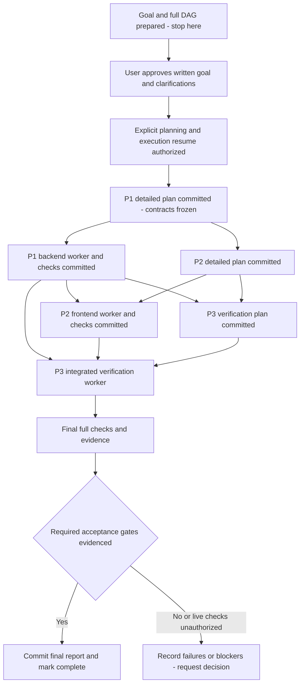

# State & dependency graph: Multimodal live voice Canvas

## Workflow configuration

- Date: 2 November 2026. This is a new objective, not a continuation of the historical Phase 1 workflow.
- Artifacts stay directly in `docs/voice-canvas-multimodal/`. Source PRD stays at its existing path.
- User request: “Try to keep this workflow within three plans,” skip research and code review, and **only write the goal and state with a fully constructed DAG**.
- Exactly three implementation units are defined below. No implementation plan, researcher, planner, worker, reviewer, or fixer has been dispatched for this objective.
- Skipped phases: `--skip research,review`. Both are **skipped**, not passed. No `research.md` or `review.md` is expected. Investigation required for safe implementation is not a separate research phase.
- Current authorization: Workflow **resumed** on 2 November 2026 by explicit user direction ("just resume the workflow from where it was left"). W1 Tasks 7–9 are dispatched; review remains skipped. No external provisioning, deployment, paid model/STT/TTS calls, or live service checks are authorized.
- Mandatory future phases: complete P1 worker tasks 7–9, dispatch W2 and P3, meaningful tests/compatibility checks, defect correction, and final verification/report.
- Orchestrator manages status, ownership, dispatch, and shared commits; never implements application code or reads `plan*.md`. Verify future plans through reported commit hashes and `git log -1 --stat <hash>`.
- At most three child agents alongside the orchestrator. Dispatch independent ready planners concurrently in the foreground; workers may run concurrently only with disjoint ownership. Serialize all staging/commits.
- No external provisioning, deployment, paid model/STT/TTS calls, or live service checks are authorized. Browser microphone/provider checks need separate approval and bounded exposure.
- Execution checkout: `voice-chat-upgrade`, clean working tree.

### Preserved workspace changes

No intervening modifications in working tree. All pre-existing Calendar edits were committed upstream. Stage named task files only.

## Workflow milestones

- [x] Source PRD, relevant repository boundaries, recent commits, and existing changes inspected.
- [x] Goal, alternatives, proposed clarifications, acceptance mapping, and complete initial DAG written.
- [x] Specification self-check for contradictions, scope, placeholders, links, and graph consistency completed.
- [x] Written goal and its proposed clarifications approved by the user (2 November 2026).
- [x] Technical research **skipped** by user instruction.
- [x] Explicit authorization to resume planning/execution received (2 November 2026).
- [x] Workflow resumed from W1 Task 7 on 2 November 2026 after the user declined a model-selection prompt and directed continuation on session-default delegation.
- [x] All three detailed implementation plans written, verified, and committed (P1 ca106f7, P2 06106ce, P3 a30ff49).
- [x] All three workers complete with required checks and commits (W1 and W2 complete; W3 defects corrected and reverified in `49559bf` and `83ce037`).
- [x] Unified code review **skipped** by user instruction.
- [x] Final verification and `verification.md` complete, with measured acceptance evidence and limitations.
- [x] `final_report.md` committed; workflow implementation gate satisfied.
- [ ] **Full acceptance gate:** awaiting operator authorization for native database, real browser, and live provider checks. These remain unverified, not passed.

## Brainstorming tasks

- [x] Explore the approved PRD and current voice, context, durable message, Canvas, and UI boundaries.
- [x] Carry forward the requested experience, three-plan ceiling, skipped phases, and documentation-only stop.
- [x] Compare separate speech/artifact channels against raw-content mixing and a second generation/scheduler.
- [x] Present the proposed architecture, safety constraints, timing limitation, and acceptance gates in `goal.md`.
- [x] Write goal and full pre-execution DAG; perform inline specification self-check.
- [x] Receive review/approval of the written goal, including the timing and grouped-history clarifications (2 November 2026).

## Initial findings

- `backend/src/instructions/system.md` prohibits visuals specifically in voice mode; text mode already encourages Canvas.
- `SpeechProse` silently drops fenced and tagged blocks. Its owner is `DurableChatRuntime`, not `AgentVoiceAdapter`; the PRD's adapter-only file list cannot implement capture by itself.
- `durable-chat-runtime.ts` currently persists the filtered speech in the assistant message/checkpoint result. `VoiceDelivery` records generated/heard speech; reconciliation and `ReferencedContextAssembler` compare that speech with assistant `content`.
- `backend/src/persistence/messages.ts` exposes internal voice turns through `voiceTranscripts`, leaving public `content` empty. `frontend/src/components/group-voice-messages.ts` groups voice turns into a call pill; source must reach Canvas and inline cards without being swallowed by that grouping.
- The portable protocol is mirrored in `backend/src/contracts/voice-wire.ts` and `frontend/src/api/voice-protocol.ts`. Strict guards require coordinated updates; a new union member alone is insufficient.
- `useLiveVoice.ts` wraps `LiveVoiceController`; WebSocket events are handled in the controller. `ChatView` currently excludes Canvas during voice and gathers artifacts from ordinary content only.
- Canvas already has artifact metadata, parser/renderers, session collection, selection, and close state. Reuse them; no new renderer or parser framework is needed.
- Current default output queue is 2000 ms. The PRD's illustrative 20-second queued-audio assumption is not established by current configuration or token-rate arithmetic.
- Backend/frontend are separate npm packages with Vitest; frontend routine tests use Node rather than a browser DOM. Browser animation/audio evidence must be recorded separately.

## Confirmed decisions and proposed clarifications

**Confirmed by the user's request / approved baseline:** multimodal live voice, silent visual syntax, concept → walkthrough → visual suffix, smooth Canvas controls, interruption retention, durable post-call access, at most three plans, research/review skipped, and documentation-only work now.

**Proposed in the goal, awaiting written approval:** preserve speech `content` and attach bounded structured visuals; expose inline cards despite call grouping; include retained visual source in follow-up context without conflating it with heard speech; retain timing ACs as measured gates rather than universal prompt guarantees. No acceptance waiver has been granted.

## Dependency matrix & execution status

`A` means written goal approval **and** explicit resume authorization. Research has no node because it is skipped. `L#` means the corresponding committed detailed plan. `W#` means its worker implementation and required checks are completed and committed. A written plan never substitutes for an upstream worker dependency.

| ID | Title & scope | Planner prerequisites | Worker prerequisites | Planner status | Worker status | Commits |
| --- | --- | --- | --- | --- | --- | --- |
| P1 | Backend speech/artifact pipeline, portable contracts, durable message projection, recovery/context | A | L1 | [x] ca106f7 | [x] Complete | b8e09cd, 28a349c, aa3083e, 2109835, 1dd3704, b1048e0, 49f5f02, 2f6cfc9, ce5158d, 6b49768 |
| P2 | Frontend live artifact state, Canvas layout/toggle/animation, inline archived cards | A + L1 with frozen wire/storage handoff | L2 + W1 | [x] 06106ce | [x] Complete | 24a7e43, ae76686, 58f3059, fe94dc7, 9e8a224, 13113e1 |
| P3 | Integrated visual/speech, interruption, recovery/reload, browser/timing evidence | A + W1 + L2 | L3 + W1 + W2 | [x] a30ff49 | [x] Verification complete; 2 owner defects corrected and reverified; full acceptance blocked on unauthorized live/native/browser gates | 8f4f8f0, 717ed70, 716f079, 48b4b17, 3cb841f, aafbb1b, 06e9f07, 49559bf, 83ce037 |

### P1 Worker Task Progress & Commit Evidence (Tasks 1–9 Committed)

- **Task 1: Freeze portable artifact event and guards** (`b8e09cd`)
  - Updated `backend/src/contracts/voice-wire.ts` and `frontend/src/api/voice-protocol.ts` mirrors with exact `canvas.artifact` event and runtime guards.
  - Tests: `backend/src/contracts/voice.spec.ts` (9 tests passed), `frontend/src/api/voice-protocol.test.ts` (5 tests passed), `frontend/src/api/protocol.test.ts` (7 tests passed).
- **Task 2: Bounded message and delivery projections** (`28a349c`)
  - Created `backend/src/contracts/canvas-artifact.ts` and updated `message.ts`, `api.ts`, `voice.ts`.
  - Tests: `backend/src/contracts/canvas-artifact.spec.ts` (4 tests passed).
- **Task 3: Capture bounded complete visual suffixes in SpeechProse** (`aa3083e`)
  - Extended `backend/src/voice/agent/speech-prose.ts` to capture closed visual blocks, enforce post-visual silence, and drop malformed/partial blocks.
  - Tests: `backend/test/voice/agent/speech-prose.spec.ts` (13 tests passed).
- **Task 4: Journal artifacts before live delivery** (`2109835`)
  - Updated `backend/src/voice/agent/agent-voice-adapter.ts`, `voice-delivery.ts`, and `backend/src/chat-runtime/ports.ts`.
  - Tests: `backend/test/voice/agent/pipeline.spec.ts` (9 tests passed), `submission.spec.ts` (5 tests passed), `voice-delivery.spec.ts` (22 tests passed).
- **Task 5: Seal clean speech with durable visual projections** (`1dd3704`)
  - Updated `backend/src/chat-runtime/durable-chat-runtime.ts` and `finalization.ts` to attach `canvasArtifacts` to originating assistant messages and checkpoints while preserving clean speech.
  - Tests: `backend/test/runtime/voice-output.spec.ts` (4 tests passed).
- **Task 6: Preserve complete visuals across interrupted recovery** (`b1048e0`)
  - Updated `backend/src/chat-runtime/reconciliation.ts` and `durable-chat-runtime.ts` to recover confirmed artifacts during crash recovery and barge-in.
  - Tests: `backend/test/runtime/voice-history.spec.ts` (3 tests passed).

### P1 Tasks 7–9 and Verification Checkpoint

- **Task 7: Retain visual follow-up context** (`49f5f02`)
  - Updated `backend/src/context/referenced-context-assembler.ts`; added `backend/test/context/voice-context.spec.ts`. Retained source is projected separately from heard speech.
- **Task 8: Project archived visuals with originating voice messages** (`2f6cfc9`)
  - Updated `backend/src/persistence/messages.ts`; added `backend/test/persistence/voice-messages.spec.ts`.
- **Task 9: Visual response instructions** (`ce5158d`)
  - Updated `backend/src/instructions/system.md`; added prompt assertions in `voice-context.spec.ts`.
- **Regression correction** (`6b49768`): updated the four stale delivery fixtures to use `responseId: key('voice-response', userId, sessionId, attemptId)` without weakening any assertion or production check. Focused run: `text-config.spec.ts` + `publication-activity-commitment.spec.ts` = 25/25 passed.
- **Verification checkpoint (2 November 2026):**
  - `frontend` build, lint, and **541/541 tests passed**.
  - `backend` build and lint passed. Focused P1 suites passed (including contracts, voice agent, runtime voice output/history, persistence voice messages, context voice context, and corrected text-config/publication tests).
  - Full `backend` `npm test` after correction: **27 failed | 2420 passed | 10 skipped**. Remaining failures are not P1 test regressions:
    - **26 performance-suite failures** in `test/performance/durable-latency.spec.ts` under full-suite load. The same suite already fails standalone at baseline `4c9ada7` (17 failures) and at current HEAD (17 failures); full-suite load increases timeout counts. Not caused by this objective; recorded as a pre-existing environment/target limitation.
    - **1 full-run-only assembly failure** in `test/assembly/calendar-simplification.built.spec.ts`. It passes standalone at both `4c9ada7` and current HEAD; recorded as a parallel-run flake, not claimed clean.
  - `test/voice/integration/fault-recovery.spec.ts` (4 tests) and the native recovery fixture were skipped for missing database prerequisites. Their fixture identity was corrected in `6b49768`; no skip counts as a pass.
  - **W1 limitation:** the repo-wide backend test suite is not fully green because of the pre-existing performance targets and assembly flake. P1-owned functional suites and the corrected regressions are green; final verification must retain this distinction.

### P2 Worker Task Progress & Commit Evidence

- **Task 1: Projection conversion, archive merge, and exit helpers** (`24a7e43`) — extended `canvas-artifacts.ts`, `CanvasPanel.tsx`, `index.ts`, `chat-reducer.ts`, and `canvas.test.ts`.
- **Task 2: Live `canvas.artifact` handling** (`ae76686`) — controller/reducer fencing for pre-audio, duplicates, stale epochs, cancellation, and barge-in; `useLiveVoice.ts` and `App.tsx` bindings.
- **Task 3: Controls and shortcut** (`58f3059`) — accessible Canvas toggle, Stop speaking action, Alt+C shortcut, live-voice CSS, and component tests.
- **Task 4: Split-screen layout and slide lifecycle** (`fe94dc7`) — `ChatView.tsx`, 320 ms entry/exit composition, reduced-motion/focus logic, CSS, and composition tests.
- **Task 5: Post-call inline transcript/cards** (`9e8a224`) — `MessageItem.tsx` and `group-voice-messages.ts` keep explanations and Canvas cards reachable outside the call modal.
- **Task 6: Cleanup** (`13113e1`) — removed unused import/prop destructuring; lint clean.
- **Verification:** `frontend` `npm run build` passed; `npm run lint` passed with warnings only; `npm test` passed **561/561**. Browser-only animation/audio/focus assertions remain deferred to P3; no browser evidence is claimed here.

### P3 Integrated Verification Results (2 November 2026)

- **Commit set:** `8f4f8f0` (ledger), `717ed70` (corpus/chunk boundaries), `716f079` (real runtime/frontend pipeline), `48b4b17` (interruption/publication/context), `3cb841f` (frontend controls/interruption), `aafbb1b` (native recovery fixture), `06e9f07` (`verification.md`), `49559bf` (W1 correction), `83ce037` (W2 correction).
- **Resolved defects and post-correction evidence:**
  - **W1 (`49559bf`):** `classifyVisual()` now recognizes labeled coordinates such as `Dog: (8, 9)`. `speech-prose.spec.ts` **14/14** and backend integrated suite **33/33** passed, including both previously failing X-Y Point Plot tests.
  - **W2 (`83ce037`):** `parseSafeAttributes()` now strips external/protocol-relative/data/javascript/vbscript paint URLs while permitting local `url(#id)` references and normal colors. Focused Canvas suite **19/19**, frontend integrated suite **15/15**, full frontend suite **577/577** passed.
- **Full backend:** **2458 passed | 23 failed | 10 skipped** with `PSExecutionPolicyPreference=Bypass`; failures are 22 pre-existing performance-target tests and 1 full-run-only assembly flake that passes standalone. Without the policy override, six guard/local-open tests are blocked by the unsigned-script policy; they pass standalone and in the permitted full run.
- **Build/lint:** backend and frontend builds passed; both linters reported 0 errors.
- **Unauthorized/unavailable gates:** isolated native MongoDB execution (prerequisites absent), real browser layout/audio/timing, and live provider checks. These remain **unverified**, not passed.
- **Baseline limitations:** performance-suite failures persist at baseline; assembly flake persists in full runs; sandbox loopback `EACCES` blocks backend HTTP e2e. Recorded separately in `verification.md` and `final_report.md`.

### Execution graph

There is no research or review edge. Failure diagnosis routes to the owning worker, not a reviewer or review-triggered fixer. After a fix, rerun affected checks before final verification.

### Planner readiness and immediate worker dispatch

| Planner | Earliest readiness | Required handoff | Worker start |
| --- | --- | --- | --- |
| P1 | A | Goal and this state; no research artifact | Immediately after L1 |
| P2 | L1 | P1 planner summary: exact event/schema, caps, identity, durable mapping, malformed/cancelled semantics | After L2 and W1 |
| P3 | W1 and L2 | P1 implementation/test summary; P2 interface/UI/test-plan summary | After L3 and W2 |

- Start W1 immediately after L1; P2 planning can overlap W1 because its plan file is disjoint. Start W2 as soon as W1 and L2 are ready; P3 planning can overlap W2. Do not wait for all plans before execution.
- This DAG intentionally has no independent ready planners at its first gate. If later corrections make multiple planners independent and ready, dispatch them concurrently in the foreground, never as detached background planners.
- Planners load `writing-plans`; workers load `executing-plans` and `test-driven-development`. Workers read their own plans; the orchestrator receives summaries/hashes only. P3 verification is not a code review.
- Freeze contracts in L1: precise limits and malformed policy, complete-block/ordinal identity, message/checkpoint representation, interruption durability, visible projection, and context behavior. If W1 changes a frozen contract, pause P2/P3, reconcile affected plans and both mirrors, and record the handoff before resuming.
- Each agent stages only owned paths. Give one commit owner a time; never use `git add .` or broad artifact-directory staging. Update this state at each committed transition.

## Plan scopes, file ownership, and completion gates

Ownership below is exclusive unless explicitly described as a sequential defect handback. Tests adjacent to an owned source belong to the same worker unless listed under P3. No agent may edit preserved Calendar tests or assume ownership of unrelated code. Additional necessary paths require an orchestrator ownership update first.

### P1 — Backend pipeline, contracts, durability, and context

**Future deliverable:** `plan1.md`; implementation of G1–G3 and backend portions of G5. Includes persistence from the outset rather than postponing it to an integration-only worker.

**Owned source paths:**

- `backend/src/instructions/system.md`
- `backend/src/contracts/voice-wire.ts`, `message.ts`, `api.ts` and `voice.ts` only if needed for compatible validation
- `frontend/src/api/voice-protocol.ts`, `frontend/src/api/protocol.ts` (portable contract mirrors only; P2 does not edit these)
- `backend/src/voice/agent/speech-prose.ts`, `agent-voice-adapter.ts`, `voice-delivery.ts`
- `backend/src/chat-runtime/ports.ts`, `durable-chat-runtime.ts`, `finalization.ts`, `reconciliation.ts`, `history.ts`
- `backend/src/context/referenced-context-assembler.ts`
- `backend/src/persistence/messages.ts`
- If no existing shared bounded visual descriptor can be reused, `backend/src/contracts/canvas-artifact.ts`; this is a type/validation boundary, not a new rendering subsystem.

**Owned tests:** `backend/src/contracts/voice.spec.ts`; focused contract tests beside owned contracts; `backend/test/voice/agent/{speech-prose,pipeline,voice-delivery,submission}.spec.ts`; `backend/test/runtime/{voice-output,voice-history}.spec.ts`; `backend/test/persistence/voice-messages.spec.ts`; `backend/test/context/voice-context.spec.ts`; `frontend/src/api/voice-protocol.test.ts` and contract validation tests for the visible-message mirror as required. **Correction-pass extension (2 November 2026):** `backend/test/runtime/text-config.spec.ts`, `backend/test/chat-runtime/publication-activity-commitment.spec.ts`, `backend/test/voice/integration/fault-recovery.spec.ts`, and `backend/test/runtime/voice-recovery.native.e2e-spec.ts` may be updated only to use the canonical runtime `responseId` (`key('voice-response', userId, sessionId, attemptId)`); no behavioral assertions may be weakened.

**Scope and handoff:** bounded complete-block callback from the actual runtime-owned filter; live sink bridge; matching wire guards; backward-compatible message artifact fields/projection; clean speech evidence preserved; saved results and interrupted complete artifacts survive recovery; retained visual follow-up context; stable live-to-durable identity. Reuse existing persistence/finalization rather than introducing an exit upload or collection. Planner reports concrete limits and protocol/schema behavior before L1 is accepted.

**Exit gate:** deterministic tests prove all chunk boundaries stay silent, no post-visual speech, complete blocks only, bounded malformed/oversized behavior, matching guards and dictation rejection, no late cancelled emission, linked complete-artifact persistence across interruption/recovery, legacy messages compatible, heard-prefix semantics unchanged, visual available to follow-up context, and text/dictation regressions absent. Run relevant backend suites/build/lint and frontend protocol checks/build. Report every skipped database check separately.

### P2 — Frontend live Canvas, controls, and archived cards

**Future deliverable:** `plan2.md`; implementation of G4 and frontend G2/G3 integration, using the exact P1 contract.

**Owned source paths:**

- `frontend/src/features/voice/state/{live-voice-controller,live-voice-reducer,useLiveVoice}.ts`
- `frontend/src/features/voice/live/{LiveVoiceControls,LiveVoicePanel}.tsx`, `frontend/src/features/voice/live/live-voice.css`
- `frontend/src/features/chat/ChatView.tsx`
- `frontend/src/features/chat/state/{chat-types,chat-reducer,use-chat}.ts`, `chat-context.tsx`
- `frontend/src/features/canvas/{canvas-artifacts,canvas-types,index}.ts`, `{CanvasPanel,CanvasArtifactCard}.tsx`
- `frontend/src/components/{group-voice-messages.ts,Transcript.tsx,MessageItem.tsx,VoiceTranscriptModal.tsx}` only as required for main-transcript explanation/cards and retained call access
- `frontend/src/features/chat/markdown/safe-markdown.tsx` only if needed to reuse existing card rendering
- `frontend/src/styles/chat.css`; `frontend/src/App.tsx` only if new bindings cannot be carried through existing props/state

**Owned tests:** adjacent Canvas/chat/reducer/controller/control/lifecycle/composition and component `*.test.ts` suites, including `frontend/src/features/canvas/canvas.test.ts`, `frontend/src/features/chat/ChatView.voice.test.ts`, and `frontend/src/components/group-voice-messages.test.ts`. Excludes P3's named integration files below and P1's protocol tests.

**Scope and handoff:** accept artifacts with correct session/epoch/turn response handling even before audio starts; retain/deduplicate across interrupt/exit/reload; one artifact list and count; responsive split view, entry/exit mounting lifecycle and reduced motion; accessible toggle and stop-speaking action; existing media instances stay stable. Main-transcript cards must remain reachable outside the grouped call modal.

**Exit gate:** state/controller tests cover fresh, duplicate, stale, cancelled, pre-audio, multi-turn, multi-session and archive-replacement events; renderer safety and chart parity regressions pass; close/reopen/selection/count preserve artifacts without mic/socket/audio lifecycle calls; reduced-motion/exit/focus logic has runnable checks. Frontend full tests/build/lint pass; record browser-only assertions still awaiting P3 rather than claiming Node tests prove animation or audio.

### P3 — Integrated interruption, persistence, and timing evidence

**Future deliverable:** `plan3.md`; integrated fixtures and evidence for every AC, not a review or a general implementation cleanup unit.

**Exclusive write ownership:**

- `backend/test/voice/integration/canvas-multimodal.spec.ts` (new deterministic integrated fixture)
- `backend/test/voice/integration/canvas-multimodal.native.e2e-spec.ts` (new isolated-database verification, when authorized prerequisites exist)
- `frontend/src/features/voice/integration-tests/canvas-multimodal.test.ts` (new integration test)
- `docs/voice-canvas-multimodal/verification.md` (future evidence artifact)
- Minimal fixture helpers beside those tests, only if existing fixture helpers cannot be reused; name them in L3 before writing them.

**Read-only inputs:** completed P1/P2 implementations and existing voice/runtime/provider/browser fixtures. P3 does not edit P1/P2 source or their tests. Integration failures go back to the original owner in a serialized correction pass; update the same plan rather than adding a fourth plan.

**Scope:** test real filter → runtime → sink → frontend event/state → Canvas conversion paths using deterministic provider/audio fixtures; interrupt before/during/after a visual; exit/reload and checkpoint publication recovery; complete visual retention, no partial cards, no duplicate archive artifact; all required diagram/chart types; measured normal and adverse streaming rates. Browser checks cover actual slide directions/duration, responsive controls, focus/reduced motion, audible timing, and local interruption.

**Exit gate:** discover and execute nonempty integrated suites with real assertions; document environment/commit set, counts/skips, clean speech versus artifact data, failure/recovery outcomes, and timing observations. Authorized native tests use isolated generated databases only. Missing live-provider approval, missing database prerequisites, or a timing miss is an explicit blocker to full acceptance, not a passing scenario. P3 reports blockers even if all offline tests pass.

## Acceptance coverage

| Goal / PRD | Implementation owner | Integrated evidence |
| --- | --- | --- |
| G1–G2; REQ-1–3; AC-1 | P1; P2 receiver | P3 chunk-boundary, malformed, protocol, and gap fixtures |
| G4; REQ-4–5; AC-2 | P2 | P3 real browser layout/motion and five-second measurements |
| G5; AC-3 | P1 ordering; P2 prompt render | P3 audible walkthrough/render timing, including slow generation |
| G4; REQ-6; AC-4–5 | P2 | P3 toggle/tab/panel/media identity integration |
| G2–G4; REQ-7; AC-6 | P1 cancellation/durability; P2 media/state retention | P3 interrupt matrix and under-250 ms browser measurement |
| G3; REQ-8; AC-7 | P1 persistence/context; P2 transcript/cards | P3 exit/reload/recovery and follow-up context tests |
| G1–G4; AC-8 | P1 source transport; P2 existing renderers | P3 Mermaid flow/sequence, bar/line/pie, scatter, existing SVG safety |

## Research handoff

**Skipped by explicit user instruction.** No researcher, research commit, or `research.md` is required. The initial findings above are direct preparation observations, not verified implementation evidence. Future planners inspect their affected code and consult current compatibility documentation when required without starting a separate research phase.

## Final verification commands and evidence

The current task is documentation-only; application checks below are **future required commands, not executed results**. Use Node versions admitted by each package and record the actual environment.

| Working directory | Future command / check | Purpose and prerequisite |
| --- | --- | --- |
| `backend` | `npm run build` | Compile runtime, contracts, and Nest wiring |
| `backend` | `npm run lint` | Type-aware lint |
| `backend` | `npm test` | Full routine deterministic regressions; verify new integration file discovered |
| `backend` | `npm run test:e2e` | Native/assembled suites; record skips and fixture prerequisites individually |
| `frontend` | `npm run build` | Type-check portable contract mirrors and UI; Vite build |
| `frontend` | `npm run lint` | Frontend lint |
| `frontend` | `npm test` | Full Node suites; verify new integrated test discovered |
| Browser | Responsive Canvas/live-call run | Desktop/tablet/mobile, real entry/exit, reduced motion, keyboard focus, media continuity |
| Browser + explicitly authorized bounded providers | Timestamped voice/Canvas acceptance run | Five-second visual target, audible-reference order, no artifact-induced gap, under-250 ms local interruption |

- Focused worker commands use `npm test -- <relative-test-path> -t "<test-name>"` in the owning package. New suites must have nonzero discovery; absence is not a pass.
- Native checks need operator-supplied `AURVIN_TEST_MONGODB_URI` and `AURVIN_TEST_DB_PREFIX=aurvin_p2_test_`, plus the admitted replica-set topology. Never use application/production data, print URIs, or run overlapping live backends on one database.
- Do not invoke service/paid checks merely because credentials are present. Request missing secrets through the private secret tool only when an authorized check actually needs them.
- No Azure profile certification is requested. `test:azure` / `test:behavior` with empty discovery is not evidence for this objective.
- Record unrelated dirty-tree failures without modifying user work; distinguish baseline failures, new regressions, skips, and authorization blockers. Required failures still prevent claiming a clean final verification.
- Full completion needs measured acceptance evidence or a user-approved acceptance change. Otherwise leave the workflow blocked with honest evidence, even if implementation is committed.

### Preparation evidence

- Inspected source PRD and actual voice/runtime/context/persistence/Canvas boundaries; no separate research performed.
- Inspected recent commits and dirty paths; no unrelated edits made.
- Automated document check passed: relative links, no placeholder markers, exactly three units, required approval/skip fields, and an acyclic 16-edge graph with the required worker prerequisites. Source-path spot-check corrected the transcript component ownership to the existing `MessageItem.tsx`.
- No application tests, live calls, browser media checks, or implementation verification performed for this documentation task.

## Artifact and commit record

| Artifact | State | Commit evidence |
| --- | --- | --- |
| `../voice-canvas-multimodal-prd.md` | Approved product baseline; unchanged | `b39dc84` |
| `goal.md` | Written; derived goal awaiting user approval | Preparation commit; locate with `git log -1 -- docs/voice-canvas-multimodal/goal.md` |
| `state.md` | Complete initial DAG; authorization stop | Preparation commit; locate with `git log -1 -- docs/voice-canvas-multimodal/state.md` |
| `research.md` | Skipped; intentionally absent | None required |
| `plan1.md` | Committed; P1 plan written | `ca106f7` |
| `plan2.md` | Committed; P2 plan written | `06106ce` |
| `plan3.md` | Committed; P3 plan written | `a30ff49` |
| `review.md` | Skipped; intentionally absent | None required |
| `verification.md` | Complete; corrected integrated evidence, final checks, and unauthorized-gate blockers | `06e9f07`, `71391db` |
| `final_report.md` | Committed; final synthesis with acceptance blockers and requested authorizations | `92b31f2` |

Future transition records must include actual planner/worker hashes; a document path or promise is not completion evidence. The preparation commit cannot embed its own hash; resolve it using the path-specific commands above.

## Current gate and resume procedure

**CURRENT GATE: IMPLEMENTATION AND OFFLINE VERIFICATION COMPLETE — FULL ACCEPTANCE BLOCKED (2 NOVEMBER 2026).**

Resume procedure and current state:

1. [x] Read this state, verify clean working tree, and confirm checkout branch (`voice-chat-upgrade`).
2. [x] Delegation resolved as inherit-session default after the user declined model selection and directed continuation. Research and review remain skipped.
3. [x] W1, W2, and the P3 plan are complete. W3 integrated verification ran and wrote `verification.md`.
4. [x] W3 recorded two real defects: W1 labeled X-Y coordinates and W2 external SVG paint URLs.
5. [x] W1 correction committed (`49559bf`) and reverified: 14/14 unit, 33/33 integrated.
6. [x] W2 correction committed (`83ce037`) and reverified: 19/19 focused, 15/15 integrated, 577/577 full frontend.
7. [x] Final full backend checks recorded: 2458 passed / 23 failed / 10 skipped; failures are 22 pre-existing performance targets and 1 assembly flake that passes standalone.
8. [x] `verification.md` updated with corrected evidence (`71391db`); `final_report.md` written and committed (`92b31f2`).
9. [ ] **Awaiting operator decision:** authorize isolated native MongoDB, real browser/audio/timing, and bounded live-provider checks, or explicitly accept the offline scope with those gates retained as limitations.
10. [ ] Do not mark full acceptance or `status: complete` until the authorized live/browser/native gates are measured or explicitly waived by the user. Do not fold the pre-existing performance-suite failures into this objective.
