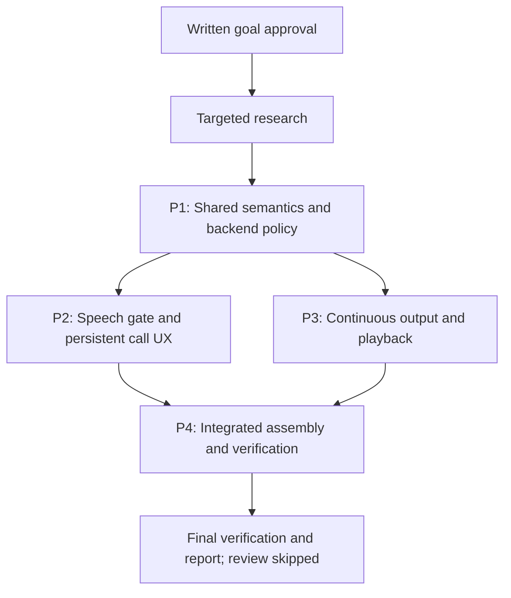

# State and Dependency Graph: Voice Cost and Conversational Flow

## Workflow configuration

- Goal: [goal.md](goal.md). Approved specification, not implementation evidence.
- Starting HEAD: `4569119`, `main`; checkout was clean and no open PR was found for `main` when this task began.
- Written goal/state approved and execution authorized on 16 October 2026: "The goal and the state looks good" followed by "You can go ahead". User later confirmed skip code review; review remains **skipped**, never passed.
- Unified review is **skipped**, not passed, per root instructions and the user's 16 October 2026 confirmation. Research, planning, implementation, regression tests, defect correction and final verification remain required.
- The orchestrator manages dispatch, ownership, state and verification; it does not implement source or read execution `research.md`/`plan*.md` artifacts. Use agent summaries and verify reported commits.
- Capacity: at most three child agents alongside the orchestrator. Independent ready planners run concurrently in the foreground. Ready workers start without waiting for unrelated planners. When spawning planners, give only the minimum context/files needed for that plan.
- Serialize staging/commits; stage explicit named paths only. Preserve unrelated user work and `.openchamber/`. Use `codex/` for a new implementation branch.
- No paid calls, actual microphone capture, live database changes or deployment are authorized.

## Workflow milestones

- [x] Step 1: Written goal and design approved (16 October 2026).
- [x] Step 2: Targeted technical research completed and committed (`1490473`).
- [x] Step 3: Implementation plans completed and committed. P1 plan `fd48b20`; P2 plan `8f813f8`; P3 plan `64a2012` (7 tasks).
- [x] Step 4: Workers completed with meaningful passing checks. P1/P2/P3 complete; P4 complete (`df844c1` `e5ff734` `293884e` `c43bcec` `bfbfef4` + Task 8 `261b9a1`). Owner fixes `54ff635` `4350b1d` `8af3cf6` `70ab85d`.
- [x] Step 5: Unified review **skipped** by repository instruction.
- [x] Step 6: Integrated verification and final report completed (`261b9a1`).

## Brainstorming tasks

- [x] Explore affected code, conventions and recent commits.
- [x] Clarify cost/latency preference and call lifetime.
- [x] Compare balanced hands-free, maximum savings and continuous-streaming approaches.
- [x] Recommend balanced hands-free operation; incorporate user's no-automatic-hang-up constraint.
- [x] Present the draft design in goal.md and self-check scope, safety exceptions and measurable evidence.
- [x] Obtain approval of the written design.
- [x] Commit the approved goal (`bc2f1b1`) and research-reconciled DAG before dispatching planners.

## Confirmed product requirements

- Fine-tuned cost/latency balance, automatic foreground speech resume, smooth continuous spoken output.
- Five-second non-speech upload suspension must not end the call or cancel Aurvin's ongoing output.
- Only explicit Hang up ends the mounted call experience; hard safety/device/provider failures stop paid work but retain an honest paused/blocked call surface.
- Browser/page destruction still releases resources; no promise of uninterrupted operation after unloading the application.

## Initial investigation

- No local speech-aware upload gate exists. Current RMS is visualization only.
- Existing live idle and terminal/error paths end the call, conflicting with the clarified requirement.
- Sentence-oriented safe-prose buffering and serial durable-before-Speak writes may starve synthesis; browser playback has no explicit jitter reserve. Acoustic attribution remains unverified.
- Existing TTS already flushes once at actual response completion. Preserve this behavior rather than assuming per-sentence Flush.
- Current quota counters are process-local and billing is estimated/incomplete; preserving safety does not certify invoice cost.

## Dependency matrix and execution status

Research-reconciled. `R` is committed research (`1490473`). A worker prerequisite means implemented, tested and committed source, never merely a written plan. P2/P3 planners wait for the committed P1 worker; their workers then run independently. P4 planner waits for P1 worker plus committed P2/P3 plans.

| Plan | Title and scope | Planner prerequisites | Worker prerequisites | Planner status | Worker status | Commits |
| --- | --- | --- | --- | --- | --- | --- |
| P1 | Shared contracts, pause/resume semantics and bounded backend resource policy | R | R and P1 plan | [x] `fd48b20` | [x] Complete | `845bb30` `a13d548` `3c86a27` `ce78bd8` `c85808e` `3187385` `7f41b41` `f8efbe5` `013c324` |
| P2 | Browser speech gate and persistent call lifecycle/UX | P1 worker | P1 worker and P2 plan | [x] `8f813f8` | [x] Complete | `f50562f` `17bf047` `607fc8d` `529a375` `bc8ced4` `0ee5450` `afe7288` `ed5915d` `22aad0a` `c44bc2f` |
| P3 | Continuous safe text delivery and bounded PCM playback | P1 worker | P1 worker and P3 plan | [x] `64a2012` | [x] Complete | `b6f81f7` `a963edf` `5c8e130` `af3384b` `0fa5eeb` `14caf84` `60bebc1` |
| P4 | Central assembly, integrated verification and operational evidence | P1 worker and P2/P3 committed plans | P2/P3 workers and P4 plan | [x] `458a72d` | Reran; 2 P2 failures left | `458a72d` `b81c338` `58e054d` `54fb8c7` `df844c1` `e5ff734` `293884e` `c43bcec` `bfbfef4` + fixes `54ff635` `4350b1d` `8af3cf6` |

### Execution graph

## Plan scopes, file ownership and exit gates

### P1 — Shared semantics and bounded backend resources

Own backend/frontend voice wire/protocol contracts, necessary manageable-setting validation/projections and related config UI/types, backend `voice/session` and `voice/usage` policy, Flux STT finalization, `live-flow.ts` lifecycle, and their direct tests. Add `input.suspend`; extend `voice.state.input` to `listening | suspended | muted`; add recovery `resume_call`, error `MEDIA_GATE_UNAVAILABLE`, and explicit `terminal: boolean` on `session.error`/`session.ended`. Reuse `input.unmute` for automatic resume. Do not add a resume event, user setting, parser, or second Flush. Idle suspend finalizes the active Flux turn once then stops PCM; no-active-turn warning is success. Manual mute keeps discard/restart. Suspension never cancels TTS or agent work. Non-terminal failures stay on the call and stop paid work. Resume cannot reset budgets or create a session.

Exit: strict wire/config validation, no media on paused input, pending turn settled once, mute privacy, stale-callback fencing, no new inference on renew, finite resource policy and honest quota states verified. P1 owns shared contracts throughout the workflow.

### P2 — Speech gate and persistent browser call

Own `frontend/src/features/voice/audio/audio-capture-*`, local detector helper, frontend `package.json`/`package-lock.json` for the pinned detector, `frontend/src/features/voice/state/live-voice-*`, corresponding hook/lifecycle/controls/panel files, and their direct tests. Pin `@ozymandiasthegreat/vad@2.0.7` imported only from `@ozymandiasthegreat/vad/lib/embedded.js`, constructed with `VADMode.AGGRESSIVE` at 16 kHz, `processFrame` 320 samples every 20 ms. Preserve MIT/BSD-3-Clause notices. WASM unavailable must enter the visible paused state, never fall back to continuous upload. Initial capture noise suppression changes from enabled to disabled; echo cancellation stays enabled. Do not edit playback scheduler, dictation semantics, or `live-flow.ts`. Implement automatic foreground resume, bounded pre-roll, explicit mute, paused/error call states, no automatic exit, and accessible controls/status. Any cross-contract need goes through P1.

Exit: AC1–AC4 input/lifecycle fixtures, long-idle and terminal-policy cases, teardown races, no duplicated accepted turns, no silent fallback to endless uploads, bounded detector costs and pending audio.

### P3 — Continuous speech delivery and playback

Own backend `voice/agent/speech-prose.ts`, `voice/agent/voice-delivery.ts`, scoped live text path in `chat-runtime/durable-chat-runtime.ts`, frontend `audio-playback-service.ts`, and direct tests. Do **not** edit P1's `live-flow.ts` or the TTS adapter unless research-reconciled ownership later transfers it. Lower the plain-text release threshold to 24 characters, splitting only on whitespace, keeping every hidden-content guard. Speak immediately while coalescing dirty evidence every 100 ms or 512 characters and always at finish/cancel/settle. Retain the initial record, failure behavior, and exactly one final Flush. Schedule the first playback packet 100 ms later; later packets remain contiguous. Do not add delay per packet or sentence.

Exit: reproduce text starvation/jitter in deterministic timing fixtures, preserve generated-before-Speak durability, no per-token write storm, safe prose at arbitrary token splits, exactly one final Flush, bounded startup/rebuffer latency, sample-accurate progress and immediate old-audio invalidation.

### P4 — Assembly and integrated verification

Own central `backend/src/app.service.ts` wiring, changed-path integration/assembly tests outside P1–P3 direct-test ownership, and feature operations/evaluation documentation. Execute all required package checks and report unavailable native/live prerequisites separately. Route source defects to their owning workers; P4 is not a unified reviewer or review-triggered fixer.

Exit: cross-layer input/output/lifecycle/quotas work together; no regressions to text/dictation/history; actual tested commits/environment/results recorded. No acoustic or billing certification without authorized device/provider evidence.

## Acceptance coverage

| Goal criterion | Primary owners | Integrated evidence |
| --- | --- | --- |
| AC1–AC2: Silence gate and lossless automatic resume | P1, P2 | P4 deterministic media path |
| AC3: Persistent call with bounded safe resources | P1, P2 | P4 expiry/failure/teardown matrix |
| AC4: Noise and interruptions | P1, P2 | P4 fixtures; separately authorized acoustic gate |
| AC5–AC6: Continuous safe speech and playback | P3 | P4 slow-text/write/jitter/interruption scenarios |
| AC7: Package/native check evidence | All workers, P4 | Final verification |
| AC8: Device listening and actual billing evidence | P4 documents procedure/authorization gate | Unrun unless explicitly authorized |

## Research handoff — complete (`1490473`)

Researcher summary (orchestrator did not read `research.md`):

- Contracts: `input.suspend`; `voice.state.input` becomes `listening | suspended | muted`; recovery `resume_call`; error `MEDIA_GATE_UNAVAILABLE`; `terminal: boolean` on `session.error` and `session.ended`. Reuse `input.unmute` for automatic resume. No resume event, user setting, parser, or second Flush.
- Idle: `input.suspend` finalizes the active Flux turn once, then stops PCM on the same mounted session. No-active-turn warning is success. If no settle signal arrives within 2,000 ms, reopen STT without submitting partial text. Suspension never cancels TTS or agent work. Unmute from suspension resumes the same STT generation; unmute from mute still discards buffered audio.
- Failures: non-terminal resource/quota/provider/reconnect failures stay on the call and stop paid work. Resume cannot reset budgets or create a session. Only Hang up, navigation, unmount, or page destruction exits.
- Detector: pin `@ozymandiasthegreat/vad@2.0.7` via `@ozymandiasthegreat/vad/lib/embedded.js`, `VADMode.AGGRESSIVE`, 16 kHz, 320 samples / 20 ms. Inlined WASM, no fetch/`eval`/`new Function`. ~53 KB unpacked, no dependencies. Preserve MIT and BSD-3-Clause notices. WASM CSP needs `'wasm-unsafe-eval'`. WASM unavailable → visible paused state, never continuous-upload fallback. Silero/ONNX and browser speech recognition rejected. P2 disables initial capture noise suppression; echo cancellation stays on.
- Output: sentence buffering is source-confirmed, not acoustic diagnosis. Lower plain-text release to 24 characters on whitespace. Keep hidden-content guards. Speak immediately; coalesce dirty evidence every 100 ms or 512 characters and always at finish/cancel/settle. One final Flush. First playback packet delayed 100 ms; later packets contiguous.
- Ownership: P1 shared wire/config, Flux finalization, live-flow lifecycle, usage policy, protocol mirror. P2 capture/detector/package/lockfile/live controller/reducer/panel/controls. P3 prose/delivery/scoped runtime delta/playback; must not edit `live-flow.ts`. P4 `app.service.ts`, integration tests, final evidence. P2/P3 planners wait for committed P1 worker.
- Checks: focused backend/frontend tests passed in deleted scratch runs. Native MongoDB variables unset; no native/e2e suite. AC8 unauthorized/unrun.

## Final verification commands and evidence

| Directory | Command | State |
| --- | --- | --- |
| backend | `npm run build` | Not run for this change |
| backend | `npm run lint` | Not run for this change |
| backend | `npm test` | Not run for this change |
| backend | `npm run test:e2e` | Not run; native prerequisites required where applicable |
| frontend | `npm run build` | Not run for this change |
| frontend | `npm run lint` | Not run for this change |
| frontend | `npm test` | Not run for this change |
| real devices/providers | Bounded consented A/B listening and usage evaluation | Not authorized, unrun |

## Artifact and commit record

| Artifact | State | Commit |
| --- | --- | --- |
| goal.md | Approved, offline execution authorized | `bc2f1b1` |
| state.md | Research-reconciled DAG | This commit |
| research.md | Complete | `1490473` |
| plan1.md | Written and P1 worker complete | `fd48b20` + worker hashes above |
| plan2.md | Written and P2 worker complete | `8f813f8` + worker hashes above |
| plan3.md | Written and P3 worker complete | `64a2012` + worker hashes above |
| plan4.md | Written; P4 partial (ticks uncommitted) | `458a72d` + P4 commits above |
| verification.md / final_report.md | Complete | `bfbfef4` + `261b9a1` |

## Current gate and resume procedure

**CURRENT GATE: COMPLETE. Review remains skipped.**

Final evidence (`261b9a1`, Windows / Node v24.18.0): backend build/lint/pass (1006 tests, 10 skipped), backend offline e2e 22 pass, native e2e 70 fail on missing isolated config (no real DB), frontend build/lint/pass (397 tests). AC1–AC7 offline; AC8 acoustic/billing unrun and unauthorized. No open PR created; branch `codex/voice-cost-and-flow` holds the work.

P4 rerun done: backend build/lint/pass (1006 tests), backend offline e2e 22 pass, frontend build/lint pass with `395 passed, 2 failed`. Remaining: `audio-transport-pipeline.test.ts:60,156` (P2 owner, stale pre-reserve clocks) plus 17 native files failing on missing isolated config (pre-existing guard, not a skip). Dispatching only that P2 fix, then P4 Task 8 rerun.

P4 independent work committed: `b81c338` (detector dependency fixture), `58e054d` (quiet media gate/pre-roll), `54fb8c7` (operations/evaluation docs). AppService needed no edit. Uncommitted (do not lose): `backend/test/assembly/voice-bootstrap.e2e-spec.ts`, `backend/test/voice/agent/pipeline.spec.ts`, `docs/voice-cost-and-flow/plan4.md` (ticks only), `frontend/src/features/voice/integration-tests/matrix-fixture.ts`, `pipeline.test.ts`, `voice-matrix.test.ts`.

Required owner handoffs, from P4 report:
1. P1 `live-flow.ts`: initial listening ACK on `input.unmute` while already unmuted — emit idempotent `voice.state` listening without new STT/TTS, turn, or conversation. Failing: `backend/test/voice/agent/pipeline.spec.ts` listening ACK; `backend/test/assembly/voice-bootstrap.e2e-spec.ts` quiet/resume bound.
2. Transport `frontend/src/api/voice-client.ts:270-272`: keep control socket on live `terminal: false` error/end; terminal callbacks only when `event.terminal === true`. Failing: frontend `pipeline.test.ts` non-terminal socket and recoverable-pause resume. P4 did not edit this file.
3. P2 direct-test clocks for the P3 100 ms origin: 50 ms heard at context 0.15, 100 ms packet drains at 0.2. Failing: 3 P2 live/controller tests. P4 did not edit P2 direct tests.

Next: dispatch minimal owner fixers for (1), (2), (3) within capacity, serialize commits, preserve the six uncommitted files. Then P4 reruns unchanged regressions, commits Tasks 2/3/5/6, and runs full checks. Final verification mandatory; acoustic/billing stay unverified without separate authorization.

P3 worker complete (`b6f81f7` through `60bebc1`): 24-character whitespace cadence, 100 ms / 512-character evidence coalescing, terminal drain/cancel/failure barriers, one 100 ms playback origin, jitter/starvation coverage. Durable-before-Speak preserved; `durable-chat-runtime.ts` inspected unchanged. Focused P3 suites pass (backend 78, frontend playback 10). Full-package failures are in other owners' files: backend voice-dependencies/bootstrap fixtures, frontend `pipeline.test.ts` missing `terminal`, plus P2/P4 interrupt/drain/lifecycle/matrix expectations. P4 owns integration, full checks, and final evidence. Worker/planner prompts use minimum context/files only.

P2 planner handoffs (do not expand P2 ownership): P1 may need an initial listening acknowledgement so P2 does not wait forever; P4 owns `VoiceClient` non-terminal error/end handling and `integration-tests/pipeline.test.ts` (currently missing required `terminal`). P2 uses independent 320-sample buffers because `processFrame` ignores typed-array offsets.

1. Read this state, approved goal and current Git status; preserve intervening changes. If a new task/foreign changes or an open PR requires isolation, offer a worktree and wait for consent.
2. Goal is approved (`bc2f1b1`); research is committed (`1490473`).
3. Dispatch P1 planner in the foreground. Do not dispatch P2/P3 planners until the P1 worker is committed.
4. Pipeline the P1 worker immediately when `plan1.md` is committed. Serialize git commits. Tick completed steps in saved plans as executed.
5. After P1 worker commit, dispatch P2 and P3 planners concurrently in the foreground, then their workers when plans exist. P4 waits for P2/P3 workers.
6. Keep review marked skipped. Do not dispatch a reviewer. Run integrated/final checks, correct execution defects through owners and record limitations.
7. Write final evidence/report; complete the workflow only when the authorized implementation and required offline verification are actually finished. Device/provider certification may remain explicitly blocked/unrun, never silently passed.
