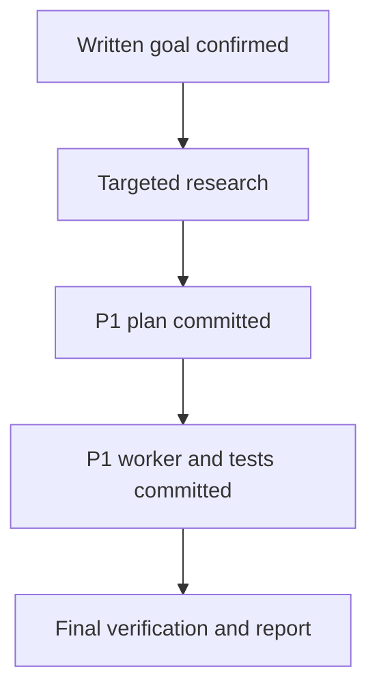

# State & dependency graph: voice-mode instructions

## Workflow configuration

- Artifacts: `docs/voice-mode-instructions/`.
- The user approved the conversational design, requested implementation, and confirmed the written goal with “Approve and implement” on 16 October 2026. Research and implementation dispatch are authorized.
- Unified review: **skipped**, not passed. Research, planning, execution, compatibility checks, defect correction, and final verification remain required.
- Worktree: `codex/voice-mode-instructions`, based on `main` by the user-approved session move.
- Preserve and exclude the pre-existing `backend/test/voice/agent/voice-delivery.spec.ts` change from edits and commits. Its cost-and-flow expectations may not be implemented on the `main` baseline; distinguish unrelated failures from regressions.
- No external provisioning, paid checks, live provider requests, or deployment are authorized.
- At most three child agents alongside the orchestrator; serialize commits. A single focused plan is sufficient here.

## Workflow milestones

- [x] Conversational requirements, alternatives, design, and authorization recorded.
- [x] Written goal and initial dependency graph created; specification self-check completed.
- [x] Written goal confirmed by user (“Approve and implement”, 16 October 2026).
- [x] Technical research committed (`8a607b1`).
- [x] Implementation plan committed (`f1adc25`).
- [x] Worker execution complete and committed (`fb2652a`, `3c3c7ac`, `115418c`; progress `8a16f3b`).
- [x] Unified review **skipped** under repository instruction.
- [x] Final verification and `final_report.md` complete.

## Brainstorming tasks

- [x] Explore current prompt, context assembly, budget accounting, live runtime, recent commits, and workspace changes.
- [x] Clarify fixed dual-mode instructions versus dynamic selection and cache-prefix reuse with the user.
- [x] Compare the approved approach against large prompt swapping and filtering alone.
- [x] Present design and receive conversational implementation authorization.
- [x] Write goal and check scope, ambiguity, consistency, and acceptance coverage.
- [x] Receive written specification confirmation.

## Initial findings and confirmed decisions

- The current shared prompt describes text chat and gives unconditional Canvas guidance.
- The assembler currently emits the fixed system pair, selected/reconciled history, and latest input; the runtime's live channel controls `SpeechProse`.
- Shared instructions will define both modes; a short backend-owned selector goes after history, immediately before the latest input.
- The selector is request-scoped, budgeted, and excluded from transcript/checkpoint conversation records.
- Existing text formatting, delivery reconciliation, identity attribution, recovery, and speech sanitization remain intact.
- Identical selected context must retain an identical prefix across modes; actual cache discounts and model compliance are not certified by offline tests.

## Dependency matrix and execution status

`R` is committed research. Worker dependencies refer to implemented, tested commits, not merely written plans.

| Plan | Scope | Planner prerequisites | Worker prerequisites | Planner | Worker | Commits |
| --- | --- | --- | --- | --- | --- | --- |
| P1 | Dual-mode shared prompt; request-scoped selector; budget/runtime wiring; deterministic context/provider/persistence regressions | Written goal approval and R | P1 plan committed | [x] `f1adc25` | [x] Complete | `fb2652a`, `3c3c7ac`, `115418c` |

## Plan scope, ownership, and completion gates

### P1 — Cache-friendly per-request response modes

- Expected ownership: `backend/src/instructions/system.md`, context contracts/assembly/budget modules, the runtime's context assembly call sites, and narrowly relevant context/runtime/provider/assembly tests. Exact minimal paths are determined by research/planning.
- Exclude the pre-existing modified voice-delivery test, frontend source, provider cache settings, and unrelated refactors.
- Exit gate: all goal acceptance criteria have deterministic coverage, selector overhead is enforced, actual outbound request prefix is checked, and relevant package checks have recorded results. Test failures must be investigated; unrelated baseline failures must be identified without overwriting user work.
- Deliverable: committed `plan1.md` followed by focused worker commits. No downstream plans or concurrent writers are needed.

## Acceptance coverage

| Goal criteria | Owner | Final verification |
| --- | --- | --- |
| 1: shared prompt and text/voice behavior | P1 | Prompt/document consistency and regression assertions |
| 2–4: selector order, prefix stability, mode changes/retries | P1 | Context/runtime tests and captured provider requests |
| 5: persistence isolation | P1 | Transcript/checkpoint and voice-history regression assertions |
| 6: finite budgets | P1 | Exact-boundary and overflow tests |
| 7: compatibility and checks | P1 and orchestrator | Backend build, lint, routine tests, e2e; explicit skips/limitations |

## Research handoff — complete (`8a607b1`)

Research is committed at `docs/voice-mode-instructions/research.md`. The orchestrator verified the commit stat (research file only) without ingesting its contents, preserving context. The P1 planner reads the goal and research artifacts directly and reconciles any contract changes before writing the plan.

## Final verification commands and evidence

| Directory | Command | Purpose | Result |
| --- | --- | --- | --- |
| `backend` | Focused context/assembly/runtime/adapter/contract/speech-prose tests | Mode, budget, payload, isolation | Pass 169/169 |
| `backend` | `npm run build` | Compilation | Pass |
| `backend` | `npm run lint` | Type-aware lint | Pass (warnings only) |
| `backend` | `npm test` | Routine regression suite; preserve unrelated user test | 986 pass / 4 fail / 10 skip; 3 protected delivery + 1 parallel bootstrap flake (passed isolated) |
| `backend` | `npm run test:behavior` | Deterministic instruction/knowledge fixtures | 4 pass / 1 fail (pre-existing knowledge digest CRLF) / 1 skip |
| `backend` | `npm run test:e2e` | Existing e2e suite | 19 pass / 70 fail / 40 skip; native Mongo unconfigured |
| repository | `git diff --check` and artifact/link/status checks | Patch and documentation consistency | Pass; protected test still uncommitted |

## Artifact and commit record

| Artifact | State | Commit |
| --- | --- | --- |
| `goal.md` | Approved | `1d00d74` |
| `state.md` | Complete DAG | `1d00d74` plus later status commits |
| `research.md` | Complete | `8a607b1` |
| `plan1.md` | Written | `f1adc25` |
| `final_report.md` | Complete | This commit |

## Current gate and resume procedure

**CURRENT GATE: COMPLETE.** Review remains **skipped**. Preserve the uncommitted `backend/test/voice/agent/voice-delivery.spec.ts` change. Native Mongo, live cache discounts, and model obedience remain uncertified.
