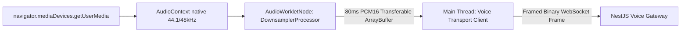
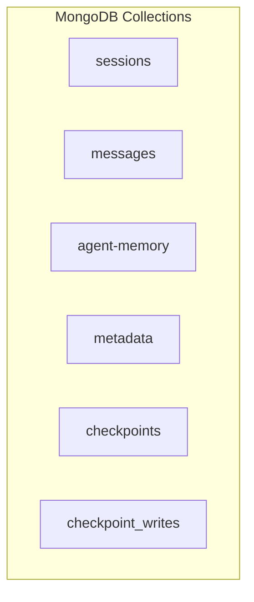
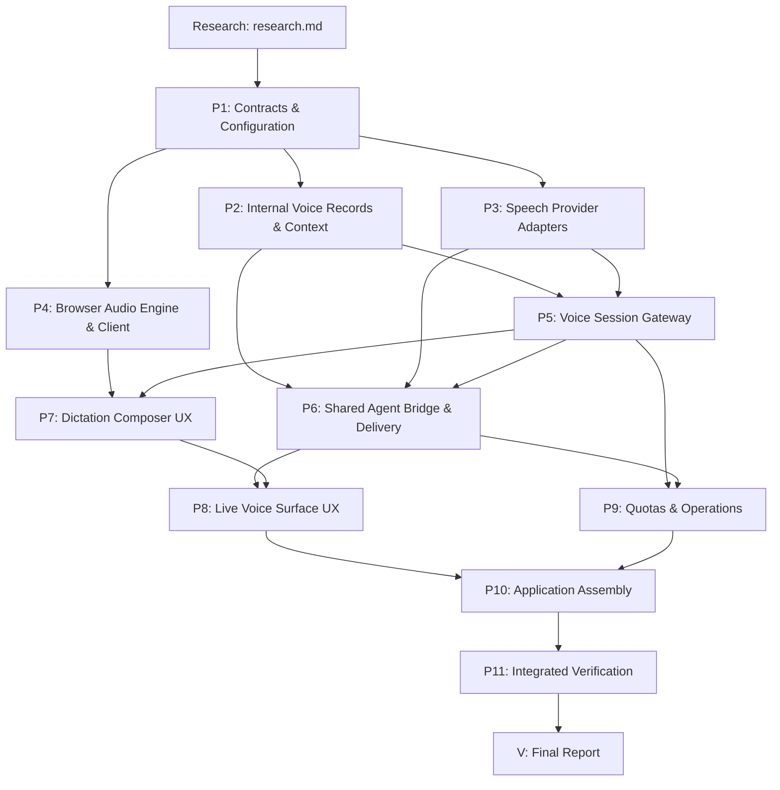

# Voice Modes Integration: Technical Research & Architecture Specification

**Document:** `docs/voice-modes/research.md`  
**Status:** Complete  
**Date:** 8 October 2026  
**Scope Alignment:** Authentication and live tools are **explicitly out of scope** (deferred to future projects). Implementation integrates with Aurvin's existing single development identity (`aurvin-dev-user`), server-configured model, and LangGraph turn runtime.

---

## 1. Executive Summary & Architectural Scope

This research establishes the technical baseline, protocols, audio pipelines, component boundaries, and integration mechanics for adding two distinct voice modes to Aurvin:
1. **Dictation Mode:** Microphone audio streams to Deepgram Nova-3 STT; interim/final hypotheses continuously update the chat composer draft. The user retains full review and editing control before explicitly triggering standard text submission. No LLM or agent runtime is invoked during dictation.
2. **Live Voice Mode:** Full-duplex conversational voice using Deepgram Flux STT (`flux-general-en`) for real-time turn detection and Deepgram Flux TTS (`flux-haley-en` / `flux-alexis-en` / `flux-priya-en`) for streaming 24 kHz spoken responses. The UI presents a dedicated, transcript-free interaction surface displaying operational states (Connecting, Listening, Thinking, Speaking, Reconnecting). Completed voice turns are routed through Aurvin's existing single-process LangGraph runtime and persisted as internal turns that remain excluded from visible text chat rendering and sidebar previews.

### Core Architectural Decisions
- **Reuse Existing Agent & Engine:** Voice turns execute against Aurvin's existing NestJS turn orchestration (`DurableChatRuntime`), MongoDB 6-collection persistence, and OpenRouter LLM backend. No secondary agent or conversational rewriting model is introduced.
- **Strict Scope Boundaries:**
  - *No Live Tools:* Live tools, tool confirmations, and mutation workflows are deferred. The agent operates in a conversational question-answering mode.
  - *No Authentication Infrastructure:* Authentication is deferred. Transport connections reuse the server-resolved identity (`ServerIdentityResolver`), validating Origin and session bindings.
- **Direct Protocol Integration (Minimal Dependencies):**
  - Integrate directly with Deepgram's WebSocket endpoints over standard WebSockets (`ws` in NestJS backend, native `WebSocket` in browser). This bypasses high-level black-box wrappers (such as Deepgram Voice Agent API or bulky SDKs), ensuring strict adherence to Aurvin's "lazy senior dev" principle (fewest dependencies, smallest diff, maximum transparency).
- **Audio Standards:**
  - Input: 16 kHz mono signed 16-bit PCM (PCM16, `linear16`), framed in 80 ms chunks (~2,560 bytes).
  - Output: 24 kHz mono signed 16-bit PCM (PCM16, `linear16`), streamed in binary frames from Deepgram Flux TTS.

---

## 2. Deepgram Protocol Specifications & Findings

### 2.1 Dictation STT: Deepgram Nova-3 (`/v1/listen`)

Deepgram Nova-3 provides state-of-the-art general speech transcription with interim results, punctuate, smart formatting, and silence-based endpointing.

- **WebSocket Endpoint:** `wss://api.deepgram.com/v1/listen`
- **Authentication:** `Authorization: Token <DEEPGRAM_API_KEY>` header during HTTP/1.1 upgrade.
- **Connection Query Parameters:**
  ```text
  model=nova-3&encoding=linear16&sample_rate=16000&channels=1&interim_results=true&smart_format=true&punctuate=true&endpointing=300
  ```
  - `model=nova-3`: Selects the Nova-3 architecture.
  - `encoding=linear16&sample_rate=16000&channels=1`: Declares raw 16 kHz mono signed PCM16 input.
  - `interim_results=true`: Enables low-latency preliminary hypotheses (`is_final: false`).
  - `smart_format=true&punctuate=true`: Normalizes dates, numbers, currency, and punctuation.
  - `endpointing=300`: Silence window (300 ms) before Deepgram emits a segment boundary (`speech_final: true`).
  - `dictation=true`: Optional query param if spoken punctuation (e.g., saying "comma", "period") is configured by the server.
- **Input Audio Delivery:**
  - Continuous binary frames containing raw 16 kHz PCM16 audio.
- **Server Response Schema:**
  ```json
  {
    "type": "Results",
    "channel_index": [0, 0],
    "duration": 0.96,
    "start": 1.24,
    "is_final": false,
    "speech_final": false,
    "channel": {
      "alternatives": [
        {
          "transcript": "Hello Aurvin how are",
          "confidence": 0.98,
          "words": [...]
        }
      ]
    }
  }
  ```
- **Lifecycle & Finalization Flow:**
  1. *Interim Hypotheses (`is_final: false`):* Ephemeral text for the active phrase. Replaces preceding interim text without committing.
  2. *Finalized Segments (`is_final: true`):* Stable segment committed once to the draft.
  3. *Pauses Mid-Dictation (`speech_final: true`):* Marks end of speech segment. Recording connection remains active; draft is **not** submitted.
  4. *Stop Action:* Client issues `dictation.stop` to backend; backend sends `{"type": "Finalize"}` to Deepgram `/v1/listen`.
  5. *Finalize Drain Timeout:* Backend allows up to 2,000 ms to receive remaining `is_final: true` segments, then terminates the stream cleanly.
  6. *Cancel Action:* Client issues `dictation.cancel`; backend terminates WebSocket immediately. Any trailing provider messages are dropped.

---

### 2.2 Conversational STT: Deepgram Flux (`/v2/listen`)

Deepgram Flux (`flux-general-en`) replaces external VAD and manual endpointing with conversational turn detection built directly into the acoustic/language model.

- **WebSocket Endpoint:** `wss://api.deepgram.com/v2/listen`
- **Authentication:** `Authorization: Token <DEEPGRAM_API_KEY>` header.
- **Connection Query Parameters:**
  ```text
  model=flux-general-en&encoding=linear16&sample_rate=16000&channels=1&eot_threshold=0.8&eot_timeout_ms=5000
  ```
  - `model=flux-general-en`: English conversational model.
  - `eot_threshold=0.8`: High-confidence threshold (range 0.5–1.0) triggering natural turn completion.
  - `eot_timeout_ms=5000`: Safety fallback forcing turn completion if silence persists.
  - *Deferred in baseline:* `eager_eot_threshold` (speculative `EagerEndOfTurn`) is deferred until single-turn baseline stability is certified.
- **Audio Framing Requirement:**
  - Deepgram strongly specifies **80 ms audio frames** for Flux.
  - At 16 kHz mono 16-bit PCM: `16,000 samples/sec * 2 bytes/sample * 0.08 sec = 2,560 bytes per frame` (1,280 samples).
- **Server Response Events (`TurnInfo`):**
  ```json
  {
    "type": "TurnInfo",
    "request_id": "2ba892a1-6c0d-4d92-9b89-0000000000",
    "event": "Update",
    "turn_index": 0,
    "audio_window_start": 0.0,
    "audio_window_end": 0.48,
    "transcript": "what is the capital of France",
    "words": [
      { "word": "what", "start": 0.0, "end": 0.12, "confidence": 0.99 }
    ],
    "end_of_turn_confidence": 0.001,
    "sequence_id": 2
  }
  ```
- **Turn Lifecycle Event Semantics:**
  - `StartOfTurn`: User started speaking. **Immediate trigger for barge-in:** cancel active assistant response, abort local playback, and signal TTS interruption.
  - `Update`: Real-time streaming transcription updates while user continues speaking.
  - `EndOfTurn`: High-confidence conclusion of user's speech (`trigger: "model"` or `"manual"`). **Authoritative trigger for agent turn execution:** finalized transcript is committed and submitted to `DurableChatRuntime`.
  - `ForceEndTurn`: Control message `{"type": "ForceEndTurn"}` supported if manual cutoff is requested.
  - `CloseStream`: Control message `{"type": "CloseStream"}` closes session cleanly.

---

### 2.3 Conversational TTS: Deepgram Flux (`/v2/speak`)

Deepgram Flux TTS (`/v2/speak`) provides turn-based streaming synthesis with native interruption handling and heard-speech reconciliation.

- **WebSocket Endpoint:** `wss://api.deepgram.com/v2/speak`
- **Authentication:** `Authorization: Token <DEEPGRAM_API_KEY>` header.
- **Connection Query Parameters:**
  ```text
  model=flux-haley-en&encoding=linear16&sample_rate=24000
  ```
  - `model`: Initial baseline `flux-haley-en` (audition variants: `flux-alexis-en`, `flux-priya-en`).
  - `encoding=linear16&sample_rate=24000`: Streams raw 24 kHz mono signed PCM16 (little-endian).
- **Client-to-Server Messages:**
  1. `Speak`: Stream text chunks as LLM generates tokens.
     ```json
     { "type": "Speak", "text": "Paris is the capital of France." }
     ```
     *Rule:* Deepgram does not automatically inject whitespace between successive `Speak` frames. The application streaming adapter must ensure inter-token and inter-sentence spacing is preserved to prevent acoustic pronunciation errors.
  2. `Flush`: Signals end of text generation for the turn.
     ```json
     { "type": "Flush" }
     ```
     Prompts Deepgram to drain synthesis buffers and complete the turn.
  3. `Interrupt`: Issued upon barge-in or manual Stop speaking.
     ```json
     {
       "type": "Interrupt",
       "playback_offset": { "type": "time_ms", "value": 2340 }
     }
     ```
     *Critical Invariant:* `playback_offset` **must be session-wide** (measured from the start of the WebSocket session's cumulative audio) and **strictly monotonically increasing**. An offset that does not advance past a prior interrupt is rejected with an `INVALID_INTERRUPT_OFFSET` warning. Playback offset resets to zero **only when establishing a brand-new provider WebSocket connection**.
  4. `Close`: Graceful shutdown.
     ```json
     { "type": "Close" }
     ```
- **Server-to-Client Messages & Audio Flow:**
  1. `Connected`: Confirms handshake with `request_id`, `model_name`, and `model_version`.
  2. `SpeechStarted`: Marks start of synthesis for a turn with server-assigned `speech_id`.
  3. *Binary Audio Frames:* Raw 24 kHz PCM16 frames delivered strictly between `SpeechStarted` and `SpeechMetadata` / `SpeechInterrupted`.
  4. `Flushed`: Confirms buffer flush completion after client `Flush`.
  5. `SpeechMetadata`: Emitted when all audio for a normal turn has been delivered. Reports `audio_duration_ms`, `billable_character_count`, and input character counts.
  6. `SpeechInterrupted`: Emitted in response to `Interrupt`. Reports:
     ```json
     {
       "type": "SpeechInterrupted",
       "audio_played_ms": 2340,
       "text_spoken": "Paris is the capital",
       "text_remaining": " of France.",
       "metadata": {
         "speech_id": "dg_sp_a1b2c3d4e5f6",
         "audio_duration_ms": 2340,
         "billable_character_count": 20
       }
     }
     ```
     `text_spoken` provides the exact substring heard by the user before cut-off, which must be fed into Aurvin's memory/context builder.
  7. `SessionMetadata`: Emitted upon `Close`, reporting cumulative session audio duration and characters.
  8. `Warning` & `Error`: Non-fatal `Warning` (e.g., `NO_ACTIVE_SPEECH`, `INVALID_INTERRUPT_OFFSET`) vs fatal `Error` (`MESSAGE-0000`, `NET-0004` inactivity timeout). Deepgram drops idle sessions after 60 seconds of client inactivity; periodic WebSocket ping/pong maintains idle sessions.

---

## 3. Browser Audio Pipeline Architecture

### 3.1 Capture Pipeline: `AudioWorklet` & Resampling



1. **Permissions & Constraints:**
   - Initialize on explicit user interaction (microphone click or live voice button).
   - Audio constraints:
     ```javascript
     {
       audio: {
         channelCount: 1,
         echoCancellation: true,
         noiseSuppression: true,
         autoGainControl: true
       }
     }
     ```
2. **Device Sample Rates & Resampling in `AudioWorkletProcessor`:**
   - Browser audio contexts typically operate at hardware-fixed sample rates (44.1 kHz or 48 kHz). Initializing an `AudioContext` with `{ sampleRate: 16000 }` directly is either ignored or degrades audio drivers on mobile browsers (especially iOS Safari).
   - **Recommendation:** Run the `AudioContext` at the browser's hardware rate. Perform audio decimation/resampling inside an `AudioWorkletProcessor` running on the high-priority Web Audio render thread.
   - Resampling Algorithm: Linear interpolation with anti-aliasing accumulator down to target 16,000 Hz.
   - Sample Quantization: Float32 `[-1.0, 1.0]` converted to signed 16-bit integer PCM `[-32768, 32767]`:
     ```typescript
     const s = Math.max(-1, Math.min(1, floatSample));
     const pcm16 = s < 0 ? s * 0x8000 : s * 0x7FFF;
     ```
   - Buffering & Framing:
     - Pack downsampled samples into 80 ms frames (1,280 samples = 2,560 bytes).
     - Post `Int16Array.buffer` to main thread via `this.port.postMessage(buffer, [buffer.buffer])` using transferable buffers (zero-copy memory transfer).
3. **Mute Handling:**
   - When muted, the processor drops captured microphone buffers immediately at the source. Muted audio is never queued, transmitted, or buffered.

---

### 3.2 Playback Pipeline: Web Audio API Scheduling & Clearing

1. **Playback Engine:**
   - Dedicated `AudioContext` initialized on user gesture (opening Live Voice).
   - Backend sends raw 24 kHz signed PCM16 binary frames.
2. **Scheduling Architecture:**
   - Convert incoming Int16 PCM to Float32:
     ```typescript
     float32[i] = int16[i] < 0 ? int16[i] / 32768 : int16[i] / 32767;
     ```
   - Create audio buffers via `audioContext.createBuffer(1, sampleCount, 24000)`.
   - Schedule sequential playback using `AudioBufferSourceNode` chained onto `audioContext.currentTime`:
     ```typescript
     const now = audioContext.currentTime;
     const startTime = Math.max(now, nextScheduledTime);
     source.start(startTime);
     nextScheduledTime = startTime + buffer.duration;
     ```
   - Maintain an active node registry tracking `{ source, startTime, duration, responseId }`.
3. **Progress & Offset Tracking:**
   - Track cumulative session audio played:
     $$\text{sessionOffsetMs} = \text{baseSessionPlayedMs} + \max(0, (\text{audioContext.currentTime} - \text{turnAudioStartContextTime}) \times 1000)$$
   - Periodically emit `playback.progress` to backend to keep transport statistics aligned.
4. **Immediate Barge-in Clearing:**
   - On detecting barge-in (`StartOfTurn` from server) or user click ("Stop speaking"):
     1. Stop and disconnect all queued and active `AudioBufferSourceNode` instances immediately:
        ```typescript
        activeNodes.forEach(node => {
          try { node.source.stop(); node.source.disconnect(); } catch {}
        });
        activeNodes.length = 0;
        ```
     2. Reset `nextScheduledTime = audioContext.currentTime`.
     3. Compute exact played milliseconds at the cut-off instant.
     4. Invalidate `activeResponseId`. Discard any late frames arriving with that response ID.
     5. Dispatch `response.interrupt` over the WebSocket containing `{ responseId, playbackPositionMs }`.

---

## 4. Application Gateway & Protocol Design

### 4.1 Route Architecture

All HTTP and WebSocket routes reside behind Aurvin's `/api` namespace:

| Method | Path | Description | Access & Validation |
| :--- | :--- | :--- | :--- |
| `GET` | `/api/voice/config` | Returns enabled voice modes and limits | Public; read-only server flags |
| `POST` | `/api/voice/sessions` | Creates and authorizes a voice session | Validates resolved user & conversation |
| `DELETE` | `/api/voice/sessions/:id` | Closes voice session and frees resources | Idempotent cleanup |
| `WS` | `/api/voice` | Full-duplex audio and control stream | Upgrades authenticated sessions |

### 4.2 WebSocket Adapter & Vite Proxy Wiring

- **NestJS Transport:** Use `@nestjs/platform-ws` with the underlying `ws` library.
  - NestJS bootstrap (`backend/src/main.ts`):
    ```typescript
    import { WsAdapter } from '@nestjs/platform-ws';
    app.useWebSocketAdapter(new WsAdapter(app));
    ```
- **Vite Proxy (`frontend/vite.config.ts`):**
  - Current proxy configuration proxies `/api` HTTP traffic to port 3000 but omits WebSocket proxying.
  - **Required Adjustment (P10):** Add `ws: true` to the `/api` proxy definition:
    ```typescript
    '/api': {
      target: process.env.BACKEND_PROXY_TARGET ?? 'http://localhost:3000',
      changeOrigin: true,
      ws: true,
    }
    ```

---

### 4.3 Application WebSocket Framing & Message Contract

#### Binary Audio Frame Specification (16-Byte Header)

To distinguish input/output audio and link audio frames to sessions and sequences without out-of-band JSON, every binary message prepends a compact, fixed 16-byte little-endian header:

```
 0                   1                   2                   3
 0 1 2 3 4 5 6 7 8 9 0 1 2 3 4 5 6 7 8 9 0 1 2 3 4 5 6 7 8 9 0 1
+-+-+-+-+-+-+-+-+-+-+-+-+-+-+-+-+-+-+-+-+-+-+-+-+-+-+-+-+-+-+-+-+
|       Magic (0xAF, 0x01)      |   Kind (1B)   |   Flags (1B)  |
+-+-+-+-+-+-+-+-+-+-+-+-+-+-+-+-+-+-+-+-+-+-+-+-+-+-+-+-+-+-+-+-+
|                       Sequence (4B LE)                        |
+-+-+-+-+-+-+-+-+-+-+-+-+-+-+-+-+-+-+-+-+-+-+-+-+-+-+-+-+-+-+-+-+
|                   Timestamp/Offset Ms (4B LE)                 |
+-+-+-+-+-+-+-+-+-+-+-+-+-+-+-+-+-+-+-+-+-+-+-+-+-+-+-+-+-+-+-+-+
|                    Payload Byte Length (4B LE)                |
+-+-+-+-+-+-+-+-+-+-+-+-+-+-+-+-+-+-+-+-+-+-+-+-+-+-+-+-+-+-+-+-+
|                          Payload Data ...                     |
```

- **Magic:** `0xAF, 0x01` (Aurvin Frame v1).
- **Kind:** `0x01` = Client microphone input (16 kHz PCM16); `0x02` = Server assistant output (24 kHz PCM16).
- **Flags:** `0x00` = Standard frame; `0x01` = End of turn audio stream.
- **Sequence:** Monotonically increasing frame sequence within connection epoch.
- **Timestamp/Offset Ms:** Monotonic session audio offset in milliseconds.
- **Payload Byte Length:** Length of PCM16 audio bytes immediately following the header.

#### JSON Control Messages

All control messages share common envelope metadata:
```typescript
interface VoiceEnvelope {
  sessionId: string;
  connectionEpoch: number;
  eventId: string;
  sequence: number;
}
```

| Direction | Event Name | Payload Fields | Purpose |
| :--- | :--- | :--- | :--- |
| C $\to$ S | `session.start` | `mode: 'dictation' \| 'live'`, `audioSettings` | Handshake initial session start |
| C $\to$ S | `dictation.stop` | — | Stop dictation capture, flush provider |
| C $\to$ S | `dictation.cancel`| — | Cancel dictation, discard output |
| C $\to$ S | `input.mute` | — | Pause audio transmission |
| C $\to$ S | `input.unmute` | — | Resume audio transmission |
| C $\to$ S | `response.interrupt` | `responseId`, `playbackPositionMs` | Barge-in report to reconcile heard speech |
| C $\to$ S | `playback.progress` | `responseId`, `playedMs`, `playedSamples` | Cumulative playback update |
| C $\to$ S | `session.end` | — | Close session cleanly |
| S $\to$ C | `session.ready` | `limits`, `effectiveAudioSettings` | Session established confirmation |
| S $\to$ C | `session.ended` | `reason` | Session closed notification |
| S $\to$ C | `dictation.partial` | `text` | Replaceable interim transcript hypothesis |
| S $\to$ C | `dictation.final` | `text` | Stable finalized segment text |
| S $\to$ C | `dictation.complete`| — | Finalization finished, composer unlocked |
| S $\to$ C | `voice.state` | `state: 'listening' \| 'thinking' \| 'speaking' \| 'reconnecting'` | Operational UI feedback |
| S $\to$ C | `audio.start` | `turnId`, `responseId`, `sampleRate` | Assistant speech begins |
| S $\to$ C | `audio.end` | `turnId`, `responseId` | Assistant speech generation ends |
| S $\to$ C | `response.cancelled`| `responseId` | Response invalidated; drop late frames |
| S $\to$ C | `session.warning` | `code`, `message` | Non-fatal diagnostic warning |
| S $\to$ C | `session.error` | `code`, `message`, `recoverable` | Fatal or recoverable error |

*Invariant for Live Voice:* `dictation.*` events are **never** emitted during live mode. In addition, no transcript or assistant response text is ever sent in live mode messages. The live voice panel UI renders solely from `voice.state` and audio streams.

---

## 5. Persistence, Context & Memory Integration

### 5.1 Storage in Aurvin's 6-Collection Layout

Aurvin's storage engine enforces a bounded 6-collection MongoDB architecture:



1. **`sessions` Collection:**
   - Maintains navigation metadata.
   - For conversations initiated via live voice, initialize with a neutral title (e.g. `"Voice Conversation"`) rather than leaking spoken transcripts.
   - Session execution lock fences concurrent text and voice executions.
2. **`messages` Collection:**
   - Store finalized user voice turns and assistant generated responses as records with `visibility: 'internal'` (or `channel: 'voice'`).
   - Query Filter: The public message paging repository (`MongoMessages.list`) filters `visibility: { $ne: 'internal' }`.
   - Result: Visible chat transcripts and sidebar previews remain 100% clean of internal voice turns, satisfying requirements A7 and A13.
3. **`metadata` Collection:**
   - Store attempt records (`kind: 'attempt'`), accounting records (`kind: 'accounting'`), and a new `VoiceDeliveryRecord`:
     ```typescript
     interface VoiceDeliveryRecord {
       schemaVersion: 1;
       kind: 'voice-delivery';
       userId: string;
       sessionId: string;
       turnId: string;
       attemptId: string;
       speechId: string | null;
       status: 'completed' | 'interrupted' | 'cancelled' | 'failed';
       audioDurationMs: number | null;
       audioPlayedMs: number | null;
       textGenerated: string;
       textSpoken: string | null;
       textRemaining: string | null;
       createdAt: string;
       updatedAt: string;
     }
     ```
4. **`agent-memory` Collection:**
   - Context manifests reference message records by ID (`messageRefs`).
   - Context Assembly Integration:
     - When `ReferencedContextAssembler` builds LLM prompt history, it retrieves the referenced assistant message.
     - If the message corresponds to an interrupted voice turn, it queries the `VoiceDeliveryRecord` and injects `textSpoken` (the delivered speech) rather than the original `textGenerated`. This ensures subsequent turns adhere to what the user actually heard.
5. **`checkpoints` & `checkpoint_writes`:**
   - Standard LangGraph checkpointer persists execution graphs for voice turns using the existing single-process executor.

---

### 5.2 Execution Boundaries & Concurrency Exclusion

1. **One Active Execution per Conversation:**
   - While a conversation is bound to an active live voice session, the backend execution coordinator holds an execution lock.
   - Concurrent text submissions (`submitTurn` or `retryTurn`) for that session ID reject with `CONFLICT_ACTIVE_TURN`.
   - Conversely, opening a live voice session for a conversation that is currently generating a text turn rejects with `CONFLICT_ACTIVE_TURN`.
2. **Dictation Isolation:**
   - Dictation does not reserve agent execution locks and never submits turns directly. It only operates as a client-side drafting aid.

---

## 6. Subsystem Boundaries, File Ownership & Plan Alignment

To ensure parallel MAW planning and implementation proceed without merge conflicts or overlapping writes, ownership is structured across eleven plans:



### Plan Breakdown & Owned Artifacts

| Plan | Subsystem | Owned File Boundaries | Core Responsibilities |
| :--- | :--- | :--- | :--- |
| **P1** | Shared Contracts & Config | `backend/src/contracts/**`, `backend/src/platform/**`, `frontend/src/api/voice-protocol.ts`, package manifests | Define schemas, binary headers, event types, Deepgram config keys, and dependency additions. Reconcile user uncommitted changes in `session.ts`. |
| **P2** | Persistence & Context | `backend/src/persistence/**`, `backend/src/context/**`, `backend/test/persistence/**`, `backend/test/context/**` | Internal message filtering, `VoiceDeliveryRecord`, context builder integration with delivered speech. |
| **P3** | Speech Provider Adapters | `backend/src/voice/providers/**`, `backend/test/voice/providers/**`, `backend/test/fixtures/deepgram/**` | Direct WebSocket adapters for Nova-3 and Flux STT/TTS; framing, interruption offsets, and mock fixtures. |
| **P4** | Browser Audio Engine | `frontend/src/features/voice/audio/**`, `frontend/src/features/voice/transport/**`, `frontend/src/api/voice-client.ts` | AudioWorklet capture, 16 kHz resampling, 24 kHz playback scheduler, queue management, and interruption clears. |
| **P5** | Voice Session Gateway | `backend/src/voice/session/**`, `backend/src/voice/transport/**`, `backend/test/voice/session/**`, `backend/test/voice/transport/**` | Session REST endpoints, NestJS WebSocket gateway (`ws`), Origin validation, framing parser, and lifetime management. |
| **P6** | Shared Agent Bridge | `backend/src/voice/agent/**`, `backend/src/agent/**`, `backend/src/chat-runtime/**`, `backend/src/http/**` | Execution exclusion, bridging completed turns to `DurableChatRuntime`, streaming assistant text to TTS, heard-speech delivery reconciliation. |
| **P7** | Dictation Composer UX | `frontend/src/features/voice/dictation/**`, `frontend/src/features/voice/components/ComposerVoiceControls.tsx`, `frontend/src/components/Composer.tsx` | Microphone entry control, selection snapshotting, read-only editing during capture, Stop/Cancel workflows. |
| **P8** | Live Voice Surface UX | `frontend/src/features/voice/live/**`, `frontend/src/features/voice/state/**`, `frontend/src/features/chat/ChatView.tsx` | Dedicated transcript-free waveform panel, mute/unmute, manual stop speaking, exit cleanup, draft preservation. |
| **P9** | Quotas & Operations | `backend/src/voice/usage/**`, `backend/src/operations/**`, `deployment/staging/**`, `docs/voice-modes/operations.md` | Budget enforcement (5m/20m caps, 60s idle prompt, 30s exit), usage tracking, operational telemetry, feature flag gating. |
| **P10**| Assembly & Wiring | `backend/src/main.ts`, `backend/src/app.module.ts`, `backend/src/app.service.ts`, `frontend/src/App.tsx`, `frontend/vite.config.ts`, `README.md` | Central module registration, Vite WebSocket proxying, bootstrap configuration, and runbook documentation. |
| **P11**| Integrated Verification | `backend/test/voice/integration/**`, `frontend/src/features/voice/integration-tests/**`, `docs/voice-modes/verification.md` | End-to-end integration tests, acceptance scenario validation (A1–A18 scoped), evaluation fixtures. |

### Reconciliation with Intervening User Work
The workspace contains uncommitted changes on `main`:
- `backend/src/contracts/session.ts` (added `pinned?: boolean`)
- `frontend/src/components/Sidebar.tsx` and `frontend/src/components/Sidebar.test.ts`
- `frontend/src/features/chat/state/chat-reducer.ts` and related state files
- `backend/src/app.service.ts`, `backend/src/contracts/api.ts`

*Enforcement Rules:*
- P1 owns shared schemas and must preserve the user's `pinned` session metadata field without overwriting it.
- P7 and P8 only add modular voice components and control hooks; they do not alter the user's custom sidebar navigation or pinned session actions.
- P10 merges module dependencies into `app.module.ts` and `app.service.ts` preserving the user's updated session delegates.

---

## 7. Minimal Dependency Analysis

Following the repository's strict standard ("the best code is the code never written; no new dependency if it can be avoided"):

### Backend Additions (Solely Managed by P1)
1. `@nestjs/websockets` (`^12.0.1`): Standard NestJS module for WebSocket gateway orchestration.
2. `@nestjs/platform-ws` (`^12.0.1`): NestJS adapter for native RFC 6455 WebSockets (avoids heavy Socket.IO overhead).
3. `ws` (`^8.18.0`): High-performance, battle-tested WebSocket implementation for Node.js.
4. `@types/ws` (`^8.5.14`): TypeScript declarations for `ws`.

*Deepgram SDK Evaluation:*
- The official `@deepgram/sdk` bundles heavy dependency graphs, Node/browser polyfills, and opinionated agent runtime layers that compete with Aurvin's LangGraph turn engine.
- **Decision:** Do **not** install `@deepgram/sdk`. The provider WebSocket protocols (`/v1/listen`, `/v2/listen`, `/v2/speak`) are compact JSON/binary protocols that are cleaner, faster, and more robustly implemented directly using `ws`.

### Frontend Additions
- **Zero new npm packages.**
- Browser native capabilities (`getUserMedia`, `AudioContext`, `AudioWorklet`, `DataView`, `Float32Array`, `Int16Array`, native `WebSocket`) completely satisfy all recording, resampling, playback, and transport requirements.

---

## 8. Reliability, Budgets & Failure Modes

### 8.1 Finite Budgets & Defaults
- **Input Audio Queue:** Bounded to 1,000 ms of pending audio. Overflow rejects with `AUDIO_BUFFER_OVERFLOW`.
- **Output Audio Queue:** Bounded to 2,000 ms of pending audio. Excess triggers synthesis throttling.
- **Dictation Session Duration:** Hard limit 5 minutes (300 seconds). Auto-stops capture and finalizes.
- **Live Session Duration:** Hard limit 20 minutes (1,200 seconds). Emits duration warning at 18 minutes.
- **Idle Inactivity Window:**
  - 60 seconds with no speech / user activity triggers an idle prompt / warning.
  - 30 seconds thereafter without activity cleanly terminates the live session.
- **Finalization Timeout (Dictation):** 2,000 ms maximum wait for final provider segments after Stop.
- **Reconnect Window:** Bounded exponential backoff with a 10,000 ms total recovery deadline. If recovery fails, cleanly return to chat.

### 8.2 Failure Mode Recovery Matrix

| Failure Condition | Operational Response |
| :--- | :--- |
| **Microphone permission denied** | Display accessible inline explanation; keep text composer active. |
| **No speech detected** | Dictation leaves draft intact. Live session remains in listening state until idle timeout. |
| **Dictation socket disconnect** | Preserve committed segments in composer. Display retry action; do not silently re-record. |
| **Deepgram STT/TTS outage (503/429)**| Gracefully terminate voice session, log error code, present non-technical user feedback. Text chat remains 100% operational. |
| **Browser audio playback blocked** | Require user interaction gesture to unlock `AudioContext`. |
| **Page hidden / tab backgrounded** | Halt audio tracks and pause streaming. Require explicit user gesture upon tab return to resume. |
| **Speaker acoustic feedback / echo**| Browser hardware AEC requested via `echoCancellation: true`. Local playback clears immediately upon `StartOfTurn` to eliminate echo loop. |

---

## 9. Verification & Evidence Strategy

1. **Unit & Protocol Verification:**
   - Provider adapters (P3) tested against recorded mock WebSocket protocol fixtures.
   - Resampling math and PCM conversions (P4) verified with synthetic sine wave test vectors.
   - Reducers and selection state (P7, P8) validated using pure Vitest suites.
2. **Deterministic Integration Tests:**
   - Simulate WebSocket interruptions, non-advancing playback offsets, and out-of-order frames in isolated test suites.
   - Verify that internal voice messages are strictly omitted from `MongoMessages.list` and sidebar previews.
3. **Hardware / Device Pilot Requirements (Gated at P11):**
   - Offline automated suites cannot certify real audio devices, latency, or acoustic feedback.
   - Formal release gates require testing across Chrome, Edge, Safari, Firefox, iOS Safari, and Android Chrome.
   - Live Deepgram provider tests require explicit operator authorization, valid API keys, and bounded spend allocation. Missing hardware or credentials must be reported as blocked prerequisites, never inferred as passing.
