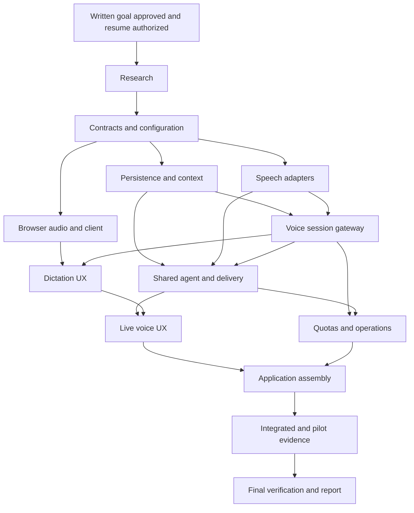

# State & Dependency Graph: Dictation and Live Voice

## 13 October silent-startup defect correction

- User reports voice closes after five or six seconds even without speaking.
- Existing user UI changes committed on request: `ed3f5cb`; six focused UI tests passed.
- Investigation: `78599a8`, `6e4472e`, `eff53e4`; [evidence](live-delivery-investigation.md).
- One explicitly authorized silent STT/TTS connection pair confirmed TTS rejects a valid resolved model name because it differs from the requested model identifier. No audio/text, retries, database changes, or further paid checks authorized.
- P12 planner complete: `7ad7af3`, [plan12.md](plan12.md). P12 worker complete: `817888f`; P3 Connected validation/provider regressions and coordinated P5 test-only silent-startup coverage.
- Dependencies: confirmed provider evidence → P12 plan → P12 worker → build/lint/test verification and final correction report. Review remains **skipped**.
- Other offline delivery-origin/deadline/precision findings are deferred, not part of this startup fix. Historical workflow completion does not claim this correction is verified.
- Correction gate: implemented and offline verified, with native integration/full-device verification blocked. Backend routine tests: 543 passed / 10 skipped; build/lint exit zero (lint warnings). Native e2e command failed prerequisite guards: 70 failed, 18 passed, 34 skipped; no isolated MongoDB configuration supplied. These failures are not passing or skipped results. See [correction final report](silent-startup-final-report.md).
- User chose to remain in the shared checkout on `codex/super-admin-config`; no branch/worktree switch by this task. Restart/retest of the real app remains operator work; no additional paid checks performed.

## Workflow configuration

- Keep all workflow artifacts directly in `docs/voice-modes/`.
- Source: [original PRD](../../voice-modes-prd.md). The [goal](goal.md) reproduces it with an authoritative integration scope reflecting the user's 8 October 2026 correction: authentication and live tools are future work, outside this workflow.
- Review is **skipped**, never passed, under the current repository workflow constraint. Research is not skipped. Brainstorming, planning, execution, defect correction, and final verification remain mandatory.
- Current authorization: Goal approved and research completed on 8 October 2026. Review is skipped.
- Preserve all existing modified/untracked files, including the original PRD and `.openchamber/`.
- Baseline: `7cbeb0d`, plus uncommitted session-action/sidebar changes observed on 8 October. Do not adopt or stage those changes. Recheck ownership and upstream commits with the user before any overlapping worker starts.
- The main orchestrator manages dispatch, dependencies, summaries, and serialized commits; it never implements code or reads `research.md`/`plan*.md`. Assigned agents read their own artifacts and return interface summaries, commits, checks, and blockers.
- At most three child agents alongside the orchestrator. Independent planners run concurrently in foreground cohorts. Ready workers start as soon as their plan and prerequisite worker commits are ready, without waiting for unrelated plans.
- Serialize all staging/commits. Stage exact owner paths, never `git add .` or a whole artifact directory containing unrelated work. P1 owns shared schemas/manifests; P10 owns central composition. Upstream contract changes pause affected work until reconciled.

## Workflow milestones

- [x] Source PRD received as the proposed goal; user clarified authentication/tools are outside scope.
- [x] Repository context inspected; initial DAG, ownership, and acceptance mapping prepared.
- [x] Explicit documentation-only stop before research recorded, 8 October 2026.
- [x] Step 1: Written goal approved; recorded user approval via /resume (`6b5986e`).
- [x] Step 2: Research completed and committed (`docs/voice-modes/research.md`; `c1bd4da`).
- [x] Step 3: All eleven plans written and committed (`plan1.md`–`plan11.md`).
- [x] Step 4: All eleven workers finished, verified, and committed.
- [x] Step 5: Unified review **Skipped**; no reviewer or review-triggered fixer.
- [x] Step 6: Final verification and `final_report.md` completed and committed.

## Brainstorming tasks

- [x] Explore source PRD, current architecture, source boundaries, manifests, recent commits, and Git changes.
- [x] Clarify incompatible assumptions: user explicitly deferred authentication and tools.
- [x] Compare approaches: one shared DAG with separate mode gates (selected proposal), separate workflows (duplicate foundation), or adding auth/tools (rejected by user).
- [x] Record architecture/data-flow/error/testing design from the PRD with repository-specific scope precedence.
- [x] Write goal and perform scope/consistency self-check; preserve all original PRD sections and IDs.
- [ ] Obtain approval of the written specification and execution graph, plus explicit authorization to resume beyond the documentation-only stop, before dispatch.

## Initial findings

- Aurvin already has NestJS/LangGraph/OpenRouter durable text chat, not an empty scaffold. `README.md` and actual source supersede stale preparation paragraphs in Phase 1 state. That workflow now records verification complete-with-blocks; it is not production certification.
- `backend/src/contracts/runtime.ts` offers submit/retry/cancel/status/reconcile for text turns. No live tool interface or application authentication exists. `ServerIdentityResolver` resolves one configured identity and rejects client overrides.
- `backend/src/contracts/message.ts` currently models visible messages only. Hidden live turns and delivered-speech evidence require coordinated contracts, persistence, context, runtime, and serializer changes, not frontend-only hiding.
- `frontend/src/components/Composer.tsx` uses the chat provider's draft; `ChatView.tsx` assembles composer/transcript/empty state. Both centered and docked composers must gain the two controls.
- Package manifests contain no direct speech/WebSocket integration dependencies. Research checks existing/transitive/native capabilities before recommending additions; only P1 changes manifests/lockfiles.
- Vitest exists in both packages; frontend routine tests use Node, not a browser DOM. Real AudioWorklet/device/accessibility evidence needs an explicit browser harness/manual procedure rather than pretending Node tests exercise hardware.
- Backend persistence admits native MongoDB replica sets and exactly one single-process executor. Existing unsafe-exit recovery and bounded mutation journaling must remain intact.
- Existing user work overlaps contracts, persistence sessions/pagination, HTTP APIs, central backend wiring, client protocol/state, sidebar, and styles. Implementation readiness includes ownership reconciliation, not just a committed plan.

## Confirmed product decisions

- Dictation and live voice are distinct, mutually exclusive experiences with independently default-off server flags; existing text chat remains available if either is disabled.
- Dictation uses Nova-3, preserves draft/selection, revises interim text, commits finals once, finalizes on Stop, restores snapshot on Cancel, and never calls the agent before explicit Send.
- English live voice uses Flux completed turns and Flux TTS with the current model/runtime; no eager processing, rewrite model, Aura fallback, multilingual release, or captions in this baseline.
- Voice UI hides transcript/composer and exposes only operational state; internal finalized turns remain usable by context but absent from all text archive serialization/previews.
- Reuse the current server-resolved identity, ownership checks, bounded storage, cancellation, and executor admission. No authentication, tenants, live tools, mutation confirmations, or public rollout are built here.
- Interruption tracks played audio separately from generated text, drops invalidated frames, and cancels best-effort without claiming billing prevention. Reconnect never replays audio or silently resubmits inference.
- Limits/telemetry/billing controls remain server-side; device/pilot targets require actual evidence and explicitly authorized provider spending.

## Dependency matrix & execution status

`G` is approval of the written goal plus a later explicit authorization lifting the stop-before-research gate. `R` is committed research with a reported compatibility/interface summary. `P#` worker dependencies require verified implementation commits, not merely a written plan. All workers additionally require their own committed plan, stable contracts, and cleared ownership conflicts.

| ID | Title & scope | Worker dependencies | Owned subsystem | Planner / researcher status | Worker status | Commits |
| --- | --- | --- | --- | --- | --- | --- |
| R | Provider/browser/runtime compatibility | G | `research.md` only | [x] `c1bd4da` complete | Not applicable | `c1bd4da` |
| P1 | Contracts, server configuration, dependency reconciliation | R | Shared contracts/platform/protocol/manifests | [x] `38a96b0` | [x] Complete `952b605`..`a2860f7` (5 commits) | `38a96b0` (plan) + `952b605`..`a2860f7` (worker) |
| P2 | Internal voice persistence and context | P1 | Persistence/context/instructions | [x] `02b8b4c` | [x] Complete `3c9d638`..`f9d13f8` (3 commits) | `02b8b4c` (plan) + `3c9d638`..`f9d13f8` (worker) |
| P3 | Nova/Flux speech adapters | P1 | Backend speech providers/fixtures | [x] `217cd08` | [x] Complete `9bac624`..`d43eabf` (4 commits) | `217cd08` (plan) + `9bac624`..`d43eabf` (worker) |
| P4 | Browser capture, PCM playback, and voice client | P1 | Frontend audio/transport | [x] `0b9e333` | [x] Complete `ac707b7`..`2e2e9e4` (6 commits) | `0b9e333` (plan) + `ac707b7`..`2e2e9e4` (worker) |
| P5 | Voice sessions and validated gateway | P2, P3 | Backend voice session/transport | [x] `885548f` | [x] Complete `479a758`..`d20b7ea` (5 commits) | `885548f` (plan) + `479a758`..`d20b7ea` (worker) |
| P6 | Shared agent execution and speech delivery | P2, P3, P5 | Runtime/agent bridge/text HTTP guards | [x] `566225e` | [x] Complete `af791f8`..`8b30670` (4 commits) | `566225e` (plan) + `af791f8`..`8b30670` (worker) |
| P7 | Dictation composer experience | P4, P5 | Dictation UI/composer/chat draft integration | [x] `cd3232e` | [x] Complete `d7bca9e`..`03b87e8` (5 commits) | `cd3232e` (plan) + `d7bca9e`..`03b87e8` (worker) |
| P8 | Live voice surface and lifecycle | P6, P7 | Live UI/ChatView/voice styling | [x] `2d1d31c` | [x] Complete `8e7e388`..`95482fc` (5 commits) | `2d1d31c` (plan) + `8e7e388`..`95482fc` (worker) |
| P9 | Quotas, usage, readiness, and runbooks | P5, P6 | Voice usage/operations/protected deployment assets | [x] `eab8cb5` | [x] Complete `cf9a380`..`5a8d53d` (5 commits) | `eab8cb5` (plan) + `cf9a380`..`5a8d53d` (worker) |
| P10 | Application assembly | P8, P9 | Central backend/frontend composition/proxy/README | [x] `ed897ca` | [x] Complete `f3b4a6e`..`ac31b8c` (5 commits) | `ed897ca` (plan) + `f3b4a6e`..`ac31b8c` (worker) |
| P11 | Integrated verification and pilot evidence | P10 | Integrated tests/evaluations/evidence | [x] `670c979` | [x] Complete `5e74cbc`..`ea9e96c` (5 commits) | `670c979` (plan) + `5e74cbc`..`ea9e96c` (worker) |
| V | Final verification & report | P11 | `final_report.md`, final state | [x] Complete | [x] Complete | `final_report.md` |

### Execution graph

Review is bypassed. Defects from tests/evaluations return to existing owners for regression tests and correction, not to a review-triggered fixer. External evidence authorization is a gate on the affected checks, not a skipped verification phase.

### Planner readiness and immediate worker dispatch

| Planner | Earliest planning prerequisites | Worker start condition |
| --- | --- | --- |
| P1 | G approved; R committed and compatibility summary available | Plan committed; R complete |
| P2, P3, P4 | P1 worker complete and contracts stable | Respective plan committed; P1 complete |
| P5 | P2/P3 plans committed with interface summaries | Plan committed; P2/P3 workers complete |
| P6 | P2/P3/P5 plans committed with lifecycle/interface summaries | Plan committed; P2/P3/P5 workers complete |
| P7 | P4/P5 plans committed with audio/dictation summaries | Plan committed; P4/P5 workers complete |
| P8 | P6/P7 plans committed with bridge/draft summaries | Plan committed; P6/P7 workers complete |
| P9 | P5/P6 plans committed with usage/drain summaries | Plan committed; P5/P6 workers complete |
| P10 | P8/P9 plans committed with composition summaries | Plan committed; P8/P9 workers complete |
| P11 | P10 plan committed and all behavior contracts defined | Plan committed; P10 worker complete |

- P2/P3/P4 are the first disjoint cohort. P6/P7 can overlap only after ownership checks; P7 owns shared chat draft state, while P6 owns backend execution. P8 follows P7 so they cannot race frontend integration. P9 excludes P5/P6-owned voice source except its dedicated usage area.
- Planners use `writing-plans`; workers use `executing-plans` and TDD, plus systematic debugging for defects. UI workers also follow `frontend-design` while preserving the existing visual language.
- Research/planners may report precise incompatibilities. No silent provider substitution or scope expansion; reconcile the goal/graph with the user if baseline provider semantics are unavailable.

### PRD phase mapping and independent release gates

The scope correction removes authentication and live-tool implementation from the source phase descriptions. Phases describe capabilities/evidence, not permission to skip prerequisites. Shared foundation work is reused rather than repeated.

| Source phase | Plan coverage | Scoped exit gate |
| --- | --- | --- |
| 0 Foundation | P1–P6, P10 assembly; P11 device evidence | Validated transport, capture/playback, scoped session admission, shared no-tool agent; actual primary desktop/mobile audio exchange |
| 1 Dictation | P3–P5, P7, P9–P11 | A1–A6 and dictation fidelity/finalization/latency targets; dictation flag independently eligible |
| 2 Live conversation | P2–P6, P8–P11 | A7–A9/A12–A13, shared context and no-tool audible-reply targets; live flag independently eligible |
| 3 Recovery and limits | P2–P6, P8–P11 | Scoped A11/A14–A18, durable delivery reconciliation, no inference replay, quotas/lifecycle; A10 and mutation/auth clauses deferred |
| 4 Pilot and rollout preparation | P9, P11, V | At least 100 utterances/30 no-tool sessions, approved noise tolerance, voice auditions, measured cost/latency, and operator ownership; no public rollout |

- Dictation eligibility does not require live-voice metrics to pass, and vice versa. Each mode needs applicable security/resource/text-regression checks and its own actual evidence; unrelated incomplete gates do not become passes.
- The final workflow requires evidence for both scoped modes. A mode can remain disabled while its evidence is blocked. Internal/staging cohort enablement still requires separate explicit operator authorization; the DAG itself does not deploy or enable flags.

### Ownership handoffs and shared-file safety

| Shared boundary | Sole owner / handoff | Rule |
| --- | --- | --- |
| Contracts, schemas, configuration and dependency/test manifests | P1 throughout | Downstream agents request serialized P1 follow-ups; no independent schema or lockfile changes |
| Voice provider implementations and fixtures | P3 | Excluded from P5/P6/P9 source ownership |
| Session/gateway tests | P5: `backend/test/voice/session/**`, `backend/test/voice/transport/**` | Not the entire `backend/test/voice/**` tree; P3/P6/P9/P11 retain their subtrees |
| Runtime/agent bridge and text serialization | P6 | P2 supplies repository/context behavior; P10 only wires the existing composition |
| Chat draft state, composer and voice entry controls | P7 | P8 starts after P7 and requests P7 changes as serialized follow-ups; no simultaneous writes |
| Live panel/ChatView/shared chat styling | P8 | P7 keeps its control stylesheet separate; P10 only mounts providers |
| Operational policy versus measurement | P9 `operations.md`; P11 evidence artifacts | Actual results never silently overwrite runbook policy |
| Application entry points/proxy | P10 | No upstream worker changes central wiring; P10 preserves/reconciles user changes |
| Workflow graph/status/final synthesis | Main orchestrator | Documentation only; no implementation or plan/research ingestion |

Ownership conflicts caused by intervening user work remain explicit execution prerequisites. A planner can report them, but a ready worker must not overwrite them to satisfy a dependency.

## Plan scopes, file ownership, and completion gates

Proposed new subdirectories below are subsystem boundaries within existing packages, not new services. Exact new filenames are selected by the assigned planner. Every code file follows root header/style rules.

### R — compatibility and integration research

**Deliverable:** `research.md`, commit, and concise decision/interface summary; no code edits.
**Scope:** Verify current official Deepgram Nova/Flux STT/TTS endpoints, models, formats, finalization, interruption offsets, usage/privacy behavior; NestJS/native `ws` transport compatibility; browser audio/resampling/playback constraints; existing runtime/checkpoint cancellation and context restoration. Use Context7 for framework/SDK/API docs and primary provider references where needed. Identify minimal dependencies, actual support gaps, browser harness, bounded queue/timeout defaults, feature-flag policy, and the admission path for loopback/protected staging. Do not inspect/print private configuration or make paid provider calls.
**Exit gate:** Version/capability matrix with primary sources, supported contract proposal, ownership reconciled against intervening user changes, and explicit hardware/provider evidence prerequisites. Findings are reported, not inferred from this PRD's documentation claims.

### P1 — shared contracts, configuration, and dependencies

**Owned files:** `backend/src/contracts/**`, `backend/src/platform/**`, `frontend/src/api/protocol.ts`, proposed `frontend/src/api/voice-protocol.ts`; both package manifests/lockfiles/test configuration and `.env.example` templates. Frontend proxy belongs to P10.
**Scope:** Versioned HTTP/JSON/binary events, epochs/sequences/response IDs, voice-session versus chat-session naming, effective PCM settings, bounds/errors, provider ports, mode/visibility/delivery records, shared execution-reservation API, default-off flags, server-only provider settings. Define empty New Chat behavior without persisting an empty chat just to open voice; accepted first live turn creates the conversation. Define draft-only dictation binding without transcript persistence. Admit only the existing identity/topology. Use smallest compatible dependencies and explicit configurable finite quota defaults.
**Exit gate:** Both packages compile against contracts; invalid frames/config/overrides rejected; secrets never returned in public config; known defaults (5/20-minute caps, 60+30-second idle policy, 2-second finalization, 10-second reconnect, 1/2-second queue budgets) validated. Wire contract fixtures for independent workers.

### P2 — internal voice records and context

**Owned files:** `backend/src/persistence/**`, `backend/src/context/**`, `backend/src/instructions/**`, corresponding `backend/test/persistence/**` and `backend/test/context/**`. Shared schemas go through P1.
**Scope:** Bounded internal finalized inputs, generated outputs, delivery evidence, replay-safe event references, retention/deletion, and context selection in existing six collections. Keep old text records compatible; no raw audio or copied unbounded histories. Handle checkpoint-restored generated content so it does not bypass delivered-content correction or duplicate new input. Provide filtered archive queries/preview metadata that never leak hidden voice text. Preserve recovery journaling and owner fencing.
**Exit gate:** Round-trip, order/isolation, filtered pagination/preview, deletion, delivered-versus-generated context, exactly-once new input, legacy records, checkpoint restoration, and ambiguous/repeated writes pass deterministic and isolated native checks when authorized configuration is available.

### P3 — independent speech provider adapters

**Owned files:** proposed `backend/src/voice/providers/**`, `backend/test/voice/providers/**`, `backend/test/fixtures/deepgram/**`.
**Scope:** Nova interim/final segments, formatting/keyterms, stop/drain/finalization; Flux Start/EndOfTurn; streamed Flux TTS, completion and interruption reconciliation with socket-wide played offsets. Reset offsets only on a new provider socket. Deadlines, bounded queues, failure/cancellation classification, redaction and usage signals behind P1 ports. No Voice Agent API, Aura fallback, or provider identity controlled by the browser.
**Exit gate:** Captured protocol fixtures prove correct options/events, final dedupe, timeout tail preservation signals, no agent trigger from partials, stale response rejection, cancellation, offset monotonicity/reset, and no secret leakage. Live behavior remains separately gated.

### P4 — browser audio engine and voice transport client

**Owned files:** proposed `frontend/src/features/voice/audio/**`, `frontend/src/features/voice/transport/**`, `frontend/src/api/voice-client.ts`, their tests. UI components and chat state excluded.
**Scope:** User-gesture capture/playback, AudioWorklet, actual resampling from device rate to mono PCM16, little-endian/framed alignment, raw 24 kHz output scheduling, bounded queues, played-sample progress, local immediate clear, response invalidation, transport validation, resource cleanup and fresh epochs. No audio replay after mute/disconnect/backgrounding; explicit resume after hidden page. Dictation retries are explicit rather than automatic.
**Exit gate:** Signal/sample-rate and frame tests, queue bounds, duplicate/late-frame suppression, mute discard, played-not-received offsets and idempotent cleanup pass. Record actual primary desktop/mobile audio-spike evidence later through P10/P11, not as a Node-test claim.

### P5 — session controller/service and gateway

**Owned files:** proposed `backend/src/voice/session/**`, `backend/src/voice/transport/**`, `backend/test/voice/session/**`, `backend/test/voice/transport/**`. Exclude providers, agent bridge, usage, integrated tests and central wiring.
**Scope:** `/api/voice/config` and create/end routes, matching native WebSocket gateway, resolved-identity ownership and Origin/state validation before provider allocation, one mode/socket, epochs/event order, bounded frames, dictation finalization/cancel, live session lifecycle, bounded reconnect without replay. Use P1 reservation port; P6 integrates text/runtime guard. A connection ticket, if needed, is not authentication and stays out of URLs/logs. Expose admission/drain/usage hooks for P9.
**Exit gate:** Disabled mode allocates no provider; wrong origin/binding/epoch/format/ended session rejected; duplicate lifecycle actions idempotent; no transcript browser events in live mode; create/connect timeout, reconnect and cleanup leave no resources. Server checks apply independently of UI.

### P6 — shared agent bridge, execution exclusion, delivery reconciliation

**Owned files:** proposed `backend/src/voice/agent/**`, `backend/test/voice/agent/**`, `backend/src/agent/**`, `backend/src/chat-runtime/**`, `backend/test/runtime/**`, `backend/src/model/**` and `backend/test/model/**` only if existing streaming policy needs a scoped voice instruction; `backend/src/http/**` and `backend/test/http/**`. Composition files remain P10-owned.
**Scope:** Same runtime/model/identity and conversation, durable acceptance before inference, finalized nonempty turns only, backend text submit/retry exclusion while live voice owns a conversation. Stream only user-facing prose; never reason/tool/JSON/Markdown internals into TTS. Preserve names/numbers/factual content without a rewrite model. Distinguish generated, durably completed and heard/interrupted/unknown delivery. Barge-in cancels response, rejects late callbacks and waits for old execution reconciliation before next turn. Recover saved results without reinference. Filter every text serializer/status/stream/preview path, not only the message list. No tools or action-confirmation state.
**Exit gate:** Two-tab/text-versus-voice conflict, final-only idempotent acceptance, interruption windows, repeated reconnect, durable completion before confirmation, heard-context after restored checkpoint, no automatic inference replay and no hidden transcript leakage pass. Cancel does not claim charge prevention.

### P7 — dictation composer UX

**Owned files:** proposed `frontend/src/features/voice/dictation/**`, `frontend/src/features/voice/components/ComposerVoiceControls.tsx`, `frontend/src/components/Composer.tsx`, `frontend/src/components/icons.tsx`, `frontend/src/features/chat/state/**`, their tests. Exclude live panel/ChatView/shared chat CSS.
**Scope:** Both labeled entry controls with feature flags and mode exclusion, selection snapshot/prefix/suffix/final/interim composition, read-only capture/finalization, disable Send on button and Enter paths, explicit Stop/Cancel, empty draft invariance, timeout-tail feedback, explicit retry, resource cleanup. Add only the shared draft/mode integration needed by P8; style voice controls in a P7-owned feature stylesheet.
**Exit gate:** A2–A6, repeated partial revisions, selected-range restoration, stale session finals, max draft budget, no LLM request during dictation, keyboard Send races and centered/docked composer parity pass. Existing text tests remain green.

### P8 — live surface and foreground lifecycle

**Owned files:** proposed `frontend/src/features/voice/live/**`, `frontend/src/features/voice/state/**`, `frontend/src/features/voice/index.ts`, `frontend/src/features/chat/ChatView.tsx`, voice styles and `frontend/src/styles/chat.css`, relevant tests. P7-owned draft/controls changes require serialized owner follow-up, not concurrent edits.
**Scope:** Dedicated waveform/bubble with independent listening/muted, agent idle/thinking/speaking and connection dimensions (tool/confirmation dimensions are deferred). Hide transcript/composer and any accessibility conversation text; preserve draft, keep listening during playback, mute/unmute, manual Stop speaking, immediate playback clear, exit and bounded recovery. Reduced-motion/focus/state announcements; page hidden/suspended, route/new-chat/device-change cleanup and explicit gesture to resume. Returning to listening follows playback completion, not synthesis completion.
**Exit gate:** A7/A9/A12/A13/A17/A18 fixture/UI checks pass; original draft restored, no hidden text in DOM/announcements, repeated enter/exit cleans resources, unsupported/permission/playback failures retain text chat. Actual browsers/devices are measured by P11.

### P9 — operational admission, usage and quotas

**Owned files:** proposed `backend/src/voice/usage/**`, `backend/test/voice/usage/**`, `backend/src/operations/**`, `backend/test/operations/**`, `deployment/staging/**`, `docs/voice-modes/operations.md`. P11 owns actual evidence, not runbook policy.
**Scope:** Configured-identity/global minutes/concurrency/spend controls, idle/duration warnings and hard stops, safe usage attribution, unknown rates, privacy/redacted telemetry and latency segments, independent flag degradation, readiness without paid probes, bounded drain, protected WebSocket proxy policy, deletion/retention/migration/rollback procedure. Speech outage must leave text available and not create restart loops. No new authentication, provisioning, or public deployment.
**Exit gate:** Fake-clock quota exhaustion/idle/cap, usage idempotency, no payload logging, flag isolation, text-readiness independence, session shutdown/drain and documented staging WebSocket/security boundary checks pass. Actual account rates, privacy choices and deployment measurements remain explicit operator inputs.

### P10 — application assembly

**Owned files:** `backend/src/main.ts`, `backend/src/app.module.ts`, `backend/src/app.service.ts`, central application tests; `frontend/src/App.tsx`, `frontend/src/App.css`, `frontend/src/main.tsx`, `frontend/vite.config.ts`, root `README.md`.
**Scope:** Wire the modules into the existing single composition/runtime/persistence owner, bootstrap the matching WebSocket adapter, connect frontend provider/control integration, configure same-origin `/api` WebSocket proxy, and document local/protected use and default-off flags. Do not overwrite concurrent user changes or duplicate upstream implementations.
**Exit gate:** Builds/lints pass; disabled/unconfigured voice leaves diagnostic/text startup intact; assembled fixture-backed dictation and live turn round trips pass. Foundation spike for capture/playback on primary desktop/mobile is recorded with actual evidence or a blocking missing-device/provider prerequisite.

### P11 — integrated verification and pilot measurement

**Owned files:** proposed `backend/test/voice/integration/**`, `backend/test/evaluations/voice/**`, `frontend/src/features/voice/integration-tests/**`; `docs/voice-modes/verification.md`, `staging-evidence.md`, `pilot-evaluation.md`. Shared test scripts/configuration changes are requested from P1.
**Scope:** Full scoped acceptance matrix, deterministic provider/audio fixtures, isolated native durability/recovery, repeat/late events, across-tab exclusion, protocol abuse, frame/queue limits, hidden-transcript serialization and no inference replay. Real Chrome/Edge/Firefox/Safari/iOS Safari/Android Chrome permission/playback/echo/lifecycle/accessibility matrix, at least 100 utterances and 30 no-tool multi-turn tasks, voice auditions, model versions, p50/p95 and actual cost. Obtain explicit authorization for paid/live checks and data use. Define and obtain product approval for the PRD's unspecified false-interrupt tolerance before certifying A15.
**Exit gate:** Every applicable A/metric has executable or measured evidence and environment/commit attribution. Deferred auth/tool scenarios are marked out-of-scope, not pass. Missing devices, consent, provider budget, service credentials, or unanswered measurement criteria block affected release gates. Route defects to owners; never relax targets silently.

### V — final verification and synthesis

Run full package checks on the final integrated commit set, reconcile all evidence/limitations, commit `final_report.md` and state. Record review as skipped. Mark overall complete only when required scoped verification and report are complete; if external evidence is unavailable, retain a blocked-verification gate and disabled rollout flags rather than claiming success.

## Acceptance coverage

| Goal criterion | Primary owner(s) | Integrated verification |
| --- | --- | --- |
| A1 text regression | P6, P7, P8, P10 | P11 text API/UI/runtime suites |
| A2 explicit permission and denial | P4, P7, P8 | P11 browser/device checks |
| A3 partial revisions | P3, P7 | P11 deterministic dictation |
| A4 existing draft/selection/cancel | P7 | P11 reducer/UI edge cases |
| A5 pauses/no submission | P3, P5, P7 | P11 provider/client assertions |
| A6 Stop/finalization/Send | P3, P5, P7 | P11 timeout/keyboard races |
| A7 voice-only surface | P6, P8 | P11 DOM/accessibility/wire leak checks |
| A8 no-tool shared context | P2, P6 | P11 prompt/checkpoint/restart tests |
| A9 interruption/delivery | P2, P3, P4, P6, P8 | P11 cancellation/audio/context timing |
| A10 mutation confirmation | None — out of scope | Deferred tools; no pass claimed |
| A11 scoped agent outcome/no replay | P2, P5, P6 | P11 reconnect/crash/idempotency; mutation portion deferred |
| A12 mute/unmute | P4, P5, P8 | P11 no buffered muted samples |
| A13 exit/draft/no transcript | P2, P6, P7, P8 | P11 archive/preview/UI cleanup |
| A14 failure/recovery | P3, P4, P5, P6, P8 | P11 fault injection/device loss |
| A15 echo/noise | P4, P8 | P11 real hardware; product-approved tolerance |
| A16 scoped transport/session rejection | P1, P5, P9 | P11 adversarial state/origin/override tests; cross-user auth deferred |
| A17 foreground/navigation | P4, P5, P7, P8 | P11 browser lifecycle/resource checks |
| A18 browser/accessibility | P7, P8 | P11 full browser/keyboard/reduced-motion matrix |
| D1–D8 dictation behavior | P3, P4, P5, P7 | P11 A2–A6/fidelity/finalization |
| V1–V5, V8 scoped agent/context, V10–V11 | P2, P3, P4, P5, P6, P8, P9 | P11 integrated live/recovery/limits |
| V6–V7 and tool-specific V9 | None — out of scope | Future tools project |
| Protocol/audio/queue bounds | P1, P3, P4, P5 | P11 malformed/order/overload checks |
| Metrics/quotas/privacy/retention | P2, P9 | P11 measured pilot and operations evidence |
| Independent flags/scoped rollout | P1, P9, P10 | P11 flag isolation; V evidence gate |

## Research handoff

Technical research committed in `c1bd4da`. Key findings and interface decisions:
- Scope: Authentication and live tools are strictly out of scope. Uses existing `aurvin-dev-user` identity, server-configured OpenRouter LLM, and single-process LangGraph turn runtime.
- Dictation (Nova-3): 16 kHz mono PCM16 over `wss://api.deepgram.com/v1/listen` (`interim_results=true`, `endpointing=300ms`). Updates composer draft without invoking LLM/agent. Stop sends `Finalize` with 2,000 ms timeout.
- Live Voice (Flux STT + Flux TTS): 16 kHz mono PCM16 80ms frames over `wss://api.deepgram.com/v2/listen` (`flux-general-en`), `StartOfTurn` for barge-in, `EndOfTurn` for completed turns. Flux TTS (`flux-haley-en`) outputs raw 24 kHz mono PCM16 over `/v2/speak`. Monotonically increasing session-wide playback offsets for interruption reconciliation. Backend records `VoiceDeliveryRecord` (`textSpoken` vs `textGenerated`).
- Persistence: Hidden live turns stored as `visibility: 'internal'` in `messages`, filtered out of text chat list queries and sidebar previews.
- Audio Pipeline: Browser `AudioWorklet` captures and resamples to 16 kHz mono PCM16; raw 24 kHz playback scheduled via `AudioBufferSourceNode` queue, immediate stop and clearance on interrupt.
- Gateway: NestJS WebSocket transport via `@nestjs/platform-ws` and `ws` at `/api/voice`, REST endpoints `/api/voice/config`, `/api/voice/sessions`.
- Dependencies: Backend adds `@nestjs/websockets`, `@nestjs/platform-ws`, `ws`, `@types/ws`. Frontend adds zero npm dependencies.

## Final verification commands and evidence

These are existing package commands, not checks run or passed during preparation.

| Working directory | Command / procedure | Purpose |
| --- | --- | --- |
| `backend` | `npm run build` | TypeScript/Nest compilation |
| `backend` | `npm run lint` | Type-aware lint |
| `backend` | `npm test` | Routine Vitest suites; ensure voice tests are actually discovered |
| `backend` | `npm run test:e2e` | HTTP/assembled/native integration |
| `frontend` | `npm run build` | TypeScript/Vite build |
| `frontend` | `npm run lint` | Frontend lint |
| `frontend` | `npm test` | Routine Node-environment tests; not device/browser certification |
| Both packages | `npm test -- <relative-test-path> -t "<test-name>"` | Focused red/green checks |
| Operator-supplied isolated native database | Existing fixture procedures | Require `AURVIN_TEST_MONGODB_URI` and `AURVIN_TEST_DB_PREFIX=aurvin_p2_test_`; never application data or URI logging |
| Authorized provider/browser pilot | P11 procedures in future evidence artifacts | Real speech/latency/fidelity/echo/audition/cost/browser targets |

No live/service/browser tests, npm install, builds, or application tests were run in this documentation-only turn. On 8 October 2026, a Node assertion check passed: exact reproduction of the original PRD, 14 graph nodes (G/R/P1–P11/V), 20 edges with exact matrix/Mermaid agreement, acyclic/known prerequisites, A1–A18 coverage, all eleven plan scopes, valid local document links, explicit review skip and the stop-before-research gate. File ownership exclusions/handoffs were checked in the documented matrix. Default `git diff --cached --check` flags the two original PRD metadata lines' intentional Markdown hard-break spaces; these are preserved for exact source reproduction. A whitespace assertion permits only those two source lines, and `git -c core.whitespace=-blank-at-eol diff --cached --check` checks the remaining Git whitespace rules. Only the two task documents are staged. P1 must register any new dedicated integration/evaluation/browser scripts; an empty or skipped suite is not a pass.

## Artifact and commit record

| Artifact | State | Commit |
| --- | --- | --- |
| Root `voice-modes-prd.md` | Original untracked user source; unchanged | Not staged by this task |
| `goal.md` | PRD plus scoped integration decisions; approved | `6b5986e` |
| `state.md` | P1 plan committed; worker in progress | Resolve with `git log -1 --format=%H -- docs/voice-modes/state.md` |
| `research.md` | Technical research completed and committed | `c1bd4da` |
| `plan1.md` | Shared contracts and configuration plan committed | `38a96b0` |
| `plan2.md` | Internal voice persistence and context plan committed | `02b8b4c` |
| `plan3.md` | Speech provider adapters plan committed | `217cd08` |
| `plan4.md` | Browser audio engine and voice transport client plan committed | `0b9e333` |
| `plan5.md` | Voice sessions and validated gateway plan committed | `885548f` |
| `plan6.md` | Shared agent execution and speech delivery plan committed | `566225e` |
| `plan7.md` | Dictation composer experience plan committed | `cd3232e` |
| `plan8.md` | Live voice surface and lifecycle plan committed | `2d1d31c` |
| `plan9.md` | Quotas, usage, readiness, and runbooks plan committed | `eab8cb5` |
| `plan10.md` | Application assembly plan committed | `ed897ca` |
| `plan11.md` | Integrated verification and pilot evidence plan committed | `670c979` |
| `operations.md` | Operations runbook committed | `bee2c4a` |
| `verification.md`, `staging-evidence.md`, `pilot-evaluation.md` | Verification, staging matrix, and pilot protocol committed | `ea9e96c` |
| `review.md` | Skipped; no review artifact expected | — |
| `final_report.md` | Final verification and synthesis report committed | `final_report.md` |

## Current gate and resume procedure

**CURRENT GATE: WORKFLOW COMPLETE. All 11 plans authored and committed; all 11 workers implemented and verified; automated integration and evaluation suites green; review skipped; final verification and report synthesized in `docs/voice-modes/final_report.md`. Both voice modes remain default-off pending operator staging pilot.**
