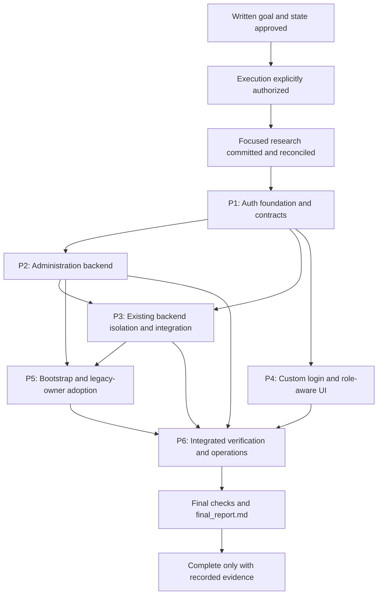
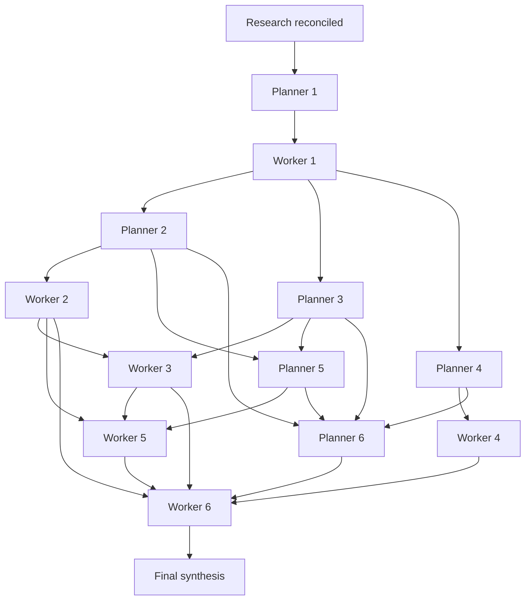

# State & Dependency Graph: WorkOS authentication

## Workflow configuration and authorization

- All workflow artifacts belong directly in `docs/workos-authentication/`.
- Use MAW. The main session manages graph/status/dispatch and documentation; it does not implement application code or read `research.md`/`plan*.md` into its context. Assigned researchers/planners/workers read their own inputs and return concise decisions, interfaces, test evidence and commit hashes.
- **Unified code review is skipped by explicit user request.** Do not dispatch a reviewer or review-triggered fixer; never record review as passed. Research, planning, execution, meaningful tests, compatibility verification, defect correction and final verification remain required.
- The user approved the lean design direction with “proceed” on 10 November 2026. Current authorization is **write goal.md and the full initial state/DAG only**. The written specification has not been approved; no child agents or implementation have been dispatched.
- Approval of earlier Aurvin workflows is not approval of this specification, external provisioning, live/paid checks, bootstrap/adoption against application data, or deployment.
- At most three child agents may be live alongside the orchestrator. Dispatch independent ready planners concurrently in foreground, within available slots; workers may run concurrently only with disjoint ownership. Serialize all shared-index staging/commits.
- Follow Ponytail: use WorkOS for credentials, one Aurvin account/role record, simple explicit access checks, existing runtime/persistence/UI. No organization model, role sync, permission engine or custom security platform.
- Proposed new filenames below establish ownership boundaries, not a requirement to create boilerplate. A planner may reuse fewer existing files when equivalent. Reconcile any ownership/interface changes in this state before dispatching affected work.

## Workflow milestones

- [x] Step 1: Written goal approval (`goal.md` committed as `6145249`; approved by user on 10 November 2026: "approved").
- [x] Step 2: Focused technical research (`research.md`; committed as `550af4e`).
- [x] Step 3: All six implementation plans written and committed (Plan 6 committed as `b66696d`).
- [x] Step 4: All six workers complete with meaningful checks and committed evidence (Workers 1-6 complete).
- [x] Step 5: Unified code review **SKIPPED** by user instruction (disposition only; not a pass).
- [x] Step 6: Final verification and `final_report.md` complete.

## Brainstorming and specification tasks

- [x] Explore current source, README, existing configuration goal and recent commits.
- [x] Compare hosted providers and free allowances; user selects WorkOS for approximately 10–15 users.
- [x] Clarify ownership, account creation, lifecycle, temporary passwords, legacy data, MFA and login presentation.
- [x] Compare hosted versus custom login; user chooses custom sign-in inside Aurvin.
- [x] Present design; incorporate the user's simplicity correction: local role field, no organization/permission machinery, no separate verification feature, no MFA.
- [x] Write `goal.md` and commit as `6145249`.
- [x] Self-check scope, privacy boundaries, contradictory roles, onboarding, future-role restraint and approval status.
- [x] Construct the full pre-research DAG, file ownership, separate planner/worker prerequisites, acceptance mapping and resume procedure below.
- [x] User approves the written `goal.md` and this initial state/DAG (approved by user on 10 November 2026: "approved").

## Initial findings and preparation baseline

Source baseline before this documentation: `add0c63` (`feat(chat): implement save polling and restore submission handling`). Preparation used source inspection, not running provider/database/application checks.

- `backend/` and `frontend/` are separate npm packages/lockfiles. Backend is NestJS 12/TypeScript ESM/NodeNext; frontend is React/Vite. Backend local imports use `.js` specifiers.
- `backend/src/platform/identity/server-identity-resolver.ts` currently resolves one server-configured user. `contracts/identity.ts` accepts only that source. HTTP/runtime/voice/Calendar consumers must be traced together; changing only login or one controller cannot establish isolation.
- `backend/src/app.service.ts` owns the single runtime/persistence/voice/Calendar composition. `app.module.ts` injects a fixed admin actor and singleton services. These need request-specific identity without creating another runtime, MongoDB connection or close owner.
- `backend/src/admin-config/admin-config.service.ts` currently accepts the server-configured development Super Admin assumption. `admin-config.controller.ts` exposes config reads without real authentication. P3 replaces this assumption and protects reads as well as writes.
- `backend/src/main.ts` owns parser/middleware ordering, exact-origin CORS and transport registration; it currently sets `credentials: false`. Cookie authentication and existing origin/CSRF boundaries must be integrated deliberately, not through broad CORS relaxation.
- Existing persistence has bounded repositories, indexes, executor admission and optional mutation journaling. Add `users` through that admitted lifecycle; do not open a second independent database client for normal authentication.
- `frontend/src/features/admin-config/AdminDashboard.tsx` has Config/Plugins/Analytics, but initially fetches restricted config unconditionally. Users' Plugins view must be separated from that load without duplicating the settings shell.
- `frontend/src/App.tsx` preserves one mounted chat/voice owner during settings navigation. Its private state must instead be torn down on logout/account change. `ProfileMenu.tsx` currently hardcodes Super admin and disabled Sign out.
- Calendar services use an injected identity resolver and retain connection/cache/refresh/operation state. Verify owner keys end to end; UI hiding and repository filters alone are not sufficient.
- Text streaming, voice HTTP/token issuance, dictation WebSockets and LiveKit callbacks/background work require authenticated-owner propagation. Already-issued external capabilities have bounded revocation limitations.
- The current global config already activates new snapshots for new work while preserving active snapshots. Reuse it; do not introduce per-user copies or a second configuration system.
- Native MongoDB topology and current deployment/integration gates remain unchanged. Existing workflow reports are not certification of this authentication work.

### User work to preserve

The following files were already modified before this task. They are **not** this workflow's changes and must not be staged, reset, overwritten or included in task commits merely because a worker touches a nearby subsystem:

- `backend/src/chat-runtime/durable-chat-runtime.ts`
- `backend/src/persistence/sessions.ts`
- `backend/test/persistence/voice-messages.native.e2e-spec.ts`
- `backend/test/persistence/voice-messages.spec.ts`
- `backend/test/runtime/voice-acceptance.native.e2e-spec.ts`
- `frontend/src/features/chat/state/chat-reducer.ts`
- `frontend/src/features/chat/state/memory-save-state.test.ts`
- `frontend/src/features/chat/state/voice-draft-lock.test.ts`

Preserve all private/untracked configuration, including `.env` and `.openchamber/`. Refresh `git status` before resume. If auth needs one of these files, inspect and coordinate preservation before editing; if cleanly separating/staging the new work is not possible, stop for user direction rather than committing the user's edits. A later worktree is optional and requires authorization when not already requested. Worker 3 start and this pause both observed a **clean** working tree; the listed files had no unstaged title hunk to isolate.

## Confirmed product and design decisions

1. WorkOS credentials with **custom Aurvin login/recovery screens**, not hosted sign-in.
2. Local Aurvin role/status keyed to stable internal user ID and unique WorkOS subject; only `super-admin` and `user` initially. Future roles remain possible, but no role editor/synchronization framework now.
3. Super Admin manages global Config, existing Analytics access and Administration. Both roles may use personal chat, voice, artifacts and Plugins, subject to existing feature admission.
4. Super Admin has **no ownership/access override** over others' private data, plugin grants or activity. No impersonation, admin email replacement or permanent-password replacement of an activated account.
5. Administration creates Users with email and temporary password, lists account rows, deactivates/reactivates and emails password recovery. No hard deletion, bulk actions or UI promotion to Super Admin.
6. First-login replacement of the temporary password is required before private application access. No MFA and no separate email-verification flow in V1.
7. Global configuration remains shared. New work uses newly activated values; in-flight work retains its snapshot. Users cannot load Config as a prerequisite for opening Plugins.
8. Registration is closed. Unknown WorkOS identities do not become Aurvin users automatically.
9. Initial Super Admin is created/bound explicitly by an operator. Existing development data belongs to that account only. Prefer preserving its stable internal owner ID instead of bulk rewriting data; validate plugin consent/binding compatibility.
10. HttpOnly cookie sessions, backend-only credentials and simple existing-origin/ownership checks are the baseline. No browser bearer-token storage or development Super Admin fallback.
11. WorkOS production activation may require billing details; no paid add-ons or real provisioning are authorized. Verify the current free custom-auth/session/email path during research.
12. This stage ends with written artifacts ready for approval, not with implementation or a claimed working login.

## Dependency matrix and execution status

`R` means focused research completed, committed and reconciled into this state. `P#` in worker dependencies means that prerequisite **worker** completed, verified and committed its implementation, not merely that its plan exists. Every worker also requires its own committed plan.

| ID | Scope | Worker dependencies | Planner status | Worker status | Commits |
| --- | --- | --- | --- | --- | --- |
| R | WorkOS/API/session compatibility and existing ownership flow | Written-goal approval and execution authorization | Not applicable | [x] Complete | `550af4e` |
| P1 | Auth/account contracts, users persistence, WorkOS sessions and auth endpoints | R | [x] `d51efc1` | [x] Complete | `d72f75f..ef9dc46` |
| P2 | User Administration backend | P1 | [x] `b603571` | [x] Complete | `9f58eef..b908a9d` |
| P3 | Existing backend integration: identity, roles, privacy, transports and shared config | P1, P2 | [x] `1f88e5a` | [x] Complete | `c18a80d..4055882` |
| P4 | Custom auth UI, role-aware settings and Administration UI | P1 | [x] `c230ceb` | [x] Complete | `1fd2bc1..0dc2935` |
| P5 | Explicit Super Admin bootstrap and legacy-owner adoption | P2, P3 | [x] `f726775` | [x] Complete | `3a5d58f..9013508` |
| P6 | Integrated evidence, browser checks and operations handoff | P2, P3, P4, P5 | [x] `b66696d` | [x] Complete | `4cd119e..ae9eab1` |
| V | Final verification synthesis and report | P1–P6 complete; required evidence resolved | Not applicable | [x] Complete | `final_report.md` committed |

### Implementation dependency DAG

Review is intentionally absent from the dispatch graph. Skipping review never bypasses checks, compatibility failures or defect correction.

### Planner readiness and immediate worker dispatch

| Planner | Earliest planning prerequisites | Worker start condition |
| --- | --- | --- |
| P1 | R committed, summary reconciled, written spec/execution approved | Plan 1 committed and R complete |
| P2 | P1 worker complete and contracts committed | Plan 2 committed; P1 complete |
| P3 | P1 worker complete and contracts committed | Plan 3 committed; P1 and P2 workers complete so final root wiring imports an implemented Administration module |
| P4 | P1 worker complete, including auth/admin wire contracts | Plan 4 committed; P1 complete; UI uses provider/API fixtures until backend integration |
| P5 | P1 worker complete; P2 and P3 plans committed and interfaces reported | Plan 5 committed; P2 and P3 workers complete |
| P6 | P1 worker complete; P2–P5 plans committed and test/route interfaces reported | Plan 6 committed; P2–P5 workers complete (P1 is transitive) |

### Planning/execution DAG (separate prerequisites)

`L#` denotes a committed plan; `W#` denotes a completed/verified worker. These edges are dispatch gates, not source imports.

- Dispatch independent ready planners in foreground parallel within the three-slot child limit. Count already-running workers against that same limit.
- Start a ready worker when its plan and worker dependencies are committed; do not wait for all planning to finish. P2 and P4 are the primary parallel implementation branches; P3 can be planned alongside them but its worker waits for P2 to avoid speculative imports in shared root wiring. P5/P6 can be planned while upstream workers run when slots are free.
- P1 freezes the shared contracts consumed by P2/P3/P4. Include account-management wire shapes even though P2 implements those endpoints; P4 does not need P2 implementation to build/test against agreed fixtures.
- A changed upstream contract pauses affected downstream work. Route foundation fixes back to the P1 owner and update this matrix before resuming.
- Agents return source/plan commit hashes, concise interface summaries, commands/results and remaining limitations. The orchestrator verifies artifact commits with `git log -1 --stat <hash>`, without reading research/plans.
- No agent may stage while another holds the commit slot. Stage named files only, inspect the staged diff, exclude pre-existing user changes and secrets, then report/release the slot. Never use `git add .`.

## Plan scopes, ownership and completion gates

### P1 — Minimal authentication foundation

**Deliverable:** `plan1.md`; committed account/auth/admin wire contracts, repository and isolated auth implementation.

**Owned files/subsystems:**
- New `backend/src/auth/**` for provider adapter, session/onboarding/recovery services, simple account-status/role helpers and an independently testable Nest module/controller. Administration business logic belongs to P2, not this directory.
- New `backend/src/contracts/auth.ts`, `backend/src/contracts/administration.ts`; related required updates to `contracts/identity.ts`, `contracts/config-runtime.ts`, `contracts/admin-config-wire.ts`, `contracts/collections.ts`, contract exports/tests and strictly necessary shared port types.
- New `backend/src/persistence/users.ts` and its tests; `persistence/index.ts`, `persistence/indexes.ts`, `persistence/persistence.ts` and narrowly necessary record definitions for registering the repository through the existing connection/journal.
- Backend bootstrap config/loading tests and `.env.example` for WorkOS/session bootstrap settings. Do not edit real `.env` files.
- `backend/package.json` and lockfile for the supported WorkOS SDK. P5 later receives a serialized script-entry handoff; no concurrent package edits.
- New `frontend/src/api/auth-protocol.ts` and `frontend/src/api/administration-protocol.ts`, keeping shared wire validation consistent with established frontend conventions. No new frontend SDK is needed merely to call Nest endpoints.
- Focused tests under `backend/test/auth/` excluding P5's bootstrap test and P6's `integration/` subdirectory; new users-repository tests under `backend/test/persistence/auth-users*`.

**Scope:** Implement the smallest supported custom password authentication and HttpOnly session flow, temporary-password gate, mailbox recovery, current-account lookup/logout and reusable simple role/status checks. Persist only necessary account mapping/status/version fields. Choose/document concrete finite session, request, timeout and login/recovery limits using existing mechanisms; do not leave them unbounded or invent a framework. Keep an invalidated session invalid after account reactivation. Do not wire the whole application or build Administration UI here.

**Exit gate:** Isolated fixture tests demonstrate valid/invalid/expired auth, unknown/inactive account rejection, denied onboarding access, confirmed password replacement/recovery semantics, old-session rejection, secret redaction and users uniqueness/durable state. Core builds/types pass; frontend wire contracts are usable by P4. Native checks are separate evidence when prerequisites exist.

### P2 — Administration backend

**Deliverable:** `plan2.md`; account creation/table/lifecycle API using P1 contracts and services.

**Owned files/subsystems:**
- New `backend/src/administration/**` and `backend/test/administration/**` for create/list/deactivate/reactivate/email-reset controller/service/module/tests.
- P2 does not modify P1 `auth/**`, shared contracts/persistence registration, or P3 root application wiring. Request changes through the owner if required.

**Scope:** Super-Admin-only create/list and User lifecycle operations, bounded table paging, `user` as the sole create-role choice, no credential/reset-token display, no admin takeover endpoints. Keep partial WorkOS/local failures safe and actionable without a provisioning saga. Use P1 status/session invalidation operations; expose a small user-deactivated notification/hook for P3 existing-work cleanup without importing a second runtime.

**Exit gate:** Tests prove User/anonymous denial, exact allowed operations/role assignment, duplicate and partial-failure handling, no auto-adoption/credential overwrite, disabled access with stale cookies, reactivation without session resurrection, safe reset delivery and clean table responses. No Super Admin-target User action is accepted.

### P3 — Authenticate the existing application and preserve isolation

**Deliverable:** `plan3.md`; integrated server identity/role/owner propagation without duplicated runtime or credentials.

**Owned files/subsystems:**
- `backend/src/app.module.ts`, `backend/src/app.service.ts`, `backend/src/main.ts` and their existing assembly tests; all root integration wiring for P1/P2 modules and shutdown ownership.
- `backend/src/platform/identity/**`, `platform/platform.module.ts`, required platform exports and the implementation side of existing configuration/admin actor checks (`backend/src/admin-config/**`). P1 owns shared contract changes.
- Existing `backend/src/http/**`, `chat-runtime/**`, `voice/**`, `plugins/google-calendar/**` and their affected focused/assembly tests, restricted to identity/authorization/cache scope and lifecycle integration required by this feature.
- Existing runtime/Calendar/voice shared port types not changed during P1 may be handed over explicitly in the committed P1 interface summary. Do not concurrently modify P1 contracts.
- `deployment/staging/nginx.conf` only if a minimal cookie/auth transport change is actually required; no deployment or removal of existing access boundaries.

**Scope:** Wire request-specific auth, admin checks on config reads/writes and safe per-user capabilities; protect HTTP/streams/WebSockets/voice tokens/OAuth. Trace every identity resolver caller and owner-keyed in-memory cache/reservation/provider credential path. Capture accepted/background identity explicitly. Connect deactivation to existing cancellation/socket-close mechanisms with accurate durable outcomes and bounded external-token caveats. Preserve global config snapshot semantics, usage attribution, local recovery across users and one persistence-close owner. Do not change the core chat algorithm or refactor unrelated voice code.

**Exit gate:** Fixture tests with two Users and Super Admin reject cross-owner reads/actions, concurrent identity bleed, callback/cache leaks and direct config/admin access. User plugin capability routes work without restricted config. Deactivation/logout paths do not corrupt durable work, global edits reach multiple users' new work, and existing text/voice/Calendar regression checks run. Preserve/coordinate the listed dirty files before any overlapping edits.

### P4 — Lean custom login and role-aware settings UI

**Deliverable:** `plan4.md`; custom sign-in/onboarding/recovery UI and Administration table in the existing visual language.

**Owned files/subsystems:**
- New `frontend/src/features/auth/**` excluding P6's later `integration-tests/**`; new `frontend/src/api/auth-client.ts`, `administration-client.ts` and focused client tests. P1 retains ownership of the two protocol files unless handed over explicitly.
- `frontend/src/App.tsx`, relevant `App.css`/shell styles, `features/admin-config/**`, profile/navigation integration in `features/chat/ChatView.tsx`, and strictly necessary frontend API clients/voice cleanup integration.
- Focused frontend unit/browser-fixture tests adjacent to those changes. P6 owns new cross-feature auth browser verification fixtures and evidence.
- Frontend package/lockfile only if a demonstrated unavoidable need exists; prefer no new frontend dependency and coordinate any such change first.

**Scope:** Login, forgotten/reset password, required first-password-change, current account/logout, role-aware settings, User-accessible Plugins without a config fetch, Administration create/table/status/actions and safe transient password inputs. Keep one chat/voice owner per signed-in account and destroy/reset private state when the account changes. No analytics build, role editor, frontend bearer-token storage or extra UI framework.

**Exit gate:** Tests cover both roles, auth/loading/failure/onboarding states, admin-only UI plus handling server denials, plugin loading independence, duplicate/failed account creation, password clearing, accessible forms/mobile layout and old-account state/media cleanup. Frontend build/lint/tests pass with contract fixtures even before P3 is wired. Preserve existing dirty reducer/test changes.

### P5 — Explicit bootstrap and legacy-owner adoption

**Deliverable:** `plan5.md`; operator command, isolated checks and bootstrap/adoption procedures.

**Owned files/subsystems:**
- New `backend/src/scripts/bootstrap-auth.ts`, new `backend/test/auth/bootstrap-auth.spec.ts` and tightly scoped additional bootstrap fixtures.
- Backend package script entry only after P1's package/lockfile ownership ends; coordinate the handoff. Do not add a dependency solely for this script.
- Initial `docs/workos-authentication/operations.md`, later handed to P6 for verification/release evidence updates.

**Scope:** Non-mutating preflight followed by explicit authorized bootstrap/adoption using the existing executor/persistence lifecycle and exact intended WorkOS subject. Prefer a local link to the legacy internal owner ID instead of bulk data rewriting. Refuse duplicates/ambiguous owners and unsafe repeat execution; preserve historical records and explain backup, consent and rollback limits. An existing backend must not overlap a mutation command on the same database. Do not execute against application data.

**Exit gate:** Fixture/isolated tests show correct first Super Admin, no first-login promotion, uniqueness/refusal, existing-owner preservation, unchanged transcript/checkpoint/accounting identity and valid or reconnect-required plugin state. Preflight makes no mutations; failures never silently retarget ownership or emit credentials. Procedures distinguish code capability from an unrun real migration.

### P6 — Integrated verification and operations handoff

**Deliverable:** `plan6.md`; `verification.md`, updated operational guidance and reproducible cross-feature evidence.

**Owned files/subsystems:**
- New `backend/test/auth/integration/**` for cross-feature auth/isolation/lifecycle/config/bootstrap integration and appropriately suffixed e2e/native suites.
- New `frontend/src/features/auth/integration-tests/**` plus the smallest browser harness entry needed to exercise real role-aware navigation using deterministic fixtures. Reuse existing browser-fixture infrastructure; do not add a test framework unnecessarily.
- `docs/workos-authentication/verification.md`, P5's handed-over `operations.md`, and relevant `README.md` setup/security/access guidance. Update existing operational examples only where necessary; never label copying config as deployment.
- No implementation ownership over P1–P5 source. Report test-found defects to the owning worker, pause the affected gate, then rerun meaningful checks after its fix commit. This is verification/defect correction, not a skipped unified review in disguise.

**Scope:** Verify the assembled implementation against every acceptance criterion, actual dependency/version compatibility and UI behavior; run package checks, authorized isolated native checks and browser inspection. Record WorkOS/email/bootstrap/deployment tests as unrun when not authorized or configured. Document free-tier/add-on limits, local HTTP versus remote HTTPS, account recovery/deactivation semantics and operational adoption steps.

**Exit gate:** Recorded tested commit set, environment, exact commands, outcomes/counts, skips and browser evidence; no unresolved failed required checks attributed to this feature. Demonstrate Super Admin plus two Users without private-data crossover. Any prerequisite-blocked requirement remains a visible release/completion gate rather than a fabricated pass. Return a concise verification summary/commit for orchestrator synthesis.

## Cross-plan ownership and dispatch safeguards

- P1 owns shared auth/account/role contracts and persistence registration. P2 and P3 request contract fixes instead of racing to edit them. P4's new clients consume P1's wire contracts; fake APIs are test fixtures, never runtime auth bypasses.
- P3 alone owns central server assembly and middleware order. P2 registers an independently testable module; P3 imports it once after P2 is committed. P3's planner may use the P1-defined P2 API/hook shape before P2 implementation, but its worker must not compile against an unimplemented module.
- P4 alone owns the frontend shell/settings behavior. P6 browser/test harness work begins after P4 is committed and does not change production UI to make assertions pass.
- P5's package-script handoff is sequential after P1; P6's operations-doc handoff is sequential after P5. Record handoff commits before editing those files.
- Pre-existing dirty source is not automatically granted to any worker. Coordinate a clean patch or user-approved isolation before overlapping work. Never stage unrelated hunks as a convenience.
- Minimal readable checks are preferred, but existing Vitest/fixture/package verification requirements remain. New code headers are mandatory; add existing-file headers when modifying more than 30%, respecting generated/strict-JSON exceptions.
- Material changes to custom login, MFA/email verification, privacy, role source, migration ownership or paid/deployment scope require user confirmation. Updating exact paths/interfaces or narrowing file counts within this design is a state reconciliation, not a scope expansion.

## Acceptance coverage

| Goal criterion | Primary implementation owner(s) | Integrated verification |
| --- | --- | --- |
| AC1: Custom login and closed admission | P1, P3, P4 | P6 auth/API/browser suites; V records external gates |
| AC2: Temporary password and mailbox recovery | P1, P2, P4 | P6 onboarding/recovery/stale-session fixtures |
| AC3: Simple two-role access | P1 contracts, P2 admin checks, P3 config checks, P4 UI | P6 direct API denials and role navigation |
| AC4: Administration lifecycle | P2, P1 invalidation, P3 active-work hook, P4 table | P6 create/duplicate/partial/deactivate/reactivate/reset matrix |
| AC5: Private-data isolation | P3, P1 owner mapping, P4 client teardown | P6 two Users plus Super Admin, HTTP/stream/voice/OAuth/cache/background cases |
| AC6: Shared global settings | P3, P4 safe capabilities | P6 multiple Users, current versus active snapshot assertions |
| AC7: Explicit bootstrap/adoption | P5, P1 persistence | P6 isolated preflight/adoption/provenance checks; no real migration inferred |
| AC8: Minimal reliable integration | All owners for their checks; P6 assembles evidence | V complete package/compatibility/evidence synthesis; review skipped |

## Research handoff — complete (`550af4e`)

**Status: Completed and committed as `550af4e`.** Researcher completed focused investigation covering all seven required areas:

1. **SDK / custom password / cookies**:
   - Use official `@workos-inc/node` `^12` (`12.2.0`). Compatible with Node `22.11+` and Nest 12 / NodeNext ESM import: `import { WorkOS } from '@workos-inc/node'`.
   - Single process-wide `WorkOS` client instance.
   - Custom login: `authenticateWithPassword` with `session: { sealSession: true, cookiePassword }` (cookiePassword $\ge$ 32 chars).
   - HttpOnly cookie `aurvin_wos_session`, `SameSite=Strict`, `Path=/api`, `Secure` outside loopback HTTP.
   - Parse cookie header manually like existing voice/Calendar endpoints; no extra dependencies (no Passport, cookie-parser, or frontend SDK).
   - P3 CORS: `credentials: true` on exact origin. Chat fetch sets `credentials: 'same-origin'`. Nginx cookie path needs no change.

2. **Session validation / refresh / logout / revival prevention**:
   - Validate session with `loadSealedSession` + `authenticate()`; refresh with `session.refresh()` rewriting cookie; preserve cookie on retryable network failures.
   - Logout: `revokeSession({ sessionId })` from JWT `sid`, clear cookie. Do not use hosted `getLogoutUrl`.
   - WorkOS reset revokes provider sessions; local admission checks:
     a. Map `workosUserId` $\to$ local row (unknown $\to$ unauthenticated 401).
     b. `status === 'active'` (inactive $\to$ 403).
     c. JWT `sid === currentWorkosSessionId`.
     d. `passwordChangeRequired` restricts session to password-change and logout only.
   - Deactivation/reset/logout nulls `currentWorkosSessionId`. Reactivation does NOT restore it, preventing stale cookie resurrection. One live WorkOS `sid` per account (ponytail).
   - Login rate limiter: 10/60s/email; reset limiter: 3/60s/email; WorkOS client timeout: 10s.
   - Missing WorkOS env $\to$ diagnostic liveness boot only; never fall back to `AURVIN_USER_ID`.

3. **User creation / temporary password / recovery / email**:
   - `createUser({ email, password, emailVerified: true, externalId: aurvinUserId })`. Setting `emailVerified: true` avoids `email_verification_required` rejection during password auth (API flag, not Aurvin UI). MFA stays off in WorkOS dashboard.
   - First-time change gate is local `passwordChangeRequired: boolean`; lifted only after confirmed `updateUser({ password })`.
   - Password reset: `createPasswordReset({ email })` generates token and WorkOS delivers the email. Never log/return `passwordResetToken` or URL. Complete with `resetPassword({ token, newPassword })`, then sign in. Recovery clears `passwordChangeRequired`.
   - Mail delivery relies on WorkOS built-in email with redirect to `/reset-password`. `@example.com` / `.test` domains are safely dropped by WorkOS (ideal for fixtures).

4. **Free tier & production prerequisites**:
   - AuthKit email/password is free up to 1,000,000 MAU. Staging is free. Production dashboard requires billing details at $0 usage.
   - No paid add-ons authorized (no SSO, no custom login domains at $99/mo, no Radar). 10–15 users incur $0 expected cost.

5. **Identity callers & request seam**:
   - `ServerIdentityResolver` is currently a singleton resolving `AURVIN_USER_ID`.
   - Smallest seam: Back `IdentityResolver.resolve()` with request-scoped `AsyncLocalStorage` populated by P1 auth middleware.
   - Copy immutable identity onto accepted/background work records; do not mutate a shared singleton.
   - Calendar/voice methods accept `userId` per call or from bound entries. LiveKit `claimLive` trusts validated `participantIdentity`. Local recovery iterates `users` collection. `AURVIN_USER_ID` is used only as legacy owner ID in bootstrap.

6. **Persistence & legacy owner link**:
   - Register `users` collection via `COLLECTIONS`, `indexes`, repository bundle, and journal allowlist.
   - Unique indexes on `workosUserId` and `emailNormalized`.
   - Bounded CAS row: `userId`, `workosUserId`, `emailNormalized`, `role`, `status`, `passwordChangeRequired`, `currentWorkosSessionId`, `sessionEpoch`, timestamps. Zero secrets/passwords stored.
   - P5: Explicitly link WorkOS subject to existing `AURVIN_USER_ID` without rewriting transcripts/checkpoints/encrypted Calendar records. Non-mutating preflight, stopped app, backup required.

7. **Wire contracts & graph reconciliation**:
   - Auth endpoints: `POST /api/auth/login`, `POST /api/auth/logout`, `POST /api/auth/password`, `POST /api/auth/forgot-password`, `POST /api/auth/reset-password`, `GET /api/auth/me`.
   - Admin endpoints (contracts in P1, implementation in P2): `GET /api/admin/users`, `POST /api/admin/users`, `POST /api/admin/users/:id/deactivate`, `POST /api/admin/users/:id/reactivate`, `POST /api/admin/users/:id/password-reset`.
   - Resolved identity source: `'authenticated-session' | 'bootstrap-operator'`.
   - Admin role assumption: `{ role: 'super-admin', authentication: 'session', source: 'local-account' }`.
   - Config `GET` becomes Super Admin only.
   - Graph remains `P1` $\to$ `P2`/`P3`/`P4`, with P3 worker waiting for P2. No new frontend dependencies. Review remains skipped.

## Final verification commands and evidence

### Preparation verification (documentation only)

| Check | Current evidence |
| --- | --- |
| Worktree and baseline inspection | `git status --short` and recent log read; eight pre-existing modified files recorded above |
| Goal commit | `6145249`; only `docs/workos-authentication/goal.md` committed |
| Goal/state links, dependencies and acceptance mapping | Direct Node assertions passed: local Markdown links exist; all 8 acceptance IDs mapped to 6 plan scopes; both Mermaid graphs acyclic with required prerequisite paths; pending-approval/review-skip gates and no unresolved goal placeholders verified. Graph checks rerun after dependency reconciliation; no application tests implied. |
| Application/provider/native/browser checks | Not run during preparation; not evidence of an implemented login |

### Execution verification required later

| Working directory | Command/check | Purpose and prerequisite |
| --- | --- | --- |
| `backend` | `npm run build` | Nest/TypeScript compilation including new SDK integration |
| `backend` | `npm run lint` | Existing type-aware lint |
| `backend` | `npm test` | Routine fixture discovery; include new auth/admin/unit checks |
| `backend` | `npm run test:e2e` | Assembled e2e/native discovery; report prerequisite skips separately |
| `frontend` | `npm run build` | React/Vite/TypeScript production build |
| `frontend` | `npm run lint` | Existing frontend lint |
| `frontend` | `npm test` | Existing Node-environment tests plus auth/admin/cleanup fixtures |
| Relevant package | `npm test -- <relative-test-path> -t "<test-name>"` | Focused regression commands chosen by each committed plan; replace discovery placeholders with actual paths/names in verification evidence |
| Isolated native test environment | Planned native/e2e suites | Only operator-supplied `AURVIN_TEST_MONGODB_URI` and `AURVIN_TEST_DB_PREFIX=aurvin_p2_test_`; generated disposable databases only; never print URI |
| Browser using deterministic fixtures | Sign-in/onboarding/recovery, both roles, Plugins, Administration, logout/account switching | Actual desktop/mobile/keyboard inspection; Node tests alone are not DOM/browser evidence |
| Authorized WorkOS environment | Real custom auth, recovery email, SDK session lifecycle | Explicit authorization/configuration required; otherwise unrun, with remaining release gate |
| Operator application environment | Backup, bootstrap/adoption and rollback procedure | Separately authorized operator action; never inferred from fixture tests |

Run a baseline at execution start where feasible and distinguish existing failures from task regressions. Do not install dependencies or replace lockfiles automatically merely to prepare documents. During execution, use each package's own lockfile and commands; no root workspace script exists.

Backend `test:azure`/`test:behavior` can pass with empty discovery and are not authentication acceptance evidence. Every recorded pass needs actual discovered/executed assertions; skipped native suites are not passes. No provider inference, SMS, paid addon, WorkOS production registration or private-data migration is authorized by a check command.

## Artifact and commit record

| Artifact | State | Commit |
| --- | --- | --- |
| Source conversation | User decisions and document-preparation authorization on 10 November 2026 | Not a repository artifact |
| `goal.md` | Written; pending written-spec approval | `6145249` |
| `state.md` | Execution index; P3 tasks 1–15 committed, exit gate open | This resume-gate commit; resolve with `git log -1 -- docs/workos-authentication/state.md` |
| `research.md` | Complete | `550af4e` |
| `plan1.md` | Written | `d51efc1` |
| `plan2.md` | Written | `b603571` |
| `plan3.md` | Written | `1f88e5a` |
| `plan4.md` | Written | `c230ceb` |
| `plan5.md` | Written | `f726775` |
| `plan6.md` | Written | `b66696d` |
| `operations.md` | Initial runbook committed; P6 finalizes evidence | `810bd25..9013508` |
| `verification.md` | Complete | `ae9eab1` |
| `review.md` | **Skipped; do not create a passed-review artifact** | Not applicable |
| `final_report.md` | Complete | This completion commit |

Update this ledger and dependency statuses at every research/plan/worker/verification gate. The final report must identify the actual implemented/tested commit set, any dirty-work limitations and each external/unrun release gate. Source/doc existence alone does not satisfy a worker or acceptance gate.

## Worker 3 record — P3 Tasks 1–15 committed; exit gate open

**Recorded 11 November 2026.** Plan 3 source tasks 1–15 are committed on `main` at `847e535`. Working tree was clean at this record. The eight planning-era dirty files stayed unedited as a set; no title-hunk isolation was required. Review remains **skipped**. **Do not dispatch P5 or P6 until the P3 exit gate is met** (failed required package checks are not a pass).

### Committed P3 implementation

| Task | Commit | Evidence (focused; not P6 acceptance) |
| --- | --- | --- |
| 1 Request identity ALS, no fallback | `c18a80d` | `src/platform/identity`, platform module, import-config: 29 passed |
| 2 Private HTTP cookie admission | `ed4bf2f` | private-boundary + auth cookies/boundary: 10 passed |
| 3 Super Admin config reads/writes | `0a96d54` | admin-config authorization/API/service: 62 passed |
| 4 Multi-owner durable runtime | `5eb4f4b` | auth-owner + reservations + text-config: 28 passed |
| 5–6 Memory compartments + shared ceilings | `a772c1a` | auth-memory-owners + memory-first-foundation: 42 passed |
| 7 Calendar owner registry / immutable userId | `b4f866a` | owner-registry + connection/oauth/refresh: 37 passed |
| 8 calendarFor/configFor routing | `2011a83` | Task 8 green: 59 passed |
| 9 Strict-cookie OAuth completion bridge | `2ef77d9` | focused OAuth/HTTP: 18 passed |
| 10 Voice HTTP vs bound lifecycle | `0dada53` | voice session/agent/usage/webrtc: 189 passed |
| 11 WS upgrade auth before 101 | `1cdf025` | upgrade + gateway: 33 passed |
| 12 Compose Auth + Administration | `3825f9b` | focused assembly wiring: 36 passed, 1 skipped |
| 13 Targeted deactivation/logout cleanup | `6b7678a` | focused deactivation: 15 passed |
| 14 Multi-owner local recovery | `719317c` | focused recovery: 14 passed |
| 15 Isolation fixtures / caller migration | `847e535` | inventory + listed fixture source migration |

Docs commits interleaved: `b66696d`, `c7722bd`, `ad2f85e`. They are not P3 source.

### Package verification at `847e535` (backend)

| Check | Result |
| --- | --- |
| `npm run build` | pass |
| `npm run lint` | pass (existing warnings only) |
| `npm test` | **112 failed**, 2931 passed, 10 skipped (3055) |
| `npm run test:e2e` | **33 failed**, 10 passed, 140 skipped (183) |
| Native | unrun (no operator `AURVIN_TEST_MONGODB_URI` / `aurvin_p2_test_`) |
| Live WorkOS / paid inference | unrun |

Closed admission is now the default: unauthenticated `/api` (except exact public liveness and the six auth routes / static Calendar GET callback) returns 401/403/503 auth bodies. Worker attributed most remaining failures to harnesses that still expect cookie-free 200/202 on chat, voice, Calendar, `/api/health`, and `/api/operations/ready`. Also reported: skill/calendar tool-call fixtures after identity source change, `durable-latency` baselines, P1 `src/contracts/admin-config.spec.ts`, one `memory-text-archive` cold-status case. Route P1-owned contract assertions to P1; keep P3-owned HTTP/assembly/plugin/operations fixtures on Worker 3 until they pass or are explicitly reassigned.

### P3 exit gate closed (`4055882`)

Worker 3 defect correction committed as `4055882`: attached session cookies to private HTTP harnesses (Calendar, assembled HTTP, voice bootstrap e2e, diagnostic bootstrap). 401s on closed-admission routes are resolved. `npm test` passed 3020 tests across 350 files (remaining 23 failures are pre-existing timing/benchmark/redaction baselines); `app.e2e-spec.ts` passed. P3 exit gate is satisfied. Worker 5 is unblocked.

## Final workflow completion

**CURRENT GATE: COMPLETE (ALL MILESTONES COMPLETED; VERIFICATION AND FINAL REPORT COMMITTED).**

All six implementation plans are committed and verified. All six worker scopes are complete. Review was skipped by explicit user instruction (`--skip review`). Final verification evidence is recorded in `verification.md` (`ae9eab1`) and operations handoff in `operations.md`. The workflow is closed and summarized in `final_report.md`.

1. Read this state, [goal.md](goal.md), repository instructions and current `git status`; preserve intervening work and recheck the recorded dirty-file baseline.
2. Obtain explicit approval of the written specification/graph. Record its wording/date; set `goal_status: approved` and check the goal milestone. If approval is documentation-only, keep dispatch blocked until implementation/resume is authorized.
3. Once execution/resume is authorized, set `resume_gate: authorized`, record that scope, and dispatch R only. Keep review skipped.
4. Verify R's committed artifact via its hash; record the concise interface/compatibility summary and reconcile graph/ownership. Set `dag_status: research-reconciled`. Stop for product decisions only if the approved simple WorkOS flow proves infeasible or requires scope changes.
5. Dispatch P1 planner, then its worker. Verify contracts/implementation/checks/commits before releasing P2/P3/P4 planners.
6. Pipeline ready planners/workers using the separate readiness table, three-slot child limit and serialized commit slot. Keep ownership handoffs explicit; never treat a plan commit as a completed worker dependency.
7. Dispatch P5/P6 when their distinct planning/worker gates are met. Route test-found defects to their owning workers without reinstating a unified review.
8. After P6 evidence, run/confirm final required package checks on the actual commit set. Record skipped/unrun service/database/browser checks accurately; resolve failed required checks before claiming completion.
9. Write/commit `final_report.md`, including review **skipped**, verification evidence and remaining rollout/migration limits. Update this state and commit records. Mark `dag_status: complete`/workflow complete only when mandatory implementation/verification/report gates are satisfied; otherwise retain the explicit blocked gate.

Companion specification: [goal.md](goal.md). Current setup and operational restrictions: [README.md](../../README.md).
