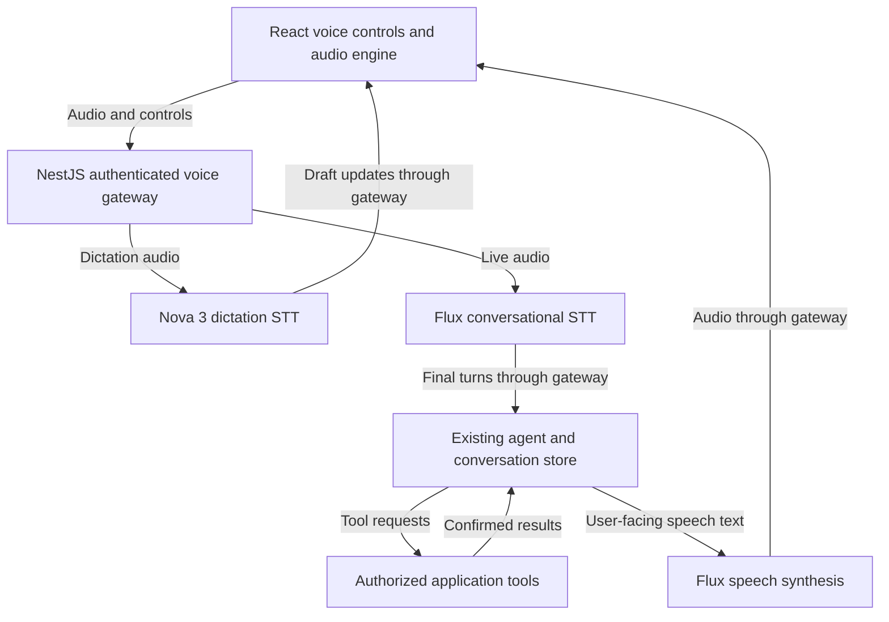

# Dictation and Live Voice for the Agent Application

**Product requirements document | Version 1.0 | 8 October 2026**  
**Status:** Proposed implementation baseline  
**Architecture:** React frontend, NestJS backend, existing LLM agent and tools

## 1. Product decision

Add two distinct voice experiences to the existing text agent:

1. **Dictation:** A microphone button captures speech and continuously fills the existing chat composer. The user reviews or edits the draft and explicitly sends it through the existing chat workflow.
2. **Live voice:** A separate waveform button opens a voice conversation surface. The composer and message stream are hidden while this mode is active. The user speaks, the agent uses its existing reasoning and tools, and the agent streams its answer as audio. No user transcript, assistant response text, or token animation appears in this surface.

Use **Deepgram Nova-3 for dictation**, **Deepgram Flux STT for conversational input**, and **Deepgram Flux TTS for spoken responses**. Keep the current LLM, tool execution, permissions, and conversation memory in the application backend. Integrate the independent speech APIs rather than moving agent orchestration into Deepgram's Voice Agent API.

The ChatGPT and Gemini experiences are interaction references: two clearly separate entry points, immediate recording feedback, and a dedicated live conversation surface. Their private implementations are not architectural requirements.

Provider capabilities in this document were checked against official documentation on 8 October 2026. Requirements, thresholds, and defaults described as proposed are product decisions, not measured provider guarantees.

## 2. Starting point and assumptions

The application currently has a React chat composer and an LLM-backed agent accessible through NestJS. It has no microphone control, voice entry point, audio capture, speech recognition, or audio playback pipeline.

The following assumptions allow implementation to proceed:

- Existing authentication, conversation IDs, message persistence, tool authorization, and text chat remain the source of truth.
- An agent adapter can accept a finalized user message and produce streamed assistant output plus tool lifecycle events. If the existing agent uses LangGraph, reuse its graph and conversation/thread ID.
- The first release supports English input and English spoken output, including evaluation with Indian English speakers. Additional languages require a tested STT and TTS pairing.
- This is an in-browser feature. Native apps, telephony, background wake words, and continuous listening outside an explicitly started session are outside the first release.
- Provider credentials and tool execution stay in NestJS. The browser connects to the application, not directly to Deepgram, for the initial implementation.

## 3. Goals and scope

### Goals

- Let users compose prompts by speaking while retaining control over the final message.
- Let users complete agent tasks through natural, multi-turn voice conversations.
- Retain the existing agent's tool capabilities and authorization rules across text and voice.
- Support interruption, pauses, follow-up questions, and recovery from audio or network failures.
- Make recording and playback state understandable without displaying conversation text in live mode.
- Measure voice reliability, latency, task success, and cost per user and session.

### First release scope

Dictation with live draft updates, stop and cancel controls, manual editing after capture, and explicit send; live voice with an animated bubble, microphone mute, interrupt, exit, streaming playback, tool execution, and shared conversation context; authenticated audio transport; quotas and operational telemetry.

### Outside the first release

Wake-word activation, voice cloning, speaker identification as authentication, multi-party meetings, call recording, telephony, automatic language switching, voice-only rendering of code or large tables, automatic prompt rewriting, and speculative tool execution before a user turn is finalized.

## 4. User experience

### Entry points

Add two independently labeled controls adjacent to the existing composer:

| Control | Accessible label | Result |
| --- | --- | --- |
| Microphone icon | Dictate message | Starts transcription into the composer |
| Waveform SVG icon | Start voice conversation | Opens the live voice surface |

Both controls are keyboard accessible and visually distinguishable. Recording feedback must use shape or state labels in addition to color. Do not activate both modes simultaneously.

### Dictation journey

1. The user focuses the composer and selects the microphone button.
2. On first use, the browser requests microphone permission. The application explains that audio is processed to transcribe the message.
3. After the connection is ready, the recording indicator becomes active. Speech appears in the composer as it is recognized.
4. The user may pause and continue without the draft being sent or the recording ending at each pause.
5. Selecting **Stop** ends capture and finalizes the transcript. Selecting **Cancel dictation** restores the draft from before this recording.
6. The user edits the finalized text and selects the existing **Send** action.

Dictation never invokes the LLM or tools by itself. A spoken sentence such as “delete this project” becomes draft text until the user sends it.

### Live voice journey

1. The user selects the waveform control. Any unsent composer draft is preserved separately and is not submitted or passed to the agent.
2. The application obtains microphone permission, initializes playback, and connects the voice session.
3. The composer and chat message stream are replaced by a dedicated voice surface with a central bubble or waveform.
4. The bubble reflects listening, working, and speaking. Short operational labels such as **Connecting**, **Listening**, or **Reconnecting** are allowed; conversation transcripts and responses are not rendered.
5. The user speaks. After a completed turn, the existing agent reasons, calls authorized tools when needed, and streams a spoken reply.
6. The user can speak over the reply. Playback stops and the application processes the new turn.
7. Selecting **Exit voice** releases capture and playback resources and restores text chat and the preserved draft.

Voice turns remain available internally for agent context. Do not automatically insert their transcripts as visible chat bubbles on exit. The conversation serializer must support internal voice turns separately from messages rendered in chat.

### Live controls

| Control | Required behavior |
| --- | --- |
| Mute microphone | Stops capture transmission and discards unsent input buffers; agent playback may continue |
| Unmute microphone | Resumes input with an explicit state change; muted audio is never replayed |
| Stop speaking | Cancels current speech playback and response generation where possible; remains in the voice session |
| Exit voice | Stops capture and playback, closes voice resources, returns to chat |

The **Stop speaking** control is required even when speech interruption is supported. If a requested task needs visual output, the agent offers to return to chat. It does not silently expose text in the voice surface.

## 5. Dictation requirements

**D1. Streaming recognition.** Stream microphone audio to Nova-3 and display interim transcription in the existing composer. Interim text is replaceable. Finalized segments are committed once. Configure interim results, punctuation, and smart formatting. [S1, S2, S3]

**D2. Draft integrity.** At session start, snapshot the composer draft and caret/selection. Dictation inserts at that position, replacing only the selected range. Maintain the original prefix and suffix, committed dictation segments, and a replaceable interim segment separately. Never append every interim hypothesis or overwrite unrelated draft text.

**D3. Editing boundaries.** During active recording, keep the composer visible but make it read-only. Stop and finalization return it to normal editing. This avoids races between user typing and transcript replacement in the first release. Send is disabled during recording and finalization.

**D4. Pauses and finalization.** Start with a proposed endpointing setting of 300–500 ms and tune on real users. A pause can finalize a segment but must not submit or end the dictation session. On Stop, drain captured audio, request provider finalization, and accept remaining final results before closing. Use a proposed two-second finalization timeout; preserve committed text and clearly indicate any unfinalized tail if it expires. [S2, S3]

**D5. Empty and cancelled recordings.** Empty speech leaves the original draft unchanged. Cancel restores the snapshot and ignores any late transcription events from the cancelled session.

**D6. Meaning preservation.** The first release performs transcription and formatting only. Do not paraphrase, remove intentional repetitions, or alter names, identifiers, dates, numbers, or negations. Optional filler cleanup or an LLM rewrite can be added later as an explicit, reversible action after transcription.

**D7. Vocabulary and spoken punctuation.** Support server-controlled domain keyterms. Spoken punctuation is an optional setting, disabled initially to avoid converting ordinary mentions of words such as “comma.” If enabled, use `dictation=true` together with punctuation and validate its supported language behavior. [S1, S4]

**D8. Resource cleanup.** Stop all media tracks and provider connections on completion, cancel, route change, logout, or unrecoverable failure. A disconnected dictation session preserves the committed draft and requires an explicit retry; do not silently resume recording.

## 6. Live conversation requirements

**V1. Shared agent.** Submit finalized voice turns to the same agent service used by text chat. Reuse the user's identity, conversation context, tool schemas, permission checks, and application state.

**V2. Completed turns.** Start with Flux `EndOfTurn` as the trigger for agent execution. Interim updates do not trigger tools. `StartOfTurn` interrupts an active reply. Eager end-of-turn optimization is deferred until baseline behavior passes acceptance tests. [S5, S6]

**V3. Streamed speech.** Forward only assistant output intended for the user to TTS as it becomes available. Never synthesize reasoning traces, tool arguments, raw tool results, JSON, Markdown syntax, or hidden instructions. Spoken output should use concise sentences and one clarification question at a time.

**V4. Interruption.** On detected speech interruption or Stop speaking, promptly clear local playback, invalidate the current response, cancel generation where supported, and notify the TTS adapter. Late frames and callbacks from the invalidated response must be dropped. [S7, S9]

**V5. Heard content.** Track how far audio has actually played. Preserve a distinction between generated response text and delivered speech so future answers do not assume that an interrupted sentence was heard. Flux TTS can reconcile this through its interruption response when provided a session-wide playback offset. [S9]

**V6. Tool results.** Speak success only after the tool reports confirmed success. On errors or ambiguous outcomes, describe the actual state and ask for clarification or offer a safe next step. If a result is long, summarize it verbally and offer more detail through a follow-up.

**V7. Confirmations.** Honor the application's existing action confirmation policy. For actions requiring confirmation, speak the specific action and target, then wait for a separate finalized user turn. Bind approval to a server-side pending action containing the target and parameters. An unrelated “yes,” background speech, or an interim hypothesis must not authorize execution.

**V8. Follow-ups.** Use the existing conversation history plus finalized voice turns, tool outcomes, and delivered assistant speech. A follow-up such as “change that date to Friday” must resolve against the same context as a text follow-up.

**V9. Slow work.** For tool work exceeding a proposed 1.5 seconds, provide one short, interruptible spoken progress acknowledgment when appropriate. Do not generate repetitive filler or claim completion early. The listening path remains active during working and speaking states.

**V10. Session limits.** Proposed defaults: five minutes per dictation recording, twenty minutes per live session, and an idle prompt after sixty seconds without speech or useful activity. Exit after a further thirty idle seconds. Warn before the duration cap. Make these limits server-configurable and tune them from usage data.

**V11. Page lifecycle.** The first release operates in the foreground. When the page is hidden or suspended, stop microphone transmission and playback, discard incomplete input, and retain finalized conversation/tool state. When the user returns, require an explicit resume gesture before audio restarts. Pending tool outcomes still need reconciliation; hiding the page does not undo an action.

## 7. Model selection and configuration

| Purpose | Initial selection | Interface | Why it fits |
| --- | --- | --- | --- |
| Dictation STT | `nova-3` | Deepgram `/v1/listen` WebSocket | General transcription with interim results and formatting |
| Live English STT | `flux-general-en` | Deepgram `/v2/listen` WebSocket | Conversational recognition with turn events |
| Future multilingual input | `flux-general-multi` | Deepgram `/v2/listen` WebSocket | Supported multilingual conversational input; requires compatible output language |
| Live English TTS | `flux-haley-en` | Deepgram `/v2/speak` WebSocket | Streaming conversational speech and interruption reconciliation |
| Alternative voice profiles | `flux-alexis-en`, `flux-priya-en` | Same Flux TTS interface | Voice audition options; Priya is an Indian English voice |
| Optional TTS fallback | `aura-2-thalia-en` | Deepgram `/v1/speak` WebSocket | An alternative already discussed; requires a separate adapter |
| Reasoning and tool use | Existing application LLM | Existing agent service | Preserves agent behavior and tool integration |

Model identifiers and capabilities are documented in [S1, S3, S5, S7, S8, S10]. These selections are recommendations for the two experiences, not a claim that one model is universally best.

**Language boundary:** Multilingual recognition does not automatically provide multilingual spoken output. The currently documented Flux TTS catalog is English. Aura-2 has other supported output languages, but a full multilingual release requires validating each input/output pair. An Indian English accent is still English, not Hindi synthesis. [S8, S10]

**Initial configuration:** Nova-3 uses an explicitly selected English locale, interim results, smart formatting, punctuation, and tuned endpointing. Flux STT initially uses its normal completed-turn behavior without eager processing. Flux TTS starts with Haley and default delivery controls; audition Haley, Alexis, and Priya against representative tasks before settling the voice.

Keep model names, voice selection, keyterms, thresholds, duration limits, and provider-region settings in backend configuration. Validate them against the chosen SDK/API version in staging. Do not assume Nova and Flux share the same options or message structures. If a model version cannot be pinned, record the provider-reported version and rerun regression evaluation after changes.

**Why independent APIs:** The application already owns its LLM and tools. Separate STT/TTS adapters let NestJS retain that orchestration. Deepgram Voice Agent API is an alternative integration product, not a dependency of this design.

## 8. Application architecture

### Logical topology

This diagram shows logical responsibilities. NestJS mediates every provider exchange, including the edges labeled “through gateway.” No provider credential is exposed to React.

### React responsibilities

- `ComposerVoiceControls`: adds separate microphone and live voice buttons.
- `useDictation`: manages draft snapshots, final/interim segments, stop, cancel, and retry.
- `LiveVoicePanel`: owns the bubble, state feedback, mute, stop speaking, and exit controls.
- `useVoiceSession`: manages the application WebSocket, session state, reconnect, and response IDs.
- `AudioCaptureService`: uses `getUserMedia` and AudioWorklet for microphone capture and conversion.
- `AudioPlaybackService`: schedules streamed PCM, tracks played samples, clears queued audio, and reports playback progress.

Use HTTPS, which is required for normal browser microphone access, and initialize playback from a user gesture. Request echo cancellation, noise suppression, and automatic gain control where supported; verify actual behavior across target devices. AudioWorklet handles audio processing away from the main UI thread. [S12, S13]

### NestJS responsibilities

| Module or service | Responsibility |
| --- | --- |
| `VoiceSessionController` | Creates, authorizes, and ends sessions; returns connection configuration |
| `VoiceGateway` | Accepts authenticated WebSocket audio/control traffic and emits events/audio |
| `VoiceSessionService` | Owns mode, lifecycle, identifiers, quotas, cleanup, and reconnect policy |
| `SpeechToTextAdapter` | Normalizes Nova and Flux output into application events |
| `SpeechSynthesisAdapter` | Streams voice output and handles provider-specific cancellation |
| `AgentVoiceAdapter` | Bridges completed turns to the existing agent and filters speech output |
| Existing tool service | Enforces tool permissions, confirmation, idempotency, and result recording |
| `VoiceUsageService` | Attributes speech, LLM, tool, latency, and cost metrics to user/session |

Implement the gateway using NestJS WebSocket support with the `ws` adapter for the proposed transport. Native browser WebSocket and Socket.IO are different protocols; the client and gateway must use matching transports. [S11]

### Audio transport baseline

Use one authenticated application WebSocket per active mode, with JSON control events and framed binary audio. Proposed input is mono signed PCM16 at 16 kHz, assembled into approximately 80 ms frames for live input; proposed output is raw PCM16 at 24 kHz. These rates are supported by the relevant Flux APIs. [S5, S7]

Browser devices may capture at a different rate. Resample the samples, not just the metadata, and configure providers with the real encoding and rate. Use explicit endian handling and frame alignment. Play raw PCM through the audio engine rather than assuming each chunk is a standalone audio file.

Bound input/output queues. Proposed starting limits are one second of pending input and two seconds of pending output. Exceeding an input limit must surface a capture/connection problem rather than submit a silently incomplete command. Prevent unlimited playback backlog by throttling synthesis input where possible and cancelling overly delayed responses.

**Deployment:** Place NestJS close to the speech/LLM services and use hosting that meets the session-duration and WebSocket requirements. The React frontend can remain on Vercel. Current Vercel documentation describes WebSocket support in public beta with bounded connection durations; a Vercel-hosted backend therefore needs explicit duration configuration, reconnect testing, and external durable state. A persistent NestJS service is the proposed baseline for this feature. [S14]

## 9. Session state and application contracts

### State model

Dictation: `idle → requesting_permission → connecting → recording → finalizing → draft_ready`. Cancellation or error returns to an editable draft.

Live voice: `idle → requesting_permission → connecting → active → ending → idle`. Within `active`, maintain independent dimensions:

- **Input:** listening or muted.
- **Agent:** idle, thinking, running_tool, awaiting_confirmation, or speaking.
- **Connection:** connected or reconnecting.

Listening remains possible while the agent speaks. Render the bubble from these dimensions rather than implementing a single exclusive state that disables input during playback.

### Proposed HTTP endpoints

| Endpoint | Purpose |
| --- | --- |
| `POST /voice/sessions` | Authorize a session with mode, conversation ID, and supported locale |
| `DELETE /voice/sessions/:sessionId` | Idempotently end a session and release resources |
| `GET /voice/config` | Return enabled modes, supported locales, and user-facing limits |

Session creation returns `sessionId`, an application `websocketUrl`, effective audio settings, and limits. The server selects models. Reuse secure application authentication; if a WebSocket ticket is required, make it short-lived, single-use, and scoped to the user and session. Keep credentials out of URLs and logs. Validate the browser Origin and conversation ownership at connection time.

### Proposed WebSocket contract

These are application event names, not literal Deepgram message names. Provider adapters translate them.

| Direction | Event | Required behavior |
| --- | --- | --- |
| Client to server | `session.start` | Begin a created session with negotiated audio settings |
| Client to server | Binary input frame | Deliver sequenced microphone samples |
| Client to server | `dictation.stop` / `dictation.cancel` | Finalize or discard the current recording |
| Client to server | `input.mute` / `input.unmute` | Change microphone transmission state |
| Client to server | `response.interrupt` | Stop a response; include playback position and response ID |
| Client to server | `playback.progress` | Report consumed output audio, distinct from received audio |
| Client to server | `session.end` | Close gracefully without executing new turns |
| Server to client | `session.ready` / `session.ended` | Confirm lifecycle transitions |
| Server to client | `dictation.partial` / `dictation.final` | Update only the current dictation span |
| Server to client | `dictation.complete` | Allow normal editing and Send after finalization |
| Server to client | `voice.state` | Update working, speaking, and confirmation feedback |
| Server to client | `audio.start` / binary output / `audio.end` | Stream a response with ordered audio frames |
| Server to client | `response.cancelled` | Invalidate queued/in-flight audio for a response |
| Server to client | `session.warning` / `session.error` | Return a stable code and recovery instruction |

Every event carries `sessionId`, `connectionEpoch`, `eventId`, and a monotonically increasing sequence number. Response events add `turnId` and `responseId`; tool events retain a server-side `toolCallId`. Binary frames have a small versioned header linking them to the session/response and audio sequence. Validate size, format, order, and allowed state before processing.

Version the contract. Duplicate events, ended sessions, obsolete connection epochs, and invalidated response IDs cannot cause text insertion, audio playback, or tool execution. Internal live transcripts and agent text do not need to be sent to the browser.

## 10. Agent execution and conversation consistency

### One turn and one execution boundary

Serialize agent turns within a conversation and prevent simultaneous text submissions while that conversation has an active voice session. Enforce the rule in NestJS, including across browser tabs. If an interrupted turn has a tool still executing, resolve its outcome before launching a conflicting mutation.

Only finalized, nonempty user turns enter the agent. Store the mode, user identity, finalized transcript, tool execution records, and response delivery status under the existing conversation identity.

### Speech delivery

Adapt the existing user-facing assistant stream for speech. Prefer generating conversational prose directly over running a second rewriting model for every response. Preserve factual values and tool results. Flux TTS accepts streaming text; mark response completion using the adapter's end-of-turn operation. Do not speak tool-call chunks or internal events. [S7]

Track at least three separate facts: the assistant's generated response, the portion played to the user, and any application mutations that occurred. Returning to listening is driven by playback completion, not by synthesis completion alone.

### Interruption procedure

1. Stop and clear local playback immediately when the interruption is detected.
2. Mark the response cancelled and drop late audio for its ID.
3. Abort LLM output where supported; prevent any newly proposed tools from being dispatched for that cancelled response.
4. For Flux TTS, use its interrupt operation with the **session-wide**, monotonically advancing playback offset. Reconcile delivered speech from the interruption result. If this report is unavailable, retain an explicit interrupted/unknown delivery status. [S9]
5. Wait for the user's next completed turn and respond using the corrected conversation state.

An interrupted reply does not imply that a tool mutation was rolled back. Cancellation of tools is best-effort. Keep completed or uncertain tool outcomes, reconcile them, and never replay a mutation just because its spoken acknowledgment was interrupted.

### Tool confirmation example

User: “Delete the project called Demo.” Agent: “Do you want me to delete the Demo project?” The backend stores a pending action for that exact project and waits. A finalized “Yes, delete Demo” authorizes that pending action only. A changed target or expired action requires renewed confirmation. Proposed confirmation lifetime is sixty seconds; exit, disconnect, or a changed action invalidates it. After successful deletion, the agent says “The Demo project has been deleted.”

Apply the same policy to any existing sensitive or irreversible action. Voice is an input channel and does not establish a new authentication factor or grant additional permissions.

### Reconnect behavior

Pause capture transmission and stop playback when connectivity is lost. Preserve finalized conversation and tool outcomes, but discard unacknowledged audio and incomplete speech. Reconnect with bounded exponential backoff and jitter, reauthorize the session, and start a fresh connection epoch. Recover state from durable storage and ask the user to repeat any lost turn. Do not replay old audio or automatically resubmit a tool action.

If recovery fails within a proposed ten seconds, end voice and restore text chat with a short operational error. A restarted provider TTS socket has its own playback-offset origin; do not carry the old socket's offset into it.

## 11. Reliability accessibility and data handling

### Failure behavior

| Failure | Product response |
| --- | --- |
| Permission denied or microphone unavailable | Explain the issue and retain usable text chat |
| No speech detected | Keep the dictation draft unchanged or remain listening until idle policy applies |
| Dictation connection lost | Preserve committed text; offer an explicit new recording |
| STT unavailable or rate limited | Stop accepting voice turns; offer retry or return to chat |
| TTS fails after tool completion | Preserve the confirmed outcome; restore chat with an operational error and do not rerun the tool |
| Agent or tool times out | Report failure or uncertainty accurately; reconcile before any retry |
| Speaker echo causes false interruption | Tune capture preprocessing and speech-start handling; retain manual Stop speaking |
| Playback blocked by browser | Ask for a user gesture to enable audio before resuming |
| Logout route change or device loss | Terminate microphone/provider resources and invalidate the session |

The Aura-2 fallback is optional, disabled until it passes evaluation, and used between turns after a recoverable TTS failure. It must not be substituted mid-sentence. Its adapter uses its own buffer-clearing behavior rather than Flux-specific interrupt semantics. [S10, S15]

### Accessibility and browser support

Target current desktop Chrome, Edge, Firefox, and Safari, plus current iOS Safari and Android Chrome. Validate microphone permission, AudioWorklet, audio playback, and interruptions on real devices. On unsupported browsers, keep text chat available and explain why voice cannot start.

Use keyboard-accessible controls, visible focus, accessible names, a clear active-recording indicator, and reduced-motion alternatives for the bubble. Announce operational state changes to assistive technology without streaming hidden conversation text. Text chat remains the alternative for users who cannot use voice. Optional live captions require a separate product decision and are outside this voice-only baseline.

### Data and security requirements

- Request microphone access only after an explicit user action. Stop transmission when muted and stop all tracks when the session ends.
- Keep Deepgram and LLM credentials in backend secrets. Do not embed them in React bundles.
- Enforce conversation ownership, tenant isolation, tool authorization, session concurrency limits, and per-user quotas server-side.
- Do not persist raw audio by default. Bound transient buffers and clear them after use. Persist finalized voice turns only under the existing conversation retention and deletion policy.
- Treat an unsent dictation draft according to the existing draft policy; it is not a submitted chat message.
- Exclude raw audio, transcripts, credentials, and tool arguments from routine telemetry. Log pseudonymous IDs, event timing, errors, and aggregate usage.
- Before production, review provider data handling and model-improvement settings against the application's existing privacy requirements. Configure any required opt-out explicitly and account for its billing impact. Do not assume request processing means zero provider retention. [S7]

## 12. Success metrics and release gates

The following are proposed targets for a pilot, measured on the actual React/NestJS/provider path. They do not represent provider SLAs. Exclude permission prompt duration from session-start latency and report cold starts separately.

| Metric | Proposed release target | Measurement |
| --- | --- | --- |
| Dictation partial latency | p50 ≤ 500 ms; p95 ≤ 1,000 ms | Recognizable speech timestamp to corresponding visible draft update |
| Dictation finalization | p95 ≤ 2 seconds | Stop action to editable finalized draft |
| First audible reply without tools | p50 ≤ 1.5 seconds; p95 ≤ 2.5 seconds | End of user speech to first played assistant sample, including turn detection |
| Playback stop after interruption detection | p95 ≤ 250 ms | Accepted speech-start event or Stop speaking click to local silence |
| Voice-session establishment | ≥ 98% | Successful ready sessions among eligible starts with granted permission |
| Dictation fidelity | WER ≤ 10%; critical value accuracy ≥ 98% | Fixed in-domain English evaluation set with names, IDs, numbers, dates, negations |
| Early turn cutoff | < 5% | Labeled pilot turns ended before the speaker finished their thought |
| Agent task completion | Within 5 percentage points of text baseline | Matched tasks with the same LLM and tools |
| Authorization and duplicate-action failures | Zero in release test suite | Confirmation, reconnect, cancellation, and repeated-event scenarios |

Track session mode, user/tenant, model/version, audio minutes, billable TTS characters or provider-reported billing units, LLM tokens, tools invoked, reconnects, failures, and latency segments. Report p50 and p95 separately for STT, turn detection, LLM, tool work, TTS, transport, and playback.

**Cost model:** Session cost equals STT usage plus TTS usage plus LLM input/output tokens plus infrastructure. Populate rates from the actual provider account and invoice, not fixed numbers in this PRD. Count open-stream/silence billing according to the provider plan and record cancelled synthesis or speculative generation when applicable. Add configurable per-user minutes, concurrent-session limits, spend alerts, and a server-enforced stop at quota exhaustion.

## 13. Acceptance scenarios

| ID | Scenario | Pass condition |
| --- | --- | --- |
| A1 | Existing text chat | Sending, rendering, tools, and permissions behave as before |
| A2 | First microphone use | Permission is requested only after activation; denial leaves chat usable |
| A3 | Dictation with partial revisions | Composer updates continuously with no duplicated phrases |
| A4 | Dictation into an existing draft | Prefix/suffix remain intact; selection replacement and cancel restoration are correct |
| A5 | Pause mid-dictation | Recording continues; no message or tool is submitted |
| A6 | Stop and immediate Send | Send remains disabled until finalization; submitted draft matches the finalized text |
| A7 | Live voice visual behavior | Composer/transcripts are hidden; reply streams audibly without response text |
| A8 | Multi-turn context | Pronouns and follow-up requests resolve against the correct shared conversation |
| A9 | Interrupt while speaking | Audio stops, late frames are dropped, and next turn uses delivered-content state |
| A10 | Confirm a mutation | Only a valid finalized confirmation of the pending action permits execution |
| A11 | Interrupt or reconnect around a tool | Completed outcomes remain recorded; mutation is not duplicated |
| A12 | Mute and unmute | No muted samples are transmitted or replayed; state is clear |
| A13 | Exit and return to chat | Resources are released; original draft returns; voice transcripts are not surfaced |
| A14 | Device/network/provider failures | Appropriate recovery occurs without lost committed drafts or replayed actions |
| A15 | Speaker playback and ambient noise | Echo does not repeatedly trigger the agent; false interrupts meet the pilot tolerance |
| A16 | Unauthorized cross-user connection | Server rejects session/conversation access before provider or tool use |
| A17 | Background tab and page navigation | Capture/playback follow lifecycle policy; no orphaned microphone session remains |
| A18 | Browser and accessibility matrix | Controls work with keyboard, reduced motion, permissions, and target devices |

Use recorded audio fixtures for deterministic transcription evaluation, real microphones/speakers for echo and interruption testing, and integration tests for tool authorization and duplicate execution. Evaluate at least 100 representative utterances and 30 multi-turn task sessions, including pauses, Indian English, names, technical terms, and realistic noise. Publish latency and fidelity results before broad rollout.

## 14. Implementation phases

| Phase | Deliverable | Exit gate |
| --- | --- | --- |
| 0 Foundation | Session contracts, authenticated gateway, audio capture/playback spike, agent adapter, configuration | End-to-end audio exchange works on primary desktop and mobile targets |
| 1 Dictation | Nova-3 draft streaming, stop/cancel, existing-draft handling, cleanup | A1–A6 and dictation metrics pass |
| 2 Live conversation | Flux STT/TTS, dedicated voice surface, spoken agent output, context | A7–A9, A12–A13 and no-tool latency targets pass |
| 3 Tools and recovery | Confirmation binding, idempotency, interruption reconciliation, reconnect, limits | A10–A18 and tool/task-completion gates pass |
| 4 Pilot and rollout | Voice auditions, noise testing, usage dashboards, per-user cost controls | Pilot metrics accepted and operational ownership assigned |

Gate dictation and live voice independently with feature flags. Start with internal users, then a small enabled cohort, and expand after reviewing error, task-success, and cost data. Either flag can be disabled while text chat remains available. Assign frontend, backend, agent, QA, and product owners before scheduling; no delivery dates are assumed here.

After the baseline is stable, consider eager end-of-turn preparation for lower latency. It requires cancelling drafts when speech resumes and must never permit a mutation before final user intent and required confirmation are established. [S6]

## 15. Decisions to confirm during implementation

These do not block the baseline above. Change the defaults through configuration or a scoped PRD revision.

| Decision | Baseline | Confirmation needed |
| --- | --- | --- |
| Agent framework | Reuse current agent; LangGraph if already in use | Current streaming, cancellation, and checkpoint interfaces |
| LLM | Existing production model | Whether its voice-path latency meets the pilot target |
| Default voice | `flux-haley-en` | Audition against Alexis and Priya with intended users |
| Languages | English in and English out | Additional input/output language pairs and quality requirements |
| Retention | Existing conversation policy; no raw audio persistence | Whether finalized internal voice transcripts need a distinct retention policy |
| Hosting | Persistent NestJS service; React can remain on Vercel | Region, proxy timeouts, quotas, and actual runtime constraints |
| Concurrency | One active submission path per conversation | Behavior for multiple devices and simultaneous conversations |
| Limits and budget | Five-minute dictation; twenty-minute live session; server quotas | Actual user minutes and monthly speech/LLM budget |

## 16. Official implementation resources

Links below support provider/browser/framework behavior. Application modules, event names, UX rules, architecture choices, and performance targets are proposed requirements in this document.

- **S1:** [Deepgram STT models and languages](https://developers.deepgram.com/docs/models-languages-overview): Nova-3 and Flux model selection and language coverage.
- **S2:** [Endpointing and interim results](https://developers.deepgram.com/docs/understand-endpointing-interim-results/): Handling partial and finalized transcript segments.
- **S3:** [Deepgram live transcription API](https://developers.deepgram.com/reference/speech-to-text/listen-streaming): Nova streaming interface, formatting, finalization, and control messages.
- **S4:** [Deepgram dictation commands](https://developers.deepgram.com/docs/dictation): Optional spoken punctuation and its punctuation prerequisite.
- **S5:** [Migrating from Nova-3 to Flux](https://developers.deepgram.com/docs/flux/nova-3-migration): Flux endpoint, audio formats, and turn-event differences.
- **S6:** [Build a Flux-enabled voice agent](https://developers.deepgram.com/docs/flux/agent): Completed-turn baseline and later eager-processing options.
- **S7:** [Flux TTS API reference](https://developers.deepgram.com/reference/text-to-speech/speak-flux): Streaming synthesis, formats, lifecycle messages, and request configuration.
- **S8:** [Flux TTS voices and languages](https://developers.deepgram.com/docs/flux-tts/voices): Haley, Alexis, Priya, and English voice coverage.
- **S9:** [Flux TTS interruption handling](https://developers.deepgram.com/docs/flux-tts/interrupt-handling): Playback offsets and delivered-text reconciliation.
- **S10:** [Aura voices and languages](https://developers.deepgram.com/docs/tts-models): Aura-2 voice IDs and supported output languages.
- **S11:** [NestJS WebSocket gateways](https://docs.nestjs.com/websockets/gateways): Backend gateway integration.
- **S12:** [Browser microphone capture](https://developer.mozilla.org/en-US/docs/Web/API/MediaDevices/getUserMedia): Permissions, capture constraints, and secure-context requirements.
- **S13:** [AudioWorklet](https://developer.mozilla.org/en-US/docs/Web/API/AudioWorklet): Browser audio processing.
- **S14:** [Vercel WebSocket support](https://vercel.com/kb/guide/do-vercel-serverless-functions-support-websocket-connections): Current beta support, duration boundaries, and shared-state requirements.
- **S15:** [Aura streaming buffer clearing](https://developers.deepgram.com/docs/tts-ws-clear): Cancellation behavior for an optional Aura adapter.
